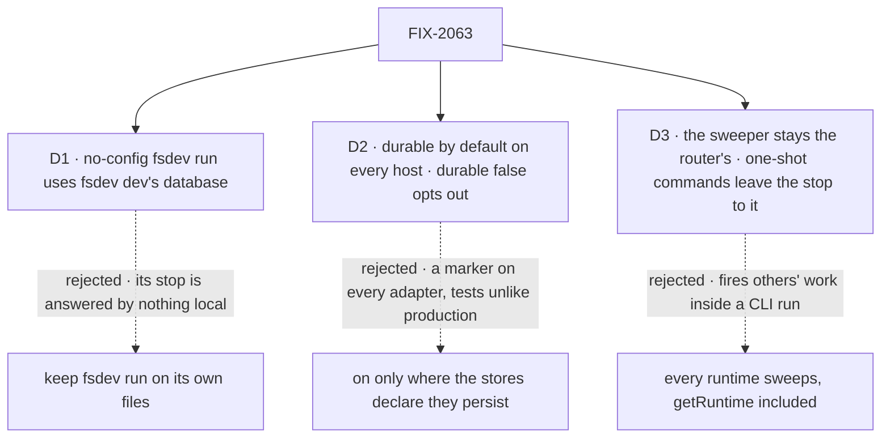

# FIX-2063 · Decisions

[Spec](SPEC.md) · **Decisions**

D1 and D2 are the sign-off surface; D3 is an engineering call the epic's review asked for by name.

## The tree

Solid edges are what you're signing. Dashed edges lost, and the label says why.

## D1 · A no-config `fsdev run` uses the database `fsdev dev` and `fsdev chat` use

| | |
|---|---|
| **Instead of** | Keeping `fsdev run`'s own filesystem store under `.fsdev/data` |
| **Because** | A stop made by `fsdev run` is answered after the command exits, and the one local host that answers is `fsdev dev`. On separate stores it never sees the stop, and no sweeper reaches its deadline. `fsdev chat` already shares the file; SQLite's WAL mode and busy timeout make a run beside a dev server safe |
| **Locks in** | A no-config run lives in `.fsdev/data/fsdev.db`, no longer JSON files an agent can read directly; the DevTool, the file and `--capture` replace them. Sessions earlier runs wrote to files are not read: local data, no migration, as the epic set for states in flight. A run with an app config is unchanged |

It comes down to who answers a run's stop: on its own files, nothing local ever does.

**What would change my mind:** agents depending on a no-config run's JSON files in a way
`--capture` can't serve. Then the headless proposal's `--store filesystem` override ships with
this, as the opt-back.

## D2 · Durable execution is on by default for every `createFlowState` host; `durable: false` turns it off

| | |
|---|---|
| **Instead of** | Turning it on only where the active store adapter declares that it persists |
| **Because** | One rule an app can predict, with nothing an adapter must declare or can forget. In-memory durability lasts the process, so tests behave like production. The provider costs nothing for an action that never stops or checkpoints (tenet 2: refine the default, don't add a second way) |
| **Locks in** | The default of `durable` flips at upgrade: an app that never set it holds stops it refused, and writes checkpoints for actions that ask. `durable: false` is the opt-out. A serverless app is held too, swept only when an invocation runs. In-memory stores are documented as for tests only |

It comes down to one rule: a declared marker is a second fact every adapter must get right.

**What would change my mind:** a supported host where holding a stop costs more than refusing
it. Then that host's adapter sets the default, and D2 narrows.

## D3 · The sweeper stays where a router runs; a one-shot command leaves the stop to it

*An engineering call, decided; recorded because the epic's review named it.*

| | |
|---|---|
| **Instead of** | Making every runtime sweep, `getRuntime()` hosts included |
| **Because** | `fsdev run` is one-shot. A sweeper there would fire other requests' due deadlines and wakes inside an unrelated command, then cut them off when it exits. The sweeper already takes a lease per tick, so one server on a shared store sweeps for every command that writes to it |
| **Locks in** | Every host that answers a person sweeps: `fsdev dev` with or without a config, `fsdev serve`, a self-hosted router. `fsdev run` and `fsdev chat` hold the stop and say where it is answered. A deadline that passes while no server runs fires within one sweep of the next start |

## Decided, not asked

- **"A host refuses a stop loudly" has one convergence point:** the stop itself
  (`ctx.suspend()`, which FIX-2129's `waitForUser` builds on). Every host without durability
  reaches it, so the refusal is written there once, naming the setting. Hosts no longer guard
  on durability themselves; their refusals go.
- **The CLI's no-config dev router gets the standard checkpoint provider** over its SQLite
  stores. The low-level `createFlowApiRouter` keeps taking a provider only when given one.
- **`fsdev run` reports a stop on exit**: the stop's id, its prompt, and where to answer it.
  The exit code and wording are the implementer's.
- **Retention stays opt-in.** On by default means held and swept, not pruned.

## Considered and dropped

| Alternative | Why not |
|---|---|
| A `fsdev resume` command | A second place to answer a stop, against the epic's one answer route ([ER-7](../../epics/FIX-2058/DECISIONS.md#who-owns-what)) |
| `fsdev dev` reading `fsdev run`'s files | The filesystem store can't hold the dev server's load; that is why `fsdev dev` left it |
| A queue (BullMQ) as the durable layer | A dispatch queue is not a suspension store; the epic's review kept this on checkpoint durability |

## How it got here

- **Draft** — framed as the epic's kill line: hold a stop on every local and self-hosted host
  with no configuration; a default flip on `durable`, one local store for both CLI commands, and
  the router's sweeper as the one that fires deadlines; builds on FIX-2077's person stop and the
  existing checkpoint provider.

## Notes from review

From the epic review (#3732), routed here on Linear:

- "Person deadlines use the suspension's expiresAt plus the existing sweeper re-arm, not a
  second poll loop. Correlated 7-day expiries may burst sweep ticks; document it if accepted."
  — cursor, round 2
- "The spec must name sweeper-on-CLI, or a loud refusal." — cursor, round 2. Answered by [D3](#d3)
- "Stay on engine checkpoint durability … not BullMQ." — round 1. Kept

**Open: none.**
