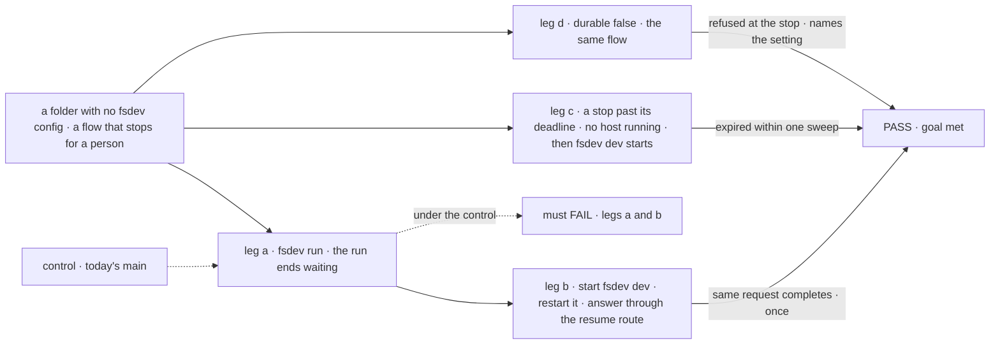
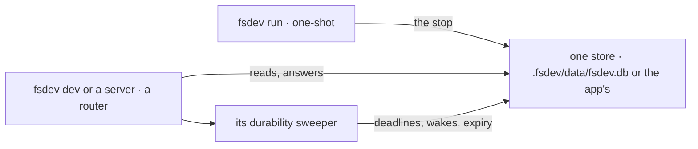

# FIX-2063 · Durable execution by default on file-backed hosts (dev, local runs, self-hosted)

**Spec** · [Decisions](DECISIONS.md)

## Six people, before and after

| Someone who… | Today | After |
|---|---|---|
| **runs `fsdev dev` with no config** | A flow that stops for a person fails: *"ctx.suspend() requires a DurabilityProvider"* | It stops; the DevTool answers it, after a restart too, and its deadline fires |
| **runs `fsdev run` with no config** | The same failure | The run ends saying it waits, and to answer it in `fsdev dev`, which reads the same local database ([D1](DECISIONS.md#d1)) |
| **self-hosts on SQLite or Postgres and never set `durable`** | Stops are refused until they find `durable: true` | Stops work; `durable: false` turns it off ([D2](DECISIONS.md#d2)) |
| **turned durability off, or built a router with no provider** | A generic error: *"Configure one in your server options"* | Refused at the stop, by an error naming the setting to change |
| **reads a no-config `fsdev run`'s state as JSON under `.fsdev/data`** | Works | Reads it in the DevTool, the SQLite file or `--capture`. The price of D1 |
| **maintains the framework** | Hosts turn durability on case by case (Shift Manager's lab host, kitchen-sink, the goal hosts) | One default; those opt-ins go |

Suspension becomes the only way work stops for a person
([FIX-2058 D1](../../epics/FIX-2058/DECISIONS.md#d1)), so this issue is the epic's kill line.

## The goal, and how we'll know it's met

**On a local or self-hosted machine, with no configuration about durability, a flow that stops
for a person is held until that person answers or its deadline passes, across a restart, and is
answered from the same place whichever command started it.**

| Is it the right goal? | |
|---|---|
| **The real need** | *"Durable execution is on by default wherever stores persist: development, local runs and self-hosted servers"* (the issue). The epic: no park survives as a fallback, so the default carries every stop ([ER-6](../../epics/FIX-2058/DECISIONS.md#who-owns-what)) |
| **Smaller, and rejected** | "`durable` defaults to true." Met while `fsdev run`'s stop sits in a store nothing answers, and while no sweeper runs, so deadlines never fire |
| **Bigger, and not this issue's** | One `waitForUser` call with a 7-day default deadline, and the Inbox answering it (FIX-2129). Serverless hosts (not a target) |
| **Not done if** | A stop works only with an app config · a run's stop can't be answered after `fsdev run` exits · a deadline passes and nothing fires · a host without durability fails at some later step rather than at the stop |



The check reads what the CLI printed and the records through the public routes. Today's `main`
must fail it, at the stop.

| How we verify | |
|---|---|
| **Goal check** | `goals/durable-by-default/a-local-stop-is-held-and-answered/` · no model · run by the implementer at completion · verdict in the implementation PR |
| **Signal** | a: `fsdev run` ends without an error, printing the stop's id and the answer hint; the request is `suspended`. b: after `fsdev dev` starts and restarts, the stop is listed; one approve completes that request id, once. c: a stop whose deadline passed while nothing ran is `expired` after one sweep. d: under `durable: false` the request fails at the stop, the error names the setting, and nothing is stored |
| **Input** | A discovery folder with one flow: an approval stop, then a step. An input stop must pass too, and so must an app config that never mentions `durable` |
| **Anti-game** | Real processes and SQLite file, public routes; no calls into the provider or sweeper |
| **Control that must fail** | Today's `main`: leg a on *the request is `suspended`*. `GOAL_CONTROL=no-sweep` (the dev router built without its sweeper): leg c on *`expired` after one sweep* |

## What changes


Read across each row: who holds a stop today, then after.

**An app config, as a person writes it:**

```diff
  export default createFlowState({
    flows: { review },
    stores: { default: { primary: sqliteStores({ filename: "data/app.db" }) } },
-   durable: true,          // was needed before any stop worked
+   // durable by default; `durable: false` turns it off
  })
```

No-config `fsdev dev` and `fsdev run` change with nothing to write.

**Docs:** update *Advanced → Durable execution → Enabling durability* (on by default, the
opt-out, which hosts sweep, in-memory stores for tests only), the `durable` row in
*Configuration → Runtime*, *API → CLI* for `fsdev run`'s store and its waiting report, the data
line in *DevTool → Setup*, and the engine README. No new page. FIX-2131 owns the stop's story.

## Where a stop lives and who answers it



A one-shot command writes the stop; the server on the same store answers and sweeps it ([D3](DECISIONS.md#d3)).

## What stays as it is

- **What a stop is, and how it is answered.** FIX-2129 and FIX-2131 own both.
- **Action and sequencer `durable` flags**, the checkpoint provider and the sweeper's work.
- **The low-level router** takes a provider only when given one; the CLI passes its own.
- **Waits on a task** still refuse where no sweeper runs (FIX-1816).

## What's already here, and the debt

| Already here | What this does with it |
|---|---|
| `createFlowState({ durable })`, default `false` (`engine/src/flowstate/types.ts`) | **Extends.** Default `true` ([D2](DECISIONS.md#d2)) |
| Other ways to make a host durable: a provider on a router's config; each host's own `durable: true` | **Builds on** the first, for the CLI's router; **removes** the second. Searched `durable`, `durabilityProvider`, `createCheckpointDurabilityProvider` in `packages/`, `apps/`, `goals/`, `labs/`: a default, not a new way |
| The durability sweeper, built only by a router; `getRuntime()` hosts sweep nothing | **Builds on.** It stays the router's ([D3](DECISIONS.md#d3)) |
| No-config `fsdev run` on filesystem stores; `fsdev dev` and `fsdev chat` on `.fsdev/data/fsdev.db` | **Replaces** the first with the second ([D1](DECISIONS.md#d1)) |
| `ctx.suspend()`'s refusal without a provider | **Extends.** Its message names the host setting |
| [FIX-406](https://linear.app/fixpoint-labs/issue/FIX-406) 6A: `fsdev run` on the filesystem store, acknowledged development-only | **Superseded in part,** for no-config runs. Configured runs keep the app's stores |
| [FIX-2058 ER-6, D1](../../epics/FIX-2058/DECISIONS.md#d1) | **Kept.** This issue owns ER-6 |

| The debt | |
|---|---|
| **Removes** | The per-host `durable: true` opt-ins, Shift Manager's conditional one included · host refusals that guard on it, such as the Error Reporter's · the docs' nonexistent `durabilityProvider` option |
| **Adds** | No shim. A serverless host's stop is held, but its deadline fires only when an invocation runs. Permanent by design: serverless isn't a target |
| **Leaves** | The headless proposal's `--store` override (`docs/internal/fsdev-headless-verification-capabilities-design.md`), unfiled: the way back to a run's JSON files |

**Net: down.** A default replaces a dozen opt-ins and two refusals; nothing is added beside it.

## Sign off

**[The goal](#the-goal-and-how-well-know-its-met), at that size:** held, answered in one place
whichever command started it, across a restart, with deadlines firing. If wrong: FIX-2129 to
FIX-2133 retire the parks onto a default that drops stops locally.

**[The debt](#whats-already-here-and-the-debt), net down:** the opt-ins go; nothing kept for
old callers. If wrong: a host somewhere relied on durability being off.

1. **[D1](DECISIONS.md#d1) · A no-config `fsdev run` uses the database `fsdev dev` uses.**
   If wrong: agents lose JSON files they read a run's state from.
2. **[D2](DECISIONS.md#d2) · Durable by default on every `createFlowState` host; `durable: false`
   opts out.** If wrong: an app that upgrades holds stops it used to refuse.
3. **[D3](DECISIONS.md#d3) · The sweeper stays where a router runs; one-shot commands leave the
   stop to it.** Engineering, decided. If wrong: a deadline waits for the next server start.

**Open: none.** Number 1 is the one to weigh: it changes where a developer's local runs live.

Improvement · `engine` + `fsdev` + docs · small · epic [FIX-2058](../../epics/FIX-2058/SPEC.md)
