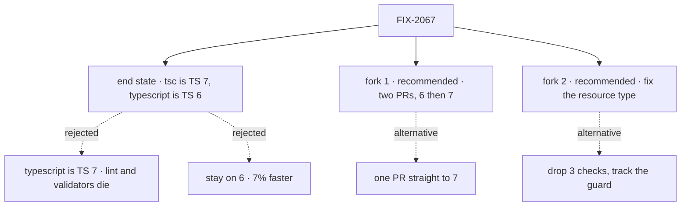

# FIX-2067 · Decisions

[Spec](SPEC.md) · **Decisions**

Two forks are open and are the sign-off surface. Everything else was decided from the spike
([findings](spike/FINDINGS.md)) and is recorded below so nobody re-derives it.

## The tree

Solid edges are the recommendation. Dashed edges lost, or are the fork's other side.

## Open

### Need your sign-off

#### 1. Ship the upgrade as two PRs (TS 6 first, then 7), or one PR straight to 7?

It comes down to where 6 and 7 disagree: one PR mixes both compilers' changes in one diff.

- **Plain terms.** Every fix TS 7 needs, TS 6 needs too, so the work is the same either way.
  The question is whether we stop at a working TS 6 first. PR 1 makes the repo green on 6. PR 2
  then flips `tsc` to 7, a two-line dependency change.
- **The trade-off.** Two PRs cost one more review and CI run, and the 3.6× lands a PR later.
  One PR is faster to land but harder to review: where the compilers disagree (they do, in one
  place), you can't tell which change caused what. Two PRs also make undoing 7 cheap: revert
  PR 2 and keep everything else.
- **My recommendation: two PRs, opened together.** PR 2 is small enough to review the same day.
  Fork 2's guard is the place 6 and 7 disagree, and it is easier to judge against a green 6.
- **What would change my mind.** If review is the bottleneck this week, and each PR waits days,
  one PR is cheaper.
- **What being wrong costs: low.** Both routes end in the same state. At worst it costs one
  review, or one harder diff.

#### 2. A resource config that sets two options that can't go together: should the editor flag it, or only the running app?

It comes down to when a developer finds out: as they type, or when the app first runs.

- **Plain terms.** `defineResource` refuses some combinations, for example a custom `render`
  together with a template. The running app always throws on them. The editor has flagged them
  too, but only by accident of how 5.7 reads the type. TS 6 stops flagging them and TS 7 flags
  them again, so the repo's three "this must be refused" checks can't pass on both.
- **The trade-off.** Fixing the type makes the editor flag them on every version, on purpose.
  It changes a public type in core, and if we get it wrong it could refuse a valid config. Dropping
  the three checks costs nothing now, but contradictory configs then compile, and fail only at
  run time, until someone fixes the type later.
- **My recommendation: fix the type in PR 1.** We're pre-1.0 and the runtime already refuses
  these configs, so nobody's working code gets refused. An editor error is the cheapest place to
  learn about a mistake, and the fix is one type.
- **What would change my mind.** If the explicit type refuses a valid `defineResource` call in
  the repo or in a design partner's code, and that call isn't a small fix. Then drop the checks
  and file the guard as its own issue.
- **What being wrong costs: moderate.** A wrongly refused config blocks a user until a patch.
  A dropped guard is a quiet gap that tends to stay open.

## Decided, not asked

- **CI is not re-measured separately.** CI's `ubuntu-latest` runner for this public repo is
  4 vCPU and 16 GB, the shape the spike measured. Each PR reports CI's typecheck job time,
  before and after.
- **`--checkers 1` only if CI agrees.** About 11% faster under turbo on 4 cores, slower for one
  package alone.
- **`stableTypeOrdering: true` in base, in the TS 6 step.** It makes 6 show TS 7's `never`
  inference in `goals`, and prints typings in 7's order so the reorder ships once. Removed if 7
  rejects it.
- **`types: ["node"]` per package, not in base.** In base it breaks the browser packages.
- **The six `goals` sites get a typed annotation.** `strictFunctionTypes` would fix them too,
  and adds 32 errors in `goals`.
- **Local `typescript` pins are deleted, not re-pinned.**
- **No changeset.** Published JavaScript is byte-identical; typings only reorder
  ([BP-022](../../../docs/contributing/best-practices.md#bp-022-release-notes-via-changesets)).
- **FIX-2053.** The implementer checks its repro on 6 and 7 and reports whether it can close.

## Considered and dropped

| Alternative | Why not |
|---|---|
| Stay on TS 6 | The simpler move, and all green. 7% faster; the need stays unmet |
| Make `typescript` itself TS 7 | TS 7.0 has no JavaScript API. Lint, two validators, a goals guard and two tests stop working |
| `@typescript/native-preview` (`tsgo`) | The old nightly channel |
| Wait for TS 7.1's API | No date. The alias gives the speed now for two lines |

## Settled

- **The alias works end to end.** CONFIRMED by the spike: `pnpm typecheck` green in 76–79s,
  lint green through TS 6, Storybook and all 28 builds green
  ([findings](spike/FINDINGS.md#compiler-api-consumers)).
- **Emitted JavaScript is unchanged on 7.** CONFIRMED: byte-identical. 17 of 376 core `.d.ts`
  files differ, only in member order.
- **Workforce's code generator doesn't use the TS API.** CONFIRMED; the issue's concern didn't
  hold.

## How it got here

- **Draft** — framed as a typecheck-speed upgrade, with TS 6 kept as the JavaScript API layer.
  Builds on the 2026-10-20 measurement spike and FIX-1343's test typecheck. Re-measuring on CI was
  decided, not asked: the CI runner shape matches the spike's.

**Open: two forks**, above.
