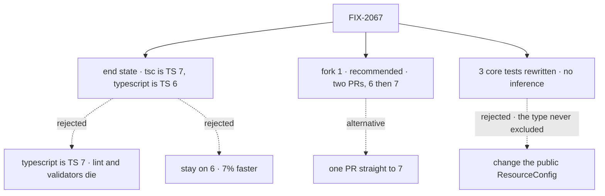

# FIX-2067 · Decisions

[Spec](SPEC.md) · **Decisions**

One fork is open and is the sign-off surface. Everything else was decided from the spike
([findings](spike/FINDINGS.md)) and is recorded below so nobody re-derives it.

## The tree

Solid edges are the recommendation. Dashed edges lost, or are the fork's other side.

## Open

### Need your sign-off

#### 1. Ship the upgrade as two PRs (TS 6 first, then 7), or one PR straight to 7?

It comes down to where 6 and 7 disagree: one PR mixes both compilers' changes in one diff.

- **Plain terms.** Every fix TS 7 needs, TS 6 needs too, so the work is the same either way.
  The question is whether we stop at a working TS 6 first. PR 1 makes the repo green on 6. PR 2
  then flips `tsc` to 7, a two-line dependency change.
- **The trade-off.** Two PRs cost one more review and CI run, and the 3.6× lands a PR later.
  One PR is faster to land but harder to review: where the compilers disagree (they do, in one
  place), you can't tell which change caused what. Two PRs also make undoing 7 cheap: revert
  PR 2 and keep everything else.
- **My recommendation: two PRs, opened together.** PR 2 is small enough to review the same day.
  The three core tests 6 and 7 disagree on are easier to judge against a green 6.
- **What would change my mind.** If review is the bottleneck this week, and each PR waits days,
  one PR is cheaper.
- **What being wrong costs: low.** Both routes end in the same state. At worst it costs one
  review, or one harder diff.

## Decided, not asked

- **CI is not re-measured separately.** CI's `ubuntu-latest` runner for this public repo is
  4 vCPU and 16 GB, the shape the spike measured. Each PR reports CI's typecheck job time,
  before and after.
- **`stableTypeOrdering: true` stays, and so does `ignoreDeprecations: "5.0"`.** 7.0.2 accepts
  both. The first catches TS 7's `never` inference in `goals` on 6, ships the `.d.ts` reorder
  once, and keeps the editor's TS 6 in step with `tsc` 7.
- **`types: ["node"]` per package, not in base.** In base it breaks the browser packages.
- **The six `goals` sites get a typed annotation**, not `strictFunctionTypes` (32 new errors).
- **A validator holds "one compiler"**: a non-root `typescript` is allowed only at the root's
  alias version (orchestration and goals import it), `@typescript/*` never. `fallow:ci` must pass.
- **No changeset expected** ([BP-022](../../../docs/contributing/best-practices.md#bp-022-release-notes-via-changesets)).
  No public type changes, and the spike's typings changed only in member order. PR 1 adds a
  patch changeset only if its `.d.ts` diff shows a change a consumer would notice.
- **FIX-2053.** The implementer checks its repro on 6 and 7 and reports.
- **The three core `@ts-expect-error` tests are rewritten, not the type.** `ResourceConfig` has no
  compile-time exclusion; only the runtime refuses the pairs. 5.7 and 7 error only because
  inference fails inside `expect(() => …)`, which also rejects valid configs. PR 1 types the
  callback or builds the config outside `expect`, keeps the `toThrow`, and drops the directives.
  The false rejection and any deliberate exclusion are [FIX-2069](https://linear.app/fixpoint-labs/issue/FIX-2069).

## Considered and dropped

| Alternative | Why not |
|---|---|
| Stay on TS 6 | The simpler move. 7% faster |
| Make `typescript` itself TS 7 | No JavaScript API in 7.0; lint and the validators stop |
| `@typescript/native-preview` (`tsgo`) | The old nightly channel |
| Wait for TS 7.1 | No date; the alias gives the speed now |
| `--checkers 1` | 11% on one box, tied to turbo's concurrency. Speculative |
| Make `ResourceConfig` exclude the pairs now | It never did; the change ripples into `DefinedResource`, `ClientDataOf`, `ScopeResourceConfig` and engine narrowing, and doesn't fix the inference bug. [FIX-2069](https://linear.app/fixpoint-labs/issue/FIX-2069) |

## Settled

- **The alias works end to end.** CONFIRMED: typecheck, lint, Storybook and 28 builds green
  ([findings](spike/FINDINGS.md#compiler-api-consumers)).
- **Emitted JavaScript is unchanged on 7.** CONFIRMED; `.d.ts` files differ only in order.
- **Workforce's code generator doesn't use the TS API.** CONFIRMED.
- **`ResourceConfig` refuses nothing at compile time.** CONFIRMED by a probe on 5.7.3, 6.0.3
  and 7.0.2: a plain contradictory `defineResource` call compiles on all three; inside
  `expect(() => …)` 5.7 and 7 reject it and a valid one alike; typing the callback compiles.

## How it got here

- **Draft** — framed as a typecheck-speed upgrade, with TS 6 kept as the JavaScript API layer.
  Builds on the 2026-10-20 spike. CI re-measuring was decided, not asked.
- **Review round 1** — the resource ask gained a third option; pins are held deleted; the changeset is conditional; the alias debt is
  [FIX-2068](https://linear.app/fixpoint-labs/issue/FIX-2068); `--checkers 1` dropped.

- **Architect review** — the resource ask was withdrawn: the guard it weighed was never a
  compile-time one. The tests are rewritten instead; the changeset is not expected.

**Open: one fork**, above.

## Notes from review

- "Reuse the existing `dynamic?: never` pattern in `resource.ts` rather than inventing a parallel exclusion mechanism." — cursor ([review](https://github.com/fixpoint-labs/flow-state-dev/pull/3565#pullrequestreview-5593011504)). Moot here; relevant to FIX-2069
