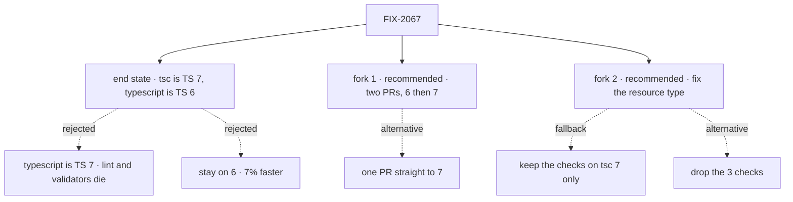

# FIX-2067 · Decisions

[Spec](SPEC.md) · **Decisions**

Two forks are open and are the sign-off surface. Everything else was decided from the spike
([findings](spike/FINDINGS.md)) and is recorded below so nobody re-derives it.

## The tree

Solid edges are the recommendation. Dashed edges lost, or are the fork's other side.

## Open

### Need your sign-off

#### 1. Ship the upgrade as two PRs (TS 6 first, then 7), or one PR straight to 7?

It comes down to where 6 and 7 disagree: one PR mixes both compilers' changes in one diff.

- **Plain terms.** Every fix TS 7 needs, TS 6 needs too, so the work is the same either way.
  The question is whether we stop at a working TS 6 first. PR 1 makes the repo green on 6. PR 2
  then flips `tsc` to 7, a two-line dependency change.
- **The trade-off.** Two PRs cost one more review and CI run, and the 3.6× lands a PR later.
  One PR is faster to land but harder to review: where the compilers disagree (they do, in one
  place), you can't tell which change caused what. Two PRs also make undoing 7 cheap: revert
  PR 2 and keep everything else.
- **My recommendation: two PRs, opened together.** PR 2 is small enough to review the same day.
  Fork 2's guard is the place 6 and 7 disagree, and it is easier to judge against a green 6.
- **What would change my mind.** If review is the bottleneck this week, and each PR waits days,
  one PR is cheaper.
- **What being wrong costs: low.** Both routes end in the same state. At worst it costs one
  review, or one harder diff.

#### 2. A resource config that sets two options that can't go together: should every user's editor flag it, only ours, or only the running app?

It comes down to whose editor flags the mistake: every user's, or only ours on TS 7.

- **Plain terms.** `defineResource` refuses some combinations, for example a custom `render`
  together with a template. The running app always throws on them. The editor has flagged them
  too, but only by accident of how 5.7 reads the type. TS 6 stops flagging them and TS 7 flags
  them again, so the repo's three "this must be refused" checks can't pass on both. What a
  user's editor shows depends on *their* TypeScript version, not ours.
- **The trade-off.** *Fix the type:* every user's editor flags it on every version, on purpose.
  A public core type changes, and a mistake could refuse a valid config. *Keep the checks on
  `tsc` 7 only:* no public type changes; the checks come out in PR 1 and return in PR 2, so the
  guard means nothing in between. Our repo stays guarded, but a user on TS 6 gets no error, and
  the next TS release can flip it again. *Drop the checks:* free now; contradictions compile
  everywhere until someone fixes the type.
- **My recommendation: fix the type in PR 1; keeping the checks on `tsc` 7 is the fallback.**
  The third option is cheaper and beats dropping, but it guards only us: TS 6 is the current
  release, so users on it are likely. We're pre-1.0 and the runtime already refuses these
  configs, so no working code gets refused, and the fix is one type.
- **What would change my mind.** The explicit type refuses a valid `defineResource` call in the
  repo or a design partner's code, and the fix isn't small. Then keep the checks on `tsc` 7 only,
  and file the type as its own issue.
- **What being wrong costs: moderate.** A wrongly refused config blocks a user until a patch.
  The fallback leaves users on TS 6 unguarded, quietly.

## Decided, not asked

- **CI is not re-measured separately.** CI's `ubuntu-latest` runner for this public repo is
  4 vCPU and 16 GB, the shape the spike measured. Each PR reports CI's typecheck job time,
  before and after.
- **`stableTypeOrdering: true` until the flip.** Two jobs: it catches TS 7's `never` inference
  in `goals` on 6, and ships the `.d.ts` reorder once. The flip drops it; 7 orders natively.
- **`types: ["node"]` per package, not in base.** In base it breaks the browser packages.
- **The six `goals` sites get a typed annotation**, not `strictFunctionTypes` (32 new errors).
- **A validator keeps the pins deleted**: the convergence point for "one compiler".
- **A changeset only if consumers would notice** ([BP-022](../../../docs/contributing/best-practices.md#bp-022-release-notes-via-changesets)).
  PR 1 adds a core patch changeset if fork 2 fixes the type, or if its `.d.ts` diff shows more
  than reordering.
- **FIX-2053.** The implementer checks its repro on 6 and 7 and reports.

## Considered and dropped

| Alternative | Why not |
|---|---|
| Stay on TS 6 | The simpler move. 7% faster |
| Make `typescript` itself TS 7 | No JavaScript API in 7.0; lint and the validators stop |
| `@typescript/native-preview` (`tsgo`) | The old nightly channel |
| Wait for TS 7.1 | No date; the alias gives the speed now |
| `--checkers 1` | 11% on one box, tied to turbo's concurrency. Speculative |

## Settled

- **The alias works end to end.** CONFIRMED: typecheck, lint, Storybook and 28 builds green
  ([findings](spike/FINDINGS.md#compiler-api-consumers)).
- **Emitted JavaScript is unchanged on 7.** CONFIRMED; `.d.ts` files differ only in order.
- **Workforce's code generator doesn't use the TS API.** CONFIRMED.

## How it got here

- **Draft** — framed as a typecheck-speed upgrade, with TS 6 kept as the JavaScript API layer.
  Builds on the 2026-10-20 spike. CI re-measuring was decided, not asked.
- **Review round 1** — fork 2 gained a third option (keep the checks on `tsc` 7 only), now its
  fallback; pins are held deleted; the changeset is conditional; the alias debt is
  [FIX-2068](https://linear.app/fixpoint-labs/issue/FIX-2068); `--checkers 1` dropped.

**Open: two forks**, above.

## Notes from review

- "Reuse the existing `dynamic?: never` pattern in `resource.ts` rather than inventing a parallel exclusion mechanism." — cursor ([review](https://github.com/fixpoint-labs/flow-state-dev/pull/3565#pullrequestreview-5593011504))
