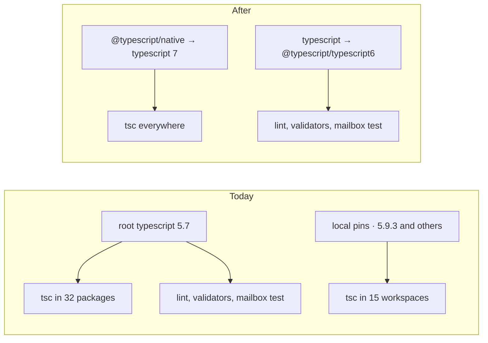

# FIX-2067 · Upgrade TypeScript 5.7 → 6.0 → 7 (native compiler)

**Spec** · [Decisions](DECISIONS.md)

| Someone who… | Today (TS 5.7) | After (TS 7 `tsc`, TS 6 for tools) |
|---|---|---|
| **runs `pnpm typecheck` before pushing** | About 312s on a 4-vCPU box, 6.3 GB peak | About 77s, 4.3 GB |
| **waits on CI's typecheck job** | Same command | Same cut: CI's runner is the 4-vCPU, 16 GB shape the spike measured |
| **runs `pnpm lint`, the validators, or the mailbox test** | Works | Works. They read TypeScript's JavaScript API, which stays on 6 |
| **edits a package that calls `tsc` itself** (apps, examples, labs, goals) | Gets 5.9.3 from a local pin; the root runs 5.7.3 | One compiler, from the root |
| **installs a published `@flow-state-dev/*` package** | — | Byte-identical JavaScript; typings reorder union members, once |

Typecheck got slower once [FIX-1343](../FIX-1343/SPEC.md) began checking every package's tests.
The spike ([findings](spike/FINDINGS.md)) measured the way out:

| Warm typecheck, same box | Time | Peak memory | Speed |
|---|---|---|---|
| TS 5.7.3 | 212–222s | 6.3 GB | 1.0× |
| TS 6.0.3 | 200s | 6.5–6.9 GB | 1.07× |
| TS 7.0.2 | 59s | 4.1–4.6 GB | **3.6×** |

## The goal, and how we'll know it's met

**`pnpm typecheck`, locally and in CI, runs on TypeScript 7's native compiler at least three
times faster than today, and every check, lint, test and build that passes today still passes.**

| Is it the right goal? | |
|---|---|
| **The real need** | *"Typecheck should get faster now that FIX-1343 typechecks every package's tests"* ([FIX-2067](https://linear.app/fixpoint-labs/issue/FIX-2067)) |
| **Smaller, and rejected** | "Move to 6.0 only." Green and cheap, but 7% faster |
| **Bigger, and not this issue's** | `strict` and `using` (ruled out by the issue). `tsc -b --builders` in place of turbo's builds (unmeasured) |
| **Not done if** | Fast, but lint, a validator or the mailbox test stopped running · a package still uses its own pinned TS · the resource guard holds on one compiler only |


The check reads timing against `main` on one box, and CI's required check. The control shows the
TS 6 alias is what keeps the tools alive.

| How we verify | |
|---|---|
| **Goal check** | No `goals/` check: a toolchain change. The implementer runs this at completion; the verdict goes in the PR that flips to 7 |
| **Signal** | `pnpm typecheck` on the branch ≤ ⅓ of `main`, same machine (spike: 77s vs 312s). CI's typecheck job time, before and after. Required check green |
| **Anti-game** | No subset, no cache hit (`TURBO_FORCE=true`), nothing dropped from typecheck |
| **Control that must fail** | `typescript` pointed at 7: `pnpm lint` and `validate-test-typecheck` must fail. A resource config with `render` plus a template must fail typecheck on `tsc` 7 and `tsc6` |

## What changes



One compiler runs everywhere, and TypeScript's JavaScript API stays on 6 for the tools that
need it.

```diff
  // package.json (root devDependencies)
- "typescript": "^5.7.3",
+ "@typescript/native": "npm:typescript@^7.0.2",
+ "typescript": "npm:@typescript/typescript6@^6.0.2",

  // tsconfig.base.json
- "baseUrl": ".",
- "@flow-state-dev/core": ["packages/core/src/index.ts"],
+ "@flow-state-dev/core": ["./packages/core/src/index.ts"],
+ "stableTypeOrdering": true,

  // nine package tsconfigs that use Node APIs (TS 6 no longer includes @types/node by default)
+ "types": ["node"],

  // every other package.json
- "typescript": "^5.9.3",
```

The rest is config, including the docs tsconfig inlined without the `baseUrl` Docusaurus sets.
Code: six annotations in `goals` (TS 7 infers `never`), seven stale `@ts-expect-error` lines in
engine tests, and the resource guard ([fork 2](DECISIONS.md#open)). Full list:
[findings](spike/FINDINGS.md#break-list--ts-603).

**Docs:** no documentation impact. No page or README names a TypeScript version, published
JavaScript is unchanged, and no package has a `typescript` peer dependency.

**When it starts:** after FIX-1343 PR 6 merges (held on #3351). Both edit the `tsconfig.json`
and `package.json` of claude-code, codex, cursor and harness-manager. Workforce's tsconfig gains
`types: ["node"]` too, so it lands after the open workforce PRs (#3521, #3538) or they rebase
first.

## What stays as it is

- `strict` stays off; no `using` or `await using` in runtime code.
- `scripts/typecheck.mjs`: it runs the root's `.bin/tsc`, which becomes 7.
- Package builds (`tsc -p`, about 6× faster), vitest, tsx, ts-morph and Storybook.
- `moduleResolution`, `target` and `lib`.

## What's already here, and the debt

| Already here | What this does with it |
|---|---|
| Root `typescript ^5.7.3` | **Replaces** with the alias pair |
| 28 local `typescript` ranges (24 at `^5.9.3`) | **Removes.** One version, from the root |
| JS-API readers: typescript-eslint, `validate-test-typecheck.mjs`, the goals guard, `task-notice.test.ts`, `.omp/test/mailbox.test.mjs` (a CI step) | **Builds on.** They import `typescript`, now TS 6. The spike didn't run the mailbox test; the flip PR does |
| Workforce's `typescript-module.ts`, in the issue's risk list | **Leaves alone.** It checks a file suffix; it doesn't import `typescript` |
| `baseUrl` in `tsconfig.base.json` and via `@docusaurus/tsconfig` | **Removes.** Deprecated in 6, an error in 7 |
| Seven engine `@ts-expect-error` lines held for FIX-2053 | **Removes.** 6 and 7 accept those calls; FIX-2053 may close |
| `defineResource`'s types refuse two option pairs, by accident | **Per [fork 2](DECISIONS.md#open).** 5.7 and 7 refuse; 6 accepts |
| Anything else that picks or pins a compiler | **None.** Searched `tsgo`, `native-preview`, `typescript6`, `tsc6` across every `package.json` and `scripts/` |
| [FIX-1343 → Decided, not asked](../FIX-1343/DECISIONS.md#decided-not-asked): its guard reads configs through `typescript` | **Kept.** That stays a full JS API |

| The debt | |
|---|---|
| **Removes** | Two compilers in one repo; 28 local pins; `baseUrl`; seven stale directives |
| **Adds** | The alias pair: `typescript` is TS 6 while `tsc` is TS 7, a surprise to a reader. Accepted: TS 7.0 has no JS API and typescript-eslint refuses 7 (its #10940 targets 7.1). An inlined copy of Docusaurus's tsconfig. One follow-up issue, filed at implementation, removes both once TS 7.1, typescript-eslint and Docusaurus catch up |
| **Leaves** | Inferred-type portability (TS2883 in one example). `add-esm-extensions.mjs`, which `rewriteRelativeImportExtensions` could replace after a codemod |

**Net: down.** Two compilers become one; deprecated config goes. An alias pair stays until TS 7.1.

## Sign off

**[The goal](#the-goal-and-how-well-know-its-met), at that size:** TS 7 for every typecheck, at
least 3× faster, nothing lost. If wrong: we settle for 7%, or trade a working lint for speed.

**[The debt](#whats-already-here-and-the-debt), net down:** one compiler; an alias pair until
TS 7.1. If wrong: a misleading `typescript` name outlives its reason.

**Open: two forks**, asked in full in [DECISIONS.md → Open](DECISIONS.md#open):

1. **Two PRs (6, then 7), or one?** Recommended: two. If wrong: one extra review, or a
   harder-to-read diff.
2. **The resource-config guard: fix the type, or drop the three checks and track it?**
   Recommended: fix the type. If wrong: a valid config wrongly refused, or a guard lost until
   someone picks it up.

Fork 2 is the one to weigh.

Improvement · root + about 45 `package.json`/`tsconfig` files across packages, apps, examples,
labs and goals · small (config, plus 6 goal lines, 10 test directives and one core type) · no
epic
