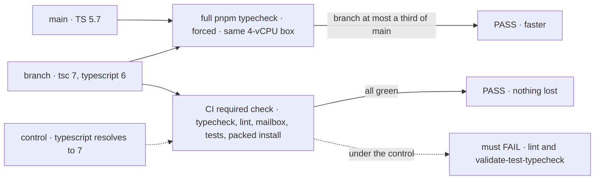
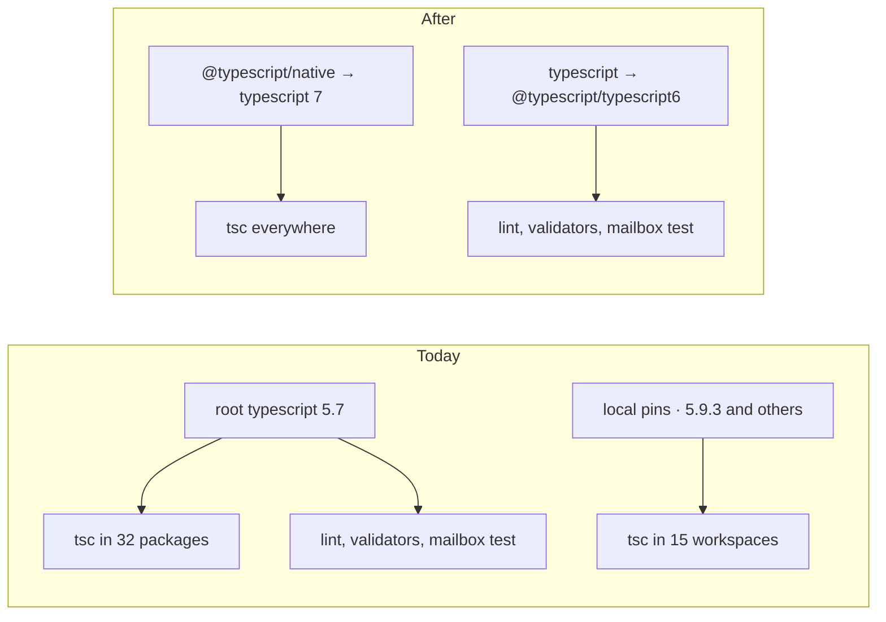

# FIX-2067 · Upgrade TypeScript 5.7 → 6.0 → 7 (native compiler)

**Spec** · [Decisions](DECISIONS.md)

| Someone who… | Today (TS 5.7) | After (TS 7 `tsc`, TS 6 for tools) |
|---|---|---|
| **runs `pnpm typecheck` before pushing** | About 312s on a 4-vCPU box | About 77s: about 4× |
| **waits on CI's typecheck job** | Same command | Same cut: CI's runner is the 4-vCPU, 16 GB shape the spike measured |
| **runs `pnpm lint`, the validators, or the mailbox test** | Works | Works. They read TypeScript's JavaScript API, which stays on 6 |
| **edits a package that calls `tsc` itself** (apps, examples, labs, goals) | Gets 5.9.3 from a local pin; the root runs 5.7.3 | One compiler, from the root |
| **installs a published `@flow-state-dev/*` package** | — | Byte-identical JavaScript; typings reorder union members, once |

Typecheck got slower once [FIX-1343](../FIX-1343/SPEC.md) began checking every package's tests.
The spike ([findings](spike/FINDINGS.md)) measured two different runs on one 4-vCPU box. The
**full `pnpm typecheck`** (forced, builds and validators included) is the goal's number. The
**warm turbo typecheck-only** run isolates the compiler.

| Run | TS 5.7.3 | TS 6.0.3 | TS 7.0.2 |
|---|---|---|---|
| **Full `pnpm typecheck`** (goal) | about 312s ¹ | about 240s ¹ | 76–79s · **about 4×** |
| Warm typecheck-only | 212–222s · 6.3 GB peak | 200s · 1.07× | 59s · 4.1–4.6 GB · 3.6× |

¹ Composed from the forced turbo run plus the validators, timed separately.

## The goal, and how we'll know it's met

**The full `pnpm typecheck`, locally and in CI, runs on TypeScript 7's native compiler at least
three times faster than today, and every check, lint, test and build that passes today still passes.**

| Is it the right goal? | |
|---|---|
| **The real need** | *"Typecheck should get faster now that FIX-1343 typechecks every package's tests"* ([FIX-2067](https://linear.app/fixpoint-labs/issue/FIX-2067)) |
| **Smaller, and rejected** | "Move to 6.0 only." Green and cheap, but 7% faster |
| **Bigger, and not this issue's** | `strict` and `using` (ruled out by the issue). `tsc -b --builders` in place of turbo's builds (unmeasured) |
| **Not done if** | Fast, but lint, a validator or the mailbox test stopped running · a package still uses its own pinned TS · the runtime refusal tests for `defineResource` fail on 6 or 7 |



The check reads timing against `main` on one box, and CI's required check. The control shows the
TS 6 alias is what keeps the tools alive.

| How we verify | |
|---|---|
| **Goal check** | No `goals/` check: a toolchain change. The implementer runs this at completion; the verdict goes in the PR that flips to 7 |
| **Signal** | The repo's normal path: full `pnpm typecheck` green, and with `TURBO_FORCE=true` at most ⅓ of `main` on one machine (spike: 77s vs 312s). CI's typecheck job duration reported, before and after. Required check green |
| **Anti-game** | No subset, no cache hit, nothing dropped from typecheck. `fallow:ci` (`--unlisted-deps`) passes. The flip PR shows `.omp/test/mailbox.test.mjs` passing |
| **Control that must fail** | `typescript` pointed at 7: `pnpm lint` or `validate-test-typecheck` must fail. A planted off-alias `typescript` pin must fail the validator |

## What changes



One compiler runs everywhere, and TypeScript's JavaScript API stays on 6 for the tools that
need it.

```diff
  // package.json (root devDependencies)
- "typescript": "^5.7.3",
+ "@typescript/native": "npm:typescript@^7.0.2",
+ "typescript": "npm:@typescript/typescript6@^6.0.2",

  // tsconfig.base.json
- "baseUrl": ".",
- "@flow-state-dev/core": ["packages/core/src/index.ts"],
+ "@flow-state-dev/core": ["./packages/core/src/index.ts"],
+ "stableTypeOrdering": true,

  // nine package tsconfigs that use Node APIs (TS 6 no longer includes @types/node by default)
+ "types": ["node"],

  // every other package.json; orchestration and goals import it, so they keep the alias
- "typescript": "^5.9.3",
+ "typescript": "npm:@typescript/typescript6@^6.0.2",   // orchestration, goals only
```

**`stableTypeOrdering`** surfaces TS 7's `never` inference while on 6 and ships the `.d.ts` reorder
once. It stays: 7.0.2 accepts it. **The editor** runs VS Code's bundled TS or the workspace
`typescript` (TS 6), either of which can differ from `tsc` 7 in CI; CI decides.

**One compiler stays held:** PR 1 adds an assertion to an existing validator: a non-root
`package.json` may declare `typescript` only as the root's alias version, and `@typescript/*` not
at all.

The rest is config, including the docs tsconfig inlined without the `baseUrl` Docusaurus sets,
with a one-line comment naming the `@docusaurus/tsconfig` version it copies and FIX-2068.
Code: six annotations in `goals` (TS 7 infers `never`), seven stale `@ts-expect-error` lines in
engine tests, and three core tests rewritten so they don't lean on inference
([decided](DECISIONS.md#decided-not-asked)). Full list:
[findings](spike/FINDINGS.md#break-list--ts-603).

**Docs:** no documentation impact. No page or README names a TypeScript version.

**When it starts:** after FIX-1343 PR 6 merges (held on #3351); both edit the configs of
claude-code, codex, cursor and harness-manager. Other open PRs need only a normal rebase.

## What stays as it is

- `strict` stays off; no `using` or `await using` in runtime code.
- `scripts/typecheck.mjs`, package builds, vitest, tsx, ts-morph and Storybook.

## What's already here, and the debt

| Already here | What this does with it |
|---|---|
| Root `typescript ^5.7.3` | **Replaces** with the alias pair |
| 28 local `typescript` ranges (24 at `^5.9.3`) | **Removes** 26. Orchestration and goals import it, so they keep it at the root's alias version |
| JS-API readers: typescript-eslint, two validators, `task-notice.test.ts`, `.omp/test/mailbox.test.mjs` | **Builds on.** They import `typescript`, now TS 6. The flip PR must show the mailbox test passing; the spike never ran it |
| Workforce's `typescript-module.ts`, in the issue's risk list | **Leaves alone.** It checks a file suffix; it doesn't import `typescript` |
| `baseUrl` in `tsconfig.base.json` and via `@docusaurus/tsconfig` | **Removes.** Deprecated in 6, an error in 7 |
| Seven engine `@ts-expect-error` lines held for FIX-2053 | **Removes.** 6 and 7 accept those calls; FIX-2053 may close |
| Three core tests that `@ts-expect-error` contradictory `defineResource` configs | **Rewrites** them to not lean on inference. The type never excluded these pairs; only the runtime does ([why](DECISIONS.md#decided-not-asked)) |
| Anything else that picks a compiler | **None.** Searched `tsgo`, `native-preview`, `typescript6`, `tsc6` |
| [FIX-1343 → Decided, not asked](../FIX-1343/DECISIONS.md#decided-not-asked): its guard reads configs through `typescript` | **Kept.** That stays a full JS API |

| The debt | |
|---|---|
| **Removes** | Two compilers in one repo, and a validator keeps it so; 28 local pins; `baseUrl`; seven stale directives |
| **Adds** | The alias pair: `typescript` is TS 6 while `tsc` is TS 7, a surprise to a reader. Accepted: TS 7.0 has no JS API and typescript-eslint refuses 7 (its #10940 targets 7.1). An inlined copy of Docusaurus's tsconfig. [FIX-2068](https://linear.app/fixpoint-labs/issue/FIX-2068) removes both when TS 7.1 ships its JS API, typescript-eslint #10940 lands, and `@docusaurus/tsconfig` drops `baseUrl` |
| **Leaves** | The 5.7/7 false rejection, and whether to add a deliberate exclusion: [FIX-2069](https://linear.app/fixpoint-labs/issue/FIX-2069). Inferred-type portability (TS2883). `add-esm-extensions.mjs`, which `rewriteRelativeImportExtensions` could replace after a codemod |

**Net: down.** Two compilers become one; deprecated config goes. An alias pair stays until TS 7.1.

## Sign off

**[The goal](#the-goal-and-how-well-know-its-met), at that size:** TS 7 for every typecheck, at
least 3× faster, nothing lost. If wrong: we settle for 7%, or trade a working lint for speed.

**[The debt](#whats-already-here-and-the-debt), net down:** one compiler; an alias pair until
TS 7.1. If wrong: a misleading `typescript` name outlives its reason.

**Open: one fork** — two PRs or one, [DECISIONS § Open](DECISIONS.md#open).

Improvement · root + about 45 `package.json`/`tsconfig` files across packages, apps, examples,
labs and goals · small (config, plus 6 goal lines, 7 test directives and 3 rewritten tests) · no
epic
