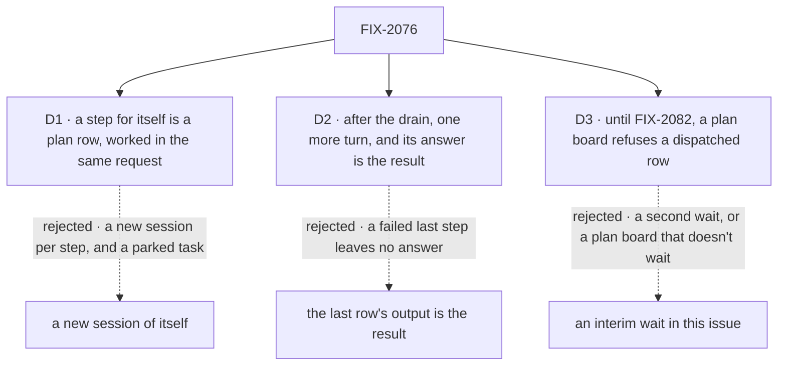

# FIX-2076 · Decisions

[Spec](SPEC.md) · **Decisions**

The model is the owner's
([concept](../../../docs/internal/design/workforce-coordination-concept.md), rules 5, 14, 18, 19);
these three carry it out.

## The tree

Solid edges are what you're signing. Dashed edges lost, and the label says why.

## D1 · A worker's step for itself is a plan row, worked inline by its own request

| | |
|---|---|
| **Instead of** | Today's piece for itself: a new task session of the same worker, with the parent task parked until it reports |
| **Because** | Rule 14 and T-01: a next step uses the session's context and the step before it. A child session sees neither, costs a session and a notice per step, and parks the task. Patterns already work this way: one more plan board, not a new idea (tenet 2) |
| **Locks in** | Filing a task naming yourself means "my next step", in a conversation or a task. A step needing its own session is a dispatched plan row, after FIX-2082. Plan rows sit on their own ledger, listed with the user's tasks, never the session's open task (rule 5) |

It comes down to the next step: inline, it sees the one before; in a child session, it doesn't.

**What would change my mind:** steps for itself that are mostly independent and long. Then a
delegate, or FIX-2082's dispatched plan row, carries them.

## D2 · After its plan drains, the worker answers once more, and that answer is the request's result

| | |
|---|---|
| **Instead of** | The output of the plan's last row (or rows) as the result, with no further model call |
| **Because** | A plan row can fail for good. Last-row-wins fails the task for one step or returns a hole; a turn that sees every ending can retry, explain or carry on. Today's split already answers from the turn after its pieces |
| **Locks in** | One more model call per request that planned, none otherwise. The result is that turn's answer, not `{ answer, pieces }`; the rows stay listable |

It comes down to a failed step: the extra turn answers around it; last-row-wins has nothing to say.

**What would change my mind:** plan rows that almost never fail, measured, and cost that matters.
Then the last row's output wins and the turn goes.

## D3 · Until the waited dispatch lands, a plan board refuses a dispatched row

| | |
|---|---|
| **Instead of** | Either a plan board that dispatches without waiting (today's behaviour, under a new name), or an interim wait built here |
| **Because** | A plan board that doesn't wait is T-23's bug. An interim wait is a second answer to "done", which the epic's POC showed lets a drain move past a running row; FIX-2082 owns every wait and is blocked by this issue |
| **Locks in** | Every board that dispatches declares `mode: "delegation"`, in the repo in this PR and in apps at upgrade, told so by the refusal. The task dispatcher gains `wait` with its final rules (`true` refused on delegation, `false` on plan); FIX-2082 lifts only the interim refusal |

It comes down to one answer for done: an interim wait is the second answer the POC ruled out.

**What would change my mind:** FIX-2082 slipping past this epic. Then the refusal is a release
long, and the interim wait is worth weighing against it.

## Decided, not asked

- **`mode` is a `taskBoard` option**, `"plan"` by default, exposed on the handle. It replaces the
  dispatcher-derived `runsElsewhere`: a delegation board excuses every row, a plan board none.
  The lease conjunct stays.
- **One convergence point for the refusals**: `taskBoard()` refuses a delegation board with an
  inline assignee (named, uniform or floor) or none that dispatches, a plan board with a
  dispatcher, and a `wait` that contradicts the mode; `goalSeekLoop()` refuses a delegation board.
  Every board is built through `taskBoard()`, so a dispatching site the change misses (the
  conversation board, the conductor lab, two goals, the dispatch tests) fails at build. That is
  the totality check; no census checker is needed.
- **Rule 18 is pinned, not built (ER-1).** A test pins that the drain records an inline row's
  return and throw, and the claim gate a dispatched row's. A plan row's turn can't settle its row:
  the task tools resolve only the delegation ledger, and FIX-2081 removes `completeTask` and
  `failTask`. The raw collection stays the substrate's escape hatch; the closure sweeps the repo.
- **An inline row's background work is its request's**: the drain records the row when its worker
  returns; the request's end, background included, is FIX-2077's rule 6.
- **The plan ledger is session-scoped and durable**, so a retry finds its rows. A failed attempt's
  open plan rows are cancelled through FIX-2080's cascade.

## Considered and dropped

| Alternative | Why not |
|---|---|
| Infer the mode from the assignees, as today | The bug this issue fixes: the author never chose, and `goalSeekLoop` can't tell |
| One board with a per-row "waits" flag | Rule 14 refuses a mixed board; two boards make rule 5 free |
| A plan board for app flows only | Most workers run the built-in agent flow; T-01 would stay unmet |
| A `board` argument on the filing tool | A second way to say who does it; the assignee already says it, and FIX-2081 owns the tool |

## How it got here

- **Draft** — framed as the declared mode plus a worker's own plan; `mode` on `taskBoard`, the
  conversation board declared a delegation board, a worker's steps for itself as plan rows worked
  by its turn; the waited dispatch left to FIX-2082 behind an interim refusal.

**Open: none.**
