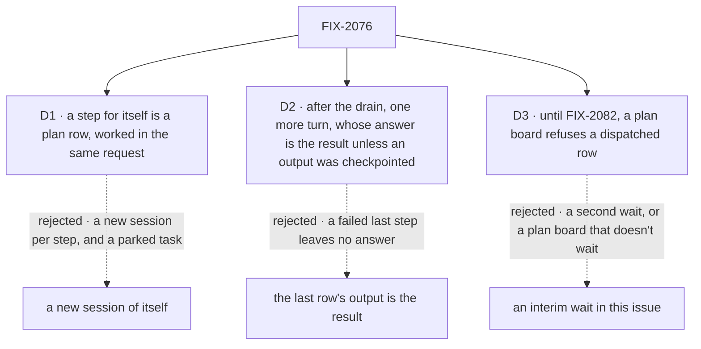

# FIX-2076 · Decisions

[Spec](SPEC.md) · **Decisions**

The model is the owner's
([concept](../../../docs/internal/design/workforce-coordination-concept.md), rules 5, 14, 18, 19);
these three carry it out.

## The tree

Solid edges are what you're signing. Dashed edges lost, and the label says why.

## D1 · A worker's step for itself is a plan row, worked inline by its own request

| | |
|---|---|
| **Instead of** | Today's piece for itself: a new task session of the same worker, with the parent task parked until it reports |
| **Because** | Rule 14 and T-01: a next step uses the session's context and the step before it. A child session sees neither, costs a session and a notice per step, and parks the task. Patterns already work this way: one more plan board, not a new idea (tenet 2) |
| **Locks in** | Filing a task naming yourself means "my next step", in a conversation or a task, and a worker is offered the task tools for it whether or not it has delegates. A step needing its own session is a dispatched plan row, after FIX-2082. Plan rows sit on their own ledger, listed with the user's tasks, never the session's open task (rule 5) |

It comes down to the next step: inline, it sees the one before; in a child session, it doesn't.

**What would change my mind:** steps for itself that are mostly independent and long. Then a
delegate, or FIX-2082's dispatched plan row, carries them.

## D2 · After its plan drains, the worker answers once more, and that answer is the result unless it checkpointed an output

| | |
|---|---|
| **Instead of** | The output of the plan's last row (or rows) as the result, with no further model call |
| **Because** | A plan row can fail for good. Last-row-wins fails the task for one step or returns a hole; a turn that sees every ending can redo the step itself, explain or carry on. Today's split already answers from the turn after its pieces |
| **Locks in** | Exactly one more model call per request that planned, none otherwise. That turn files no step for itself: such a filing is refused, telling it to do the work or answer; a task it files for a delegate is handed off as usual. The worker's latest `output` checkpoint is the result. That turn's answer, plain text included and not `{ answer, pieces }`, is the result only if the task never called `reportProgress` with an `output`; to replace a checkpoint, the turn checkpoints again ([FIX-2081's D3](../FIX-2081/DECISIONS.md#d3), [owner sign-off](https://github.com/fixpoint-labs/flow-state-dev/pull/3593#issuecomment-6317553797)). Inside an inline step, `reportProgress` acts on the row whose claim the turn holds, the step's own row, never the parent; the parent's checkpoint comes only from a turn holding its claim (FIX-2081's D3). The rows stay listable |

It comes down to a failed step: the extra turn answers around it; last-row-wins has nothing to say.

**What would change my mind:** plan rows that almost never fail, measured, and cost that matters.
Then the last row's output wins and the turn goes.

## D3 · Until the waited dispatch lands, a plan board refuses a dispatched row

| | |
|---|---|
| **Instead of** | Either a plan board that dispatches without waiting (today's behaviour, under a new name), or an interim wait built here |
| **Because** | A plan board that doesn't wait is T-23's bug. An interim wait is a second answer to "done", which the epic's POC showed lets a drain move past a running row; FIX-2082 owns every wait and is blocked by this issue |
| **Locks in** | Every board that dispatches declares `mode: "delegation"`, in the repo in this PR and in apps at upgrade, told so by the refusal. No dispatcher `wait` lands here: FIX-2082 adds it, with its rules, and lifts the refusal |

It comes down to one answer for done: an interim wait is the second answer the POC ruled out.

**What would change my mind:** FIX-2082 slipping past this epic. Then the refusal is a release
long, and the interim wait is worth weighing against it.

## Decided, not asked

- **`mode` is a `taskBoard` option**, `"plan"` by default, exposed on the handle. It replaces the
  dispatcher-derived `runsElsewhere`: a delegation board excuses every row, a plan board none.
  The lease conjunct stays.
- **Five refusals, at two construction points.** `taskBoard()` refuses a delegation board with an
  inline assignee (named, uniform or floor), a delegation board with no dispatcher, and, until
  FIX-2082, a plan board with a dispatcher. `goalSeekLoop()` refuses a delegation board and a board
  with `onReview: "exit"`: either drain can return with a row not ended, and its judge would rule
  on it.
  Every board is built through `taskBoard()`, so a dispatching site the change misses (the
  conversation board, the conductor lab, two goals, the dispatch tests) fails at build. That is
  the totality check; no census checker is needed.
- **Rule 18 is pinned, not built (ER-1).** A test pins that the drain records an inline row's
  return and throw, and the claim gate a dispatched row's. The task tools route a filing by its
  assignee (itself to the plan ledger, anyone else to the delegation ledger) and list both, but
  settle only the delegation ledger's rows, so a plan row's turn can't settle its row; FIX-2081
  removes `completeTask` and `failTask`. The raw collection stays the substrate's escape hatch; the closure sweeps the repo.
- **An inline row's background work is its request's.** The drain records the row when its worker
  returns, so a dependent row can start while the row before it still writes in the background; it
  sees that row's return. The task's ending waits for all of it: FIX-2077's rule 6 settles after
  the engine drains background work (aligned with #3592).
- **The plan ledger is session-scoped and durable**, so a retry finds its rows. Whichever of
  FIX-2076 and FIX-2080 lands second wires the plan board into FIX-2080's cascade, so a failed
  attempt's open plan rows end cancelled. If FIX-2080 is on main when this lands, this PR adds it
  and leg a asserts the cancel. Until then, a failed attempt's open plan rows stay open and the
  retry adopts them.
- **Plan rows: who files them, and what they take after.** Only a filing the worker's own request
  makes (its task turn, or its turn in its conversation) that names itself goes to the plan ledger.
  A filing from anywhere else naming the session's worker, such as a schedule fire or a screen, is
  not a step: FIX-2081 refuses a claimless one. Once filed, a plan row's fields can be edited
  before it starts, and a cancel ends it: the drain drops its late record and the parent carries on
  (FIX-2081's plan-row note). An inline plan row takes no message, refused with "steer the task
  this step belongs to" (FIX-2086). A change of assignee that crosses the worker itself is refused
  with "a step for itself and a task for a delegate are filed apart: cancel and file again"; a
  change between delegates stands (FIX-2081's field table).
- **A plan row can't be filed held.** The drain doesn't wait on a held row, so the answering turn
  would run before every step ended, and nothing would work the row after. It is refused at
  filing, naming the setting and the move ("to hold work, file it for a delegate, held"), through
  FIX-2080's refuse-at-filing point; whichever of the two lands second wires it, and leg b gains
  the refusal. For the same reason a hold after filing is refused on a plan row.
- **Plan rows still count toward the chain.** A step filed from a task session counts toward
  today's 100 tasks under one top task, so moving self-steps off the delegation board doesn't
  free them from the cap; the self-filing chain tests move with it. Inline rows add no depth, and
  a dispatched plan row waits for FIX-2082.

## Considered and dropped

| Alternative | Why not |
|---|---|
| Infer the mode from the assignees, as today | The bug this issue fixes: the author never chose, and `goalSeekLoop` can't tell |
| One board with a per-row "waits" flag | Rule 14 refuses a mixed board; two boards make rule 5 free |
| A plan board for app flows only | Most workers run the built-in agent flow; T-01 would stay unmet |
| A `board` argument on the filing tool | A second way to say who does it; the assignee already says it, and FIX-2081 owns the tool |

## How it got here

- **Draft** — framed as the declared mode plus a worker's own plan; `mode` on `taskBoard`, the
  conversation board declared a delegation board, a worker's steps for itself as plan rows worked
  by its turn; the waited dispatch left to FIX-2082 behind an interim refusal.
- **Review round 1** — the interim dispatcher `wait` dropped (FIX-2082 owns it, and the refusal
  needs only `mode`); the answering turn files no step for itself, so D2's one call stays one;
  `goalSeekLoop` also refuses a park-exit board, which could hand its judge a parked row.
- **Cross-spec** — the latest checkpoint set through `reportProgress({ output })` is the result; D2's
  answering turn's answer is the result only when no `output` was ever checkpointed (FIX-2081's D3).
- **Owner sign-off** ([comment](https://github.com/fixpoint-labs/flow-state-dev/pull/3593#issuecomment-6317553797)) — D1 accepted; D2 changed: the answering turn still runs
  after the drain, but its answer is the result only if no `output` checkpoint was made, otherwise
  the latest checkpoint is; D3 accepted.

## Notes from review

- "One durable ledger + row kind instead of two session ledgers … if implementers feel pain, worth a 'considered' row on **one ledger + row kind** with mode-driven wait rules—without reopening mixed-board API." — cursor ([thread](https://github.com/fixpoint-labs/flow-state-dev/pull/3593#discussion_r4332349588))
- "If implementers later need a slimmer hot path, a **conditional** final turn (only when a row failed or outputs need reconciliation) is the usual middle ground—worth a one-line pointer in debt so it doesn't get re-litigated as surprise scope." — cursor ([thread](https://github.com/fixpoint-labs/flow-state-dev/pull/3593#discussion_r4332349606)); also: "skip it when every row succeeded and the last row's output already is the answer … if the implementer measures it, put the number in the PR." — second look ([comment](https://github.com/fixpoint-labs/flow-state-dev/pull/3593#issuecomment-6306328261), #6)
- "Unbounded **sequential inline plan rows in one request** (lease/transport stretch) plus **D2's unconditional extra turn** → worst case N+1 model calls per request." — cursor ([review](https://github.com/fixpoint-labs/flow-state-dev/pull/3593#pullrequestreview-5594151124))
- "The totality claim should be backed by a test, not an argument … `dispatchedTaskPredicate` is exported from `dispatch-assignee.ts` and used by tests directly … Add a check that the predicate is not reachable except through the `mode` path after this change (or delete the export)." — second look ([comment](https://github.com/fixpoint-labs/flow-state-dev/pull/3593#issuecomment-6306328261), #3)
- "task actions, the devtool task view, `check-board`, and the claim gate each currently assume one collection per session. The spec doesn't say which of them read both ledgers and which only one. Name them, because a reader that quietly sees only the delegation ledger would show a worker's steps as missing." — second look ([comment](https://github.com/fixpoint-labs/flow-state-dev/pull/3593#issuecomment-6306328261), #5)
- "The `reach()` comment at `board.ts:~290` says the session's own worker is on the roster so it can file a piece for itself … the roster change and the chain-limit tests that relied on self-filing need to move together (BP-034 …), not just the branch." — second look ([comment](https://github.com/fixpoint-labs/flow-state-dev/pull/3593#issuecomment-6306328261), #7)
- "Replacing it with a board-level `mode` is a chance to make 'does the drain wait on this row' one function owned by the board rather than an optional callback passed down four layers. Do that only as the replacement of `runsElsewhere` itself, not as a wider tidy of the quiescence code." — second look ([comment](https://github.com/fixpoint-labs/flow-state-dev/pull/3593#issuecomment-6306328261), architecture note)
- "Optional: drop low-information 'tie' rows in D2/D3 SVGs; share figure CSS template to cut line count." — cursor ([review](https://github.com/fixpoint-labs/flow-state-dev/pull/3593#pullrequestreview-5594151124))

These are inputs, not instructions. Adopt, adapt, or discard them.

**Open: none.**
