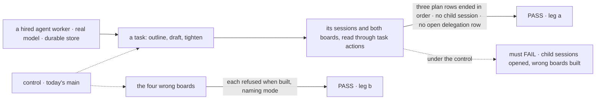
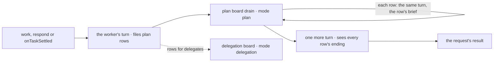

# FIX-2076 · A board's mode decides whether its drain waits: plan boards and delegation boards

**Spec** · [Decisions](DECISIONS.md)

## Five people, before and after

| Someone who… | Today | After |
|---|---|---|
| **builds a worker that does a job in steps** | Its steps for itself go to new sessions of itself, and its task parks until they report back | It files them on its **plan board**; its own request works them in order, each step seeing the one before ([D1](DECISIONS.md#d1)) |
| **reads that worker's answer** | `{ answer, pieces }`, from whichever turn ran after the last piece | One answer, from a turn that saw every step end, a failed one included ([D2](DECISIONS.md#d2)) |
| **builds a board that hands rows to other sessions** | Declares a dispatcher; the drain quietly stops waiting on those rows | Declares `mode: "delegation"`. Without it the board is refused when built, with that fix in the error ([D3](DECISIONS.md#d3)) |
| **builds a goal-seek loop** | Over a board that dispatches, the judge rules while rows still run, and each `continue` burns an iteration | Refused when built over a delegation board. Over a plan board the judge sees every row ended |
| **builds a pattern** | `planAndExecute`, `parallelTasks`, `supervisor` drain inline | The same, unchanged: they are plan boards already |

## The goal, and how we'll know it's met

**Whether a board's drain waits on its rows is the flow author's declared choice, a board that
contradicts it is refused before it runs, and a worker's own steps run in its own request.**

| Is it the right goal? | |
|---|---|
| **The real need** | The issue's three problems: the assignee kind decides waiting; a worker has no plan of its own; `goalSeekLoop` doesn't check its board ([FIX-2076](https://linear.app/fixpoint-labs/issue/FIX-2076), epic [FIX-2056](../../epics/FIX-2056/SPEC.md) rows *plan board and delegation board*, *a goal-seek loop needs a plan board*) |
| **Smaller, and rejected** | "`taskBoard` takes a `mode`." Hittable with no worker able to plan, so T-01 stays unmet and the self-piece keeps parking |
| **Bigger, and not this issue's** | "A plan board waits on a row it dispatched." [FIX-2082](https://linear.app/fixpoint-labs/issue/FIX-2082) owns every wait, this one included (epic POC) |
| **Not done if** | A board that dispatches builds without `mode: "delegation"` · a goal-seek loop over one builds · a worker's step for itself opens a child session · a plan row counts as the session's open task · no test pins who settles a row (rule 18) |



The check reads what a user could list and what a builder throws, not the drain's internals.

| How we verify | |
|---|---|
| **Goal check** | `goals/task-board/a-worker-plans-its-own-steps/` (leg a, real model) and `goals/task-board/refuses-a-board-built-wrong/` (leg b, no model) · run by the implementer at completion · verdict in the implementation PR |
| **Signal** | Leg a: three plan rows `completed` in the task's own session, each started after its dependency ended; zero child sessions; the session's delegation rows open count stays 0; the task's result names the tightened draft. Leg b: four refusals, each naming `mode` and the fix |
| **Input** | Leg a: a three-step brief; a two-step one, or one with a failing step, must pass too (the answer names the failure). Leg b: the four boards under the fence in *What changes* |
| **Anti-game** | Assert on rows and sessions read through the public task actions and on thrown builds. Not on mocked turns or on the drain's quiescence verdict |
| **Control that must fail** | Today's `main`: leg a fails on *zero child sessions*, leg b on *four refusals* |

## What changes


The left panel is today's single board; the right is the two the session gets, with the fence of
boards refused at build.

**A board that dispatches, as its author writes it:**

```diff
  const board = taskBoard({
    name: "issue-work",
    boardId: "issue-work",
+   mode: "delegation",
    collection: issues,
    workers: { implement: dispatcher({ action: "work", session: "per-task" }) },
  });
```

**A worker's own step, as its model files it:**

```diff
- addTask({ goal: "Tighten the draft", assignee: "writer" })  // a new session of writer; the task parks
+ addTask({ goal: "Tighten the draft", assignee: "writer" })  // a plan row; this request works it next
```

**Docs:** update `orchestration/task-board` (`mode`, the dispatching assignee section and its
construction checks), `orchestration/configuration` (the `mode` row), `orchestration/goal-seek-loop`
(the plan-board precondition), `workforce/delegating-work` (a step for itself is a plan row), and
the orchestration, core and workforce READMEs. No new page; FIX-2081 publishes the one-task opening.

## How a worker's request runs its plan



Rows for itself run inline and the drain waits on them all; rows for delegates are handed off.

## What stays as it is

- **Patterns**, plan boards already, with the same outputs.
- **The delegation board**: today's conversation board, now declared; routing, notices, chain limits.
- **Pieces for other workers**, and their split park until FIX-2077.
- **`dispatcher()` outside a board**, which FIX-2082 gives `wait`.

## What's already here, and the debt

| Already here | What this does with it |
|---|---|
| Whatever decides whether a drain waits: the dispatcher assignees' `runsElsewhere`, `onIdle`, `onReview: "exit"`, `shouldExit` | **Replaces** the first with `mode`, a parameter on `taskBoard`, the closest entry. The other three stay: they say when an idle pool stops. Searched `wait`, `runsElsewhere`, `quiesc`, `drained` across `packages/` |
| `goalSeekLoop`'s construction guards ([FIX-910](https://linear.app/fixpoint-labs/issue/FIX-910)) | **Extends** with one |
| The drain's recorders and the claim gate | **Builds on.** Rule 18 is pinned by a test, not built |
| [FIX-1802 → *Decided, not asked*](../FIX-1802/DECISIONS.md#decided-not-asked), "one board per session" | **Superseded in part:** two per session |
| FIX-1802's roster that lets a task session file a piece for itself (`workforce/src/conversation-board/board.ts:290`) | **Superseded:** a filing for itself is a plan row |
| [FIX-1786 D8](../../epics/FIX-1786/DECISIONS.md#d8): any worker files, and the split ships | **Kept** for pieces to others |

| The debt | |
|---|---|
| **Removes** | The assignee-derived `runsElsewhere` · the self-piece's child session and park · a mixed board |
| **Adds** | `mode` · a task dispatcher's `wait`, whose only job until FIX-2082 is to be refused ([D3](DECISIONS.md#d3)), lifted there · a second session ledger, plan rows' |
| **Leaves** | A worker can still settle a row through the raw collection, the substrate's escape hatch ([decided](DECISIONS.md#decided-not-asked)) · the split park for other workers' pieces, FIX-2077 |

**Net: flat.** One inference and one park go; one option, one interim refusal and one ledger arrive.

## Sign off

**[The goal](#the-goal-and-how-well-know-its-met), at that size:** declared waiting, wrong boards
refused, and a worker's own plan. If wrong: a `mode` field ships while workers still can't plan.

**[The debt](#whats-already-here-and-the-debt), net flat.** If wrong: the interim `wait` refusal
outlives FIX-2082.

1. **[D1](DECISIONS.md#d1) · A worker's step for itself is a plan row, worked in the same request.** If
   wrong: a step that needs its own session waits for FIX-2082. **The one to weigh.**
2. **[D2](DECISIONS.md#d2) · After its plan drains, the worker answers once more, and that is the result.**
   If wrong: one model call per planned request, spent for nothing.
3. **[D3](DECISIONS.md#d3) · Until FIX-2082, a plan board refuses a dispatched row.** If wrong: a board
   that wants a waited dispatch can't be built for one issue's span.

**Open: none.**

Feature · `core` + `orchestration` + `workforce` · medium: three packages, one board option, one dispatcher field, one session ledger · epic FIX-2056
