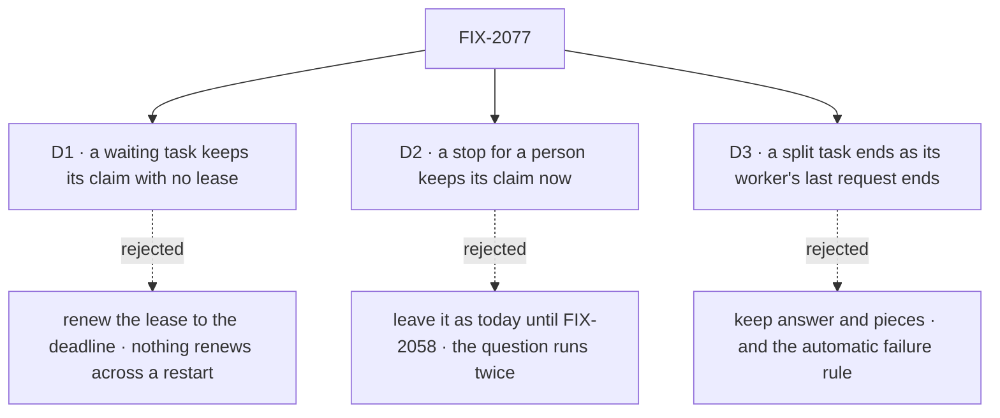

# FIX-2077 · Decisions

[Spec](SPEC.md) · **Decisions**

The epic made rule 6 the one answer for done ([ER-2](../../epics/FIX-2056/DECISIONS.md#who-owns-what));
these three carry it out.

## The tree

Solid edges are what you're signing. Dashed edges lost, and the label says why.

## D1 · A waiting task keeps its claim with no lease

| | |
|---|---|
| **Instead of** | Keeping the lease and renewing it up to the wait's deadline |
| **Because** | A lease means "a live worker holds this". A waiting task has no live worker: its request is stored, and after a restart nothing renews anything. So the row records what holds it and drops its lease, and the reclaim, which only takes rows whose lease has run out, leaves it alone. A wait on filed tasks has no deadline to renew to at all |
| **Locks in** | A waiting task is never re-run by a lapse. The price: a task whose wait is lost (a resume that never comes) stays running until its wait's own deadline or FIX-2078's sweeper ends it. Until FIX-2078, a wait on filed tasks has no backstop but its pieces ending |

It comes down to a restart while the task waits: a renewed lease lapses, and the task runs twice.

**What would change my mind:** a host that must take a waiting task back by lease, for example
to move it off a worker pool being retired. Then the hold keeps a long lease instead of none.

## D2 · A task stopped for a person keeps its claim now, before FIX-2058 shows it

| | |
|---|---|
| **Instead of** | Leaving a person's stop as today (the lease lapses and the task runs again) until FIX-2058 marks it *waiting on a person* |
| **Because** | The gate has to tell the two suspensions apart to keep a wait running (the epic's [D2](../../epics/FIX-2056/DECISIONS.md#d2)). Once it can, leaving a person's stop on the lapse path means a question is asked twice and its work is done twice. The hold records which kind it is, so FIX-2058 reads it rather than re-deriving it |
| **Locks in** | Between this issue and FIX-2058, a task waiting on a person shows *running* in task lists, not *waiting on a person*. The Inbox still shows the question, as today |

It comes down to an open question: on the lapse path it is asked again, and its work redone.

**What would change my mind:** FIX-2058 landing in the same release as this issue. Then the
interim label never ships and the two land as one.

## D3 · A task that split ends as its worker's last request ends

| | |
|---|---|
| **Instead of** | Keeping [FIX-1802](../FIX-1802/DECISIONS.md#d3)'s rule: the output is `{ answer, pieces }`, and a piece that failed for good fails the task unless the next turn files it again |
| **Because** | Rule 6 is one rule for every task: done when a request for it ends with a result and nothing open. A second rule for tasks that filed tasks is the second answer for done the epic's POC refuted. The worker's turn already reads each piece's ending, so it decides what a failed piece means (concept rule 7), and the retry marker goes |
| **Locks in** | The output of a task that split is its worker's last answer, and a failed piece fails the task only if the worker's turn throws. A filer that read `.pieces` reads the pieces' rows. Teams outside the repo rewrite at upgrade; the changeset carries the line |

It comes down to one rule for done: a second one for splits is what the epic's POC refuted.

**What would change my mind:** a filer that needs every piece's output in the parent's output
without its worker restating it. Then the gate appends the pieces' outputs, as data, not as a rule.

## Decided, not asked

- **The convergence point.** One rule-6 function in `orchestration`, called by the gate at the end
  of every request it admitted for a dispatched task. Today's other writers of done go: the split
  settle here, `completeTask`/`failTask` in FIX-2081, a wait's cancel in FIX-2082. FIX-2078 calls
  the same function when a filed task ends. No Workforce code reads session state to decide done.
- **Where it runs:** the request's `onFinished`, after the engine drains background work, on every
  terminal path. It composes with an author's `onFinished`; one that throws does not skip it.
- **Admitted for a task** (rule 2): `work`, `onTaskSettled` in the task's session, the message entry
  for a message queued there, and a resume of any of them. Admission re-mints the claim from the
  row (its run link names the session), restarts renewal and clears the hold.
- **"Queued" is durable:** a message row for the task's session not yet acted on, read from the
  message log, not the process's admission line. FIX-2070 caps how many hold a task open.
- **The output** is the last result of a `work` or `onTaskSettled` request. A message's request never
  changes it, and one that errors fails the attempt. A notice landed as a line keeps the last answer.
- **A person's suspension** is `human_approval` or `human_input`, the kinds `waitForUser` will carry.
  Any other reason is a wait. The hold names the kind and the suspension, in a new nullable row
  field read with a `== null` guard (BP-030).
- **Upgrade:** a split parked at upgrade reads as running with a hold, through FIX-2080's map entry,
  turned on in the PR that stops writing the park (ER-6).
- **FIX-1024 stays open:** the settle reads the claim from the row; the inline drain keeps its copy.
- **No POC and no checker:** the premises are read from code and pinned by the epic's POC; the one
  count, three writers, is its census.

## Considered and dropped

| Option | Why it lost |
|---|---|
| Settle at the entry's last step, and re-check later | Two answers for done. The epic's POC showed a drain moving past a running row in four of six scenarios |
| A new engine hook after the background drain | `onFinished` already runs there on every terminal path. The epic's round 2 checked it |
| A new task status for "waiting" | Running is the concept's word for a waiting task. Statuses are FIX-2080's and FIX-2058's |
| Read "queued" from the in-process admission line | Lost on restart and not seen by another process |

## Settled

- **Today's gate settles before background work ends, with a filed task open, and treats a person
  and a wait alike.** CONFIRMED by the epic's POC ([`claim-gate-seam`](../../epics/FIX-2056/poc/claim-gate-seam/README.md),
  G1 to G3, 7 pass on `c179030c`). The premise this spec rests on held.

## How it got here

- **Draft** — framed as the epic's ER-2: one rule-6 check at the end of every request for a task,
  built on the engine's existing drain-then-`onFinished`, with the split park removed and a hold
  in place of a lease while a task waits.

Open: none.
