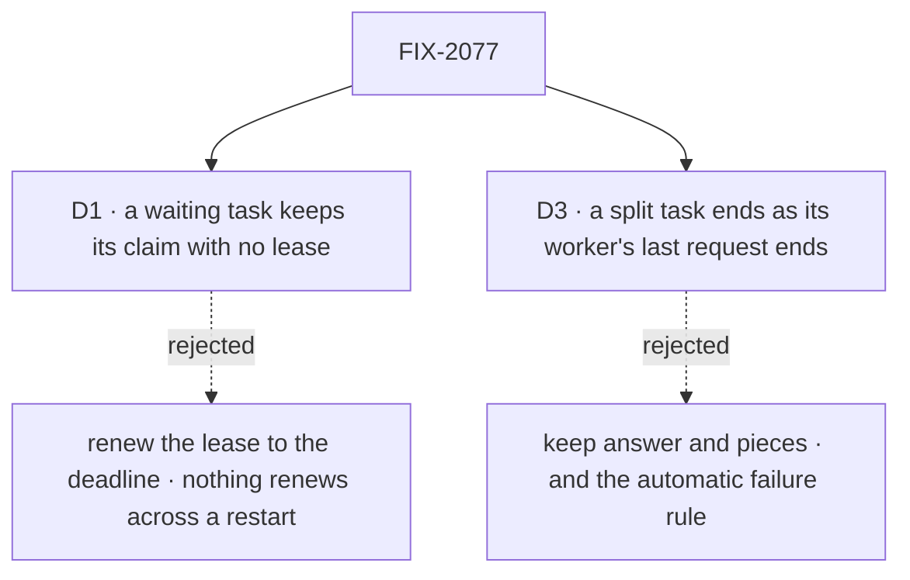

# FIX-2077 · Decisions

[Spec](SPEC.md) · **Decisions**

The epic made rule 6 the one answer for done ([ER-2](../../epics/FIX-2056/DECISIONS.md#who-owns-what));
these two carry it out.

## The tree

Solid edges are what you're signing. Dashed edges lost, and the label says why.

## D1 · A waiting task keeps its claim with no lease

| | |
|---|---|
| **Instead of** | Keeping the lease and renewing it up to the wait's deadline |
| **Because** | A lease means "a live worker holds this". A waiting task has no live worker: its request is stored, and after a restart nothing renews anything. So the row records what it waits on (`waitingOn`) and drops its lease, and the reclaim, which only takes rows whose lease has run out, leaves it alone. A wait on filed tasks has no deadline to renew to at all |
| **Locks in** | A waiting task is never re-run by a lapse. That covers a request that suspends and one that ends with [filed work still holding it](#filed-work-holding): both set `waitingOn` and drop the lease. The price: a task whose wait is lost (a resume that never comes) stays running until its wait's own deadline or FIX-2078's sweeper pays it, so this ships with or after FIX-2078 |

It comes down to a restart while the task waits: a renewed lease lapses, and the task runs twice.

**What would change my mind:** a host that must take a waiting task back by lease, for example
to move it off a worker pool being retired. Then a row with `waitingOn` keeps a long lease instead of none.

## D3 · A task that split ends as its worker's last request ends

| | |
|---|---|
| **Instead of** | Keeping [FIX-1802](../FIX-1802/DECISIONS.md#d3)'s rule: the output is `{ answer, pieces }`, and a piece that failed for good fails the task unless the next turn files it again |
| **Because** | Rule 6 is one rule for every task: done when a request for it ends with a result and no [filed work still holding it](#filed-work-holding). A second rule for tasks that filed tasks is the second answer for done the epic's POC refuted. Every piece's ending, a failure included, already reaches the worker's turn ([rule 7](../../../docs/internal/design/workforce-coordination-concept.md#the-rules)), so that turn decides what a failed piece means, and the retry marker goes |
| **Locks in** | The output of a task that split is its latest `reportProgress` checkpoint, else its worker's last answer ([FIX-2081's D3](../FIX-2081/DECISIONS.md#d3)), and a failed piece fails the task only if the worker's turn throws. A worker that ignores a failed piece completes its task without saying so; the changeset says that. A filer that read `.pieces` reads the pieces' rows. In the repo only the split's own tests, its goal (`goals/workforce/split-to-roster/`), the workforce README and the *Delegating work* page read it, all rewritten here. Teams outside the repo rewrite at upgrade |

It comes down to one rule for done: a second one for splits is what the epic's POC refuted.

**What would change my mind:** a filer that needs every piece's output in the parent's output
without its worker restating it. Then the gate appends the pieces' outputs, as data, not as a rule.

## Decided, not asked

- **The convergence point.** One rule-6 function in `orchestration`, called by the gate at the end
  of every request it admitted for a dispatched task. Today's other writers of done go: the split
  settle here, `completeTask`/`failTask` in FIX-2081, a wait's cancel in FIX-2082. FIX-2078 calls
  the same function when a filed task ends.
- **Rule 6's "nothing it filed is open" means no filed work still
  holding the parent.** *Filed work still holding the parent* is a filed row that isn't terminal,
  or a filed row whose ending is still owed to the parent's session (`owedNotices` /
  `isNoticeOwed` on `@flow-state-dev/orchestration/tasks`); after FIX-2082
  ([#3597](https://github.com/fixpoint-labs/flow-state-dev/pull/3597)), also a lapsed wait slot its
  request has not read. One predicate, in `orchestration`, with no Workforce read: lift
  `holdsSettle` (`split.ts`) into orchestration. So when the last piece ends during a request for
  the parent, that request's check leaves it running, and the turn the piece's ending wakes
  decides it, as D3 assumes.
- **Where it runs: after the engine's last drain.** The engine drains background work, runs
  `onFinished`, then drains what `onFinished` and `onErrored` started
  (`engine/src/execution/runAction.ts`: `drainRequestSideChainPool` at `:2447`, `onFinished` at
  `:2630`, the second drain at `:2641`; on the error path `:2773`, then `:2836`/`:2864`/`:2918`, then
  `:2936`). The check runs after that second drain, on every terminal path, through an engine seam
  that framework packages register for a request. It is not a flow-author hook. An author's
  `onFinished`, and a throw from it, cannot skip it.
- ~~**"Queued" is durable, and Workforce answers it.**~~ Removed by amendment 4: a message queued
  for the task's session holds nothing and isn't part of the task.
- **Admitted for a task** (rule 2): `work`, `onTaskSettled` in the task's session, and a resume of
  either. A message is never admitted (amendment 4). Admission re-mints the claim from the
  row (its run link names the session), restarts renewal and clears `waitingOn`.
- **`waitingOn`.** A new nullable row field read with a `== null` guard (BP-030), naming what keeps
  the task open: a person, filed tasks, or another wait. A running row with `waitingOn` set has no lease;
  admission clears it and restarts the lease. It is named apart from FIX-2080's `held`
  ([#3595](https://github.com/fixpoint-labs/flow-state-dev/pull/3595)): `held` is a status that applies
  only before a start, `waitingOn` a field that applies only after one, so no screen shows "held" for both. The review park stays until FIX-2058 retires it.
- **A person's stop keeps its claim now**, before FIX-2058 shows it. A
  person's suspension is `human_approval` or `human_input`, the kinds `waitForUser` will carry; any
  other reason is a wait. The gate must tell the two apart to keep a wait running (the epic's
  [D2](../../epics/FIX-2056/DECISIONS.md#d2)), and once it can, leaving a person's stop on the lapse
  path asks the question twice and does its work twice. Until FIX-2058, task lists show such a task
  as *running*; the Inbox still shows the question.
- **The output** is the latest checkpoint the worker reported with `reportProgress({ output })`
  ([FIX-2081's D3 (`reportProgress`)](../FIX-2081/DECISIONS.md#d3), not this spec's D3). Only when
  it never reported one is the output the last result of a `work` or `onTaskSettled` request; a
  message's answer never is. While the task is started and not finished, any request holding its
  claim may checkpoint `output` and set a `statusNote`; a message holds no claim (amendment 4). A terminal request that errors fails the attempt, keeping the checkpoint for the
  next. A notice landed as a line keeps the last answer.
- **A task's pieces** are read through FIX-2081's tools: a filter by the filing task on
  `listTasks` (`filedByTask`) is FIX-2081's, since ER-5 makes its five tools the only task surface.
- **Cancelling a split task** cancels its pieces through FIX-2080's cascade; the split's own cascade
  only fired on the park this removes.
- **Upgrade:** a split parked at upgrade reads as running with `waitingOn` set, through FIX-2080's map entry,
  turned on in the PR that stops writing the park (ER-6). The epic's
  [migration lines](../../epics/FIX-2056/migration.md) carry the removed surfaces.
- **FIX-1024 stays open:** the settle reads the claim from the row; the inline drain keeps its copy.
- **No POC and no checker:** the premises are read from code and pinned by the epic's POC; the one
  count, three writers, is its census.

## Considered and dropped

| Option | Why it lost |
|---|---|
| Settle at the entry's last step, and re-check later | Two answers for done. The epic's POC showed a drain moving past a running row in four of six scenarios |
| Check in `onFinished`, and let work the end hooks start not count | The engine drains that work after `onFinished`, so a filer would hear "done" while it still writes. It narrows the goal instead of moving the check |
| `orchestration` reads Workforce's message log | A dependency upward, from the lower package, to land one rule |
| A new task status for "waiting" | Running is the concept's word for a waiting task. Statuses are FIX-2080's and FIX-2058's |
| Read "queued" from the in-process admission line | Lost on restart and not seen by another process (and, since amendment 4, no queued message holds a task) |

## Settled

- **Today's gate settles before background work ends, with a filed task open, and treats a person
  and a wait alike.** CONFIRMED by the epic's POC ([`claim-gate-seam`](../../epics/FIX-2056/poc/claim-gate-seam/README.md),
  G1 to G3, 7 pass on `c179030c`). The premise this spec rests on held.
- **The engine drains again after `onFinished`.** Read from `runAction.ts` (cited above) and
  `docs/architecture/execution-and-errors.md` step 9. The epic's "no engine hook needed" was wrong;
  its who-owns-what row is corrected in this PR.

## Notes from review

For the implementer, recorded verbatim, not baked into the design.

- *Cursor, review:* "rule-6 will run on every terminal request while still 'not done' — design
  bounded message-log and 'open filed work' queries (FIX-2070 caps), a single settle choke point
  vs today's `.tap(recordSuccess)`, and avoid duplicating `hold` alongside existing `wait`/park
  fields without a one-line invariant."
- *Cursor, DECISIONS.md:72:* "Implementation should extend `record-result.ts` / gate wiring rather
  than a parallel Workforce module (matches epic POC census)."
- *Cursor, DECISIONS.md:88:* "If epic schedule allows two implementation PRs, phase A (settle move
  + holds + predicate) vs phase B (D3 output contract) reduces blast radius."
- *Cursor, review of amendment (3):* rule 6 now runs the owed check for every filed child on every
  terminal request; use a boolean "any owed" check with an early exit (not `owedNotices`' sorted
  list), over a bounded `filedByTask` scan.

## How it got here

- **Draft** — framed as the epic's ER-2: one rule-6 check at the end of every request for a task,
  built on the engine's existing drain-then-`onFinished`, with the split park removed and a hold
  in place of a lease while a task waits.
- **Round 1** — the check moved after the engine's second drain, through an engine seam, because
  `runAction.ts` drains what `onFinished` starts after it runs. "Queued" became a predicate
  Workforce supplies. A request that ends with work open records a hold too. D2 moved to *decided*:
  once the gate tells a person from a wait, the lapse path for a person is the bug.
- **Round 2** — the running-row field is renamed from "hold" to `waitingOn`, because FIX-2080
  ([#3595](https://github.com/fixpoint-labs/flow-state-dev/pull/3595)) makes `held` the status for
  a task filed and not started. One term, one thing. No change to the approach.
- **Amendment, after merge** — the output line takes the owner's checkpoint
  ([decision](https://github.com/fixpoint-labs/flow-state-dev/pull/3593#issuecomment-6315764765),
  [correction](https://github.com/fixpoint-labs/flow-state-dev/pull/3593#issuecomment-6315963943)),
  superseding the `updateTask({ id, output })` amendment in
  [#3606](https://github.com/fixpoint-labs/flow-state-dev/pull/3606), closed unmerged. The tool and
  its rules are FIX-2081's; the goal check's leg c follows. No change to the approach.
- **Amendment, after merge (2)** — output precedence and who may checkpoint follow the owner's
  sign-off ([#3596](https://github.com/fixpoint-labs/flow-state-dev/pull/3596#issuecomment-6317555200), [#3593](https://github.com/fixpoint-labs/flow-state-dev/pull/3593#issuecomment-6317553797)), carried in
  [#3596](https://github.com/fixpoint-labs/flow-state-dev/pull/3596) with FIX-2081's D3, through the
  rest of this spec: the split row, the message row and *Not done if*, leg b, the filer's diff and
  the docs line, D3's *Locks in* and figure, and the epic's split-output migration row. No change
  to the approach.
- **Amendment, after merge (3)** — from the epic's cross-spec audit (F2), after the original
  review in [#3592](https://github.com/fixpoint-labs/flow-state-dev/pull/3592): rule 6 counts
  [filed work still holding the parent](#filed-work-holding). No change to the approach.
- **Amendment, after merge (4)** — FIX-2103 (owner's decision, Oct 22) reverses the queued-message
  hold: a task settles when its turn ends, and a message to its session doesn't hold it and isn't
  part of it (while its turn runs, it's answered after), with no claim, no `reportProgress`, and
  no say in the attempt. "Queued" leaves rule 6, `TaskEndRules` and `waitingOn`; leg c is
  inverted; a stored `waitingOn: "queued"` reads as `"filed"` with no lease, and the upgrade's
  backfill owes its session the check that settles it with its kept answer. Steering stays the one way into open work (FIX-2086). No other
  change to the approach.

Open: none.
