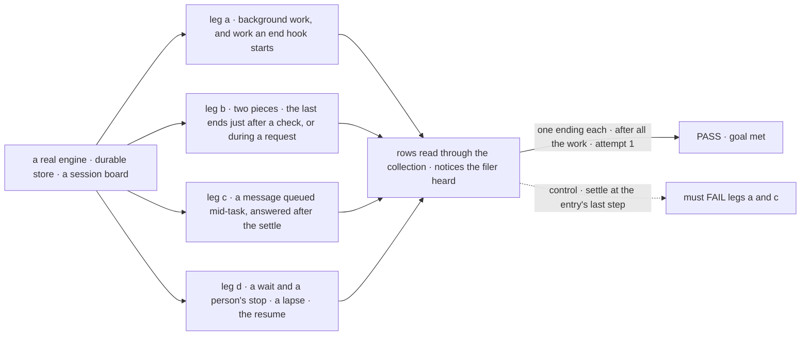
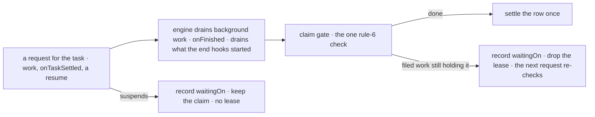

# FIX-2077 · When a task is done: one completion rule, applied at the claim gate

**Spec** · [Decisions](DECISIONS.md)

## Six people, before and after

| Someone who… | Today | After |
|---|---|---|
| **files a task whose worker leaves background work running** | Hears "done" while that work still writes | Hears "done" once, after it ends, including work the flow's own end hooks start |
| **builds a manager worker that splits its task** | The task parks; a separate step settles it as `{ answer, pieces }`, failing it if a piece failed | The task stays running. It is done when a request for it ends with no [filed work still holding it](DECISIONS.md#filed-work-holding); its output is the latest `reportProgress` checkpoint, else that answer ([D3](DECISIONS.md#d3)) |
| **messages a worker whose task is running** | The message runs after the task settled | It runs for the task before it settles; its answer never becomes the output, though a checkpoint it reports does |
| **has a task whose request waits on a webhook, a call or a task** | Its claim lapses in two minutes and the task runs again | It shows running and keeps its claim, across a restart too ([D1](DECISIONS.md#d1)) |
| **has a task that stops to ask a person** | The same lapse: it runs again with the question open | It keeps its claim; it shows running until FIX-2058 ([decided](DECISIONS.md#person-stop)) |
| **maintains the framework** | Three code paths decide that a task is complete | One rule, checked in one place |

## The goal, and how we'll know it's met

**A dispatched task is settled once, by the claim gate, only when its work is over: its request
and all that request's background work have ended, no [filed work is still holding
it](DECISIONS.md#filed-work-holding). A task that waits is never run twice. A message to its session
doesn't hold it and isn't part of it (amendment 4).**

| Is it the right goal? | |
|---|---|
| **The real need** | *"The result they hear about is complete, and a task waiting on other work stays running instead of being run twice"* (the issue). The epic's ER-2: one predicate for done, which every wait wakes on |
| **Smaller, and rejected** | "The gate waits for background work." Splits still park and settle by hand, a waiting task still runs twice, and FIX-2082 has no single ending to wake on |
| **Bigger, and not this issue's** | A task shown as *waiting on a person* in the Inbox (FIX-2058). An ending that reaches its filer when nothing touches the board (FIX-2078). Waits inside a task (FIX-2082) |
| **Not done if** | The gate settles a row before rule 6 holds · the split park or its settle entry still exists · a waiting task runs again after a lapse · the check passes only with no background work · a queued message delays the settle or becomes the output |



The check reads the rows and the filer's notices, not the gate's calls. The dashed path is the same run with today's
settle point, and it must fail.

| How we verify | |
|---|---|
| **Goal check** | `goals/task-board/settles-when-its-work-is-over/` · no model · run by the implementer at completion · verdict in the implementation PR |
| **Signal** | Each leg: one ending, heard once by the filer. a: settled after the last write of the side chain the action starts and of the one the flow's `onFinished` starts. b: running while a piece is open; the last piece ends after a request's check ran and before its notice is admitted; settled once with the last turn's answer (its worker never checkpoints), no running row left. Variant: the last piece ends while a request for the parent runs; that request's check leaves it running, and it settles after the turn the piece's notice wakes, with that turn's answer. c: the message's request ends before the settle; output is the latest `reportProgress` checkpoint, the message's request's included, or, when none was made, `work`'s returned result, never the message's answer. d: a wait and a person's stop each still running on attempt 1 after a reclaim past the lease; done after the resume |
| **Input** | Deterministic workers on the Workforce session board. A different delay, piece count or suspension reason must pass too |
| **Anti-game** | No assertions on recorder calls or a stubbed gate: rows through the collection, notices as the filer got them |
| **Control that must fail** | `GOAL_CONTROL=settle-at-return` must FAIL leg a on *settled after the side chain's last write* and leg c on *the message's request ends before the settle*. Today's `main` must also FAIL legs b and d |

## What changes


The settle moves from the entry's last step to the end of the request. It moves again whenever
another request for the task ends.

**A worker that splits its task, read by its filer:**

```diff
  const row = await tasks.get(id)
- const { answer, pieces } = row.output   // a split task's output
+ const answer = row.output              // the latest reportProgress checkpoint, else the last answer, like any task
+ // Need a piece's result? Its worker says it in the answer, or read the piece's own row.
```

Nothing else is written differently. A flow author's own `onFinished` keeps running beside the gate.

**Docs:** update *Workforce → Delegating work → Splitting a task* (the task stays running; its
output is the latest `reportProgress` checkpoint, else the worker's last answer; a failed piece
does not fail it alone). Update *Orchestration →
Task board → Assignees that dispatch* (the run settles after background work, and a message to its session doesn't hold it;
a suspended run keeps its claim). Update the orchestration and workforce READMEs where they say
the same. No new page.

## How it settles



Every request for the task ends at the same check, after the engine's last drain. A request that
suspends, or ends with work still open, records what it waits on (`waitingOn`) instead.

## What stays as it is

- **Inline plan rows.** The drain records each row when its worker returns (FIX-2076). Its
  background work belongs to the parent task's request, so it delays the parent's settle, not the row's.
- **Failures.** A request that throws fails the attempt where it does today; retries are unchanged.
- **Who a piece can go to.** Any worker on the roster that takes tasks (delegates as authority is FIX-2081's).
- **A worker's review park** (`awaitReview`), and `answerTask`, until FIX-2058. A row with
  `waitingOn` set is not a review park, and this issue changes neither.

## What's already here, and the debt

| Already here | What this does with it |
|---|---|
| The claim gate around a task entry (`task-board/task-entry.ts`) | **Extends.** It admits every request for the task and settles at the request's end |
| The recorders the gate and the inline drain share | **Builds on.** The inline drain keeps them as they are |
| The request's end: drain, `onFinished`, then a second drain for what the end hooks started, on every terminal path | **Extends.** The gate's check runs after that second drain, through a seam for framework packages. Not a flow-author hook ([decided](DECISIONS.md#decided-not-asked)) |
| Lease renewal, and the reclaim that skips a row with no lease | **Builds on.** A row with `waitingOn` set drops its lease, so the reclaim leaves it alone. A board counts it as dispatched, as it does a live lease today |
| The message entry, deferred behind the task's turn | **Builds on.** Admitted for the task; FIX-2070 renames it `receive` |
| Whatever else decides a task is done | **Three today** (the epic POC's census of every `complete`/`fail`/settle write in `orchestration` and `workforce`): the gate's recorders, `completeTask`/`failTask`, the split settle. The settle goes here, the tools in FIX-2081, a wait's cancel in FIX-2082 |
| [FIX-1802 D3](../FIX-1802/DECISIONS.md#d3) and its BR-16: a failed piece fails the parent unless re-filed | **Superseded.** The worker's last request decides ([D3](DECISIONS.md#d3)) |
| [FIX-1802](../FIX-1802/DECISIONS.md) S4: the park, the parent binding, the settle and the cancel that reaches the pieces | **Superseded.** The task stays running; the end of the next request for it settles it. FIX-2080's cascade cancels its pieces. Parked rows in flight are read through FIX-2080's map. The settle's replay on a later touch is not this issue's: FIX-2078 ([#3594](https://github.com/fixpoint-labs/flow-state-dev/pull/3594)) removes it |
| The epic's [ER-2](../../epics/FIX-2056/DECISIONS.md#who-owns-what) and [D3](../../epics/FIX-2056/DECISIONS.md#d3) | **Kept.** This issue owns ER-2 and turns on the parked-split entry of D3's map |

| The debt | |
|---|---|
| **Removes** | The split park, its parent binding and its settle entry (`settleSplitTask`) · its cancel cascade (FIX-2080's replaces it) · the `{ answer, pieces }` output · the automatic piece-failure rule and the retry marker · the settle at the entry's last step |
| **Adds** | `waitingOn` on a running row: what keeps it open (a person, filed tasks, or another wait). Not a form of FIX-2080's `held`, which is a status before a start; `waitingOn` exists only after one. It outlives the review park, which FIX-2058 retires. One engine seam after the last drain. The parked-split entry in FIX-2080's map, removed with the map no earlier than FIX-2071 |
| **Leaves** | An error in background work is logged and does not fail the attempt (FIX-2088) · a stranded wait is paid only by the sweeper (FIX-2078), so this ships with or after it · the split's replay on a later touch: FIX-2078 ([#3594](https://github.com/fixpoint-labs/flow-state-dev/pull/3594)) removes it, not this issue; a crash between the last piece ending and the settle, before its notice is acted on or after, strands the parent until FIX-2078's wake pays it · the claim's two copies (FIX-1024): the settle reads the row, not either copy |

**Net: down.** A park, a settle entry, a cascade, an output shape and a failure rule go; one
`waitingOn` field and one engine seam arrive.

## Sign off

**[The goal](#the-goal-and-how-well-know-its-met), at that size:** settled once, after all the
work, and never run twice for waiting. If wrong: FIX-2082 and FIX-2086 build on a "done" that
moves.

**[The debt](#whats-already-here-and-the-debt), net down:** the split park and its settle go; a
`waitingOn` field and an engine seam arrive. If wrong: a field nobody reads after FIX-2058.

1. **[D1](DECISIONS.md#d1) · A waiting task keeps its claim with no lease.** If wrong: a task whose
   wait is lost stays running until the sweeper pays it.
2. **[D3](DECISIONS.md#d3) · A task that split ends as its worker's last request ends.** If wrong:
   filers outside the repo reading `.pieces` rewrite at upgrade. In the repo only the split's own
   tests, goal and docs read it.

**Open: none.** Number 2 is the one to weigh: it changes an output people read.

Improvement · `orchestration` + `workforce` + `engine` · medium · epic [FIX-2056](../../epics/FIX-2056/SPEC.md)
