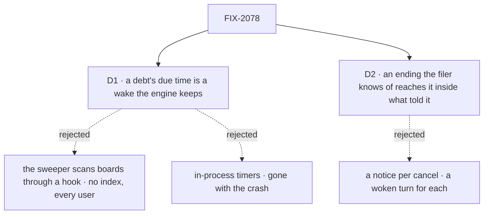

# FIX-2078 · Decisions

[Spec](SPEC.md) · **Decisions**

The epic gave this issue [ER-3](../../epics/FIX-2056/DECISIONS.md#who-owns-what): every ending
reaches its filer once through one path, and every debt has a due time with the sweeper as
backstop. These two carry it out.

## The tree

Solid edges are what you're signing. Dashed edges lost, and the label says why.

## D1 · A debt's due time is a wake the engine keeps, one per session, fired until a pass clears it

| | |
|---|---|
| **Instead of** | A hook orchestration registers, which the sweeper calls to scan boards · in-process timers · a parked request per debt, riding the wait deadlines the sweeper reads |
| **Because** | The engine stays free of orchestration, and a debt survives a crash (story F-01). A wake is generic: a session, an internal entry, a due time and the owner, all server-written. A scan has no due-time index and reads every user's ledgers each tick. A timer dies with its process. A parked request carries a lease and a history, and its deadline can't move earlier |
| **Locks in** | A record kind in the engine's stores: memory, filesystem, SQLite and Postgres keep it; a custom adapter may. Without it, or with no durability provider, a host keeps the fast paths and says so once at start. Where the sweeper runs as an external cron, a debt is paid no sooner than its next run |

It comes down to a crash after an ending: a wake is in the store; a timer is gone, and a scan
reads every board to find it.

**What would change my mind:** a store that already indexes rows by a time field the sweeper can
query. Then the due time is a field on the row, and no record kind is added.

## D2 · An ending the filer already knows of reaches it inside what told it

| | |
|---|---|
| **Instead of** | A notice for every cancel: the filer's own, and each dependent a failure cancelled, each waking a judgment turn |
| **Because** | Rule 7 says *once*. The filer's own cancel already returned to it as its call's result, and a dependent a failure cancelled is part of that failure. In a judgment conversation each notice is a model turn: a failure with five dependents would wake the coordinator six times. The epic's leg c expects one failure notice |
| **Locks in** | A cancel owes a notice unless the filer's own session made it. A failure's notice names the dependents it cancelled, and those owe none. A user's cancel from a screen, or one cascaded from above the filer, owes one. Who cancelled is read from the server (BP-031) |

It comes down to a failure that cancels five dependents: one notice and one turn, or six.

**What would change my mind:** a filer that acts on a dependent's cancel apart from the failure
that caused it. Then each cancel gets its notice, and turns are batched instead.

## Decided, not asked

- **The convergence point.** One delivery in orchestration, run by every writer of a delegated
  row's ending: the claim gate, a refused hand-over, the settle of a row whose worker died too
  often, a cancel. It writes the wake, marks the notice in the ending's write, and sends it.
  Only the filer's delivery clears it.
- **Who hears it.** A request waiting on the task is resumed by the delivering side; no
  `onTaskSettled` runs for it. Otherwise one `onTaskSettled` request runs in the filer's session
  and flow, read from the row's server-written filing fields.
- **The entry.** `taskSettledEntry({ block })` and its input schema come from
  `@flow-state-dev/orchestration`; the input keeps today's notice shape (FIX-2071 owns renames).
  A board that hands rows out (FIX-2076's delegation board, or a dispatcher that doesn't wait) in
  a flow with no `onTaskSettled` is refused when built. FIX-2084 checks a hired manager the same way.
- **The wake.** Written before the write that owes, so a crash between leaves a wake that pays
  nothing, never a debt with no wake. One per session and entry; a second write keeps the earlier
  due time (the coalescing). The sweeper fires a due wake as the owner it names and moves it one
  retry interval out. A pass clears it by version only when nothing is owed, so one written
  during the pass survives. The re-arm reads the earliest wait deadline or wake.
- **The debts.** An ending owed to the filer, a wait owed a resume, a ready row not started, and
  a claimed row whose lease may lapse (FIX-1884), due at the lease's end. A task whose filed tasks
  have all ended is settled through its last ending's delivery: that `onTaskSettled` is admitted
  for the task and ends at FIX-2077's rule-6 check, not a second one. Until FIX-2077 lands,
  today's split settle runs there. Due times are a few seconds, set per kind by the implementer.
- **Fast paths and resends.** The settling side sends at once. A filing, a start, an answer, a
  retry or an ending that makes a row ready runs the session's pass. A touch or a pass resends
  only what is past due. A notice the 32-cap refuses stays owed.
- **One pass at a time.** The board-run entry declares `reject`, keyed on its session. Repairs
  run first, then the drain, whose last ready check is the last step before the wake is cleared.
- **The error report ([(f)](../../epics/FIX-2056/DECISIONS.md#f)).** A task's final failure goes to
  the Error Reporter's intake inside its ending's delivery, before it is acknowledged, as the task
  occurrence the intake already takes and dedupes. A notice refused because the conversation is
  gone forwards it where the refusal is handled; a post's, on `onPostSettled` until FIX-2083.
- **Upgrade.** A report marker on a row at upgrade is ignored: its notice carries the failure
  (BP-030). An owed notice from before has no wake; the first touch or pass writes one.
- **Changesets.** Orchestration (the entry), engine and the SQLite and Postgres stores (the wake),
  workforce (cancels heard, the refusal). No `errorCapture` migration line, per (f).
- **No POC and no checker.** The premises are read from code on `main` at `96404d25`, and the spec
  rests on no count. A search for the report marker proves its removal at implementation.

## Considered and dropped

| Option | Why it lost |
|---|---|
| Keep `onTaskSettled` in Workforce; give orchestration a callback | A flow without Workforce wires its own delivery: ER-3's second path |
| Keep the report marker, paid by the wake too | Two debts for one ending; FIX-1983's own rule says the report rides the ending signal |
| Queue a second pass instead of rejecting it | Rule 17. The first pass's last check and the wake cover it |

## Settled

Nothing was disputed. The premises (where endings are written, where the sweeper re-arms, the
cancel rule, no `concurrency` on the board-run entry) were read from `main` at `96404d25`.

## Notes from review

Implementer notes from the epic coordinator, recorded before review:

- "Implementer note (epic review): classify board debts by latency; keep the 32-notice cap and coalescing."
- "Owner decision (f), 2026-10-21: keep Shift Manager's automatic error route. Re-express errorCapture (packages/shift-manager/teams/devteam/host.mts:1194; workforce/src/error-reporter/reporter.ts:315-320) on the new ending/notice path so it is not a second route (ER-3). Hosts wiring errorCapture keep getting error reports, and the changeset needs no migration line for it. The reportOwed marker (ledger.ts:106, report-owed.ts:34-38) and its resends still go. In the same PR, amend the internal design docs that say a failure alone never reaches the Error Reporter: concept rule-7 checklist line 481, gaps row line 117 ('Error Reporter hears only what a filer messages'), and stories F-05. The closure should not gate on that half."

## How it got here

- **Draft** — framed as the epic's ER-3: one delivery in orchestration for every ending, a wake
  in the engine's stores written before each debt and fired by the sweeper, one pass per session
  with its last ready check last, and the error report riding the ending per (f).

Open: none.
