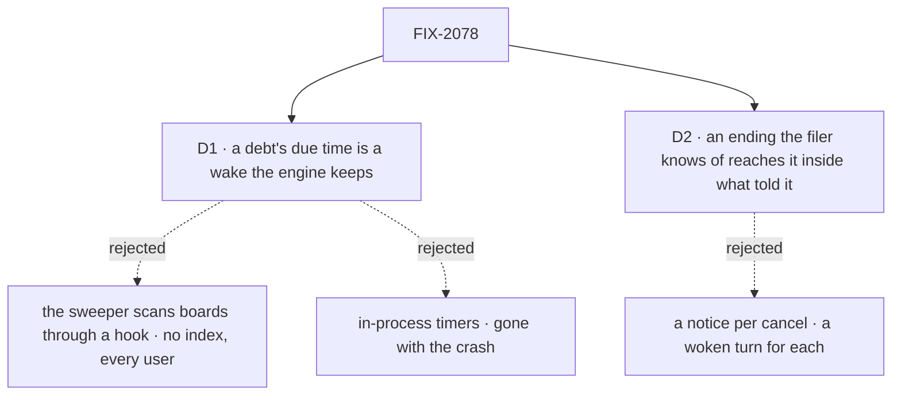

# FIX-2078 · Decisions

[Spec](SPEC.md) · **Decisions**

The epic gave this issue [ER-3](../../epics/FIX-2056/DECISIONS.md#who-owns-what): every ending
reaches its filer once through one path, and every debt has a due time with the sweeper as
backstop. These two carry it out.

## The tree

Solid edges are what you're signing. Dashed edges lost, and the label says why.

## D1 · A debt's due time is a wake the engine keeps, one per session and entry, fired until a pass clears it

| | |
|---|---|
| **Instead of** | A hook orchestration registers, which the sweeper calls to scan boards · in-process timers · a parked request per debt, riding the wait deadlines the sweeper reads |
| **Because** | The engine stays free of orchestration, and a debt survives a crash (story F-01). A wake is generic: a session, an internal entry, a due time and the owner, all server-written. A scan has no due-time index and reads every user's ledgers each tick. A timer dies with its process. A parked request carries a lease and a history, and its deadline can't move earlier. The schedule index (`claimDue`) is the nearest index, and it doesn't fit: it lives in `scheduled`, which the engine can't depend on, advances rows by cron, and is at-most-once, where a debt must fire until paid |
| **Locks in** | A record kind in the engine's stores: memory, filesystem, SQLite and Postgres keep it; a custom adapter may. On the store registry it is one optional key beside the suspension store, so an adapter written before it still type-checks and loads. A host detects it by that key being present, checked once at start: without it, or with no durability provider, the host logs once and keeps the fast paths only. Where the sweeper runs as an external cron, a debt is paid no sooner than its next run. The wake is the engine's one due-time source: a wait deadline is a wake whose entry resumes the wait. This issue doesn't move today's wait deadlines; FIX-2082 puts any it adds or reshapes on the wake, not on a second path. On a host that can't fire wakes, each due-time consumer either keeps a fast path or is refused when the flow is built, and its spec names which: this issue's debts keep their fast paths; FIX-2082's waits are refused; FIX-2083 states it for its round deadline |

It comes down to a crash after an ending: a wake is in the store; a timer is gone, and a scan
reads every board to find it.

**What would change my mind:** a store that already indexes rows by a time field the engine's
sweeper can query, at-least-once. Then the due time is a field on the row, and no record kind is
added. None does today: the schedule index is the only one, and it fails both conditions.

## D2 · An ending the filer already knows of reaches it inside what told it

| | |
|---|---|
| **Instead of** | A notice for every cancel: the filer's own, and each dependent a failure cancelled, each waking a judgment turn |
| **Because** | Rule 7 says *once*. The filer's own cancel already returned to it as its call's result, and a dependent a failure cancelled is part of that failure. In a judgment conversation each notice is a model turn: a failure with five dependents would wake the coordinator six times. The epic's leg c expects one failure notice |
| **Locks in** | A cancel owes a notice unless the filer made it in its own request: a model's task tool inside the filer's turn. A public `_tasks` action owes one even in the filer's session, as do a user's cancel from a screen and one cascaded from above the filer. A failed or cancelled ending's notice names the dependents its ending cancelled that share its filer, read from the cause FIX-2080 writes on each cascaded cancel, and those owe none. A dependent another session filed owes that filer a notice of its own. Who cancelled, and how (tool or action), and who filed are read from the request's server-set source, never caller input (BP-031); today's cancel tool and `_tasks` action set that marker in the ending's write |

It comes down to a failure that cancels five dependents: one notice and one turn, or six.

**What would change my mind:** a filer that acts on a dependent's cancel apart from the failure
that caused it. Then each cancel gets its notice, and turns are batched instead.

## Decided, not asked

- **The convergence point.** One delivery in orchestration, run by every writer of a delegated
  row's ending: the claim gate, a refused hand-over, the settle of a row whose worker died too
  often, a cancel. It writes the wake, marks the notice in the ending's write, and sends it.
  Only the filer's delivery clears it. For a failed or cancelled ending, the delivery writes the
  cancels of same-board dependents, with their cause, before it composes the notice, so the
  notice can name them; on repair a pass pays an owed cascade before it resends an owed notice.
  A plan board's inline rows (FIX-2076) are worked inside the filer's own turn: they owe no
  notice, and the delivery skips them. A dispatched plan row (after FIX-2082) is ended by another
  session's claim gate: it owes its waiting drain a resume through this delivery and its wake.
  On every filed-task ending, one that owes no notice included, the delivery calls FIX-2077's
  rule-6 function for the parent when no request for the parent is running (a running one checks
  at its own end): the same function, not a second predicate.
- **Who hears it.** A request waiting on the task is resumed by the delivering side; no
  `onTaskSettled` runs for it. If the wait's deadline has lapsed while that request still runs
  (FIX-2082), the ending is held for it: its next read returns it, and only if it ends without
  reading it is the ending owed to `onTaskSettled`, once. Otherwise one `onTaskSettled` request
  runs in the filer's session and flow, read from the row's filer fields.
- **The filer fields.** A delegated row carries server-written filer fields, the session and flow
  that filed it, stamped at filing from the request's server-set identity, never from caller
  input (BP-031). They name the filer under the concept's rule 4, so a user's follow-up copies
  the original's filer rather than the session it was typed in. A row filed before them has none
  (BP-030): it falls back to Workforce's filing session from its partition, and with neither the
  notice is settled undeliverable. This issue owns them; FIX-2082 and FIX-2086 read them.
- **The entry.** `taskSettledEntry({ block })` and its input schema come from
  `@flow-state-dev/orchestration`; the input keeps today's notice shape plus one additive, typed
  field, the dependents its ending cancelled (D2). FIX-2071 owns renames. Workforce never exported
  the entry, so the move is internal and Workforce keeps no re-export.
  A board that hands rows out (FIX-2076's delegation board, or a dispatcher that doesn't wait) in
  a flow with no `onTaskSettled` is refused when the flow is built, at flow construction, so before
  any hire check runs. FIX-2084 checks a hired manager the same way.
- **The wake.** Written before the write that owes, so a crash between leaves a wake that pays
  nothing, never a debt with no wake. One per session and entry; a second write keeps the earlier
  due time (the coalescing). The sweeper fires a due wake as the owner it names and moves it one
  retry interval out. The re-arm reads the earliest wait deadline or wake.
- **When a wake moves and when it clears.** A debt is *outstanding* from its write until it is
  paid, and *due* at its due time; a lease-end debt is outstanding long before it is due. After
  each pass the wake's due time is the earliest due time over the outstanding debts its entry
  pays, and the wake clears only when none is outstanding. Each of a session's wakes moves and
  clears on its own, by that rule, whatever its entry. It clears by version, so a wake written
  during the pass survives.
- **The fence against a write still landing.** A wake carries the time its guarded write must
  have landed by: the writer's request lease. A pass that finds nothing outstanding before that
  time moves the wake there instead of clearing it, so a writer that stalls between its wake and
  its row can't lose the wake to a pass. A writer past its lease has failed, and its request's
  recovery reruns it. The implementer proves the interleaving in a test: a stalled writer, a
  pass, then the writer's commit and a kill.
- **A debt that can't be paid ends.** A pass that finds the filer's session or conversation gone
  settles the notice as undeliverable: the row records it, a final failure's report goes where a
  refused notice's goes, and the debt is no longer outstanding. A debt still outstanding at a
  maximum age, counted from its due time (a host setting, 24 hours by default), ends the same way
  and is logged. Every wake clears.
- **The debts and their due times.** Each is due within 2 s of the write that owes it, except a
  lease, due at its end. A task whose filed tasks have all ended is settled through its last
  ending's delivery: an `onTaskSettled` it starts is admitted for the task and ends at FIX-2077's
  rule-6 check; an ending that owes no notice calls that check directly. The same function, not
  a second predicate. Until FIX-2077 lands, today's split settle runs there. A row with
  FIX-2077's `waitingOn` set has no lease, so the rows below, not a lease, keep it moving.

  | Debt | Due | Goal leg |
  |---|---|---|
  | An ending owed to its filer | the write + 2 s | a, b |
  | A wait owed a resume | the write + 2 s | a |
  | A ready row not started | the write + 2 s | c (starts within 5 s) |
  | A claimed row whose lease may lapse (FIX-1884) | the lease's end | e |
  | A final failure's error report | rides its ending | d |
  | A cascade owed (FIX-2080), filer-board half: a failed or cancelled row's dependents. Paid by the filer's pass, under the wake the ending already writes | the write + 2 s | d |
  | A cascade owed (FIX-2080), task-session half: a task's open filed tasks. Paid by that session's pass, under a wake written there before the ending | the write + 2 s | d |
  | A task whose filed tasks have all ended, owed its settle. Paid by today's split settle until FIX-2077, by its rule-6 check after | the write + 2 s | b |
  | A lapsed wait's ending (FIX-2082), owed to `onTaskSettled` if the waiting request ends without reading it. Its wake is fenced by that request's lease | that request's end + 2 s | FIX-2082's |
  | A message queued for a running task, owed its request. The send writes the wake with the log row; the pass re-dispatches the message entry, idempotent by message id. Since FIX-2103 it holds no task, so an undeliverable message is settled and no task is re-checked | the write + 2 s | — |
  | A cancel owed: a stopped wait whose cancel failed (`Task.cancelOwed`). Paid in the pass's repairs | the write + 2 s | — |
  | A steer owed a turn (FIX-2086) | the write + 2 s | FIX-2086's |

  The cascade owed is the debt of FIX-2080's D2
  ([#3595](https://github.com/fixpoint-labs/flow-state-dev/pull/3595)): orchestration's own
  ending recorder writes it in the ending's write. This issue pays it at the delivery step the
  convergence point names (same-board dependents' cancels before the notice is composed; on
  repair, an owed cascade before an owed notice is resent), with a wake per half as the two rows
  above say, so it is paid on time after a crash. It is one debt with no resend of its own:
  until this issue lands, the ending's own pass pays it and a touch pays it once past due;
  after, it follows the rule for every debt below.

- **Order against FIX-2077.** This issue removes the replay of owed endings on a touch and
  replaces it with the wake. If FIX-2077 lands first, it keeps that replay and removes only the
  split settle. The replay goes only together with the debt *a task whose filed tasks have all
  ended, owed its settle*, so a split parked at upgrade always has a payer.
- **Fast paths and resends.** The settling side sends at once. A filing, a start, an answer, a
  retry or an ending that makes a row ready runs the session's pass. A touch or a pass resends
  only what is past due. A notice the 32-cap refuses stays owed. This narrows the concept's rule
  8 ("every touch resends"); the implementation PR amends it to "a pass or a touch resends what
  is past due".
- **One pass at a time.** The delegation board's run entry declares `reject`, keyed on its
  session; a plan board's drain inside `work` or `respond` is not touched. Every runner of the
  delegation board's pass goes through that entry: the delivery, and Shift Manager EM's `drain`
  entry and `ask`'s approved branch, trigger it rather than run the pass inline. A rejected trigger
  leaves the wake as it is. Repairs run first, then the drain, whose last ready check is the
  last step before the wake moves or clears.
- **The error report ([(f)](../../epics/FIX-2056/DECISIONS.md#f)).** A task's final failure goes to
  the Error Reporter's intake inside its ending's delivery, before it is acknowledged, as the task
  occurrence the intake already takes and dedupes. A notice refused because the conversation is
  gone forwards it where the refusal is handled; a post's, on `onPostSettled` until FIX-2083.
- **Upgrade (BP-030).** A report marker still owed at upgrade can outlive its notice, which may
  already be acknowledged. It is read as an owed report on the new path: the next pass sends it
  to the intake as the task occurrence, which dedupes, and drops the marker once accepted. An
  owed notice or marker from before has no wake, so on its first start the host writes one for
  every session that holds either, or a parked split. The implementer places that one-off backfill (host start or
  a migration step), and the changeset names it.
- **`resumeOwedWaits`.** Removed. Its one job no other path does, paying a cancel owed, is now a
  debt the pass repairs, and nothing in the framework calls it after this. The epic's
  `migration.md` carries its row (owner FIX-2078), and its docs paragraph goes.
- **Changesets.** Orchestration (the entry and its added field), engine and the SQLite and
  Postgres stores (the wake), workforce (cancels heard). Orchestration's also carries the
  `resumeOwedWaits` removal line. Two behaviour lines, each with a
  `migration.md` row the implementation PR adds (owner FIX-2078): a board that hands rows out
  from a flow with no `onTaskSettled` is refused when built, and an `onTaskSettled` handler now
  receives `cancelled` endings (BR-29 reversed). No `errorCapture` migration line, per (f).
- **No POC and no checker.** The premises are read from code on `main` at `96404d25`, and the spec
  rests on no count. A search for the report marker proves its removal at implementation.
- **Splitting the work.** The delivery, D2, `taskSettledEntry` and the marker's removal need no
  store change; the wake and the sweeper step do. The implementer may ship them as two PRs.

## Considered and dropped

| Option | Why it lost |
|---|---|
| Keep `onTaskSettled` in Workforce; give orchestration a callback | A flow without Workforce wires its own delivery: ER-3's second path |
| Keep the report marker, paid by the wake too | Two debts for one ending; FIX-1983's own rule says the report rides the ending signal |
| Queue a second pass instead of rejecting it | Rule 17. The first pass's last check and the wake cover it |
| Put the wake on the schedule index | Outside the engine, cron-shaped and at-most-once ([D1](#d1)) |

## Settled

Nothing was disputed. The premises (where endings are written, where the sweeper re-arms, the
cancel rule, no `concurrency` on the board-run entry) were read from `main` at `96404d25`.

## Notes from review

Implementer notes from the epic coordinator, recorded before review:

- "Implementer note (epic review): classify board debts by latency; keep the 32-notice cap and coalescing."
- "Owner decision (f), 2026-10-21: keep Shift Manager's automatic error route. Re-express errorCapture (packages/shift-manager/teams/devteam/host.mts:1194; workforce/src/error-reporter/reporter.ts:315-320) on the new ending/notice path so it is not a second route (ER-3). Hosts wiring errorCapture keep getting error reports, and the changeset needs no migration line for it. The reportOwed marker (ledger.ts:106, report-owed.ts:34-38) and its resends still go. In the same PR, amend the internal design docs that say a failure alone never reaches the Error Reporter: concept rule-7 checklist line 481, gaps row line 117 ('Error Reporter hears only what a filer messages'), and stories F-05. The closure should not gate on that half."

From spec review, round 1 ([#3594](https://github.com/fixpoint-labs/flow-state-dev/pull/3594)), recorded verbatim for implementation:

- FSD Architect, fix 8: "Name the exact engine code (SPEC.md:125, DECISIONS.md:68-72): the sweeper re-arm in `durability-sweeper.ts:40-52`; `onWaitDeadline` in `wait-deadlines.ts`, and `resumeWaitGate`; where the wake store sits next to `SuspensionStore` (`engine/src/stores/types.ts:1509`); `ledger.ts:106` and `report-owed.ts:34-38`, moved into the debt table."
- FSD Architect, fix 9: "Optional wake store (SPEC.md:136). Spell out its shape on the registry and how hosts detect it. A host without it should log once and run on the fast paths only." *Round 2: folded into D1 → Locks in at the architect's request; the key's name is the implementer's.*
- Second look, note: "Control coverage. Only leg b has a must-fail control. A control for leg c (for example, the fast-path run off) would show that its 5 s start isn't being paid by the sweeper instead."
- Cursor: "'Decided, not asked' ≈ build plan. Wake versioning, coalescing, four debt kinds, repair→drain→last-ready, upgrade paths — mostly derivable from `durability-sweeper.ts`, `wait-deadlines.ts`, and Workforce `board.ts`."
- Cursor: "Duplication. 'How a debt is paid' + SVG + Decided, not asked + sign-off repeat the same pipeline; SVG aria-labels repeat D1/D2 prose. One canonical flow section would be enough."

## How it got here

- **Draft** — framed as the epic's ER-3: one delivery in orchestration for every ending, a wake
  in the engine's stores written before each debt and fired by the sweeper, one pass per session
  with its last ready check last, and the error report riding the ending per (f).
- **Round 1** — the wake gained a fence against a write still landing, an end for a debt that
  can't be paid, and a due time recomputed over outstanding debts; the wake became the engine's
  one due-time source, which FIX-2082's waits use. D2 kept a dependent's notice when another
  session filed it. Owed report markers are carried across the upgrade and old debts get a wake.
  The goal names the hosts it covers and gained a lease leg. Because review found a wake a pass
  could clear before its debt was written, and debts that never cleared or were lost at upgrade.
- **Round 2** — D1 now locks in the wake store's place on the registry (one optional key) and how
  a host detects it, which round 1 had left to the implementer. The order against FIX-2077 on
  removing replay-on-touch waits on #3592 agreeing that this issue removes it.
- **Round 3** — FIX-2080's cascade became one of this issue's debts: the debt table gained
  *a cascade owed*, recorded by FIX-2080 with the ending and paid on time by this issue's wake,
  with no resend of its own. FIX-2080 now blocks this issue, since D2 and leg d read its cascade
  and the cause it records. Because the architect found that FIX-2080's interim touch payment
  would bring back the unconditional resend this issue removes.
- **Cross-spec audit** — the delivery calls rule 6 on every filed-task ending, and the debt table
  gained the settle, a lapsed wait's ending, a queued message, a cancel owed and a steer, with the
  cascade split by the session that pays each half. The filer fields became this issue's; a
  cancel's notice is decided by tool or action; the notice names a cancelled ending's cascade,
  written first. `resumeOwedWaits` goes. D1 says *per session and entry* and what a host without
  wakes does. Because reading the twelve specs against each other found ending paths no rule
  covered. D1 and D2 stand.

Open: none.
