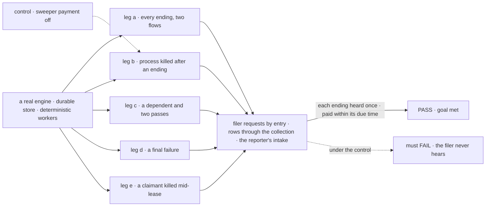
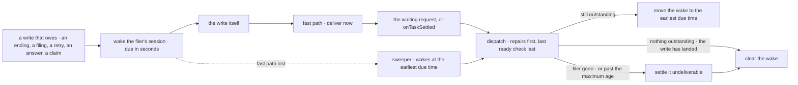

# FIX-2078 · Every ending reaches its filer once, and a board pays what it owes: due times, the sweeper, one dispatch at a time

**Spec** · [Decisions](DECISIONS.md)

**Blocked by:** [FIX-2080](https://linear.app/fixpoint-labs/issue/FIX-2080) (spec
[#3595](https://github.com/fixpoint-labs/flow-state-dev/pull/3595)). It records the cascade owed
with the ending and writes each cascaded cancel's cause, which D2 and leg d read; this issue's
wake pays that debt on time. A parent's settle runs FIX-2077's rule-6 check once FIX-2077 lands, today's split settle
until then; FIX-2077 keeps the replay on a touch, which this removes.

## Six people, before and after

| Someone who… | Today | After |
|---|---|---|
| **builds a flow on orchestration's board, without Workforce** | Never hears how a task it handed out ended | Gets one `onTaskSettled` request per ending |
| **cancels a delegated task from a screen** | Its filer never hears, unless a request waits on it | Its filer hears once ([D2](DECISIONS.md#d2)) |
| **runs Workforce on a host that restarts** | An ending or a ready row waits for someone to touch the board; in a quiet conversation, for good | Paid within seconds of its due time, by the sweeper if nothing else ([D1](DECISIONS.md#d1)). On a host whose sweeper is an external cron, by its next run |
| **has a task waiting on a dependency** | Starts on the next touch after the dependency ends | Starts within seconds |
| **runs Shift Manager with the Error Reporter** | A task's failure goes out on a marker of its own, resent on every touch | Goes out with the ending's one delivery; reports keep coming |
| **maintains a store adapter** | Nothing to add | Keeps one more record kind, the wake, or its hosts keep the fast paths only, and from FIX-2082 on refuse waits ([D1](DECISIONS.md#d1)) |

## The goal, and how we'll know it's met

**Every ending of a delegated task (done, failed or cancelled) reaches its filer exactly once, on
any flow that files tasks, and nothing a board owes waits on a later touch: each debt is paid
within seconds of its due time, after a crash too, by one dispatch at a time per session.** The
seconds hold on a host with a durable store that keeps wakes and an in-process sweeper; an
external-cron sweeper pays by its next run, and a store without wakes keeps the fast paths only.

| Is it the right goal? | |
|---|---|
| **The real need** | *"Nothing they filed goes quiet… work never waits on someone touching the board"* (the issue). The epic's [ER-3](../../epics/FIX-2056/DECISIONS.md#who-owns-what), owned here |
| **Smaller, and rejected** | "Move `onTaskSettled` to orchestration and deliver cancels." A crash still strands an ending until a touch, under FIX-2083's routed tasks too |
| **Bigger, and not this issue's** | Waits (FIX-2082). A person's stop (FIX-2058). `dispatch` by name and roles checked at hire (FIX-2084). An Error Reporter only a filer messages ([(f)](../../epics/FIX-2056/DECISIONS.md#f)) |
| **Not done if** | A cancel the filer didn't make goes unheard · a flow without Workforce gets no `onTaskSettled` · a waited ending also starts one · a report marker or an unconditional resend survives · a ready row waits for a touch · two passes run at once in a session · a debt waits for the 10-minute interval · a wake never clears · a report owed at upgrade is lost · a host wiring `errorCapture` loses task failure reports |



The check counts what the filer's session ran, from the request store. The dashed path is leg b
with the sweeper's new step off, and it must fail.

| How we verify | |
|---|---|
| **Goal check** | `goals/task-board/every-ending-reaches-its-filer/` · no model · run by the implementer · verdict in the implementation PR |
| **Signal** | a: a plain orchestration flow and a Workforce conversation each hear a done, a failed and a user-cancelled task once; a waited task resumes its waiter and starts no `onTaskSettled`. b: killed after an ending's write, before its send; after restart the filer hears, and a parent whose last filed task ended settles, within due time plus 2 s. c: a dependent starts within 5 s, with no read of the board; a second pass is rejected, and a row made ready during the first still starts. d: one failure notice with the error, naming the dependent it cancelled; one task occurrence at the intake; no report marker on any row. e: a claimant killed mid-claim; within its lease's end plus 2 s the row is reclaimed or settled, with no read of the board |
| **Input** | SQLite store, the sweeper in-process at its default interval. Other due times and task counts must pass too |
| **Anti-game** | No spies on sends and no stubbed sweeper: requests from the engine's store, rows through the collection, a real process kill |
| **Control that must fail** | `GOAL_CONTROL=no-sweeper-payment` must FAIL leg b on *the filer hears within due time*, and leg e. Today's `main` must also FAIL legs a, b and c |

## What changes


A wake is written before every write that owes something. Fast paths pay it in seconds; the
sweeper pays what they missed.

**A flow on orchestration's board, without Workforce, that hands rows to other sessions:**

```diff
+ import { taskSettledEntry, taskSettledInputSchema } from "@flow-state-dev/orchestration";
+
+ const onEnding = handler({
+   name: "on-ending",
+   inputSchema: taskSettledInputSchema,
+   execute: (ending) => decide(ending.taskId, ending.ending, ending.output, ending.error)
+ });
+
  defineFlow({
    kind: "planner",
    actions: { plan: { block: planTurn } },
+   internal: { actions: { onTaskSettled: taskSettledEntry({ block: onEnding }) } },
    resources: { ...board.resources }
  });
```

A Workforce worker flow writes nothing new: `defineSessionBoard().entries(turn)` builds on the
same factory. A board that hands rows out from a flow with no such entry is refused when the flow
is built.

**Docs:** update *Orchestration → Task board* (`onTaskSettled`, every ending; a ready row starts
on its own; one pass at a time; the `resumeOwedWaits` paragraph goes), *Workforce → Delegating
work*, *Workforce → Error Reporter* (a failure goes out with its ending), *Advanced → Durable
execution → Retention and cleanup* (the sweeper pays due wakes) and *Persistence → Store
adapters* (the wake record). Update the orchestration, workforce, engine, SQLite and Postgres
READMEs. Amend the internal concept, gaps and stories lines that [(f)](../../epics/FIX-2056/DECISIONS.md#f)
names, and the concept's rule 8 to "a pass or a touch resends what is past due". No new page.

## How a debt is paid



Every path ends in the session's one pass, which clears the wake only when nothing is
outstanding and the write it guards has had time to land. A pass that dies leaves the wake, and
the sweeper fires it again. A debt that can't be paid ends, so every wake clears.

## What stays as it is

- **The notice's dedupe** by task, attempt and ending, and the 32-notice cap per conversation.
- **What Workforce does with an ending:** a line under the delegate's name, or a woken judgment
  turn. Posts keep `onPostSettled` until FIX-2083; a question's park notice stays until FIX-2058.
- **The engine's `errorCapture`** for failed requests, and the reporter holding a task session's
  failures for the task's ending ([(f)](../../epics/FIX-2056/DECISIONS.md#f)).
- **The entry name `runTaskBoard`**, until FIX-2084 names it `dispatch`.

## What's already here, and the debt

| Already here | What this does with it |
|---|---|
| Orchestration's notice module: the owed marker in the ending's write, the dedupe key | **Builds on.** Every delegated row owes it, not only a ledger that opts in |
| Workforce's `onTaskSettled` entry and its delivery | **Moves** to orchestration; Workforce keeps its handling |
| The durability sweeper, re-armed from wait deadlines | **Extends.** The wake as a due-time source and one step. A wait deadline is one case of a wake; FIX-2082's waits use it, not a second path ([D1](DECISIONS.md#d1)) |
| Ways to run something later: wait deadlines, cron schedules, in-process timers, the stale-request sweeper | **The closest is the wait deadline.** None both survives a crash and fires until paid ([D1](DECISIONS.md#d1)) |
| Ways to hear an ending: the notice, a waiter's resume, a post's notice, the report marker, a waiting drain | **Five today, four after.** The marker folds into the notice; posts go in FIX-2083 |
| A board run on a filing, an assign, an answer, a retry; the `reject` concurrency policy | **Builds on.** An ending that makes a row ready runs it too; one pass per session |
| [FIX-1794](../FIX-1794/BUSINESS-RULES.md) BR-26a (a lost notice waits for a touch) and BR-29 (a cancel owes none) | **Superseded.** A due time backs the touch; a cancel the filer didn't make owes one ([D2](DECISIONS.md#d2)) |
| [FIX-1983 → Decided, not asked](../FIX-1983/DECISIONS.md#decided-not-asked): the report mark beside the notice | **Superseded.** The report rides the notice; its [D1](../FIX-1983/DECISIONS.md#d1), what counts, is kept |
| [FIX-1816](../FIX-1816/SPEC.md): a waiter resumed by a touch | **Amended.** The sweeper pays a resume no touch paid |

| The debt | |
|---|---|
| **Removes** | The report marker, its sends and its 5-minute resend · `resumeOwedWaits`, whose cancel-owed payment becomes a debt · the resend of every owed notice on every run · the post-drain repair pass (repairs now run before the drain) · a waiter's resume carried by an `onTaskSettled` request |
| **Adds** | The wake: a record kind in the built-in stores, optional for custom ones, and one sweeper step. Permanent by design: how a debt survives a crash. The server-written filer fields on a delegated row. The refusal of a board that hands rows out with no `onTaskSettled`. A one-off backfill of wakes at upgrade |
| **Leaves** | An error in background work doesn't fail the attempt (FIX-2088) · an Error Reporter only a filer messages (deferred by the owner) |

**Net: down at runtime, up in the store contract.** A marker, two resend loops and a
Workforce-only entry go; one record kind arrives that every built-in store keeps.

## Sign off

**[The goal](#the-goal-and-how-well-know-its-met), at that size:** every ending heard once, on any
flow, and every debt paid within its due time, after a crash too, on a host with an in-process
sweeper. If wrong: FIX-2083 and FIX-2084 build on endings that wait for a touch.

**[The debt](#whats-already-here-and-the-debt), net down at runtime:** the report marker and two
resend loops go; the wake arrives in the store contract. If wrong: a record kind every store
adapter keeps for nothing.

1. **[D1](DECISIONS.md#d1) · A debt's due time is a wake the engine keeps, one per session and
   entry, fired until a pass clears it, and the engine's one due-time source.** If wrong: store
   adapters add a record kind a scan could have spared them, and FIX-2082 builds its waits on it.
2. **[D2](DECISIONS.md#d2) · An ending the filer already knows of reaches it inside what told
   it.** If wrong: a filer misses a dependent's cancel it needed as its own notice.

**Open: none.** D1 is the one to weigh: it changes the store contract.

Improvement · `engine` + `orchestration` + `workforce` + the stores · large · epic [FIX-2056](../../epics/FIX-2056/SPEC.md)
