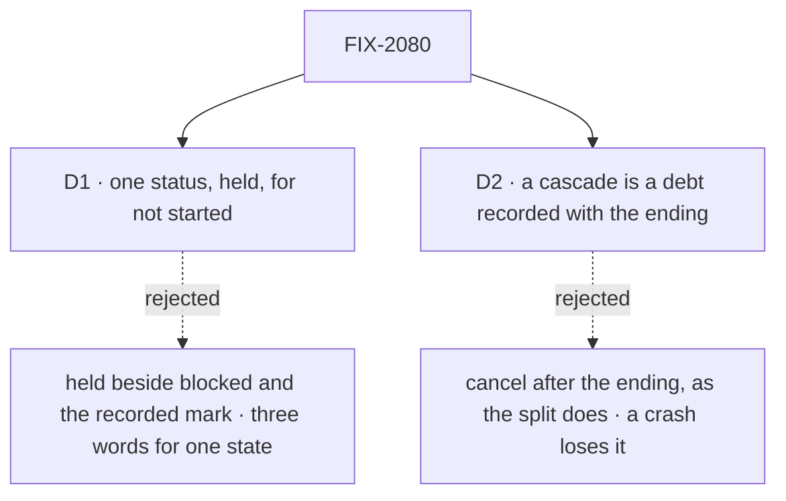

# FIX-2080 · Decisions

[Spec](SPEC.md) · **Decisions**

The concept fixed the four settings and both cascades (rules 4, 5, 6, 16); these two carry them
out.

## The tree

Solid edges are what you're signing. Dashed edges lost, and the label says why.

## D1 · One status, `held`, replaces `blocked` and recorded-not-started

| | |
|---|---|
| **Instead of** | Adding `held` beside `blocked` and the recorded-not-started mark, and leaving each to its own tool |
| **Because** | All three mean "filed, not started, until someone says go". `blocked` has no way out (`unblock` has no caller), and the recorded mark is released only by `dispatchTask`, which FIX-2081 removes. Three words for one state is the incoherence the concept retires; one status is what a screen and a filter can show |
| **Locks in** | The status `held`, the collection verbs `hold` and `release`, and change kinds `held` and `released`, all public. `blocked`, `block`, `unblock` and `blockTask` are removed outright ([(e)](../../epics/FIX-2056/DECISIONS.md#e)); the board's `counts.blocked` becomes `counts.held`. On a Workforce board, `addTask` files held and `dispatchTask { taskId }` releases, until FIX-2081. Rows of both old shapes in a store read as `held` through the map, entries turned on here |

It comes down to a screen of unstarted work: one word, or three that mean the same.

**What would change my mind:** a filer that must tell "held by me" from another not-started reason
it can act on. Held on questions is FIX-2058's, and the concept makes it pending, so it is not one.

## D2 · A cascade is a debt recorded with the ending, paid within seconds

| | |
|---|---|
| **Instead of** | Cancelling after the ending write, best effort, as the split's piece cancel does today |
| **Because** | A task's filed work sits on another board in another session, so no one write can end both. Recorded in the ending's own write (the ledger's ending recorder already lands debts that way), a crash between the two leaves the cascade owed, and rule 8 says every debt is paid |
| **Locks in** | One more debt kind: the gate pays it in-process when the task's own session failed or retried, a dispatch into that session pays a cancel from above, and every touch resends it; FIX-2078's sweeper pays it when due. A cascaded cancel records its cause, the task whose ending caused it, server-written, so FIX-2078 can name a failure's dependents in one notice. Dependents on the same board are cancelled right after the ending, with the claim pass as the backstop, so they need no debt |

It comes down to a crash between the two writes: owed, it is paid on restart; best effort, the work runs on.

**What would change my mind:** a task and the tasks it filed kept in one store write. Then the
cancel lands in the ending's write, and no debt is needed.

## Decided, not asked

- **The settings are fields of the task row, in orchestration.** `held` (start, beside `deps`),
  `session` (`"new"` default or `"ongoing"`; a follow-up stays `followUpOf`), `resultTo` (`"filer"`
  default or `"conversation"`) and `maxAttempts`. Top level and server-written, never in
  `metadata`, since they decide routing (BP-031); absent reads as the default (BP-030). FIX-2081
  names them on `createTask`. A board refuses at filing a value it can't honour, naming the
  setting: a plain board takes only the defaults; Workforce's takes `ongoing` and `conversation`
  only from a conversation, never from a task's session.
- **Editable until start, by one guard.** `held`, `deps` and `maxAttempts` may change while the row
  is pending or held; `session`, `resultTo` and `followUpOf` never change (ER-4). The guard is in the
  collection's patch, so FIX-2081's `updateTask` inherits it.
- **The convergence points** (tenet 5). *A dependency on this board:* the collection's add and
  patch, on both backings, so `addTask`, `addTasks`, seeded `initialTasks`, replans and the Workforce
  add all pass it; ids in the same batch count. A dependency already failed or cancelled is refused
  too. *One open task per session:* the Workforce board's one start test, read by every start path.
  Its key is the session the row runs in: the task's own, its root's for a follow-up, the delegate's
  ongoing one; a started, unfinished row holds it, plan rows never. *Cascades:* the ending detection
  every write goes through (`endingOf`), for `errored`, `cancelled` and `retried`, whoever wrote it:
  the gate, a cancel, a refused hand-over, an abandoned row's settle.
- **The cascade reaches every board Workforce keeps for the task's session**: its delegation board
  and FIX-2076's plan board. Those are the only boards a task's session files on in the repo.
- **Dependents keep the `skipped` label** a pattern's output reads, so plan-and-execute and
  supervisor outputs don't change when their step goes.
- **The map.** One function at the read boundary, beside the `parked` and `wait` migrations, with a
  switch per entry and one test per shape. Five entries: blocked to held and recorded to held,
  turned on here; a post to a routed task (FIX-2083), a parked split to running (FIX-2077) and a
  reopened row to pending (FIX-2086), built here, turned on by their owners. The epic's D3 named
  four: the recorded mark is the fifth, because D1 retires it here. FIX-2077's entry needs the hold
  field FIX-2077 adds, so it adds that field to this entry, in this map. Removed no earlier than
  FIX-2071.
- **A wait on a conversation-result task is refused on today's wait**, so T-32 holds now; it moves
  with the wait to `getTask` (FIX-2082).
- **No POC and no checker.** The premises are read from code (the gaps file's rows, re-read at
  `96404d25`), and no claim here rests on a count.

## Considered and dropped

| Option | Why it lost |
|---|---|
| Keep `createCascadeSkipDependents` and wire it on Workforce's board | Two routes to one job, and every new board would have to remember the step (tenet 3) |
| Settings in Workforce state only | A plain orchestration board would accept a session it can't honour, silently |
| Keep refusing a follow-up into a busy session | Rule 5 is the owner's: another stays pending |
| File a dependent of a dead dependency, then cancel it | A filing that ends at once tells the filer less than a refusal |
| Leave the recorded mark to FIX-2081 | Two not-started states for one more merge, and a sixth map shape later |

## Settled

None yet.

## How it got here

- **Draft** — framed as the epic's ER-4 and ER-6: the settings stored on the row, readiness that
  holds a busy session, two cascades refined from the pattern step and the split cancel, and the
  epic's one read map, with the recorded mark folded into `held`.

Open: none.
