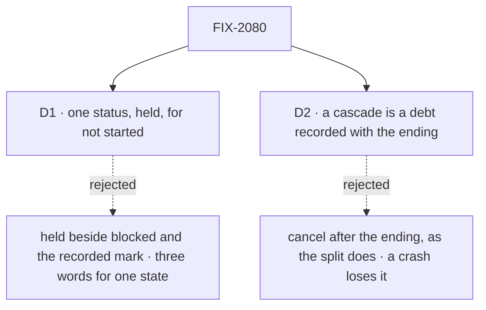

# FIX-2080 · Decisions

[Spec](SPEC.md) · **Decisions**

The concept fixed the four settings and both cascades (rules 4, 5, 6, 16); these two carry them
out.

## The tree

Solid edges are what you're signing. Dashed edges lost, and the label says why.

## D1 · One status, `held`, replaces `blocked` and recorded-not-started

| | |
|---|---|
| **Instead of** | Adding `held` beside `blocked` and the recorded-not-started mark, and leaving each to its own tool |
| **Because** | All three mean "filed, not started, until someone says go". `blocked` has no way out (`unblock` has no caller), and the recorded mark is released only by `dispatchTask`, which goes with FIX-2082 and FIX-2083. Three words for one state is the incoherence the concept retires; one status is what a screen and a filter can show |
| **Locks in** | The status `held`, the collection verbs `hold` and `release`, and change kinds `held` and `released`, all public. `hold` and `release` are the guarded patch's `held` write under named entry points, not a second write. Every release of a held row emits `released`, whoever releases it, and the `dispatched` change kind goes, with a migration line. `blocked`, `block`, `unblock` and `blockTask` are removed outright ([(e)](../../epics/FIX-2056/DECISIONS.md#e)); the board's `counts.blocked` becomes `counts.held`. A model holds and releases with `updateTask({ taskId, patch: { status } })`: this issue adds `status` to today's patch, and FIX-2081 flattens the call. On a Workforce board, `addTask` files held until FIX-2081 replaces it, and `dispatchTask { taskId }` releases until `dispatchTask` goes (FIX-2082, FIX-2083): `TaskCollectionRef.dispatch` becomes that release on a held row. Rows of both old shapes in a store read as `held` through the map, entries turned on here |

It comes down to a screen of unstarted work: one word, or three that mean the same.

**What would change my mind:** a filer that must tell "held by me" from another not-started reason
it can act on. Held on questions is FIX-2058's, and the concept makes it pending, so it is not one.

## D2 · A cascade is a debt recorded with the ending, paid within seconds

| | |
|---|---|
| **Instead of** | Cancelling after the ending write, best effort, as the split's piece cancel does today |
| **Because** | A task's filed work sits on another board in another session, and even a same-board dependent is a second row write, so no one write can end both. Recorded in the ending's own write (orchestration's ending recorder already lands the resume debt that way, on both backings), a crash between the two leaves the cascade owed, and rule 8 says every debt is paid |
| **Locks in** | One more debt kind, *a cascade owed*, covering both cascades: the task's open filed tasks and a failed or cancelled row's dependents. It is due at the write + 2 s, one of FIX-2078's debts, with a wake per half, as FIX-2078's debt table says: dependents are paid by the filer's pass under the wake the ending already writes, filed tasks by the task session's pass under a wake written there before the ending. It is paid at the step FIX-2078 names: for a failed or cancelled ending, the delivery writes same-board dependents' cancels before it composes the notice, and on repair an owed cascade is paid before an owed notice is resent. Until FIX-2078 lands, the ending's own pass pays it and a touch pays it once past due; after, it is paid by FIX-2078's rule for every debt. So this issue lands before FIX-2078. A cascaded cancel records its cause, the task whose ending caused it, server-written, so FIX-2078's notice for a failed or cancelled ending names the dependents it cancelled |

It comes down to a crash between the two writes: owed, it is paid once due; best effort, the work runs on.

**What would change my mind:** a task and the tasks it filed kept in one store write. Then the
cancel lands in the ending's write, and no debt is needed.

## Decided, not asked

- **The settings are fields of the task row, in orchestration.** `held` (start, beside `deps`),
  `session` (`"new"`, the default for a delegated task, or `"ongoing"`: the delegate's session for
  this conversation, or the session the filing resolved (FIX-2083); a plan row's unset session is
  FIX-2082's; a follow-up stays `followUpOf`, and one filed with a `session` is refused, naming the
  rule), `resultTo` (`"filer"` default or `"conversation"`) and `maxAttempts`. A conversation-result
  task has attempts 1: unset reads as 1, and any other value is refused at filing, naming the rule. Top level and server-written, never in
  `metadata`, since they decide routing (BP-031); absent reads as the default (BP-030). FIX-2081
  names them on `createTask`. A board refuses at filing a value it can't honour, naming the
  setting: a plain board takes only the defaults; Workforce's takes `ongoing` and `conversation`
  only from a conversation, never from a task's session.
- **Editable until start, by one guard.** `held`, `deps` and `maxAttempts` may change while the row
  has never started; a retry's return to pending does not reopen them. `session`, `resultTo` and
  `followUpOf` never change (ER-4). The guard is in a new collection patch, the first that edits
  `deps`, so FIX-2081's `updateTask` inherits it. This guard evaluates whether the row has ever
  started; FIX-2081's field table lists which fields need it.
- **The convergence points** (tenet 5). *A dependency on this board:* the collection's add and
  patch, on both backings, so `addTask`, `addTasks`, seeded `initialTasks`, replans and the Workforce
  add all pass it; ids in the same batch count. A dependency already failed or cancelled is refused
  too, and so is one that closes a loop, within a batch or through a patch. *One open task per session:* the Workforce board's one start test, read by every start path.
  Its key is the session the row runs in: the task's own, its root's for a follow-up, the delegate's
  ongoing one, or the session the filing resolved (FIX-2083); a started, unfinished row holds it, plan rows never. *Cascades:* the ending detection
  every write goes through (`endingOf`), for `errored`, `cancelled` and `retried`, whoever wrote it:
  the gate, a cancel, a refused hand-over, an abandoned row's settle. A lapsed lease's reclaim
  writes no ending and cascades nothing: the re-run in the same session adopts its filed work.
- **The cascade reaches every board Workforce keeps for the task's session**: its delegation board
  and FIX-2076's plan board. Those are the only boards a task's session files on in the repo.
  Whichever of FIX-2076 and FIX-2080 lands second wires the plan board in.
- **`held` means before a start, and nothing after.** FIX-2077's field naming what keeps a
  running task open is not a form of "hold": FIX-2077 names it `waitingOn`, and the
  parked-split entry below uses that name.
- **One owner for the split's cascade.** This issue builds the general cascade; FIX-2077 deletes
  the split's own piece cancel along with the park it keys on.
- **Dependents keep the `skipped` label** a pattern's output reads, so plan-and-execute and
  supervisor outputs don't change when their step goes.
- **The map.** One function at the read boundary, beside the `parked` and `wait` migrations, with a
  switch per entry and one test per shape. Six entries: blocked to held and recorded to held,
  turned on here; a post to a routed task, carrying a workstream post's session (FIX-2083); a parked
  split to running, with `waitingOn` set (FIX-2077); a reopened row to pending, to which FIX-2086
  adds its steers; and a row parked for a turn to pending, uncharged (FIX-2086); built here, turned
  on by their owners. The epic's D3 named four; this PR amends it to six: the recorded mark is the
  fifth, because D1 retires it here, so FIX-2080 owns that entry and FIX-2081 adds none; the row
  parked for a turn is the sixth, so FIX-2086 builds no entry of its own. FIX-2077's entry needs the running-row field
  FIX-2077 adds, so it adds that field to this entry, in this map. Removed no earlier than FIX-2071.
- **A wait on a conversation-result task is refused on today's wait**, so T-32 holds now; it moves
  with the wait to `getTask` (FIX-2082).
- **No POC and no checker.** The premises are read from code (the gaps file's rows, re-read at
  `96404d25`), and no claim here rests on a count.

## Considered and dropped

| Option | Why it lost |
|---|---|
| Keep `createCascadeSkipDependents` and wire it on Workforce's board | Two routes to one job, and every new board would have to remember the step (tenet 3) |
| Settings in Workforce state only | A plain orchestration board would accept a session it can't honour, silently |
| Keep refusing a follow-up into a busy session | Rule 5 is the owner's: another stays pending |
| File a dependent of a dead dependency, then cancel it | A filing that ends at once tells the filer less than a refusal |
| Leave the recorded mark to FIX-2081 | Two not-started states for one more merge, and one more map shape later |
| A filed task cancels itself when it finds its filer ended (a pull, no debt) | A running child that never touches its board is not reached, and every claim reads another board's row. The debt rides FIX-2078's wake instead |
| Build only the two map entries turned on here | The epic's D3 has this issue build every entry, so no child writes its own read |

## Settled

None yet.

## How it got here

- **Draft** — framed as the epic's ER-4 and ER-6: the settings stored on the row, readiness that
  holds a busy session, two cascades refined from the pattern step and the split cancel, and the
  epic's one read map, with the recorded mark folded into `held`.
- **Round 1** — D2's payment moved onto FIX-2078's wake: one cascade debt, same-board dependents
  included, due at the write + 2 s, paid by a touch only until the wake lands, so FIX-2078 now
  waits on this issue. Edits are refused once a row has started, and so are dependency loops.
- **Cross-spec audit** — D2 names a wake per half and FIX-2078's delivery step; the map has six
  entries; a conversation-result task has attempts 1; `hold`, `release` and the interim
  `updateTask` status write are named, and the `dispatched` change kind goes.

## Notes from review

- Cursor: "convergence must not full-scan the board on every ending" … "cascade work should be **O(direct dependents / filed children)** where possible (index at filing, or one batch pass keyed by ending id), not a full-board scan per failure" ([thread](https://github.com/fixpoint-labs/flow-state-dev/pull/3595#discussion_r4332793395)).
- Cursor: "Session 'one open task' already uses `list().find` for busy detection; rule 5 queues more rows per session." … "reverse-dep index, batch cascade pass, cap `maxAttempts` on Workforce" ([review](https://github.com/fixpoint-labs/flow-state-dev/pull/3595#pullrequestreview-5594683719)).
- Cursor: "a single fold sentence that ER-6 cascades are **in scope here** (not FIX-2081) would help PMs size the implementation PR" ([thread](https://github.com/fixpoint-labs/flow-state-dev/pull/3595#discussion_r4332793392)).
- Second look: "`resultTo` lands with no behaviour except refusals … Consider landing `resultTo` with the work that reads it. ER-4 lists the four settings as one set" ([comment](https://github.com/fixpoint-labs/flow-state-dev/pull/3595#issuecomment-6307421456)).
- Second look: "The spec says Workforce's delegation board and FIX-2076's plan board are the only boards a task's session files on. I did not verify that against the code. … the implementer should confirm it first."
- FSD Architect, fix 8: "Cite: `endingOf` (`orchestration/src/tasks/collection/ending.ts:69-89`); the recorder seam (`internal.ts:1184-1188`); Workforce's start test `isStartable` (`workforce/src/conversation-board/board.ts:216`), where one open task per session lands; the busy refusal (`task-tools-capability.ts:554-607`); the recorded mark's write and release (`internal.ts:268-279`, `:867`; `TaskCollectionRef.dispatch`, `types.ts:866`); the step being removed (`cascade-skip-dependents.ts:43`)" ([comment](https://github.com/fixpoint-labs/flow-state-dev/pull/3595#issuecomment-6307497797)).
- FSD Architect, fix 6: "No collection method edits `deps` today (`collection/types.ts:582-845`). … confirm seeding goes through `addTasks` (`createSeedCollection`, `blocks/seed-collection.ts:36`)."

Open: none.
