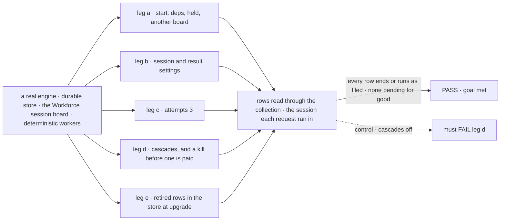
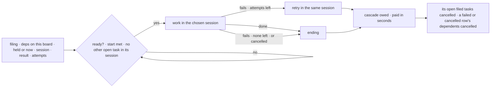

# FIX-2080 · A task's filing settings and lifecycle: start, session, result and attempts; order and cascade

**Spec** · [Decisions](DECISIONS.md)

## Six people, before and after

| Someone who… | Today | After |
|---|---|---|
| **files a follow-up to a worker that is still busy** | Is refused, and has to try again later | The follow-up waits, then starts in that session when the open task ends |
| **files a task that must wait until they say go** | Moves it to *blocked*, and nothing ever unblocks it | Files it *held*; it starts when they release it, and not before |
| **names a dependency on another board** | The task stays pending for good | The filing is refused, naming the rule: cross boards with a wait or a held task |
| **has a dependency fail or get cancelled** | The dependent waits for good, unless a pattern wired a cleanup step | The dependent is cancelled, and so are its own dependents |
| **cancels, retries or fails a task that filed work** | The filed work keeps running, unless the task was a split | Every open task it filed is cancelled within seconds, after a restart too ([D2](DECISIONS.md#d2)) |
| **wants a flaky task tried more often** | Gets 2 tries; a post gets 1 | Sets the attempts at filing; the default stays 2 |

## The goal, and how we'll know it's met

**A delegated task runs where, when and how often its filer chose at filing, and nothing waits on
work that will never finish: no row stays pending for good, no filed task outlives the task that
filed it, and no busy session refuses a task.**

| Is it the right goal? | |
|---|---|
| **The real need** | *"Work runs in the order it needs, and nothing waits on work that will never finish"* (the issue). The epic's [ER-4](../../epics/FIX-2056/DECISIONS.md#who-owns-what) and [ER-6](../../epics/FIX-2056/DECISIONS.md#who-owns-what), owned here |
| **Smaller, and rejected** | "Add the four settings." Settings alone leave a dependent of a failed task, and a filed task under a cancelled one, waiting or running for good, and FIX-2083's routed tasks need both cascades |
| **Bigger, and not this issue's** | The settings on `createTask` and `updateTask` (FIX-2081). Delivering a result to the conversation (FIX-2078, used by FIX-2083). A task held on questions (FIX-2058). Due times and the sweeper (FIX-2078) |
| **Not done if** | A row with a dead or foreign dependency stays pending · a filed task survives its parent's cancel, retry or failure, a restart included · `blocked` or the recorded mark is still written · a retired row is dropped or misread · a cascade needs a step a board wires |



The check reads stored rows and which session each request ran in, not the board's calls. The
dashed path is the same run with both cascades switched off, and it must fail.

| How we verify | |
|---|---|
| **Goal check** | `goals/task-board/runs-by-its-filing-settings/` · no model · run by the implementer at completion · verdict in the implementation PR |
| **Signal** | a: a dependent starts after its dependency ends; a held task starts only on release; a dependency on another board is refused, filing nothing. b: a follow-up filed while its task runs waits, then runs in that task's session; an ongoing task runs in the delegate's session for this conversation; from a task's session both conversation settings are refused, as is a wait on a conversation-result task. c: attempts 3 fails after the third failure, each retry in the same session. d: a cancel, a retry and a final failure each cancel the open filed task; a failed and a cancelled dependency each cancel a two-deep chain; killed between a cancel and its cascade, the child is cancelled on the next touch. e: a seeded blocked row and recorded row read as held and start on release; the other entries read as today |
| **Input** | Deterministic workers. Another chain depth, attempt count or kill point must pass too |
| **Anti-game** | No assertions on cascade calls or a stubbed collection: stored rows, and session ids from the request records |
| **Control that must fail** | `GOAL_CONTROL=no-cascade` must FAIL leg d on *the open filed task is cancelled* and *the dependent chain is cancelled*. Today's `main` must also FAIL leg a on *refused and files nothing* and leg b on *the follow-up stays unstarted* |

## What changes


The four settings become fields of the task, chosen at filing; two cascades run on every board.

**A flow that files and orders tasks through the collection:**

```diff
  await tasks.addTask({
    goal: "Chart it",
-   deps: ["pull-csv"],            // an id from another board waited for good
+   deps: ["pull-csv"],            // on this board, or the add is refused
+   held: true,                    // starts when released
    maxAttempts: 3,                // the attempts setting; Workforce defaults it to 2
+   session: "ongoing",            // Workforce: the delegate's session for this conversation
+   resultTo: "conversation",      // Workforce: from a conversation only
  })
- await tasks.block(id, "waiting on legal")
- await tasks.unblock(id)
+ await tasks.hold(id)             // before it starts
+ await tasks.release(id)
  const plan = sequencer({ name })
    .then(board.drain)
-   .tap(createCascadeSkipDependents({ name }))   // every board cancels dependents now
```

A model's `blockTask` goes; `updateTask({ status: "held" | "pending" })` holds and releases until
FIX-2081 rewrites the tool list. The other settings reach models with FIX-2081's `createTask`.

**Docs:** update *Orchestration → Task substrate* (`held`, dependencies, cascades), *Orchestration →
Task board* (the built-in cascade replaces *Cascade-skipping dep-blocked tasks*), *Workforce →
Delegating work* (the settings, one task per session), *Patterns → Supervisor* and *Plan and
execute* (no cascade step), and the orchestration, workforce and patterns READMEs. No new page;
FIX-2081 publishes the shared story.

## How a filed task runs



Each ending records what it owes in the same write, so a crash leaves the cascade owed, not lost.

## What stays as it is

- **Patterns.** Plan boards as they stand; a dependent of a failed step still ends `cancelled` with
  the `skipped` label their outputs read.
- **Who settles a row.** The claim gate and the drain (ER-1); a cascade's cancel is a cancel, the
  same write a user's is.
- **Splits, posts, reopen and `dispatchTask`.** Their children retire them and turn on their map
  entries; this issue only builds those entries.
- **How a retry re-enters its session**, and the attempts' default of 2 on Workforce boards. A plain
  collection's unset `maxAttempts` still means one try.

## What's already here, and the debt

| Already here | What this does with it |
|---|---|
| The job, *end what depends on a dead task*: `createCascadeSkipDependents`, a step two patterns tap after a drain, for `errored` only; the split's piece cancel, the only parent cascade. Closest for each half | **Refines.** The first moves into the collection's ending, for failed and cancelled; the second becomes every task's cascade. The step goes |
| `maxAttempts` on every row: 2 on Workforce boards, 1 for posts | **Builds on.** It is the attempts setting |
| `followUpOf`, the earlier task's session, refused while its session is busy | **Builds on.** The refusal becomes a wait (rule 5) |
| `blocked`, and the recorded-not-started mark `dispatchTask` releases | **Replaced** by one status, `held` ([D1](DECISIONS.md#d1)) |
| The read-boundary migrations for `parked` and `wait` (BP-030) | **Built beside.** The retired-shape map sits at the same boundary |
| The epic's [D3](../../epics/FIX-2056/DECISIONS.md#d3), [ER-4, ER-6](../../epics/FIX-2056/DECISIONS.md#who-owns-what) | **Kept**, with a fifth map entry ([decided](DECISIONS.md#decided-not-asked)) |

| The debt | |
|---|---|
| **Removes** | `blocked`, `block`, `unblock`, `blockTask` · the recorded-not-started mark · `createCascadeSkipDependents` · the busy-session refusal · the split-only cancel cascade · a dependency id that never resolves |
| **Adds** | `held`, `hold` and `release` · the `session` and `resultTo` fields · a cascade debt on the ending · the retired-shape map, removed no earlier than FIX-2071 |
| **Leaves** | A cascade owed after a crash is paid on the next touch until FIX-2078's sweeper pays it on time · the refusal of a wait on a conversation-result task lives on today's wait, and moves with it to `getTask` (FIX-2082) |

**Net: down.** A status, a mark, a cascade step and a refusal go; one status replaces two, and two
fields arrive. The map is debt by design, with a removal date.

## Sign off

**[The goal](#the-goal-and-how-well-know-its-met), at that size:** every task runs as filed, and
nothing waits or runs for good. If wrong: FIX-2083's routed tasks orphan their work.

**[The debt](#whats-already-here-and-the-debt), net down:** two not-started states become one,
and one cascade replaces two partial ones. If wrong: two fields only Workforce reads.

1. **[D1](DECISIONS.md#d1) · One status, `held`, replaces `blocked` and recorded-not-started.**
   If wrong: apps outside the repo reading `blocked` rewrite at upgrade for nothing.
2. **[D2](DECISIONS.md#d2) · A cascade is a debt recorded with the ending, paid within seconds.**
   If wrong: for a few seconds a cancelled task's filed work still spends.

**Open: none.** Number 1 is the one to weigh: it changes a status screens show.

Feature · `orchestration` + `workforce` + `patterns` · large · epic [FIX-2056](../../epics/FIX-2056/SPEC.md)
