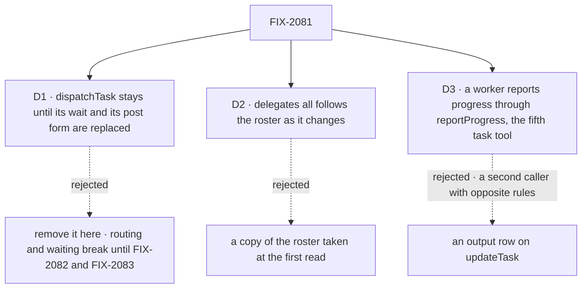

# FIX-2081 · Decisions

[Spec](SPEC.md) · **Decisions**

The owner decided the tools, the field rule and delegates as authority in the concept
([rules 3, 13, 20](../../../docs/internal/design/workforce-coordination-concept.md#the-rules)).
D1 and D2 carry it out where the concept and the epic's order meet the code.

## The tree

Solid edges are what you're signing. Dashed edges lost, and the label says why.

## D1 · `dispatchTask` stays until its wait and its post form are replaced

| | |
|---|---|
| **Instead of** | Removing it here, as the epic's [migration lines](../../epics/FIX-2056/migration.md) assign it |
| **Because** | It does two jobs nothing else does yet: its `wait` is how a request waits on a task (`getTask`'s wait is FIX-2082's), and `post: true` is how a judgment coordinator hands a message on (routed tasks are FIX-2083's). This issue blocks both. Removed here, any release in between ships coordinators that can't route and workers that can't wait; the epic counts a regressed coordinator goal as *not done* |
| **Locks in** | FIX-2082 removes the wait form, FIX-2083 the post form, and the later one the tool and its action, its changeset carrying the tool's migration line (amended in this PR). Meanwhile `dispatchTask({ goal })` duplicates `createTask`, `{ taskId }` releases a held task, and `{ taskId, assignee }` obeys the field table; the goal check's leg b covers both. Amended with it, in this PR: the epic's [(e)](../../epics/FIX-2056/DECISIONS.md#e) allows `dispatchTask` until then, #3102's PR-2 rides its wait until FIX-2082, and FIX-2087's tool sweep names it. At the closure, still no task tool but the five, `answerTask` and `parkOnQuestion` (until FIX-2058) |

![D1: when dispatchTask goes. Keep it until its wait and post form are replaced, chosen, beside removing it here. Decides it: a release between this issue and FIX-2082 and FIX-2083. Kept, coordinators still route and workers still wait; removed, both break. The price: a second way to file and start a task for one to two issues. A tie: the closure still allows no task tool beyond the five but answerTask. Locks in: the later of FIX-2082 and FIX-2083 removes it. Flips if both land in the same release as this one](figures/d1-dispatch-task-stays.svg)

It comes down to a release in between: removed here, coordinators can't route and workers can't wait.

**What would change my mind:** FIX-2082 and FIX-2083 landing in the same release as this issue.
Then the tool goes here, and each of them builds on its absence.

## D2 · `delegates: all` follows the roster as it changes

| | |
|---|---|
| **Instead of** | Copying the roster into the session's list at its first read, as a listed `delegates:` is copied |
| **Because** | `all` means *the whole roster* ([concept](../../../docs/internal/design/workforce-coordination-concept.md#chain-of-command)). A copy goes stale at the first hire: the new worker is unreachable by a worker told to reach everyone, and a fired one stays listed. Read per call, it is the roster hiring already keeps, each worker passing the delegate check as now |
| **Locks in** | An `all` worker reaches every worker its user hires, at once, itself included (as a plan row, for a filing its own request makes). Removing one turns the list into the roster as it stands minus that worker, no longer following. The 25-delegate cap bounds a written list, not `all`; the chain limits are what bound a loop through it. Only the user's worker file sets `all`: an `editsOwnDelegates` coordinator's tools edit a written list and can't switch it to `all`, which would widen its own reach (C-02) |

It comes down to a worker hired mid-conversation: a copy of the roster never reaches it.

**What would change my mind:** users reading `all` as *everyone I had when I set it*. Then `all`
is copied at first read, like a listed `delegates:`.

## D3 · A worker reports progress through `reportProgress`, the fifth task tool

| | |
|---|---|
| **Instead of** | An `output` row on `updateTask` the assignee writes while its task runs, as [first settled](https://github.com/fixpoint-labs/flow-state-dev/pull/3593#issuecomment-6315204382); or the answering turn's last reply as the only way a task gets its output |
| **Because** | The owner decided it ([decision](https://github.com/fixpoint-labs/flow-state-dev/pull/3593#issuecomment-6315764765)). `updateTask` is the filer's tool: only the filer, or the user from a screen, calls it, and its fields change only before a start. A worker writing `output` while the task runs is a second caller with opposite rules on one tool, the overload the four tools removed. Done still follows the return (rule 6), and a worker still never settles its own row (rule 18) |
| **Locks in** | `reportProgress({ statusNote?, output? })`. **Where:** offered only on a task turn; it acts on the row whose claim the turn holds (FIX-1047): an inline plan step's own row or a dispatched plan row, never the parent, whose checkpoint comes only from turns holding its claim. So it takes no `id`. Refused once the task has finished. **Who sets what:** while the task is started and not finished, any request holding its claim may set both `statusNote` and `output`, a queued `receive` included; only the assignee writes, through its claim on its own running task ([owner sign-off](https://github.com/fixpoint-labs/flow-state-dev/pull/3596#issuecomment-6317555200)). **Fields:** `statusNote` is a one-line progress note for task views; `output` is a checkpoint of the result so far. **Never status:** neither field changes the task's status. Done stays rule 6, and a worker never settles its own row (rule 18); the name is `statusNote`, not `status`, so no one reads it as a way to complete a task ([owner](https://github.com/fixpoint-labs/flow-state-dev/pull/3596#issuecomment-6315808568)). **The checkpoint rule:** the latest `output` checkpoint is the task's output. The worker's final result becomes the output only when `reportProgress` was never called with an `output`, so a final answer never replaces a checkpoint. A failed attempt or a lease reclaim keeps the checkpoint for the next attempt, and a finished task's output never changes (rule 20). **Waiters:** `getTask({ wait: true })` and ER-2 still wake only on done; `getTask` shows the latest checkpoint as progress, cut to the read limit; `listTasks` rows show `statusNote` only (BP-042). **Counts:** five task tools (the filer's four and this) and seven model tools. **Later:** `percent`. **Held:** `followUps`; found work still goes to the filer as a message. `updateTask` keeps one caller and its rules; FIX-2076's D2 and FIX-2077's output line point here |

**What would change my mind:** a worker needing a report to also mean done. Then it is a settle
tool again, which rule 18 rules out.

## Decided, not asked

- **One point decides who a task can reach:** the board's roster check, per call. Every assignee
  writer passes it, tool or action: `createTask`, `updateTask({ assignee })`, `dispatchTask`, a
  task session's pieces, the hand-over's re-check. Only its source changes: the delegates, or the
  roster under `all`. Posts keep their own check until FIX-2083. A plan row (the worker itself,
  FIX-2076) needs no delegate, and only a filing the worker's own request makes is one: a request
  the gate admitted for its task, or its own conversation turn. A claimless filing (a screen's
  action, a schedule's fire) naming the session's own worker is refused, naming the rule: a
  worker's own steps are filed by its own request.
- **One point decides each field's rule:** one table in `orchestration`, read inside the
  collection's guarded patch, the one FIX-2080 adds for `held`, `deps` and `maxAttempts`. It checks
  the row inside the write, as `setAssignee` declines today
  ([`resource-backed.ts:988`](https://github.com/fixpoint-labs/flow-state-dev/blob/96404d2519cd7848940de2857841b67adaf87646/packages/orchestration/src/tasks/collection/resource-backed.ts#L988),
  [`state-backed.ts:834`](https://github.com/fixpoint-labs/flow-state-dev/blob/96404d2519cd7848940de2857841b67adaf87646/packages/orchestration/src/tasks/collection/state-backed.ts#L834)). The `updateTask` block the tool and
  the action share maps the input and names the refusal. A task that starts in between is
  refused, not edited. *Before it starts* means never started: no attempt ever claimed, so a row
  pending again after a retry stays locked, as FIX-2080 and ER-4 say. FIX-2080's guard evaluates
  *started*; this table says which fields need it. The per-field setters stay unguarded. The table also carries FIX-2080's
  `held`, `deps` and `maxAttempts` rows, so once this lands FIX-2080's guard reads its until-start
  check from it rather than keeping its own beside it: one rule source inside the one patch.
- **The field table is the concept's,** with four notes where it is silent. *An inline plan row:*
  edits before it starts; a hold is refused, naming FIX-2076's rule (file it for a delegate,
  held); a cancel ends the row, the drain's late record of it is dropped
  and the parent carries on; `message` follows FIX-2086. *An assignee change that crosses the
  worker itself* (a plan row to a delegate, or a delegated row to the worker) is refused, naming the
  move: a step for itself and a task for a delegate are filed apart, so cancel and file again; a
  change between delegates stands. *The `held` row, on a plan row:* refused in every state, naming FIX-2076's rule, since the drain
  doesn't wait on a held row. *`maxAttempts` on a task whose result goes to the conversation*
  is refused in every state, naming FIX-2080's rule (one attempt). `message` is FIX-2086's row. A cancel sent with
  anything else is refused. A refusal names field, state and next move: steer (FIX-2086), cancel
  and refile, or a follow-up.
- **A started task can't be reassigned,** closing FIX-1659 with neither of its options. The
  concept made the call (story T-24).
- **Inputs are flat and use `id`,** as the concept writes them; `labels` replaces the list, and
  `addLabel`/`removeLabel` go. Two writers editing a pending task's labels: the last write wins,
  as with `priority`, and only until the task starts. Callers of `updateTask_tasks` rewrite at upgrade (epic
  [(e)](../../epics/FIX-2056/DECISIONS.md#e)).
- **`createTask` takes the same fields and FIX-2080's four settings,** under FIX-2080's names.
  Start and attempts follow the table; session and result never change (ER-4). It starts as its
  start setting says, so nothing filed waits for a dispatch. FIX-2083 adds `target` to
  `createTask` after this lands.
- **A row `addTask` recorded reads as held,** through FIX-2080's map entry (its D1). Nothing is
  added here.
- **Reads reach down the filer's own tree:** its boards, and `listTasks({ filedBy })` for the
  tasks its task filed (FIX-2077), through `listTasks({ filedByTask })`, read from a filing-task
  link this issue stamps on the row at filing. `filedBy` keeps its shipped meaning, the user who
  filed (`TaskTargetQuery.filedBy`). Any of the user's tasks by id is FIX-2070's.
- **`managesOwnDelegates`,** a coordinator setting, default `false`, gates `addDelegate`,
  `removeDelegate` and `setFallback`; every worker with a board gets `listDelegates`. It exists
  for Shift Manager's Shift Coordinator, which hires and adds its own delegates.
  2026-10-22: the owner renamed it `editsOwnDelegates`, so it can't be read as "can use its
  delegates".
- **A screen acts as the user:** the tools' own blocks, claimless, in a session the engine refuses
  to another user. Identity is the host's principal (BP-031).
- **`listTasks` rows carry `statusNote`, not `output`.** A list of uncut checkpoints is an
  unbounded payload (BP-042), and `listTasks` returns no results today; `getTask` shows one
  checkpoint, cut as `readTask` cuts output.
- **The checkpoint rule ships with the tool.** This issue's implementation PR changes the recorder
  the gate and the inline drain share (`task-board/blocks/record-result.ts`) so a final result never
  replaces a checkpoint. FIX-2077 builds on it, and is blocked by this issue.
- **No POC and no checker.** Every premise is read from code and cited; nothing rests on a count.

## Considered and dropped

| Option | Why it lost |
|---|---|
| Strip `dispatchTask` to its wait and post forms now | Two shapes of one tool in two releases, for a tool leaving within the epic |
| Move its wait onto `getTask` here | FIX-2082's mechanism: a wait is marked when the row is filed, so waiting on an earlier task is new work |
| Keep `patch: { … }` and `taskId` | A second spelling beside `getTask({ id })` |
| Revoke the running worker's claim on a reassign (FIX-1659 A) | Two accountable workers across the swap |
| Keep delegate tools on every coordinator | Rule 13: a worker widens its own reach (C-02) |

## Settled

- **Every tool and action reads one roster, per call.** Read from `board.ts` (`reach` at `:280-296`,
  `roster` at `:299-302`, the actions at `:735`) and the hand-over's re-check (`:347-362`). The
  premise that one source change covers every writer held.

## Notes from review

Recorded for the implementer, not folded into the design.

- **Second look, #5 (scope):** "Two separable changes share one PR. (a) Tool collapse + field rules + screen actions; (b) delegates-as-authority (`all`, `managesOwnDelegates`, task-session reach removal, filer filter). They share exactly one thing, the roster check. (b) is the smaller, security-flavoured change that closes C-02 and could ship first and independently of the tool rename churn. ... the implementer should consider two PRs under `issue-multi-pr`."
- **Second look, refactor:** "Collapse `reach()` to one source. ... With the task-session roster reach removed, `taskSession` and the `reachable`/`delegates` split become dead. Delete them in this change rather than leaving a vestigial flag ... Guard: the `all` branch must be read per call (D2), so no memoisation in that function." And: "Keep the shared `updateTask` block as the single deep module ... resist a separate 'action adapter' that re-validates. Test at the block's interface."
- **Cursor, implementation risks:** "D2 at scale: live roster per assignee write is correct; memoize reach within one invocation (not across calls)." "D1 window: thin shims on existing handlers/`TaskToolsOptions`, not a fifth subsystem." "Flat `labels`: ... docs can say 'send full `labels` when known from list/get.'"
- **Cursor, document weight (SPEC Signal, Docs line, sign-off, the edit-check figure, this file's restatements and line cites, D1's interim shapes):** "mostly document weight, not API shape ... will drift on implementation unless trimmed." Kept at this size for the gate; the implementer plans tests and the docs sweep from the code, not from these lines.
- **Cursor:** "One row for 'one action + opaque patch' (lost: named refusals / ER-5 parity) so readers don't re-litigate."

## How it got here

- **Draft** — framed as the epic's ER-5: four task tools, one table of field rules behind one
  guarded write, and the delegate list as the board's one roster. `dispatchTask` stays until
  FIX-2082 and FIX-2083 replace its two jobs.
- **Round 1** — the until-start rule moved into the collection's guarded patch FIX-2080 adds; the
  recorded row's map entry left to FIX-2080; D1's three epic lines amended; migration rows added.
- **Round 2** — the field table carries FIX-2080's rows too, so the patch has one rule source; a
  cancel records its ending through `endingOf`, with no write path of its own.
- **Cross-spec** — the owner's checkpoint, first as an `output` row on `updateTask`, then, on the
  owner's revision, as the worker's own `reportProgress` ([D3](#d3)); FIX-2076 and FIX-2077 point
  at it, and FIX-2086's caller line is back to the filer and the user.
- **Owner sign-off** ([comment](https://github.com/fixpoint-labs/flow-state-dev/pull/3596#issuecomment-6317555200)) — D1 accepted: `dispatchTask` stays until FIX-2082 and
  FIX-2083 replace it, amending the epic's call (e). D2 accepted: `delegates: all` follows the
  roster as it changes. D3 accepted, with two rules changed: (a) the latest `output` checkpoint is
  the output, and the final answer is only when none was made; (b) any request holding the claim
  may checkpoint `output`. FIX-2077's output line and its goal check's
  leg c are amended to match in this PR. (A queued `receive` was named here too; FIX-2103 removed
  it, since a message holds no claim.)
- **Cross-spec audit** — the set's coherence audit aligned this spec with its siblings: the row
  `reportProgress` acts on, list rows without output, *before it starts* as never started, four
  field-table notes (inline plan rows, a plan row's hold, a cross-ledger reassign, a conversation
  result's attempts),
  a claimless self-filing refused, `filedByTask`, the self-step grant in `reach()`, the cancel's
  notice marker, the goals it rewrites, and FIX-2077's output line carried through the rest of its
  spec. FIX-2076 now lands before this issue, and this before FIX-2077. No change to D1-D3.
- **Amendment, after merge** — FIX-2103 (owner's decision, Oct 22): a task settles when its turn ends, and a message to its session is conversation, not part of it, holding no claim, so it can't call `reportProgress`. The two field-table
  rows and the sign-off line drop "a queued `receive` included". No change to D1-D3.

Open: none.
