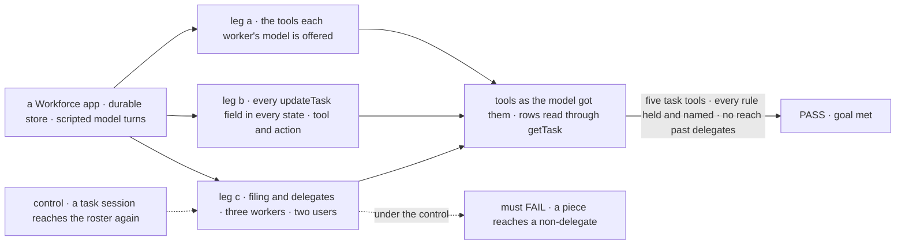
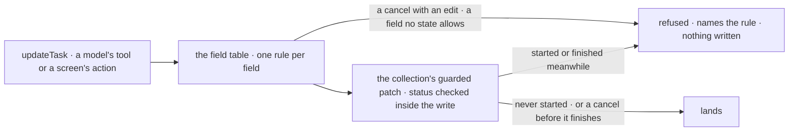

# FIX-2081 · Five task tools with one rule per field, as public actions, and delegates as authority

**Spec** · [Decisions](DECISIONS.md)

## Six people, before and after

| Someone who… | Today | After |
|---|---|---|
| **builds a worker that hands out work** | Eleven task tools: three of them reassign, two settle a task by hand | Five: the filer's `createTask`, `getTask`, `listTasks`, `updateTask`, and the worker's `reportProgress` ([D3](DECISIONS.md#d3)). A task ends when its worker returns or throws |
| **edits a task after filing it** | Only priority, metadata, assignee and a label change, and they land in any state, a finished task included | Every field changes until the task first starts, and a retry doesn't reopen it. After that, only a cancel. A finished task refuses everything, and each refusal names its rule |
| **reassigns a task a worker is running** | It lands, and the old worker's result still counts (FIX-1659) | Refused: cancel it and file it again. A running task keeps one accountable worker |
| **is a user deciding who gives work to whom** | A worker running a task hands pieces to anyone on the roster, and any worker with the delegate tools changes its own list | Tasks go only to the filer's delegates, or to anyone with `delegates: all`. Only the user changes a list, unless a coordinator was set at hire to change its own |
| **runs a screen: the DevTool, an app** | Eleven `<tool>_tasks` actions, two that settle a task by hand | The same four, called as the signed-in user: cancel, hold, release or edit a task |
| **maintains the framework** | Three ways to reassign, two to settle by hand, edits with no state rule | One write per field, its rule checked inside the write |

## The goal, and how we'll know it's met

**A worker or a screen changes a task through five task tools; every field of `updateTask`
follows one rule, which a refusal names; and a task reaches only a worker its filer may give work
to.**

| Is it the right goal? | |
|---|---|
| **The real need** | *"One tool per job, and a refusal that names the rule … they decide who gives work to whom, and can cancel, release or edit tasks from a screen"* (the issue). The epic's [ER-5](../../epics/FIX-2056/DECISIONS.md#who-owns-what): the five task tools (the filer's four and the worker's `reportProgress`) are the only task surface, for models and screens, with identity from the server |
| **Smaller, and rejected** | Rename `addTask` and `readTask`, drop the settle tools. `updateTask` still writes a finished task, a running task is still reassigned, and pieces still reach anyone on the roster |
| **Bigger, and not this issue's** | `getTask`'s wait (FIX-2082) · `updateTask`'s `message` (FIX-2086) · routed tasks (FIX-2083) · held on questions and `answerTask` (FIX-2058) · `sendMessage`, and reading any of the user's tasks by id (FIX-2070) |
| **Not done if** | A removed tool or its action is still exported, apart from `answerTask` and, until FIX-2082 and FIX-2083, `dispatchTask` ([D1](DECISIONS.md#d1)) · an edit lands on a started or finished task, through `updateTask` or `dispatchTask`'s reassign and release · a task or a piece reaches a worker that is not its filer's delegate · a worker not set to change its delegates changes them · `reportProgress` is offered off a task turn, takes an `id`, changes the task's status, or lands once the task has finished · a final result replaces an `output` checkpoint, or a `receive` holding the claim is refused one · an action as another user lands · a rule holds through the tool but not through the action |



The check reads what the model was offered and the rows as a screen reads them. The dashed path
puts back today's reach, and it must fail.

| How we verify | |
|---|---|
| **Goal check** | `goals/task-tools/five-tools-one-rule-per-field/` · no model: scripted turns on the real Workforce flows · run by the implementer at completion · verdict in the implementation PR |
| **Signal** | a: workers are offered the four, `reportProgress` on a task turn only, `parkOnQuestion` on a task turn not waited on, `listDelegates`, and `answerTask` and `dispatchTask` while they stand; only a configured coordinator gets `addDelegate`, `removeDelegate`, `setFallback`; an inline plan step that calls `reportProgress({ output })` checkpoints its own row, and the task's result is still the answering turn's. b: each field in each state (pending, held, pending after a retry, running, finished; a retried row refuses every edit but a cancel), by tool, by `updateTask_tasks` as the user, and by `dispatchTask`'s reassign and release while it stands: allowed writes read back changed; refused ones leave the row unchanged and name field and state; a cancel with an edit is refused; a running task's reassign is refused and its first worker's result lands. c: a piece for a non-delegate is refused; under `all`, a worker hired mid-session is reachable; Bob's call to Alice's action is refused |
| **Input** | Deterministic workers and scripted tool calls. Other worker names and another field order must pass too |
| **Anti-game** | Tools from the model request; rows through the public read actions, not the collection |
| **Control that must fail** | `GOAL_CONTROL=roster-reach` must FAIL leg c on *a piece for a non-delegate is refused*. `GOAL_CONTROL=edit-any-state` must FAIL leg b on the running and finished columns. Today's `main` also fails legs a and b |

## What changes


Six tools leave, `updateTask` gets a rule per field, and the delegate list becomes the only reach.

**A worker's calls, and a coordinator's file:**

```diff
- addTask({ goal: "Find adoption numbers", assignee: "researcher" }) // recorded, not started
+ createTask({ goal: "Find adoption numbers", assignee: "researcher" }) // starts as its start setting says
- readTask({ taskId })
+ getTask({ id })
- updateTask({ taskId, patch: { priority: 2, addLabel: "stats" } })
+ updateTask({ id, priority: 2, labels: ["stats"] })     // refused once it starts
- assignTask({ taskId, assignee: "coder" })
+ updateTask({ id, assignee: "coder" })                  // a delegate, before it starts
- cancelTask({ taskId, reason })
+ updateTask({ id, status: "cancelled" })                // until it finishes
- completeTask({ taskId, output }) / failTask({ taskId, error })
+ // return or throw: the claim gate records the ending
+ reportProgress({ statusNote: "Drafting the summary", output }) // on a task turn: a checkpoint, not done
```

The worker's one task tool, `reportProgress`, beside the question park until FIX-2058, is offered
only on a task turn and acts on the row whose claim the turn holds, so it takes no `id`; once the
task finishes it is refused ([D3](DECISIONS.md#d3)):

| Field | Means |
| -- | -- |
| `statusNote` | A one-line progress note for task views; any request holding the claim may set it (a message holds none). It never changes the task's status: done stays rule 6, and a worker never settles its own row (rule 18) |
| `output` | A checkpoint of the result so far, read by `getTask` as progress, cut to the read limit as `readTask` cuts output today; `listTasks` rows show `statusNote` only, never `output` (BP-042); any request holding the claim may set it while the task runs (a message holds none). Wakes no waiter. The latest checkpoint is the task's output: the final result becomes the output only when `reportProgress` was never called with an `output`. A failed attempt or a reclaimed lease keeps it |

```diff
  # WORKER.md of a coordinator
  delegates: [eng.em, eng.coder]        # or: delegates: all
+ editsOwnDelegates: true             # only then addDelegate, removeDelegate, setFallback
```

**Docs:** *Orchestration → Task board* opens by teaching one task: the five tools and the field
table (the epic's shared opening). *Workforce → Delegating work* and *Coordinators* take delegates
as authority, `all` and the new setting. Every other page, guide and README naming a removed tool
is updated (*Task substrate*, *Overview*, *Goal-seek loop*, *Shift Coordinator*, *Projects*, the
glossary, four guides; orchestration, workforce, DevTool READMEs). No new page.

**Goals that call what this removes** are rewritten or retired in the implementation PR, each
keeping its stated intent: `goals/workforce/split-to-roster/` leg 1 (a piece to a non-delegate on
the roster); `goals/coordinators/hands-each-post-to-its-delegates/` leg f's `f:tool-refused` (the
chief of staff's own `addDelegate` tool; leg d's app actions stay);
`goals/coordinators/files-tasks-down-the-owners-chain/` and `goals/hand-offs/ask-survives-a-restart/`
(`addTask`; FIX-2082 rewrites the latter's wait later). The screen cancels in FIX-2078's and
FIX-2085's goal checks call today's `cancelTask_tasks`: rewritten here if they land first, written
with `updateTask` if they land after.

## How an edit is checked



The tool and the action run the same block, so a screen meets every rule a model does. The write
is the collection's guarded patch FIX-2080 adds for its own fields, and one table holds every
field's rule, FIX-2080's included; the block maps the input and names the refusal.

## What stays as it is

- **`answerTask` and the question park,** until FIX-2058. **`dispatchTask`,** until FIX-2082 and
  FIX-2083 replace its wait and its post form ([D1](DECISIONS.md#d1)).
- **What a cancel does past the row:** `updateTask({ status: "cancelled" })` records its ending
  through `endingOf`
  ([`ending.ts:69-89`](https://github.com/fixpoint-labs/flow-state-dev/blob/96404d2519cd7848940de2857841b67adaf87646/packages/orchestration/src/tasks/collection/ending.ts#L69-L89)),
  with no write path of its own; the cascade is FIX-2080's; a resolved suspension, FIX-2082's and
  FIX-2058's; the Inbox item, FIX-2058's; the filer's notice, FIX-2078's. The shared `updateTask`
  block records, from the request's server-set source, whether the cancel was a model's tool call
  inside the filer's turn or a public `updateTask_tasks` action (BP-031), which FIX-2078's D2 reads.
- **The delegate actions a screen calls,** and a project coordinator's workstream leads.
- **The raw collection's per-field setters,** the substrate's escape hatch (as FIX-2076): a
  cascade's `skipped` label and a failure audit annotate finished rows through them.
- **Plan rows.** A filing the worker's own request makes naming the worker itself is a plan row
  (FIX-2076), with no delegate check. A worker with a board is offered `createTask` for its own
  steps with or without delegates.

## What's already here, and the debt

| Already here | What this does with it |
|---|---|
| What changes a task: `updateTask` (with FIX-2080's interim `patch.status` for hold and release), `assignTask`, `cancelTask`, `completeTask`, `failTask`, `blockTask`, `dispatchTask({ taskId, assignee })`, the collection's setters | **Folds** the first three into `updateTask`, the closest; the settle tools go (rule 18); `blockTask` is FIX-2080's; `dispatchTask` stays ([D1](DECISIONS.md#d1)) |
| What reads: `readTask`, `listTasks` | **Renames** `readTask`; `listTasks` gains `filedByTask`, for FIX-2077's pieces |
| The board's roster check, per call, and again at hand-over | **Builds on.** The one point deciding *who a task can reach*; its source narrows |
| `taskToolActions`; the engine refusing another user's session ([`action-routes.ts:235`](https://github.com/fixpoint-labs/flow-state-dev/blob/96404d2519cd7848940de2857841b67adaf87646/packages/engine/src/routes/action-routes.ts#L235)) | **Builds on.** The tool's own block; identity from the host's principal (BP-031) |
| [FIX-1802 D1](../FIX-1802/DECISIONS.md#d1): the delegate list is the whole grant | **Kept,** with `all` |
| The task-session reach to the whole roster (`workforce/src/conversation-board/board.ts:290-295`) | **Superseded:** delegates only. `reach()`'s roster arm is replaced by the self-step grant: a worker files its own steps as FIX-2076's plan rows, with or without delegates, so `files()` never goes false for a leaf worker. FIX-2076 lands first |
| [FIX-1875 D1](../FIX-1875/DECISIONS.md#d1) and [D2](../FIX-1875/DECISIONS.md#d2): `addTask` records, `dispatchTask` starts | **Superseded in part:** `createTask` starts as its start setting says; a recorded row reads as held through FIX-2080's map entry, nothing added here |
| [FIX-1629 D1](../FIX-1629/DECISIONS.md#d1) and its [BR-25](../FIX-1629/BUSINESS-RULES.md#the-ready-made-actions): row actions are the task tools, claimless | **Amended:** the filer's four; `reportProgress` has no action; no row action settles |
| FIX-1659's fork: revoke the claim, or treat assign as a hint | **Closed** with neither: a started task can't be reassigned |
| The epic's [migration lines](../../epics/FIX-2056/migration.md), [ER-5](../../epics/FIX-2056/DECISIONS.md#who-owns-what) and [(e)](../../epics/FIX-2056/DECISIONS.md#e) | **Kept;** amended in this PR for [D1](DECISIONS.md#d1): the `dispatchTask` line moves to FIX-2082 and FIX-2083, (e) allows it until then, #3102's PR-2 rides its wait until FIX-2082, and the lines this issue owns are completed |

| The debt | |
|---|---|
| **Removes** | Six tools and their actions · the settle tools' claim guard · unguarded edits on the tool path · the task-session roster reach · delegate tools on every coordinator |
| **Adds** | The field table, read by FIX-2080's guarded patch · `reportProgress` ([D3](DECISIONS.md#d3)) · `delegates: all` · `editsOwnDelegates` · `listTasks({ filedByTask })` and the filing-task link it reads · `dispatchTask` beside `createTask` for one or two issues, paid by FIX-2082 and FIX-2083 ([D1](DECISIONS.md#d1)) |
| **Leaves** | Reading any of the user's tasks by id, across boards: FIX-2070's `{ task }` addressing · the raw collection's unguarded setters, the substrate's escape hatch |

**Net: down.** Six tools, a guard and a reach go; one table, a worker tool, two settings and a filter arrive.

## Sign off

**[The goal](#the-goal-and-how-well-know-its-met), at that size:** five tools, every field's rule
held and named for a model and a screen alike, and no reach past the delegates. If wrong: FIX-2082,
FIX-2083 and FIX-2086 build on a tool surface that moves again.

**[The debt](#whats-already-here-and-the-debt), net down:** six tools and a reach go; one guarded
table and two settings arrive. If wrong: `dispatchTask` outlives its two replacements.

1. **[D1](DECISIONS.md#d1) · `dispatchTask` stays until its wait and its post form are replaced.**
   If wrong: a task tool beyond the five and `answerTask` for one or two issues longer than the
   epic planned. **The one to weigh:** it amends your epic decision (e), its migration line and
   #3102's re-home; approving D1 approves those three lines.
2. **[D2](DECISIONS.md#d2) · `delegates: all` follows the roster as it changes.** If wrong: a
   worker hired for one job starts getting work from an `all` worker nobody pointed at it.
3. **[D3](DECISIONS.md#d3) · a worker reports progress through `reportProgress`, not `updateTask`.**
   Your decision on the epic thread. If wrong: a fifth task tool where a field would do; only
   FIX-2076's D2 and FIX-2077's output line build on it.

**Open: none.**

Improvement · `orchestration` + `workforce` + `devtool` + `shift-manager` · medium · epic [FIX-2056](../../epics/FIX-2056/SPEC.md) · blocked by FIX-2076, FIX-2080
