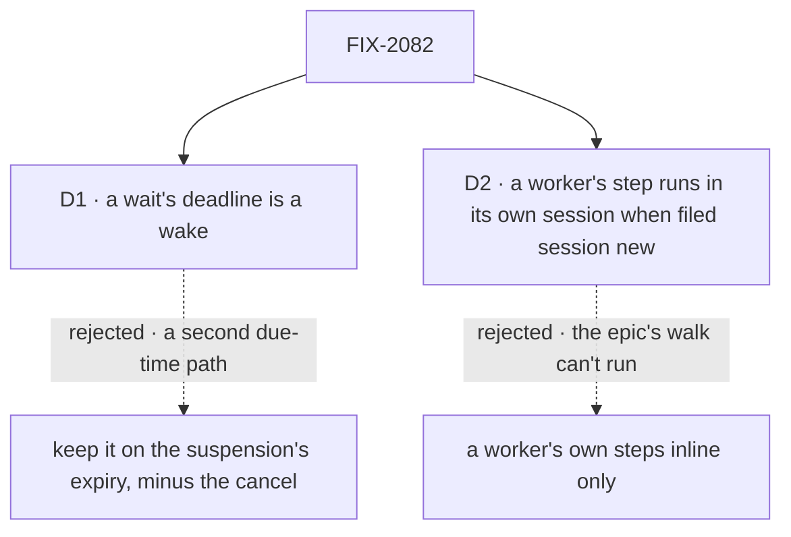

# FIX-2082 · Decisions

[Spec](SPEC.md) · **Decisions**

The concept decided the wait ([rule 9](../../../docs/internal/design/workforce-coordination-concept.md#the-rules)):
`getTask` waits, 5 deep, and a deadline cancels nothing. These two carry it out where FIX-2078's
wake and FIX-2076's plan board meet it.

## The tree

Solid edges are what you're signing. Dashed edges lost, and the label says why.

## D1 · A wait's deadline is a wake

| | |
|---|---|
| **Instead of** | Keeping the deadline on the suspension's expiry, as today, with only the cancel removed |
| **Because** | FIX-2078's D1 ([#3594](https://github.com/fixpoint-labs/flow-state-dev/pull/3594)) makes the wake the engine's one due-time source and puts any wait deadline this issue reshapes on it; the coordinator confirmed it for this issue. On the old path the sweeper keeps two due-time reads, and a drain that waits again at each deadline rewrites a record built to expire once |
| **Locks in** | A wait needs a store that keeps wakes. On a host without one, `getTask`'s wait, a dispatched plan row and `dispatcher({ wait })` are refused, naming why, as a host with no sweeper is refused a wait today. This issue ships after FIX-2078. The sweeper's resume of a wait gate on expiry goes once no gate parked before the upgrade is left |

It comes down to where the sweeper looks: one record for every due time, or two.

**What would change my mind:** a store adapter in use that expires suspensions but can't keep a
wake. Then the deadline keeps the suspension's expiry on that store only.

## D2 · A worker's step runs in its own session when filed `session: "new"`

| | |
|---|---|
| **Instead of** | Keeping a worker's own steps inline, with a dispatched plan row only on a board a flow author builds |
| **Because** | FIX-2076's D1 locks in *"a step needing its own session is a dispatched plan row, after FIX-2082"*, and the epic's walk has writer's plan board wait on a dispatched fact-check. A worker files its steps with `createTask` naming itself; what tells inline from dispatched is where the step runs, which is the session setting's job (FIX-2080). `"new"` is that setting's own value, so nothing new is named |
| **Locks in** | On a filing naming the worker itself, no `session` means this session, inline (FIX-2076, unchanged), and `session: "new"` a new session of the same worker, dispatched and waited on by the drain. The ongoing-session and follow-up values are refused on a plan row. The concept's *"a plan row uses only those two"* gains the session, amended by the implementation PR; FIX-2080 (#3595) is told at this gate |

It comes down to the epic's walk: inline only, writer's fact-check can't have a session of its own.

**What would change my mind:** the owner reading *"a plan row uses only start and attempts"* as a
rule, not a description. Then a dispatched plan row is a flow author's board only, and the
closure's walk dispatches the fact-check from one.

## Decided, not asked

- **The convergence point.** One gate, core's wait gate, which every wait parks on, and one depth
  check, the engine's, run as a request parks on any wait. `getTask`'s wait and a plan board's
  dispatched row share one orchestration function that marks the row and adds the task checks;
  `dispatcher({ wait })` binds the gate to the child request instead. FIX-2070's calls and
  FIX-2058's `waitForUser` park on the same gate and pass the same count.
- **The task checks.** A wait is refused, before anything is written and naming the rule, on a task
  this session didn't file, on one whose result goes to the conversation (moved from FIX-2080), on a
  second wait in one model step, past 5 deep, and on a host that can't hold a wait. A task already
  ended returns at once.
- **What it returns.** `getTask` with `wait` returns the task as `getTask` does, once it ends or at
  the deadline; its status says which. The `answer` field and the wait error codes go: a model reads
  `failed`, `cancelled` or `in_progress` off the task. A dispatcher's wait outputs
  `{ status, output?, error?, requestId }`, with status `completed`, `failed` or `running`.
- **The deadline.** `deadline` is milliseconds from the call: a model can't read the clock. Unset,
  it is a host setting, five minutes by default, today's. Above the host's maximum (24 hours by
  default, never past FIX-2078's maximum debt age) it is refused, naming the maximum. At the
  deadline the row's wait is cleared, so the ending reaches `onTaskSettled` unless the request waits
  again (rule 7). A row holds one wait at a time; a session runs one request at a time.
- **A drain's wait** uses the host's default and waits again at each deadline, a check-in. It never
  moves past a running row; its own request keeps its task's claim through FIX-2077's hold.
- **A dispatcher's `wait`.** Inside a board an unset `wait` follows the mode; `taskBoard()` refuses a
  plan board with `wait: false` and a delegation board with `wait: true`, and FIX-2076's refusal of
  any dispatcher on a plan board goes. Outside a board it defaults to `false`.
- **The depth, and why 5.** Server-written, never input, and taken when a request waits: one more
  than the depth of whatever waits on the request's own work, read off its task's wait slot or,
  for a waited dispatch's child, its birth. Each wait records its depth where the work below reads
  it. A wait started late, on a task whose request already waits, doesn't re-count the waits below;
  the tree bounds such a chain, since a request waits only on what it filed. **Why 5:** a
  chain of task waits can't pass the tree's 5, so the limit binds only chains that mix in waited
  dispatches and, later, calls, which build no tree. One number bounds both, each parked wait keeps a
  session busy, and nothing in the repo nests deeper than one today.
- **The tree's limits** stay Workforce's chain check. Plan rows count toward the 100; an inline one
  adds no depth, and a dispatched one's session is one board deeper.
- **`dispatchTask`.** This issue removes `wait` and `timeoutMs`; if FIX-2083 has landed, also the
  tool, its action and the epic's migration line (FIX-2081's D1). The implementation PR adds the
  migration row `dispatchTask({ wait, timeoutMs })` → `createTask`, then `getTask({ id, wait, deadline })`.
- **Upgrade (BP-030).** A row's wait slot written by today's filing reads as today. A gate parked
  before the upgrade keeps its deadline on the suspension's expiry until it resolves, without the
  cancel; the implementer places the read, or FIX-2078's backfill writes it a wake.
- **No POC and no checker.** The wait, its durability and its restart are on `main` and proved by
  `goals/hand-offs/ask-survives-a-restart/`; a parked task keeping its claim is FIX-2077's D1. The
  spec rests on no count.

## Considered and dropped

| Option | Why it lost |
|---|---|
| `createTask({ wait })`, marked at filing as today | `createTask` only files (rule 9), and a wait on an earlier task needs the late mark anyway |
| No bare `dispatcher({ wait })`: no caller today | The concept and the epic decided it, and FIX-2070's calls reuse its request binding |
| Count depth on every hop, waited or not | Makes the tree's 5 and the waits' 5 one count; the concept counts them apart |
| The deadline as a tool error | It isn't a failure: the task as it stands is the answer, and the model reads its status |

## Settled

- **A wait parks durably and survives a restart.** On `main`: `goals/hand-offs/ask-survives-a-restart/`
  passes, and both its controls fail. Kept as the base this builds on.

## Notes from review

None yet.

## How it got here

- **Draft** — framed as the epic's wait seam: one wait on core's gate, reached by `getTask`, a plan
  board's dispatched row and a waiting dispatcher, its deadline on FIX-2078's wake, its depth counted
  once in the engine; the task-request refusal and the timeout's cancel removed.

Open: none.
