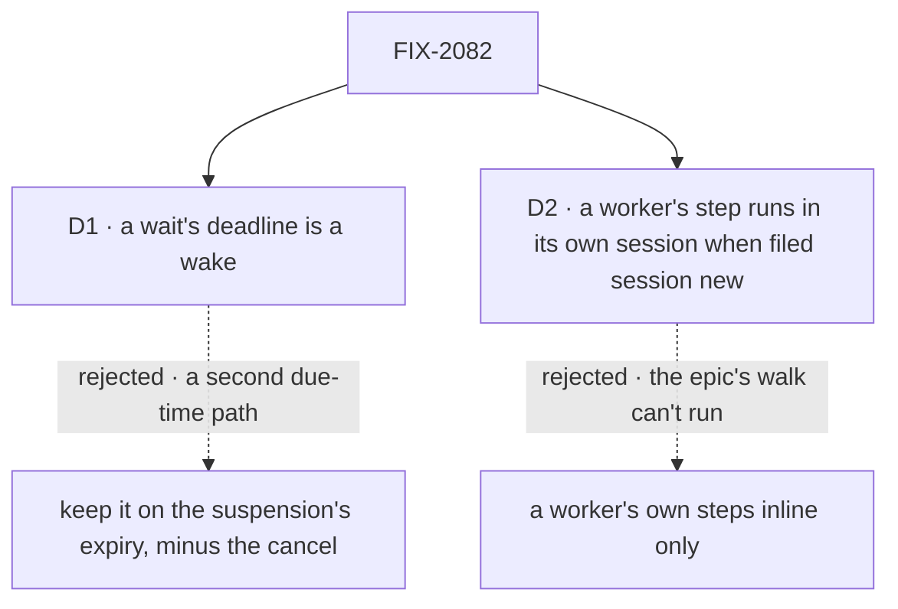

# FIX-2082 · Decisions

[Spec](SPEC.md) · **Decisions**

The concept decided the wait ([rule 9](../../../docs/internal/design/workforce-coordination-concept.md#the-rules)):
`getTask` waits, 5 deep, and a deadline cancels nothing. These two carry it out where FIX-2078's
wake and FIX-2076's plan board meet it.

## The tree

Solid edges are what you're signing. Dashed edges lost, and the label says why.

## D1 · A wait's deadline is a wake

| | |
|---|---|
| **Instead of** | Keeping the deadline on the suspension's expiry, as today, with only the cancel removed |
| **Because** | FIX-2078's D1 ([#3594](https://github.com/fixpoint-labs/flow-state-dev/pull/3594)) makes the wake the engine's one due-time source and puts any wait deadline this issue reshapes on it; the coordinator confirmed it for this issue. On the old path the sweeper keeps two due-time reads, and a drain that waits again at each deadline rewrites a record built to expire once |
| **Locks in** | A wait needs a store that keeps wakes. On a host without one, `getTask`'s wait, a dispatched plan row and `dispatcher({ wait })` are refused, naming why, as a host with no sweeper is refused a wait today. This issue ships after FIX-2078. The sweeper's resume of a wait gate on expiry goes once no gate parked before the upgrade is left |

It comes down to where the sweeper looks: one record for every due time, or two.

**What would change my mind:** a store adapter in use that expires suspensions but can't keep a
wake. Then the deadline keeps the suspension's expiry on that store only.

## D2 · A worker's step runs in its own session when filed `session: "new"`

| | |
|---|---|
| **Instead of** | Keeping a worker's own steps inline, with a dispatched plan row only on a board a flow author builds |
| **Because** | FIX-2076's D1 locks in *"a step needing its own session is a dispatched plan row, after FIX-2082"*, and the epic's walk has writer's plan board wait on a dispatched fact-check. A worker files its steps with `createTask` naming itself; what tells inline from dispatched is where the step runs, which is the session setting's job (FIX-2080). `"new"` is that setting's own value, so nothing new is named |
| **Locks in** | On a filing naming the worker itself, no `session` means this session, inline (FIX-2076, unchanged), and `session: "new"` a new session of the same worker, dispatched and waited on by the drain. On a plan row FIX-2080's *"an absent session reads as the default"* does not apply: an inline plan row stores no session, nothing writes the default onto it, and only an explicit `"new"` dispatches; `createTask`'s `session` description says so. A plan row takes dependencies, attempts and `session: "new"`; held, ongoing and follow-up are refused, each naming the rule. `session: "new"` on a filing naming the worker itself is refused unless its flow declares `contributor` (FIX-2084), or, before FIX-2084 lands, has a marked `work` entry, naming the rule. The concept's *"a plan row uses only those two"* gains the session, amended by the implementation PR; FIX-2080 (#3595) is told at this gate |

It comes down to the epic's walk: inline only, writer's fact-check can't have a session of its own.

**What would change my mind:** the owner reading *"a plan row uses only start and attempts"* as a
rule, not a description. Then a dispatched plan row is a flow author's board only, and the
closure's walk dispatches the fact-check from one. Or the owner placing a plan row's session with FIX-2080,
which owns the setting (round 1's second look recommends this split): then this issue lifts the
refusal and makes a drain wait on a dispatched row from any board (legs a, b, c, e), and FIX-2080
decides `session: "new"` on a worker's own step, against its own default of `"new"`.

**The new session's slot:** a plan row filed `session: "new"` never holds a one-open-task slot,
its new session's included, like every plan row under FIX-2080 (DECISIONS L68-70). Only a task the
session itself works holds its slot.

## Decided, not asked

- **The convergence point.** One gate, core's wait gate, which every wait parks on, and one depth
  check, the engine's, run as a request parks on any wait. `getTask`'s wait and a plan board's
  dispatched row share one orchestration function that marks the row and adds the task checks;
  `dispatcher({ wait })` binds the gate to the child request instead. FIX-2070's calls and
  FIX-2058's `waitForUser` park on the same gate and pass the same count.
- **The task checks.** A wait is refused, before anything is written and naming the rule, on a task
  this session didn't file, on one whose result goes to the conversation (moved from FIX-2080), on a
  task another request already waits on, on a second wait in one model step, past 5 deep, and on a
  host that can't hold a wait. A task already ended returns at once. *This session filed it* reads
  FIX-2078's server-written filer fields (session and flow) on the row, never input (BP-031): `createdBy`
  names only the user, and two sessions of one user can reach one shared board. A row filed before
  the upgrade has none and reads as *filer unknown*, refused, as `createdBy` reads today (BP-030).
  *Another request already waits*: a session can run requests side by side (`concurrency: "allow"` is
  the default), so the row's wait slot is taken in one conditional write and a second taker is
  refused; it never replaces the first gate.
- **What it returns.** `getTask` with `wait` returns the task as `getTask` does, once it ends or at
  the deadline; its status says which. The `answer` field and the wait error codes go: a model reads
  `errored`, `cancelled` or `in_progress` off the task (the task's own vocabulary; `failed` is only the
  dispatcher's result below). A dispatcher's wait outputs
  `{ status, output?, error?, requestId }`, with status `completed`, `failed` or `running`.
- **The deadline.** `deadline` is milliseconds from the call: a model can't read the clock. Unset,
  it is a host setting, five minutes by default, today's. Below the host's minimum (the sweeper's
  resolution by default: a shorter deadline can't come due sooner, and would only spin park and
  resume) or above its maximum (24 hours by default) it is
  refused, naming the bound.
- **The wait's wake.** A wait's deadline is a wake whose entry is `waitDeadline`, on the waiting
  request's session. Parked waits in one session share that wake (FIX-2078's one per session and
  entry); it carries the earliest deadline, and each time one resumes it re-arms to the next parked
  wait's deadline, clearing when none is parked.
- **Who gets the ending: exactly once.** FIX-2078's one delivery decides it, for every ending
  writer, read against the row's wait slot in the write that records the ending: a parked request is resumed with it; otherwise it is owed to
  `onTaskSettled` (rule 7). At the deadline the slot is not cleared but lapsed, in one conditional
  write that loses to an ending already written, so an ending and a deadline due together resume the
  request once. A lapsed slot still holds the ending for the request that waited, while that request
  runs: its next `getTask` (waiting or not) returns it and the notice is never owed. Only when that
  request ends without reading it is it owed to `onTaskSettled`, once: the lapsed-slot case this
  issue adds to FIX-2078's delivery, a debt due at that request's end plus 2 s.
- **A drain's wait** uses the host's default and waits again at each deadline, a check-in. It never
  moves past a running row; its own request keeps its task's claim through FIX-2077's `waitingOn` (its D1: the claim kept, no lease).
- **A cancel ends a parked wait.** Cancelling a task whose request is parked on any of the three
  waits (`getTask`'s, a drain's dispatched row, a waiting dispatcher) resolves the wait as cancelled.
  The request ends with no further model call, its writes are refused, and its return is not
  recorded. FIX-2081 hands this here ([#3596](https://github.com/fixpoint-labs/flow-state-dev/pull/3596)).
- **A dispatcher's `wait`.** Inside a board an unset `wait` follows the mode; `taskBoard()` refuses a
  plan board with `wait: false` and a delegation board with `wait: true`, and FIX-2076's refusal of
  any dispatcher on a plan board goes. Outside a board it defaults to `false`.
- **The depth, and why 5.** Server-written, never input, and the length of the live chain of parked
  waits, checked whenever a wait starts, from either end. Above: one more than whatever waits on the
  request's own work now, read live off its task's wait slot or, for a waited dispatch's child, its
  parent request's park, never a count copied at birth. Below: a wait on work that is itself already
  waiting (a task whose request waits, a child request that dispatched and waits) adds the deepest
  live wait under it. Over 5 is refused. So a chain built below a task nobody waits on, then waited
  on late, can't pass 5, and nor can a wait added below after a deadline. The tree alone does not
  bound this: a waited dispatch builds no tree level. **Why 5:** a
  chain of task waits can't pass the tree's 5, so the limit binds only chains that mix in waited
  dispatches and, later, calls, which build no tree. One number bounds both, each parked wait keeps a
  session busy, and nothing in the repo nests deeper than one today.
- **The tree's limits** stay Workforce's chain check, kept for plan rows: they count toward the 100
  (FIX-2076 keeps them in the count); an inline one adds no depth, and a dispatched plan row's
  session is one board deeper.
- **`dispatchTask`.** This issue removes `wait` and `timeoutMs`; if FIX-2083 has landed, also the
  tool, its action, `TaskCollectionRef.dispatch`, `TaskDispatchOptions`, `Task.dispatchCall` and the
  already-dispatched decline (FIX-2081's D1); whichever of the two lands later removes those. It
  amends FIX-2081's one `dispatchTask` row in the epic's migration.md rather than adding a second:
  `timeoutMs` becomes `getTask`'s `deadline`, which cancels nothing. It adds a row for
  `dispatchAndWait` and its `DispatchAndWait*` types → `getTask({ id, wait: true })`.
- **Upgrade (BP-030).** A row's wait slot written by today's filing reads as today. A gate parked
  before the upgrade keeps its deadline on the suspension's expiry until it resolves, without the
  cancel; the implementer places the read, or FIX-2078's backfill writes it a wake.
- **No POC and no checker.** The wait, its durability and its restart are on `main` and proved by
  `goals/hand-offs/ask-survives-a-restart/`; a parked task keeping its claim is FIX-2077's D1. The
  spec rests on no count.

## Considered and dropped

| Option | Why it lost |
|---|---|
| `createTask({ wait })`, marked at filing as today | `createTask` only files (rule 9), and a wait on an earlier task needs the late mark anyway |
| No bare `dispatcher({ wait })`: no caller today | The concept and the epic decided it, and FIX-2070's calls reuse its request binding |
| Count depth on every hop, waited or not | Makes the tree's 5 and the waits' 5 one count; the concept counts them apart |
| The deadline as a tool error | It isn't a failure: the task as it stands is the answer, and the model reads its status |

## Settled

- **A wait parks durably and survives a restart.** On `main`: `goals/hand-offs/ask-survives-a-restart/`
  passes, and both its controls fail. Kept as the base this builds on.

## Notes from review

Round 1 ([#3597](https://github.com/fixpoint-labs/flow-state-dev/pull/3597)), recorded for the
implementer, not baked into the design:

- *"Don't leave a half-empty `wait-for-response.ts` behind. Rename the surviving park/resume core
  for what it now is (a wait on a task), and complete the move (BP-034)."* — second look
- *"The spec's debt table does not list these, so check each is dead or still reached by the stop
  path (which stays): `WAIT_TIMED_OUT_REASON`, the `wait_timed_out`, `wait_timeout_out_of_range` and
  `wait_task_*` error codes, `cancelOrOwe`, and `Task.cancelOwed`/`markCancelOwed`. Delete what the
  stop path doesn't use."* — second look
- *"The sweeper's expiry-resume of wait gates stays only for pre-upgrade gates. Put a removal
  condition on it, as D1 already hints."* — second look
- *"Drain's wait is unbounded … a hung dispatched step parks a session forever. The spec leans on
  FIX-2078's maximum debt age. State that this is the bound."* — second look. Corrected after the
  cross-spec audit: debt age doesn't bound it. A hung dispatched step is bounded by its row's lease
  and its reclaim or abandonment, whose ending the drain then hears.
- *"Check that the in-memory test store and the Vercel and BullMQ hosts keep wakes after FIX-2078.
  If not, kitchen-sink and the unit suites can't exercise a wait."* — second look
- *"This issue ships after FIX-2078, FIX-2076, FIX-2077 and FIX-2081 … Re-read their final shapes
  before the implementer starts."* — second look
- *"Drain re-wait on host default (5m) every deadline … a sentence on whether drains get a longer
  deadline tier (or in-place wake extension) would head off a 'why is my plan drain waking every 5
  minutes?' surprise."* — Cursor
- *"Refactor `wait-for-response.ts` in place … don't add a parallel `packages/orchestration/src/waits/`.
  Thread D1 through FIX-2078 wake APIs; extend `WaitGateBinding` in core once … Land `getTask` wait on
  FIX-2081's tool after rename … extend `goals/hand-offs/` harness; new
  `goals/task-board/waits-on-a-task-it-filed/` should share libs, not a second runner."* — Cursor
- *"One home for the implementation contract"*, *"keep one canonical figure"*, *"figures carry the
  comparison"* — Cursor's editorial dedup across SPEC, DECISIONS and the figures. Below the
  direction bar; worth doing if the implementation PR amends these documents.

## How it got here

- **Draft** — framed as the epic's wait seam: one wait on core's gate, reached by `getTask`, a plan
  board's dispatched row and a waiting dispatcher, its deadline on FIX-2078's wake, its depth counted
  once in the engine; the task-request refusal and the timeout's cancel removed.

- **Sign-off (2026-10-21)** — the owner accepted D1 (a wait's deadline is a wake) and D2 (a worker's
  step runs in its own session when filed with `session: "new"`), and asked that the new session's
  slot agree with FIX-2080's *"plan rows never"*: [comment](https://github.com/fixpoint-labs/flow-state-dev/pull/3597#issuecomment-6317555768).

Open: none.
