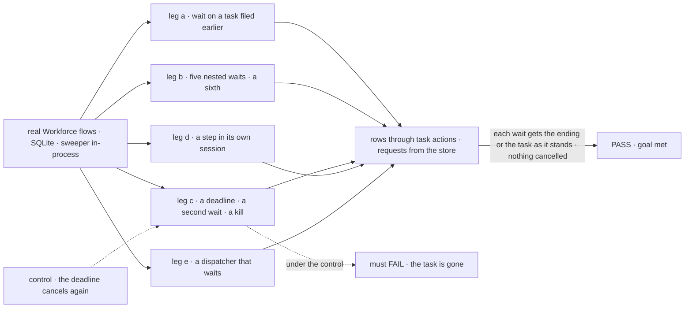
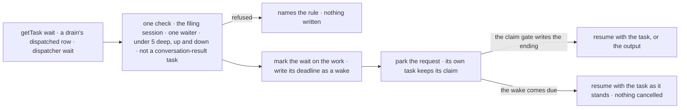

# FIX-2082 · A request waits on a task it filed with getTask, nested up to five deep, and a deadline leaves the task running

**Spec** · [Decisions](DECISIONS.md)

## Six people, before and after

| Someone who… | Today | After |
|---|---|---|
| **builds a worker that needs another worker's result** | Must file and wait in one `dispatchTask` call; a task filed earlier can't be waited on | Files with `createTask`, then waits now or in a later request with `getTask({ id, wait: true })`, which returns the task once it ends |
| **builds a worker whose own task needs a sub-task's result** | Refused any wait while it works a task, so it ends its turn and is woken later | Waits in the same request, up to 5 waits deep; a sixth is refused, naming the limit |
| **waits on slow work** | At the timeout (30 s to 1 h) the task is cancelled and its work is lost | At the deadline the request carries on with the task still running. Waiting again gets the result; if nothing waits, the ending arrives once, as `onTaskSettled` |
| **builds a worker whose step needs a fresh session** | Can't: a worker's steps run inline only (FIX-2076) | Files the step with `session: "new"`. Its drain dispatches it and waits; the next step sees its result ([D2](DECISIONS.md#d2)) |
| **hands work to another session with `dispatcher`** | Gets a handle back; the result needs a reply entry of its own | Sets `wait: true` and gets the work's result as the block's output, bounded by a deadline |
| **runs a host that restarts mid-wait** | The deadline lives on the suspension's expiry, beside the board's due times | The deadline is a wake, the record that pays every other debt; a restart keeps it ([D1](DECISIONS.md#d1)) |

## The goal, and how we'll know it's met

**A request waits on a task it filed, or on work it dispatched, through one wait that returns
when the claim gate writes the ending or the deadline passes, whichever is first. The deadline
cancels nothing, and waits nest up to 5 deep.**

| Is it the right goal? | |
|---|---|
| **The real need** | *"A task can't use a sub-task's result in the same request. And a wait's timeout … cancels the task it waited on"* (the issue). The epic's seam: FIX-2082 owns the wait and its limits, and every wait wakes on the ending the gate writes ([ER-2](../../epics/FIX-2056/DECISIONS.md#who-owns-what)) |
| **Smaller, and rejected** | "Move the wait to `getTask` and drop the cancel." Task requests still can't wait, a plan board still refuses a dispatched row (FIX-2076 D3), and the epic's closure has no dispatched row to wait on |
| **Bigger, and not this issue's** | Waiting on a call (`sendMessage({ wait })`, FIX-2070) or a person (`waitForUser`, FIX-2058): both reuse this wait and its depth. Waiting on several tasks in one call |
| **Not done if** | A deadline cancels or settles anything · a wait decides "done" itself instead of reading the ending the gate wrote · a task's request under 5 deep is refused a wait · a sixth wait files anything, at either end of a chain · an ending reaches its filer twice, or not at all · a plan row escapes the tree's 100 · a drain moves past a running dispatched row at its deadline · `dispatchTask`'s `wait` or `timeoutMs` is still exported · a wait's deadline lives anywhere but the wake |



The check reads rows and requests as a screen and the store see them. The dashed path puts back
today's cancel, and it must fail.

| How we verify | |
|---|---|
| **Goal check** | `goals/task-board/waits-on-a-task-it-filed/` · no model: deterministic workers · run by the implementer at completion · verdict in the implementation PR |
| **Signal** | a: a conversation files with `createTask` and ends; a later request waits with `getTask` and gets the task `completed` with its output in that request; a second session of the same user is refused a wait on it, and so is a second request of the filing session while the first waits. b: five nested waits, four through task requests and one waited dispatch, each resume with the result below; a sixth is refused and nothing is filed; a chain of five built below a task nobody waits on, then a late wait on that task, is refused; the 101st filing under a top task, a plan row, is refused. c: a deadline shorter than the work resumes the request with the task `in_progress` on attempt 1; a second wait gets it `completed`; the task ending after the deadline while that request still runs reaches it once, on its next `getTask`, and no `onTaskSettled` fires; in another run the request ends without waiting again and one `onTaskSettled` hears the ending; an ending and a deadline held due together resume the request once, and the ending is delivered once; killed mid-wait, the deadline still resumes within due time plus 2 s; the task whose request waits is cancelled, and that request ends with no further model call and no recorded return. d: a step filed `session: "new"` is waited on through two deadlines, and the next step's output carries a value only it produced. e: `dispatcher({ wait: true })` outputs the child's output |
| **Input** | Other depths, deadlines and kill points must pass too |
| **Anti-game** | Rows through `getTask_tasks` and `listTasks_tasks`, requests from the engine's store. No stubbed gate, sweeper or clock |
| **Control that must fail** | `GOAL_CONTROL=deadline-cancels` must FAIL leg c on *`in_progress` on attempt 1* and *a second wait gets it*. `GOAL_CONTROL=drain-moves-on`, a drain that takes its deadline as an ending, must FAIL leg d. Today's `main` must also FAIL legs a and b |

## What changes


Three ways in, one wait: the claim gate's ending or the wake resumes it, and neither cancels.

**A worker's calls, a worker's step, and a flow author's dispatcher:**

```diff
- dispatchTask({ goal: "Find adoption numbers", assignee: "researcher", wait: true, timeoutMs: 600_000 })
+ const { id } = createTask({ goal: "Find adoption numbers", assignee: "researcher" })
+ getTask({ id, wait: true, deadline: 600_000 }) // now or in a later request: the task when it ends, or as it stands
```

```diff
- createTask({ goal: "Fact-check the draft", assignee: "writer" })                 // inline, in this session
+ createTask({ goal: "Fact-check the draft", assignee: "writer", session: "new" }) // its own session, waited on
```

```diff
  const checkLinks = dispatcher({
    name: "check-links",
    action: "check",
    session: { key: (input) => input.docId },
+   wait: true, // output: { status: "completed", output }, or { status: "running" } at the deadline
  });
```

**Docs:** update *Orchestration → Task board* (waiting on a task, the deadline and the depth;
a plan board's dispatched row; the dispatcher's `wait` and its two refusals), *Workforce →
Delegating work* (a task's request may wait; a step in its own session), *Advanced → Durable
execution* (a wait's deadline resumes and cancels nothing), and the core, orchestration and
workforce READMEs. No new page; FIX-2081 publishes the one-task opening.

**Goals this changes,** rewritten or retired by the implementation PR, each stating the intent it
keeps: `goals/hand-offs/ask-survives-a-restart/` on `getTask`; FIX-2076's
`goals/task-board/refuses-a-board-built-wrong/`, whose plan-board-with-a-dispatcher fixture gives
way to the two wait refusals (D2's dispatcher bullet); FIX-2076's leg a and its Not-done-if
(*no child session*), scoped to steps filed without `session: "new"`; and FIX-2080's
`runs-by-its-filing-settings` and FIX-2078's `every-ending-reaches-its-filer` where they wait
through `dispatchTask({ wait })`. D2 needs one board change past FIX-2076's: a plan board's drain
reads inline or dispatched per row, not per board. With FIX-2083 (#3598), whichever removes
`dispatchTask` rewrites `goals/coordinators/files-tasks-down-the-owners-chain/` leg e and
`goals/coordinators/task-session-stays-open/` leg c.

## How a wait runs



Every wait passes the same check, parks the same way, and is resumed by an ending it never
decides.

## What stays as it is

- **A person stopping a waiting request** ends it and cancels the task it waited on, as today.
- **One wait per model step,** and `waitForCondition`, the wait on a condition inside a running request.
- **Who pays a resume owed after a crash, and a cancel owed by a stop:** FIX-2078's delivery and its wake. A dispatched plan row's ending owing its waiting drain a resume is FIX-2078's case for plan rows filed `session: "new"`, which this relies on.
- **The tree's limits,** Workforce's chain check: 5 deep, 100 under a top task. Plan rows stay in it, as FIX-2076 keeps them; a dispatched plan row's session is one board deeper.

## What's already here, and the debt

| Already here | What this does with it |
|---|---|
| What waits on another session's work: `dispatchTask({ wait, timeoutMs })` over `dispatchAndWait`; `waitForCondition` with `onTaskChangeFor`; a person's park (`awaitReview`, `parkOnQuestion`) | **Folds** the first into `getTask`, the closest; a dispatcher's wait is the same wait, not a second. The condition wait holds a running request open and stays (rule 9's *condition*). A person's park is FIX-2058's. Searched `wait`, `park`, `resume`, `await` across `packages/` |
| The wait gate (`parkOnWait`), the row's wait slot and its resume | **Builds on.** The slot is written when the wait starts, not at filing; the gate also binds a request, for a dispatcher's wait |
| The task-request refusal (`orchestration/src/tasks/helpers/wait-for-response.ts:222`) | **Removes,** for routed turns too once FIX-2083 makes them task turns |
| The timeout's range and its cancel (`:212`, `:440`) | **Removes.** A stop's cancel stays |
| Wait deadlines on the suspension's expiry, read by the sweeper's resume and re-arm (`engine/src/durability/durability-sweeper.ts`) | **Moves** to FIX-2078's wake ([D1](DECISIONS.md#d1)) |
| FIX-2076's interim refusal of a dispatched plan row (its D3, [#3593](https://github.com/fixpoint-labs/flow-state-dev/pull/3593)) | **Lifts** it |
| Workforce's chain limits (`workforce/src/conversation-board/chain.ts`) | **Kept** as the tree's half of the limits, and kept for plan rows, which FIX-2076 moves off the board it checks but keeps in its count; a dispatched plan row's session is one board deeper |
| [FIX-1816 D1](../FIX-1816/DECISIONS.md#d1): a wait is a task on the asker's board, its request parked on the row | **Kept** |
| [FIX-1816 BR-5a, BR-14, BR-14a](../FIX-1816/BUSINESS-RULES.md): one deep; the timeout cancels; 30 s to 1 h | **Superseded:** 5 deep, a deadline that cancels nothing, no fixed range |
| [FIX-1875 D2](../FIX-1875/DECISIONS.md#d2): `dispatchTask` takes `wait` and `timeoutMs` | **Superseded** in part: they move to `getTask` as `wait` and `deadline` |
| The epic's row for [FIX-1870 D1](../../epics/FIX-1870/DECISIONS.md#d1), and FIX-2081's D1 ([#3596](https://github.com/fixpoint-labs/flow-state-dev/pull/3596)): this issue removes `dispatchTask`'s wait form | **Kept** |

| The debt | |
|---|---|
| **Removes** | `dispatchTask`'s `wait` and `timeoutMs`, and the tool itself if FIX-2083 has landed · `dispatchAndWait` and its `DispatchAndWaitOptions` and `DispatchAndWaitResult` types (to `getTask({ id, wait: true })`) · the task-request refusal · the timeout's cancel and range · wait deadlines on the suspension's expiry · FIX-2076's interim refusal |
| **Adds** | `getTask`'s `wait` and `deadline` · `dispatcher`'s `wait` · a request binding on the wait gate, the second thing that can resume a park (a child request finishing, where the rest resume on a row's ending) · one depth count, server-written and checked at both ends of a chain · a host default, minimum and maximum deadline · `session: "new"` on a worker's own step ([D2](DECISIONS.md#d2)) |
| **Leaves** | A late result of a bare dispatch can't be waited on again: FIX-2070's call ids |

**Net: small, one wait gate.** A wait form, a refusal, a cancel and a second due-time path go; one
park with three ways in, one count and one setting value arrive. The request
binding is the piece most likely to drift into a wait of its own, and the two result shapes
(`getTask`'s task, the dispatcher's `{ status, output?, error?, requestId }`) are FIX-2070's to pick between.

## Sign off

**[The goal](#the-goal-and-how-well-know-its-met), at that size:** one wait for tasks, a drain's
dispatched row and a dispatcher, 5 deep, and a deadline that cancels nothing. If wrong: FIX-2070's
calls and FIX-2058's `waitForUser` build a wait of their own.

**[The debt](#whats-already-here-and-the-debt), net small:** the wait form, the cancel and the
second due-time path go; one wait gate and one count arrive. If wrong: the request binding is a second
wait in all but name.

1. **[D1](DECISIONS.md#d1) · A wait's deadline is a wake.** If wrong: a host whose store keeps no
   wakes can't wait at all.
2. **[D2](DECISIONS.md#d2) · A worker's step runs in its own session when filed `session: "new"`.**
   If wrong: a plan row carries a setting the concept gave only to delegated tasks. **The one to
   weigh:** it amends a concept line.

**Open: none.**

Feature · `core` + `engine` + `orchestration` + `workforce` · medium: one wait, three ways in, one count · epic [FIX-2056](../../epics/FIX-2056/SPEC.md) · blocked by FIX-2076, FIX-2077, FIX-2078, FIX-2081
