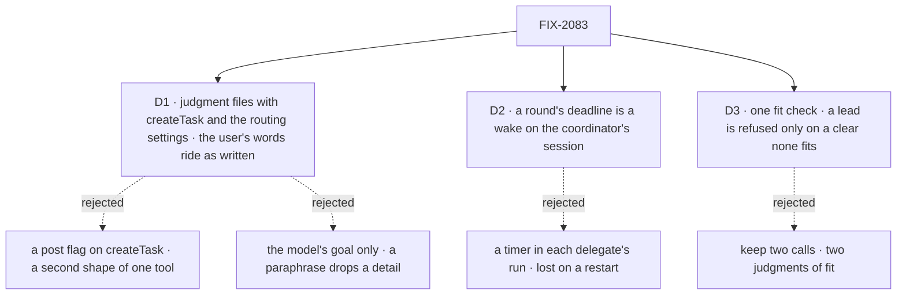

# FIX-2083 · Decisions

[Spec](SPEC.md) · **Decisions**

The concept fixed what a routed task is (*Routing*, rules 5, 6, 7 and 9) and the epic gave the
settings to FIX-2080 and the ending path to FIX-2078. These three calls carry the rest.

## The tree

Solid edges are what you're signing. Dashed edges lost, and the label says why.

## D1 · A judgment coordinator files with `createTask` and the routing settings; the delegate reads the user's words as written

| | |
|---|---|
| **Instead of** | A `post: true` flag moved onto `createTask`, which refuses a goal; or the model's goal alone, as for any task |
| **Because** | [FIX-1872 D2](../FIX-1872/DECISIONS.md#d2) holds: a delegate answers what the person wrote, and the coordinator goal grades a held-out word arriving intact. A flag keeps a second shape of one tool, which FIX-2081 just retired. So the model files an ordinary task with the routing settings and its own goal, and on a turn routing a message the server attaches that message, as written, with who wrote it and the recent lines, to every task the turn files with its result to the conversation |
| **Locks in** | `target` on `createTask`, the public field naming a workstream record, accepted only from a filer whose delegates have targets. The attached message is server-written and never an input field. The routing settings are the model's per task (the concept's *chooses per task*): the policies always file attempts 1; a judgment model that leaves `maxAttempts` out gets the board's default |

It comes down to the tool surface: both keep Alice's words, but a flag is a second shape of `createTask`.

**What would change my mind:** the product wanting a coordinator to brief its delegates in its own
words. Then nothing is attached, and the goal is the brief.

## D2 · A round's deadline is a wake on the coordinator's session

| | |
|---|---|
| **Instead of** | Today's timer, which each delegate's run keeps beside its turn and which wakes the coordinator at the deadline |
| **Because** | The timer lives in the delegate's process, so a restart loses it and the round waits for some other wake. FIX-2078's wake is the engine's one due-time source ([its D1](https://github.com/fixpoint-labs/flow-state-dev/pull/3594)), fired until a pass clears it, after a crash too. The deadline belongs to the coordinator's round, not to a delegate's run, which a routed task's `work` entry no longer special-cases |
| **Locks in** | A round's deadline is due time on the coordinator session's wake, cleared when every round is closed. This issue therefore lands after FIX-2078, as the epic already orders. `roundDeadline` stays the internal entry the wake runs |

It comes down to a restart: the wake closes the round on time; the timer is gone with the process.

**What would change my mind:** FIX-2078 landing without a wake the sweeper keeps. Then the timer
stays until it does.

## D3 · One fit check; it vets a lead by refusing only a clear "none fits"

| | |
|---|---|
| **Instead of** | Two calls: best fit's evaluator, which picks with a confidence, and FIX-1920's lead-fit generator, which answers *does the work say its sort* and *does the lead fit* |
| **Because** | Both judge one thing, whether a worker's description fits the work. One check, asked the candidates and the work, answers a pick and a confidence. Best fit reads the pick through its ladder unchanged. Opening a workstream asks it about the chosen lead with a *none fits* choice, and refuses only that answer, so it stays a backstop for clear misfits, never a router. A failed call, or work that names no sort, lets the open through, as today |
| **Locks in** | Lead-fit's two-part answer is gone; `lead-doesnt-fit` now means the check answered *none fits*. `leadFit: { model }` keeps naming the model, and its record keeps its shape |

It comes down to agreement: two calls can call one worker a fit for routing and a misfit for leading.

**What would change my mind:** a lead vet that needs something best fit can't answer, such as
whether the lead can manage the workers under it. Then the vet keeps its own call.

## Decided, not asked

- **A routed task is only its settings.** Session *ongoing*, result *conversation*, and, from a
  policy, attempts 1, on the coordinator's delegation board, worked on `work`. No kind marker,
  no entry of its own, no special case on cancel, assign or lease. The conversation's recent
  lines ride the task's server-written brief and are shown to the delegate's model as one
  user-role message on that turn, never system text, never stored (today's guarantee).
- **The ongoing session of a workstream record** is the workstream's session, resolved at filing as
  today. A record whose target names none files nothing and is recorded.
- **Rule 5 holds.** One open routed task per delegate session; a second waits. Best fit's hold
  ([FIX-1833 D2](../FIX-1833/DECISIONS.md#d2)) still picks the delegate; the message now queues.
- **A routed turn is a task turn.** The `taskTurn: false` stopgap goes; the delegate may file work
  and wait on it (rule 9), and its task stays open until that work ends (rule 6, FIX-2077). The
  coordinator never waits on a routed task (FIX-2082's refusal).
- **Endings.** One entry, `onTaskSettled`, through FIX-2078's path. A conversation-result ending
  lands as a line under the delegate's name and feeds the rounds; nothing wakes a judgment turn
  for it. A failure's error report rides it ([(f)](../../epics/FIX-2056/DECISIONS.md#f)).
- **Rounds, deadlines and the routing record key on task ids.** A round holds the ids it filed.
  A routed task's id stays derived from the message, the round and the delegate record, so the
  same pick twice files one task. Stored routing records and round state naming a post id are
  dual-read (BP-030).
- **A delegate is a worker whose flow takes conversation tasks.** `defineCoordinatorFlow` stops
  requiring the post entry; FIX-2084 checks roles at hire.
- **The convergence point** for *a task whose result goes to the conversation*: FIX-2080's filing
  check, refusing it from anything but a conversation. Its two writers are routing's filing step
  and `createTask` on a judgment turn.
- **Retired rows.** This PR turns FIX-2080's *post to a routed task* entry on as it stops writing
  posts, and builds no read of its own (ER-6).
- **`dispatchTask`.** This issue removes its post form; if FIX-2082 has landed, the tool and its
  action too (FIX-2081 D1).
- **Changeset lines**, removed outright under [(e)](../../epics/FIX-2056/DECISIONS.md#e):
  `DELEGATED_POST_ENTRY`, `delegatedPostEntry`, `delegatedPostHistory`, `delegatedPostOnFinished`
  and `delegatedPostSchema` (a delegate declares `work` only); `dispatchTask({ post, target })`
  (`createTask` with the routing settings); `taskLedgers({ taskTurn })` (nothing). The epic's
  `migration.md` names only the first; the others ride its row.
- **No POC and no checker.** The premises are read from code at `96404d25`, and no claim here
  rests on a count.

## Considered and dropped

| Option | Why it lost |
|---|---|
| Keep the post entry, drop only the kind marker | The entry is what holds the timer, the cancel action and the stopgap; the row would only look like a task |
| A `routed: true` preset on `createTask` | A name for three settings; one rule per field (FIX-2081) and the concept's per-task choice say set them |
| Address a workstream by an `assignee` like `eng.em (pricing-page)` | A string format a model must spell exactly; `target` is today's field, moved |
| Let a routed task run beside another in the delegate's session | Rule 5 is the owner's, and two open tasks in one session break FIX-2077's done |
| Refuse a goal on a routing turn's `createTask` | A field rule that changes with the turn; the attached message already keeps the words |

## How it got here

- **Draft** — framed as the epic's R-01 to R-05: a post becomes a task with FIX-2080's settings
  on `work`, its ending on FIX-2078's path, its round deadline on FIX-2078's wake, and the two
  fit calls folded into one.

**Open: none.**
