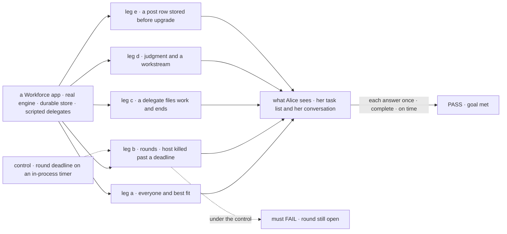
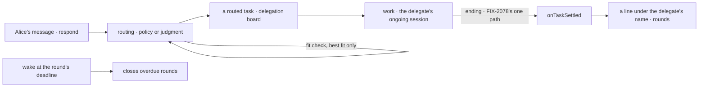

# FIX-2083 · Routed tasks replace posts: a coordinator hands a user's message to a delegate by filing a task

**Spec** · [Decisions](DECISIONS.md)

## Six people, before and after

| Someone who… | Today | After |
|---|---|---|
| **sends a message a coordinator routes** | It becomes a *post*: a row titled "Post for writer" she can cancel, and nothing else. A crash mid-answer ends it unanswered | An ordinary task in her list: writer's ongoing session, result to this conversation, one try. A crash is handled as any task's |
| **asks a delegate that hands part of the job on** | Gets writer's first reply. The handed-on work's result lands in writer's own session, not hers | Gets one answer, under writer's name, once the handed-on work is back |
| **sends a second message while that delegate still works** | Both run side by side in writer's session | The second waits in her list as a pending task she can cancel, then starts in the same session when the first ends. If writer is waiting on work it handed on, the second waits for that too |
| **runs rounds on a host that restarts** | A round past its deadline closes only when something else wakes the conversation | It closes within seconds of its deadline, restart or not ([D2](DECISIONS.md#d2)). A host without wakes keeps today's in-process round timer, so a restart there still waits for another wake, as today |
| **writes a judgment coordinator's prompt** | `dispatchTask` with `post: true` | `createTask` with the routing settings. The delegate still reads her words as written ([D1](DECISIONS.md#d1)) |
| **maintains the framework** | A post row kind, its own entry, ending entry, cancel action and stopgap; two fit calls | One task through one entry and one ending path; one fit check ([D3](DECISIONS.md#d3)) |

## The goal, and how we'll know it's met

**Every message a coordinator routes becomes a task its user can see and cancel, worked in the
delegate's ongoing session, whose one complete answer lands in her conversation under the
delegate's name, with nothing in the framework that writes or works a post: a post row stored
before the upgrade is read only through FIX-2080's map, until FIX-2071.**

| Is it the right goal? | |
|---|---|
| **The real need** | *"Routed work is an ordinary task they can see, steer and cancel. Maintainers: one row kind, one entry"* (the issue). Stories R-01 to R-05; the epic's PD-3 and PR-1, re-homed here |
| **Smaller, and rejected** | "Drop the post kind; keep its entry, deadline timer and cancel action." The row looks like a task and still answers early, misses a deadline after a restart, and keeps the stopgap |
| **Bigger, and not this issue's** | Steer (FIX-2086) · `respond` and `dispatch` names (FIX-2084) · messages to a coordinator (FIX-2070) · `getTask`'s wait and its refusal of a conversation-result task (FIX-2082) |
| **Not done if** | An answer lands before the delegate's filed work ends · a round needs a later wake to close · a post row in a store at upgrade is lost · `onDelegatedPost`, `post: true` or a post row kind is still written · best fit and the lead vet still make different calls · the project hand-off goal (FIX-2005) or the coordinator goal regresses |



The check reads Alice's task list and her conversation, not the coordinator's calls. The dashed
path keeps today's deadline timer, and it must fail.

| How we verify | |
|---|---|
| **Goal check** | `goals/coordinators/routes-each-message-as-a-task/` · no model: scripted delegates and turns on the real coordinator flow · run by the implementer at completion · verdict in the implementation PR. Then the existing `goals/coordinators/hands-each-post-to-its-delegates/` and the FIX-2005 hand-off leg of `goals/workforce-privacy/two-users-share-a-project-and-nothing-else/`, real model, are rewritten on routed tasks (same intent; they read post rows today), then must pass. `goals/coordinators/routes-a-follow-up-by-its-conversation/` is rewritten the same way, and `goals/coordinators/one-fence-answers-each-post-once/` is retired into this check, whose legs a and b keep its intent (each answer lands once; a round closes at its deadline). The implementation PR does each, naming the intent kept |
| **Signal** | a: each message is one task per delegate in Alice's list, read through the public task action, with session *ongoing*, result *conversation*, one attempt, including when the judgment model leaves `maxAttempts` out (it reads 1); a judgment model's `maxAttempts: 3` on such a task is refused at filing, naming FIX-2080's rule; each answer lands once under its delegate's name; a second message to a busy delegate starts only after the first ends, in the same session; Alice's cancel ends the task and the round does not wait; cancelling the waiting second task ends it unstarted. b: with the host killed while a delegate works past a 2 s deadline, the round closes within the deadline + 2 s of restart, and the late answer lands once and goes no further. c: one line under writer's name, after the filed task ends, carrying its result. d: the judgment delegate's input holds Alice's held-out word; a workstream ask lands in the workstream's session; best fit's pick, its fallback and a misfit lead's refusal each run the one fit check, and a lead opened on work that names no sort (a bare name) passes. e: a seeded post row is worked and answered once, through FIX-2080's map. Sweep: no post entry declared, no post row written, no `post` field offered |
| **Input** | Deterministic delegates and evaluator picks, SQLite, the sweeper in-process. Other wording, delegate count and kill point must pass too |
| **Anti-game** | Read tasks through `listTasks_tasks` as Alice and lines from her conversation. No spies on filings or timers |
| **Control that must fail** | `GOAL_CONTROL=round-timer` must FAIL leg b on *the round closes within the deadline + 2 s of restart*. Today's `main` must FAIL leg c on *one line, after the filed task ends* and the sweep. With FIX-2080's *post to a routed task* entry off, leg e must FAIL |

## What changes

![Today against after. Today: a coordinator files a post row with a post kind, handed to onDelegatedPost in the delegate's session, its answer back on onPostSettled, a cancel on postCancelled, a deadline timer in the delegate's run, and two fit calls. After: routing files a task with three settings on the conversation's delegation board, handed to work in the delegate's ongoing session; its ending reaches onTaskSettled and lands under the delegate's name; the round's deadline is a wake on the coordinator's session; one fit check](figures/what-changes.svg)

The post's six parts go; a task's settings, its one entry and its one ending path carry the job.

**A judgment coordinator's call, and a delegate flow of your own:**

```diff
- dispatchTask({ post: true, assignee: "writer" })
+ createTask({ goal: "Draft the launch post", assignee: "writer",
+              session: "ongoing", resultTo: "conversation", maxAttempts: 1 })
+ // writer reads Alice's message as written, with this goal beside it
- dispatchTask({ post: true, assignee: "eng.em", target: "pricing-page" })
+ createTask({ goal: "…", assignee: "eng.em", target: "pricing-page",
+              session: "ongoing", resultTo: "conversation", maxAttempts: 1 })
```

```diff
  defineFlow({
    kind: "research",
-   request: { onStarted: loadWorker, onFinished: delegatedPostOnFinished },
+   request: { onStarted: loadWorker },
-   task: { actions: { [DELEGATED_POST_ENTRY]: delegatedPostEntry(researchAnswer) } },
+   task: { actions: { [WORKER_TASK_ENTRY]: workerTaskEntry({ name: "research", turn: researchAnswer }) } },
+   // a routed task arrives here like any task; the turn still gets { message }
  })
```

**Docs:** update *Workforce → Coordinators* (a routed task replaces the post throughout; the
judgment call; *Making your own flow a delegate* loses the post entry), *Shift Coordinator*,
*Projects → Checking the lead fits* (the one fit check), *Overview* and the glossary (post →
routed task), and the workforce and shift-manager READMEs. No new page.

## How a message is routed



A routed task is a task with three settings; routing only chooses who.

## What stays as it is

- **The policies** (judgment, best fit, round robin, everyone), best fit's ladder and hold,
  rounds and their limit, the routing record, and a coordinator's recent lines shown to the
  delegate as data, never as instructions.
- **Who settles a row**: the claim gate (ER-1). **Done** is FIX-2077's rule 6.
- **A project coordinator's** workstream records and `changeWorkstreamDelegate`.
- **`leadFit: { model }`** and the `lead-doesnt-fit` refusal, now answered by the one check.

## What's already here, and the debt

| Already here | What this does with it |
|---|---|
| Ways to hand a user's message to a delegate: the post (`onDelegatedPost`, `dispatchTask({ post })`) and a task through `work` | **Two today, one after.** The closest is the task: it differs only by settings, which FIX-2080 adds |
| The post's parts: its row kind, `isPostRow`'s three board refusals, `onPostSettled`, `postCancelled`, `delegatedPostOnFinished`, the deadline timer, `taskTurn: false` | **Removes** |
| FIX-2080's settings and its map entry *a post to a routed task* | **Builds on**, and turns the entry on |
| FIX-2078's one ending path and its wake | **Builds on.** A round's deadline is one more due time ([D2](DECISIONS.md#d2)) |
| FIX-2081's `createTask` and [D1](../FIX-2081/DECISIONS.md#d1): `dispatchTask` stays until its post form goes | **Removes** the post form here, and the tool if FIX-2082 has landed |
| Best fit's evaluator call; FIX-1920's lead-fit call | **Folds** into one fit check ([D3](DECISIONS.md#d3)) |
| [FIX-1872 D1](../FIX-1872/DECISIONS.md#d1): a post is worked on its own entry | **Superseded**, as the epic says: its reason, a cold session, is the session setting |
| [FIX-1872 D2](../FIX-1872/DECISIONS.md#d2): the model names who; the post goes as written | **Kept**, on `createTask` ([D1](DECISIONS.md#d1)) |
| [FIX-1870 D2](../../epics/FIX-1870/DECISIONS.md#d2); #3102's PD-3 and PR-1 | **Kept and finished** |
| [FIX-1833 D2](../FIX-1833/DECISIONS.md#d2): best fit holds the delegate on the last message | **Kept;** a held message now waits its turn (rule 5) |
| [FIX-1791 D1](../FIX-1791/DECISIONS.md#d1)'s round closing at its deadline | **Amended:** closed by a wake, not the delegate's timer |

| The debt | |
|---|---|
| **Removes** | The post row kind and its schema · `DELEGATED_POST_ENTRY` and `delegatedPostEntry`, `delegatedPostHistory`, `delegatedPostOnFinished`, `delegatedPostSchema` · `dispatchTask`'s post form · `defineCoordinatorFlow`'s `delegateFlows`, `defineSessionBoard`'s `postFlows` and `posts`, and `posts`/`both` in what `listDelegates` says a delegate takes · `onPostSettled` and `postCancelled` · the deadline timer, where wakes are supported · `taskTurn: false` · the lead-fit call · if this lands after FIX-2082, `TaskCollectionRef.dispatch`, `TaskDispatchOptions`, `Task.dispatchCall` and the `already-dispatched` decline, with the tool. Each public one is a changeset line ([decided](DECISIONS.md#decided-not-asked)) |
| **Adds** | `target` on `createTask`, set at filing only ([D1](DECISIONS.md#d1)) · the user's message attached to a routed task's brief ([D1](DECISIONS.md#d1)) · a round-deadline due time on FIX-2078's wake |
| **Leaves** | A post-shaped row read through FIX-2080's map until FIX-2071 · a worker's message to a round-robin or everyone coordinator is still routed, until FIX-2070's `receive` (R-06) |

**Net: down.** A row kind, two entries, an action, a timer, a stopgap and a model call go; one
field and one due time arrive.

## Sign off

**[The goal](#the-goal-and-how-well-know-its-met), at that size:** every routed message is a task
Alice lists, whose one complete answer lands on time, and nothing writes or works a post. If wrong: FIX-2084
builds the worker contract on an entry that should be gone.

**[The debt](#whats-already-here-and-the-debt), net down:** posts and their six parts go; `target`
and one due time arrive. If wrong: `createTask` carries a coordinator-only field for good.

1. **[D1](DECISIONS.md#d1) · A judgment coordinator files with `createTask` and the routing
   settings; the delegate reads the user's words as written.** If wrong: a field and an attached
   message on `createTask` that only coordinators use. **The one to weigh.**
2. **[D2](DECISIONS.md#d2) · A round's deadline is a wake on the coordinator's session.** If
   wrong: one more due-time kind the sweeper serves.
3. **[D3](DECISIONS.md#d3) · One fit check; it vets a lead by refusing only a clear "none fits".**
   If wrong: a lead opened today is refused, or the reverse.

**Open: none.**

Improvement · `workforce` + `orchestration` + `shift-manager` · large · epic [FIX-2056](../../epics/FIX-2056/SPEC.md) · blocked by FIX-2077, FIX-2078, FIX-2080, FIX-2081
