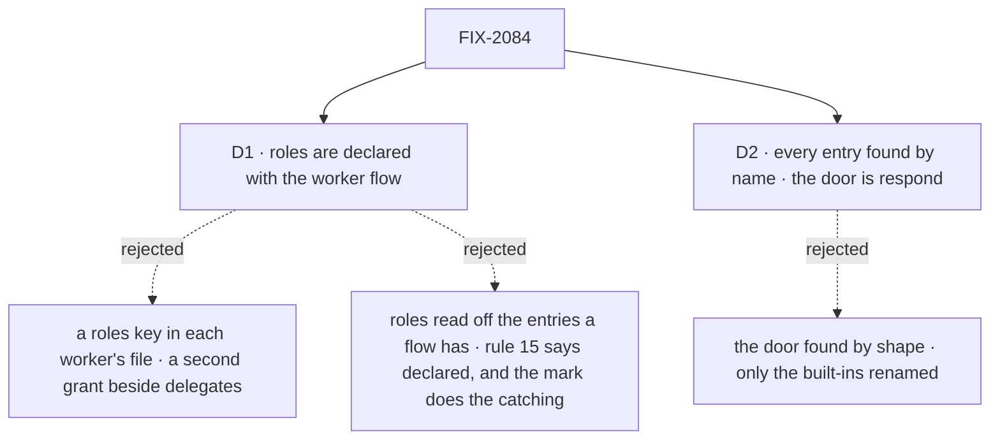

# FIX-2084 · Decisions

[Spec](SPEC.md) · **Decisions**

The epic gave this issue rule 15 of the
[concept](../../../docs/internal/design/workforce-coordination-concept.md#the-worker-contract) and
stories W-01, W-02 and W-04. These two carry it out.

## The tree

Solid edges are what you're signing. Dashed edges lost, and the label says why.

## D1 · Roles are declared with the worker flow, not in each worker's file

| | |
|---|---|
| **Instead of** | A `roles:` key in each `WORKER.md`, as the concept's parts table places it (*Stored: the worker's configuration*) · roles read off whichever entries a flow happens to have |
| **Because** | A role's entries live on the flow, so the flow is where a role is true or false. A worker's file could only narrow its flow, and what narrowing would carry, whether the worker files, its delegate list decides: [FIX-1802 D1](../FIX-1802/DECISIONS.md#d1) rejected a filing flag beside delegates because the two could disagree. Reading roles off the entries present would catch a half-wired flow, but not a manager kit spread with none of its entries, the W-01 failure; only the factory's mark catches that, declared or not. The concept's rule 15, the owner's call, says roles are declared, so they stay declared. 164 worker files stay as they are |
| **Locks in** | `roles` on `workerFlow(build, { roles })` and on a `workerFlows` entry (`{ flow, roles }`), a public option. Omitted, a flow has no role beyond every worker's. The check runs both ways: a declared role missing an entry is refused, and so is a piece of a role's factory on a flow that doesn't declare that role (its entries; for a manager, the delegation board's pieces: its ledger, `dispatch`, `onTaskSettled` and the delegate actions. The plan ledger and a worker's tools for its own steps carry no manager mark). Both ways read the factory's mark, not a bare name: a declared role's entry must carry it, and a flow's own unmarked `dispatch` or `work` is its own action, never a role's. The built-ins declare theirs: agent, contributor and manager; coordinator, all three. The concept's parts-table row moves to *the worker flow's registration*; *whether a coordinator may change its own delegates* stays worker configuration (rule 13) |

**What would change my mind:** an app that needs two workers on one flow to differ by role in a
way their delegate lists can't say. Then a worker's file narrows its flow's roles, never widens
them.

It comes down to the delegate list: a role per worker is a second grant beside it, and the two can disagree.

## D2 · The hire finds every entry by name, the door included: every worker flow's door is `respond`

| | |
|---|---|
| **Instead of** | Keeping today's door search, the one public action that declares `userMessage` and takes `{ message }`, whatever its name, and renaming only the built-ins' `run` |
| **Because** | Rule 15 checks that a role's entries exist, which means by name: `work`, `dispatch` and `onTaskSettled` are already found that way, and a door found by shape is the one entry an app can't call without first reading the inventory. W-04 asks that no flow has a `run`; a shape search can't promise that for flows outside the repo. The owner already accepted that outside teams rewrite at upgrade ([(e)](../../epics/FIX-2056/DECISIONS.md#e)) |
| **Locks in** | A worker flow whose user-message action has any other name is refused, the problem naming the action to rename. A second public action that declares `userMessage` is still refused. The inventory's `door` stays and reads `respond`. The changeset carries the epic's `run` → `respond` line widened to *every worker flow's door* |

**What would change my mind:** a worker flow whose door must keep another name for a caller we
can't change. None in the repo: the doors are the agent's, coordinator's and Error Reporter's
`run`, Shift Manager's EM `message` and coder `message`, and the goal fixtures' `run` doors, all
ours.

It comes down to rule 15: every other entry is found by name, and a door found by shape is the one exception.

## Decided, not asked

- **The convergence point.** One table in Workforce lists each role's entries: name, section and
  probe input. Every hire path (`hireWorkforce`, the boot reload, the runtime hire, all through
  `checkWorkerFlows`), `workerFlowProblems` and the delegate check read it. `receive` joins it
  in phase 4 (FIX-2070).
- **Probe inputs come from the framework's own schemas**: core's task envelope for `work`,
  FIX-2078's notice for `onTaskSettled`, `{}` for `dispatch`, `{ message }` for `respond`. A test
  keeps each parsing against its source, as for `CONTRACT_PROBE_BAG`. A probe runs no block.
- **The contributor check reads the conversation-task mark at hire**: a declared contributor's
  `work` must be `workerTaskEntry`'s, so a `work` gated by another binding is refused at hire,
  not at the claim gate. The manager's factory gets the same kind of mark.
- **The delegate check reads the declared role**; the hire guarantees the entry behind it. A
  delegate list on a flow that isn't a manager stays accepted (FIX-1802 D1). It is the one answer
  to which flows take routed or filed work; FIX-2083 removes `delegateFlows` and `listDelegates`'
  `posts`/`both`. The contributor guarantee covers a dispatched plan row through FIX-2082's check.
- **Requests and wakes stored at upgrade (BP-030).** A stored request under `run`, running or
  parked (today every parked `dispatchTask` wait), resumes as `respond` in the resume path: an
  internal read of an old record, not an [(e)](../../epics/FIX-2056/DECISIONS.md#e) alias, and
  callers can't send `run`. A stored request under `runTaskBoard` resumes as `dispatch` the same
  way. Beside FIX-2078's one-off wake backfill, host start rewrites any stored wake naming
  `runTaskBoard` to `dispatch`, a no-op when there is none. No task row names either entry.
- **Shift Manager**: EM's and coder's `message` become `respond`. EM's behaviour is unchanged;
  the coder's is whatever its door does when this lands (FIX-2086's steer door if that landed
  first). Each declares the roles its entries give it after FIX-2083. EM's `drain` runs the
  board pass outside `dispatch`; it is removed, or becomes a screen that triggers `dispatch`, so
  FIX-2078's one pass at a time holds.
- **What this takes from FIX-2078 and FIX-2083**, neither on `main`: their specs as reviewed
  (#3594, #3598). FIX-2078 brings the `onTaskSettled` factory and the board pass this names
  `dispatch`; FIX-2083 removes posts, so `onDelegatedPost` and the post ending leave the table.
- **Changesets**: workforce, minor; the epic's migration rows for every worker flow's door, `runTaskBoard` → `dispatch`, and `roles`. No POC and no
  checker: premises read from `main` at `96404d25`, and the spec rests on no count.

## Considered and dropped

| Option | Why it lost |
|---|---|
| Rename `defineSessionBoard` and `workerTaskEntry` to role names | A rename with no behaviour; FIX-2071's retired-terms pass owns names |
| Run each entry once with a probe input | Writes state and needs a session; rule 15 says probe the schema, as the door check does |
| Keep `run` and `runTaskBoard` as hidden aliases callers can still send | [(e)](../../epics/FIX-2056/DECISIONS.md#e): no aliases. Stored records are read under the new names instead (BP-030) |
| Check one way: only a declared role's entries | Hires a manager kit spread with neither its entries nor `roles`, the W-01 failure |
| Refuse every public action but `respond` | Polices a flow's own screens (EM's `file`, `ask`); the concept's line is about where a user's message arrives |

## Settled

Nothing was disputed. The premises (the contract's three checks, the delegate check's mark, the
door search, the doors in the repo, request recovery by action name) were read from `main` at
`96404d25`.

## Notes from review

Recorded for the implementer, verbatim; not baked into the design.

- *Second look, PR #3599:* "**Collapse door detection to one function.** `worker-door.ts` (`isDoor`, `workerDoorOf`) and `doorProblem` in `worker-flow-contract.ts:195-211` each define "door" (the latter re-runs `workerDoorOf` once per action to count doors). D2 makes the door a name lookup, so both should reduce to "action `respond` exists, is public, declares `userMessage`, accepts `{ message }`". The spec lists "the door found by shape" under *Removes*; name `worker-door.ts` and `doorProblem` as the places it goes, so the implementer doesn't leave two definitions."
- *Second look, PR #3599:* "**The role table is the right deep module.** [...] Make it the only place that knows entry names. `ledger.ts:74`, `coordinator-flow.ts:1127` (`"run"` literal) and `TASK_SETTLED_ENTRY` (`notice-delivery.ts:25`) are separate string constants today, and a grep finds about 45 non-test references to `run` / `runTaskBoard`. Have them import from the table, so the rename is one edit and a future `receive` (FIX-2070) is a row."
- *Second look, PR #3599:* "**Separate the two changes' risk.** The `roles` check is additive and the `run` → `respond` rename is breaking and public. [...] If the PR split is open to the implementer, landing the rename first shrinks the blast radius. If they stay together, say why."
- *Second look, PR #3599:* "The probe-input table (`work`, `onTaskSettled`, `dispatch`, `respond`) duplicates schemas that live elsewhere, and a test keeps them in step. Preferring each factory to *export* its own input schema, and the table to reference it, makes that test unnecessary. The spec can note this as the implementer's call."
- *Cursor, PR #3599:* "`coordinator` duplicates the full manager kit plus three entries. If the implementation table is copy-pasted rows, consider documenting coordinator as **manager +** `routeOn` / `roundDeadline` / `changeWorkstreamDelegate` so the registry doesn't imply a third independent factory hierarchy."
- *Cursor, PR #3599:* "if `workerFlowProblems` stays WeakMap-cached, include resolved `roles` (or full registration) in the cache key so two `{ flow, roles }` entries do not share a verdict."
- *Cursor, PR #3599:* "Central role table + four consumers: Good DRY target; keep the table minimal and extensible for FIX-2070 `receive` without over-fitting prose to exactly four roles today."
- *Cursor, PR #3599:* "This section + mermaid largely repeats DECISIONS "convergence point" and `what-changes.svg`. [...] a single canonical hire-check section (DECISIONS) with SPEC linking here would reduce drift."

## How it got here

- **Draft** — framed as rule 15 on the contract the hire already runs: roles declared with the
  worker flow, each role's entries found by name and probed, `respond` and `dispatch` as the
  names, building on FIX-2078's `onTaskSettled` factory and FIX-2083's routed tasks.
- **Review round 1** — the reverse check reads each role factory's mark instead of bare names,
  and covers a manager kit spread with no entries, because Codex showed an optional `roles`
  alone hires that flow and the second look showed bare names collide with a flow's own
  `dispatch` or `work`. The goal's *one factory per role* narrowed to the entries; the
  conditional wake rename dropped. Roles stay declared (rule 15) against the architect's lean
  to infer them.
- **Cross-spec audit** — stored `run` requests and board-pass wakes carried across the rename
  instead of lost; the door inventory completed; leg a's fixtures reshaped so FIX-2078's build
  check can't refuse them first; the manager mark scoped to the delegation board; Shift
  Manager's `drain` and coder door named; the migration rows widened.

Open: none.
