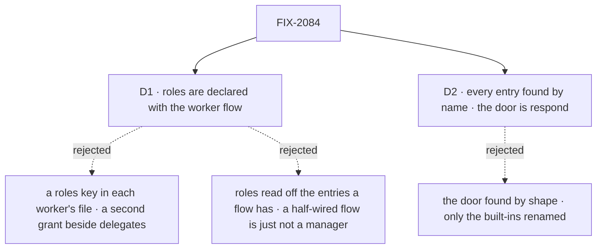

# FIX-2084 · Decisions

[Spec](SPEC.md) · **Decisions**

The epic gave this issue rule 15 of the
[concept](../../../docs/internal/design/workforce-coordination-concept.md#the-worker-contract) and
stories W-01, W-02 and W-04. These two carry it out.

## The tree

Solid edges are what you're signing. Dashed edges lost, and the label says why.

## D1 · Roles are declared with the worker flow, not in each worker's file

| | |
|---|---|
| **Instead of** | A `roles:` key in each `WORKER.md`, as the concept's parts table places it (*Stored: the worker's configuration*) · roles read off whichever entries a flow happens to have |
| **Because** | A role's entries live on the flow, so the flow is where a role is true or false. A worker's file could only narrow its flow, and what narrowing would carry, whether the worker files, its delegate list decides: [FIX-1802 D1](../FIX-1802/DECISIONS.md#d1) rejected a filing flag beside delegates because the two could disagree. Reading roles off the entries present declares nothing: a half-wired manager is just not one, found mid-task. 164 worker files stay as they are |
| **Locks in** | `roles` on `workerFlow(build, { roles })` and on a `workerFlows` entry (`{ flow, roles }`), a public option. Omitted, a flow has no role beyond every worker's. The check runs both ways: a declared role missing an entry is refused, and so is an entry of a role the flow doesn't declare. The built-ins declare theirs: agent, contributor and manager; coordinator, all three. The concept's parts-table row moves to *the worker flow's registration*; *whether a coordinator may change its own delegates* stays worker configuration (rule 13) |

**What would change my mind:** an app that needs two workers on one flow to differ by role in a
way their delegate lists can't say. Then a worker's file narrows its flow's roles, never widens
them.

It comes down to the delegate list: a role per worker is a second grant beside it, and the two can disagree.

## D2 · The hire finds every entry by name, the door included: every worker flow's door is `respond`

| | |
|---|---|
| **Instead of** | Keeping today's door search, the one public action that declares `userMessage` and takes `{ message }`, whatever its name, and renaming only the built-ins' `run` |
| **Because** | Rule 15 checks that a role's entries exist, which means by name: `work`, `dispatch` and `onTaskSettled` are already found that way, and a door found by shape is the one entry an app can't call without first reading the inventory. W-04 asks that no flow has a `run`; a shape search can't promise that for flows outside the repo. The owner already accepted that outside teams rewrite at upgrade ([(e)](../../epics/FIX-2056/DECISIONS.md#e)) |
| **Locks in** | A worker flow whose user-message action has any other name is refused, the problem naming the action to rename. A second public action that declares `userMessage` is still refused. The inventory's `door` stays and reads `respond`. The changeset carries the epic's `run` → `respond` line widened to *every worker flow's door* |

**What would change my mind:** a worker flow whose door must keep another name for a caller we
can't change. None in the repo: the doors are the agent's and coordinator's `run` and Shift
Manager's EM `message` and coder `message`, all ours.

It comes down to rule 15: every other entry is found by name, and a door found by shape is the one exception.

## Decided, not asked

- **The convergence point.** One table in Workforce lists each role's entries: name, section and
  probe input. Every hire path (`hireWorkforce`, the boot reload, the runtime hire, all through
  `checkWorkerFlows`), `workerFlowProblems` and the delegate check read it. `receive` joins it
  in phase 4 (FIX-2070).
- **Probe inputs come from the framework's own schemas**: core's task envelope for `work`,
  FIX-2078's notice for `onTaskSettled`, `{}` for `dispatch`, `{ message }` for `respond`. A test
  keeps each parsing against its source, as for `CONTRACT_PROBE_BAG`. A probe runs no block.
- **The contributor check keeps the conversation-task mark**: a `work` gated by another binding
  refuses a conversation's tasks at the claim gate, which no probe can see.
- **The delegate check reads the declared role**; the hire guarantees the entry behind it. A
  delegate list on a flow that isn't a manager stays accepted (FIX-1802 D1).
- **Requests in flight at upgrade.** A request running under `run` or `runTaskBoard` isn't
  recovered after the rename: the loss the epic accepted for durable keys. No task row names
  either entry. A lost pass is re-run by the next ending, touch or wake. If a release carried
  FIX-2078's wakes, the host's start renames their entry once, beside FIX-2078's backfill.
- **Shift Manager**: EM's and coder's `message` become `respond`, behaviour unchanged; each
  declares the roles its entries give it after FIX-2083.
- **Changesets**: workforce, minor; migration rows for the door and `roles`. No POC and no
  checker: premises read from `main` at `96404d25`, and the spec rests on no count.

## Considered and dropped

| Option | Why it lost |
|---|---|
| Rename `defineSessionBoard` and `workerTaskEntry` to role names | A rename with no behaviour; FIX-2071's retired-terms pass owns names |
| Run each entry once with a probe input | Writes state and needs a session; rule 15 says probe the schema, as the door check does |
| Keep `run` and `runTaskBoard` as hidden aliases for requests in flight | [(e)](../../epics/FIX-2056/DECISIONS.md#e): no aliases; the loss is one reply turn at the upgrade moment |
| Refuse every public action but `respond` | Polices a flow's own screens (EM's `file`, `ask`); the concept's line is about where a user's message arrives |

## Settled

Nothing was disputed. The premises (the contract's three checks, the delegate check's mark, the
door search, the doors in the repo, request recovery by action name) were read from `main` at
`96404d25`.

## Notes from review

None yet.

## How it got here

- **Draft** — framed as rule 15 on the contract the hire already runs: roles declared with the
  worker flow, each role's entries found by name and probed, `respond` and `dispatch` as the
  names, building on FIX-2078's `onTaskSettled` factory and FIX-2083's routed tasks.

Open: none.
