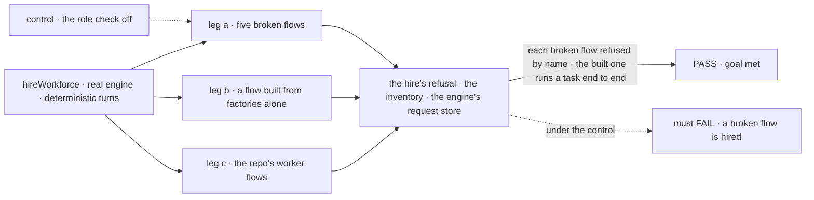
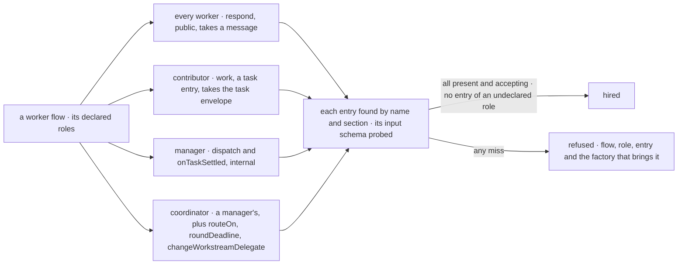

# FIX-2084 · The worker contract: roles declared and checked at hire, entries named respond and dispatch

**Spec** · [Decisions](DECISIONS.md)

**Depends on:** FIX-2078 (the `onTaskSettled` factory and the one pass at a time this renames
`dispatch`) and FIX-2083 (posts gone, so a contributor's one entry is `work`). Review now; build
after both merge.

## Six people, before and after

| Someone who… | Today | After |
|---|---|---|
| **writes a worker flow that files tasks** | Spreads nine fields into six places; a missed `entries(turn)` files tasks whose endings never arrive | Declares `roles: ["manager"]`; a miss is refused at hire, naming the entry and the field to spread |
| **gives a worker flow its own `work`** | A `work` refusing the task's envelope fails at the claim gate, mid-task | Refused at hire |
| **adds a `work` entry and doesn't say so** | Takes tasks once named a delegate | Refused until it declares `contributor` ([D1](DECISIONS.md#d1)) |
| **sends a user's message by action name** | `run` on the agent and coordinator, `message` on Shift Manager's EM | `respond` on every worker ([D2](DECISIONS.md#d2)); apps reading `door` change nothing |
| **reads a trace of a board pass** | Sees `runTaskBoard` | Sees `dispatch` |
| **upgrades a host mid-reply** | — | That one turn isn't recovered; the user resends it |

## The goal, and how we'll know it's met

**A worker flow that can't do what its roles promise is refused when it is hired, by a check
that names the role, the entry and the fix; each role's whole kit comes from one factory; and
every worker takes a user's message on `respond` and runs its delegation board on `dispatch`,
with no `run` or `runTaskBoard` left on any worker flow.**

| Is it the right goal? | |
|---|---|
| **The real need** | *"A broken worker is refused at hire, not mid-task"* (W-01) · *"I spread one thing per role into my flow"* (W-02) · *"entries named for what starts them"* (W-04) · rule 15 of the [concept](../../../docs/internal/design/workforce-coordination-concept.md#the-rules) |
| **Smaller, and rejected** | The two renames alone: a flow missing an entry is still found mid-task. Or checking names without probing inputs: a `work` that refuses the envelope still fails at the claim gate |
| **Bigger, and not this issue's** | `receive` in the check (FIX-2070) · routed tasks (FIX-2083) · one `dispatch` at a time (FIX-2078) · the kit and chief-of-staff renames (FIX-2071) |
| **Not done if** | A declared role missing an entry, an entry refusing its input, or an entry of an undeclared role is hired · a task reaches a flow that doesn't declare `contributor` · a manager wires an entry outside its factory · a repo worker flow keeps `run` or `runTaskBoard` · an app reading `door` breaks · a hire path (boot, reload, runtime) skips the check |



The check reads what the public hire returns and what the engine ran. Under the control, leg a
must fail.

| How we verify | |
|---|---|
| **Goal check** | `goals/workers/roles-checked-at-hire/` · no model · run by the implementer · verdict in the implementation PR |
| **Signal** | a: five flows with one fault each (contributor without `work`; `work` refusing the task envelope; manager without `onTaskSettled`; undeclared `work`; door named `run`), each refused with one problem naming flow, role and entry; nothing hired. b: a flow wired only from the two factories plus `respond` is hired as both; a task it files starts through `dispatch` and its ending arrives on `onTaskSettled`. c: agent, coordinator and Shift Manager's devteam host hire; every worker flow has `respond`, no `run`; every manager `dispatch`, no `runTaskBoard` |
| **Anti-game** | Refusals from `hireWorkforce`, not `workerFlowProblems`; leg c reads registered action maps, not source; leg b reads the engine's request store |
| **Control that must fail** | `GOAL_CONTROL=no-role-check` must FAIL leg a on *each broken flow refused*. Today's `main` must FAIL all three legs |

## What changes


The hire reads the roles a flow declares and checks the entries each needs. A miss is
refused before any worker runs.

**A worker flow of your own that files tasks:**

```diff
  export const emFlow = workerFlow((installation) => {
    const board = defineSessionBoard({ installation, flowKind: "em" });
    // …
    return defineFlow({
      kind: "em",
      configSchema: workerConfigSchema(),
      session: { ...installation.session(board.sessionStateShape), serverOwned: [...board.serverOwned] },
      resources: { ...installation.resources, ...board.resources },
      actions: {
-       run: { inputSchema: messageInput, block: answer, userMessage: (input) => input.message },
+       respond: { inputSchema: messageInput, block: answer, userMessage: (input) => input.message },
        ...board.actions,
      },
      internal: { actions: board.entries(answer) },
    });
- });
+ }, { roles: ["manager"] });
```

A flow passed built declares in its entry, `{ flow, roles }`. One that also takes tasks adds
`"contributor"` and its `workerTaskEntry`.

**Docs:** update *Workforce → Workers on disk* (*Which flows can run workers*: roles, the entries
checked, the door named `respond`), *Workforce → Delegating work* (*On your own worker flow*:
`roles`, `dispatch`), and the `run` examples on *Code on disk*, *Built-in worker* and
*Coordinators*. Update the workforce README (*Hiring a workforce*, *What a hireable worker flow
must admit*). Amend the concept's parts table for [D1](DECISIONS.md#d1). No new page; FIX-2081
publishes the task-board story.

## What the hire checks



One table of roles and their entries, in Workforce, is read by the hire, by
`workerFlowProblems` and by the delegate check. Nothing else lists a role's entries.

## What stays as it is

- **The contract's checks** of configuration, attribution and one user-message action.
- **Who files:** a worker whose delegates take a task ([FIX-1802 D1](../FIX-1802/DECISIONS.md#d1)).
- **The inventory's `door`**, now always `respond`, and what `respond` does: today's `run`,
  reopen included until FIX-2086.
- **`defineSessionBoard` and `workerTaskEntry`**, as the manager's and contributor's factories.
- **Other public actions**: task actions, standing rules, a flow's own.

## What's already here, and the debt

| Already here | What this does with it |
|---|---|
| The worker contract (`worker-flow-contract.ts`): configuration, one door, attribution | **Extends.** Ways to refuse a broken worker before it runs: this, a flow's mint refusals, a board's build-time refusals (FIX-2076, FIX-2078). This adds no fourth; roles join the first |
| [FIX-1690 D1](../FIX-1690/DECISIONS.md#d1): the door is the one public action that takes a person's message | **Amended.** The door is that action, named `respond` ([D2](DECISIONS.md#d2)) |
| [FIX-1802 D1](../FIX-1802/DECISIONS.md#d1): delegates are the whole grant to file, no flag | **Kept**, and why roles live on the flow ([D1](DECISIONS.md#d1)) |
| The delegate check: a delegate takes tasks when its flow has a marked `work` | **Reads the role.** The mark stays inside the contributor check |
| `defineSessionBoard`, `workerTaskEntry` | **Kept** as the factories the check names |
| The epic's [migration row](../../epics/FIX-2056/migration.md): the agent's `run` → `respond` | **Delivered**, widened to every worker flow's door |

| The debt | |
|---|---|
| **Removes** | The door found by shape · the `run` and `runTaskBoard` names · a missing role entry found mid-task |
| **Adds** | `roles` on a worker flow's registration, permanent by design · one probe input per role entry, kept in step with its source schema by a test · a one-off rename of FIX-2078's wakes at host start, only if a release carried them |
| **Leaves** | Nothing new |

**Net: flat.** One public option arrives; two names change; one failure class goes.

## Sign off

**[The goal](#the-goal-and-how-well-know-its-met):** a broken worker refused at hire, one
factory per role, `respond` and `dispatch` everywhere. If wrong: FIX-2070 adds `receive` to a
check that doesn't exist.

**[The debt](#whats-already-here-and-the-debt), flat:** `roles` arrives, two names change.
If wrong: one option every worker flow outside the repo adds.

1. **[D1](DECISIONS.md#d1) · Roles are declared with the worker flow, not in each worker's
   file.** If wrong: two workers on one flow can't differ by role.
2. **[D2](DECISIONS.md#d2) · The hire finds every entry by name, the door included: every
   worker flow's door is `respond`.** If wrong: teams outside the repo rename a door for a
   constant they didn't need.

**Open: none.** D1 is the one to weigh: it amends the concept's parts table.

Feature · `workforce` + `shift-manager` + goals · medium · epic [FIX-2056](../../epics/FIX-2056/SPEC.md)
