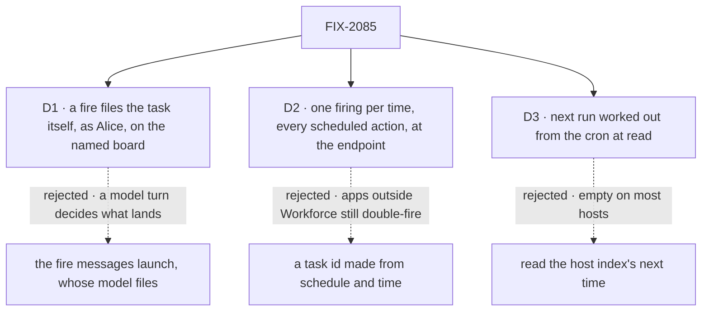

# FIX-2085 · Decisions

[Spec](SPEC.md) · **Decisions**

Three calls shape the outcome. The concept already decided that recurring work is a schedule that
files an ordinary task ([`workforce-coordination-concept.md`](../../../docs/internal/design/workforce-coordination-concept.md));
these carry it out.

## The tree

Solid edges are what you're signing. Dashed edges lost, and the label says why.

## D1 · A fire files the task itself, as Alice, on the named worker's board; no model turn decides

| | |
|---|---|
| **Instead of** | The fire sends launch a message ("refresh the adoption numbers"), and launch's model files the task, or doesn't |
| **Because** | S-01 asks for recurring work that *arrives* as an ordinary task. A model turn in between is a second chance to file nothing, or something else, and the concept says a schedule files the task. Filing through the board's own filing, as Alice in her conversation with launch, means the task is launch's like any it filed: launch's delegates only (FIX-2081), the filing settings (FIX-2080), its ending to launch (FIX-2078). Tenet 2: no new kind of task |
| **Locks in** | The schedule row's public shape: `kind: "task"`, `input.filer` naming the worker whose board it lands on, and the rest of `input` as `createTask` takes it. A schedule can't skip or reshape a week's work; to change it, the schedule is edited |

It comes down to Monday morning: a message can file nothing, and a filing always lands.

**What would change my mind:** users asking for a coordinator that judges each firing ("skip it if
nothing changed"). Then a schedule files a held task the coordinator releases or cancels, still
through the same filing.

## D2 · At most once per scheduled time, for every scheduled action, at the dispatch endpoint

| | |
|---|---|
| **Instead of** | A Workforce-only guarantee: the task's id made from the schedule and its time, so a second filing finds the first |
| **Because** | S-03 is a flow author's story: "a restart or a second host never files the same work twice", for any scheduled action. Every cron path, a host's own cron, a polling tick and BullMQ, meets at the dispatch endpoint, and the per-process cache there is what fails: each host and each restart has its own. One stored time per schedule, claimed with a compare-and-set in the host's store before any handler runs, holds across hosts and restarts. It is one record per schedule, not one per firing, so it never grows |
| **Locks in** | Every app using `scheduled` changes at upgrade: a fire for a time already fired, or earlier, is refused, so a late retry of a missed time never runs, and a manual POST between times counts against the nearest one. `idempotencyWindowMs` and the body's `idempotencyKey` go. On a store the processes don't share (the memory store), the guarantee holds per process only |

It comes down to apps outside Workforce: a task id protects only tasks, and invoices still go out twice.

**What would change my mind:** no app runs scheduled actions outside Workforce on more than one
process. Then the task id alone meets S-03, and `scheduled` is left as it is.

## D3 · A schedule's next run is worked out from its cron and time zone when the list is read

| | |
|---|---|
| **Instead of** | Showing the next time the host's schedule index holds |
| **Because** | S-02 asks for the next run on Alice's list. An index is optional, and the BullMQ index keeps no times, so on most hosts that column is empty. A time stored on the row goes stale. The cron and zone are on every row |
| **Locks in** | The list says when the schedule is *due*, not when the host *will* fire it: on a host whose cron isn't running, it still shows a time |

It comes down to hosts without an index: the index's time leaves the list empty there.

## Decided, not asked

- **The convergence point for "one firing per time" is the dispatch endpoint**, after the
  schedule resolves and passes its checks, before its handler runs. Every writer of a firing
  passes through it: the Vercel GET shim, the polling tick, BullMQ's dispatch worker and a host's
  own cron all POST there. No index or worker keeps a second check of its own; each index's
  claim stays only as the index's way of finding due rows.
- **A fire's time is the scheduled time nearest the time it carries,** or nearest now when it
  carries none. A clock a second early still lands on the right time. A fire refused before the
  engine admitted it (a concurrency refusal) gives its time back, so a retry can run, as today.
- **The record lives in the host's store,** beside the schedule's own data, not in the index or a
  new store method. Store adapters change nothing.
- **A fire files even if last week's task is still open.** `onOverlap` covers the filing request,
  not the task. Each firing is its own task, as the concept says.
- **The row names a worker, never a session.** The fire resolves Alice's conversation with that
  worker on the server, as her own message would reach it (BP-031). A worker not on her roster, or
  an assignee not among its delegates, refuses the filing, and the fire is dropped like any failed
  filing. The write itself is not checked: a roster changes after a row is written.
- **One filing path.** If FIX-2081 lands first, the fire calls `createTask`'s block; if this
  lands first, the filing beneath today's actions, which FIX-2081 keeps. No filing code is this
  issue's own.
- **A body `idempotencyKey` is refused with 400 naming the change**, not ignored (BP-030), so a host
  relying on it learns at upgrade. The routes file's header comment is rewritten with it, which
  closes [FIX-1219](https://linear.app/fixpoint-labs/issue/FIX-1219).
- **No POC and no checker.** The compare-and-set is the store contract's create-if-absent and
  version check (`engine/src/stores/types.ts:1294-1320`); nothing rests on a count.

## Considered and dropped

| Option | Why it lost |
|---|---|
| A schedule-owned board, its own filer | A second kind of filer; the ending would reach no worker, and S-01 says launch hears it |
| A durable record per firing | Grows by one row per fire, forever, for the same guarantee |
| Keep the cache and document the host's idempotency | Already the docs' answer. Vercel Cron and `node-cron` send no dedupe key, and a restart empties the cache |
| Both D2 and the task id | Two places to keep one guarantee in step (tenet 5) |

## How it got here

- **Draft** — framed as three stories meeting at two seams: the dispatch endpoint for "once",
  the board's filing for "an ordinary task"; builds on the scheduled transport and the task tools.

**Open: none.**
