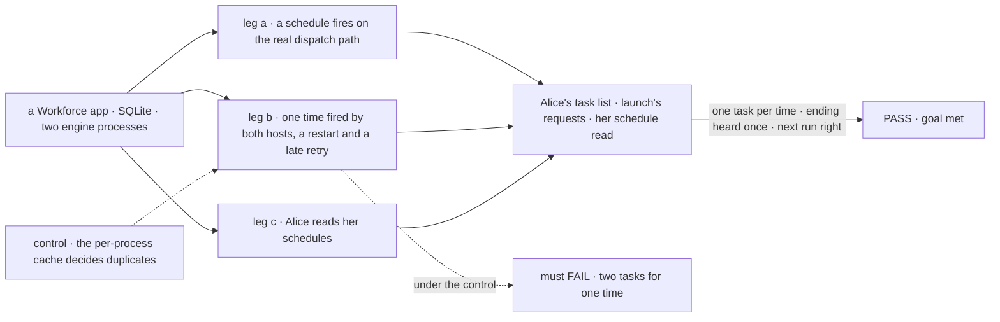
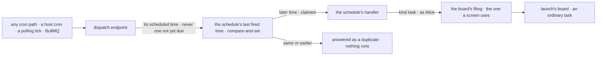

# FIX-2085 · Recurring work is a schedule that files an ordinary task

**Spec** · [Decisions](DECISIONS.md)

## Five people, before and after

| Someone who… | Today | After |
|---|---|---|
| **wants launch to refresh the adoption numbers every Monday** | No way in Workforce: a schedule starts a request outside the task model, and nothing files a task from one | Each Monday a task lands on launch's board, assigned to researcher. It retries, reports and cancels like any task, and launch hears its ending once ([D1](DECISIONS.md#d1)) |
| **opens her list of scheduled work** | There is no such list, and a schedule row has no next run unless the host keeps a schedule index | Sees each schedule with its next run, worked out from its cron and time zone, on any host ([D3](DECISIONS.md#d3)) |
| **adds or removes a schedule** | Nothing shows it | The list shows the change on its next read |
| **runs two hosts, or restarts one, behind any cron** | Each process dedupes in its own memory for a minute: two hosts, or a restart, fire one time twice | One firing per scheduled time, on every cron path, for every scheduled action, on a store the hosts share: SQLite or Postgres ([D2](DECISIONS.md#d2)) |
| **sends a fire late, early or twice** | A fire with no time is deduped only for a minute | A fire carrying a time counts against that scheduled time; a fire with none counts against the latest time already due, never the next one. A fire for a time already fired, or earlier, is answered as a duplicate and nothing runs |

The two limits the concept states stand: a fire whose filing fails is dropped, not retried, and a
crash can lose a firing.

## The goal, and how we'll know it's met

**Alice's recurring work arrives as an ordinary task on the board she named, once per scheduled
time across restarts and hosts, and she can see every schedule's next run.**

| Is it the right goal? | |
|---|---|
| **The real need** | *"It arrives as a task they can watch and cancel, and they can see what will run and when"* (the issue). Stories S-01 to S-03 of [`workforce-coordination-stories.md`](../../../docs/internal/design/workforce-coordination-stories.md); the gaps file's phase 1 row *recurring work is a schedule* |
| **Smaller, and rejected** | "A Workforce schedule kind that files a task." Two hosts still file the same Monday twice, and the list still needs a host index to show a time |
| **Bigger, and not this issue's** | Telling launch "every Monday, refresh the numbers" and having it set up the schedule: no worker tool writes schedules ([FIX-2089](https://linear.app/fixpoint-labs/issue/FIX-2089)). The filer hearing a cancel it didn't make (FIX-2078) |
| **Not done if** | A fire reaches the board without passing the filing a screen uses · a fire runs a model turn to decide what to file · two hosts or a restart file one time twice · the list shows nothing without a host index · the per-process cache still decides a duplicate |



The check reads what Alice and launch see, not the dispatch responses. The dashed path puts
today's dedupe back, and it must fail.

| How we verify | |
|---|---|
| **Goal check** | `goals/scheduled-work/recurring-work-files-a-task/` · no model: deterministic workers · run by the implementer at completion · verdict in the implementation PR |
| **Signal** | a: one fire, POSTed as a host scheduler does, puts one task on launch's board in Alice's list, assigned to researcher; it runs, and launch's session runs one ending request for it; a second time's task, cancelled by Alice through the public task action, ends cancelled. b: one scheduled time POSTed by two processes sharing the store, again after one restarts, and again 20 s late, files exactly one task; an untimed POST a minute before the time files nothing, and the time's own fire still files. c: the list shows each schedule's next run equal to its cron in its time zone; a schedule added or removed shows on the next read, with no schedule index configured |
| **Input** | A weekly cron in `Europe/London` on a pinned clock. Another cron, zone, or a fire on either side of the slot must pass too |
| **Anti-game** | Tasks through the public task read; launch's requests from the engine's store; two real processes, not two handlers in one |
| **Control that must fail** | `GOAL_CONTROL=memory-dedupe` must FAIL leg b on *exactly one task*. Today's `main` FAILS leg a on *one task on launch's board* and leg c on *next run* |

## What changes


Read the middle column: one stored time per schedule replaces the per-process memory, and a
Workforce fire ends on a board, not in a free request.

**A schedule row in Alice's collection, and the host:**

```diff
+ // a row in Alice's schedule collection: the fire files this task on launch's board
+ { cron: "0 9 * * 1", timezone: "Europe/London", kind: "task",
+   input: { filer: "launch", goal: "Refresh the adoption numbers", assignee: "researcher" } }
```

```diff
  const flows = hireWorkforce(installation, {
+   schedules: { index },   // optional: a polling or BullMQ index; omit it and the host's own cron POSTs per schedule
  });
- createScheduledTransportAdapter({ idempotencyWindowMs: 5 * 60_000 })
+ createScheduledTransportAdapter()   // one firing per scheduled time, kept in the host's store
```

**Docs:** update *Server → Scheduled actions* (the dispatch body, the response codes, and
*Idempotency* rewritten as *At most once per scheduled time*), *Server → Schedule index* (its
contract line), and the `scheduled` README. Extend *Workforce → Delegating work* with a
*Recurring work* section, and *Shift Manager* with the scheduled-work list; one line in the
`workforce` README. No new page.

## How a fire reaches the board



The time is claimed once, where every path meets, before any handler runs; Workforce adds only
the handler, which files.

## What stays as it is

- **The two stated limits:** a fire whose filing fails is dropped; a crash can lose a firing.
- **Static schedules, `kind` handlers that aren't Workforce's, the overlap check, the org binding**
  of [FIX-1442](https://linear.app/fixpoint-labs/issue/FIX-1442), and each index's own claim.
- **What the task does once filed:** start, attempts, retry, cancel and its ending are the
  board's, through FIX-2080, FIX-2081 and FIX-2078.

## What's already here, and the debt

| Already here | What this does with it |
|---|---|
| What fires a time at most once: the per-process cache (`scheduled/src/idempotency.ts`), the index's atomic `claimDue`, BullMQ's one job per slot, the best-effort overlap check | **Replaces** the cache with one stored time per schedule at the endpoint, where all paths meet. The closest, `claimDue`, covers only the polling path. The rest are left alone |
| What files a task from outside a worker turn: a screen's task actions, and routing's `filePost` (`workforce/src/conversation-board/board.ts:712`) | **Builds on** the screen's filing (FIX-2081's `createTask` once it lands; until then the start-now filing beneath `dispatchTask_tasks`). `filePost` is FIX-2083's |
| What works out a next run: `parseNextFireAt`; the index row's `nextFireAt` | **Builds on** `parseNextFireAt` at read. The index row stays the index's |
| [FIX-1546 D1](../FIX-1546/DECISIONS.md#d1): an index row is its schedule's cell plus key | **Kept** |
| The resolver's `kind` → block map (FIX-838) and the row's stamped org (FIX-1442, FIX-1545) | **Kept.** Workforce adds one `kind`, `task` |
| The epic's [ER-1](../../epics/FIX-2056/DECISIONS.md#who-owns-what), [ER-3](../../epics/FIX-2056/DECISIONS.md#who-owns-what) and [ER-5](../../epics/FIX-2056/DECISIONS.md#who-owns-what) | **Kept.** A fire records no ending, sends none, and adds no task surface |

| The debt | |
|---|---|
| **Removes** | The per-process cache · `idempotencyWindowMs` · the body's `idempotencyKey` |
| **Adds** | One stored record per schedule, its last fired time. Permanent by design: it is the guarantee. A `schedules` option on `hireWorkforce` |
| **Leaves** | A worker can't set up a schedule from a conversation (FIX-2089) · a durable dynamic schedule doesn't recover across a crash, a stated limit |

**Net: flat.** A cache, an option and a body field go; one stored record and one option arrive.

## Sign off

**[The goal](#the-goal-and-how-well-know-its-met), at that size:** an ordinary task per fire,
once per time on every path, and a next run on any host. If wrong: recurring work double-files on
the first multi-host deploy, or the list stays empty without an index.

**[The debt](#whats-already-here-and-the-debt), net flat:** the cache and two knobs go; one
stored record per schedule arrives. If wrong: a host that relied on `idempotencyKey` breaks at
upgrade.

1. **[D1](DECISIONS.md#d1) · A fire files the task itself, as Alice, on the named worker's
   board; no model turn decides.** If wrong: launch can't adapt the week's work without the
   schedule being edited.
2. **[D2](DECISIONS.md#d2) · At most once per scheduled time, for every scheduled action, at
   the endpoint.** If wrong: a late or out-of-order retry of a missed time never runs. **The one to weigh:** it
   changes the `scheduled` package for apps outside Workforce too.
3. **[D3](DECISIONS.md#d3) · The next run is worked out from the cron at read.** If wrong: the
   list shows a time on a host whose cron isn't running.

**Open: none.**

Feature · `scheduled` + `workforce` + `shift-manager` (+ docs; `vercel` and `bullmq` docs only) · medium · epic [FIX-2056](../../epics/FIX-2056/SPEC.md) · no blocker
