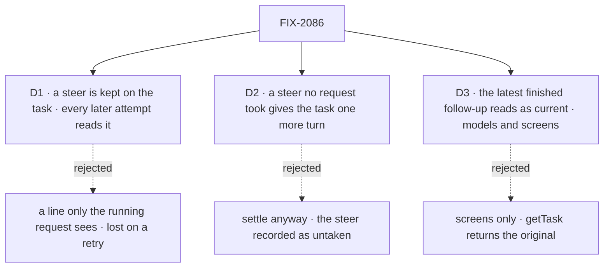

# FIX-2086 · Decisions

[Spec](SPEC.md) · **Decisions**

The owner decided the steer, the follow-up and fixed output in the concept
([rule 20, the `updateTask` table](../../../docs/internal/design/workforce-coordination-concept.md#the-rules)).
These three carry it out where the concept leaves the mechanism open.

## The tree

Solid edges are what you're signing. Dashed edges lost, and the label says why.

## D1 · A steer is kept on the task, and every later attempt reads it

| | |
|---|---|
| **Instead of** | A line written into the task's session, which only the request running now reads, as a user's line reaches a task today |
| **Because** | A steer "joins the brief" (the concept's table), and a brief outlives an attempt: if the attempt that took a steer fails, the retry must not redo the task as first filed. Session history can't carry that: a retry may start before the line is read, retention evicts old items, and history can't tell a kept line from a refused one, which is why the coding door keeps its own `turns` collection today. On the row, `getTask` shows what the task was told |
| **Locks in** | `steers` on the task row: server-written, append-only, each with its sender and the attempt that took it, readable through `getTask`. The coding door's `turns` collection folds into it and goes. At most 20 per task; the 21st is refused, naming the rule (cancel and refile, or a follow-up). A retry's brief carries every steer, taken or not |

It comes down to a retry after a steer: a session line is lost, and the task runs as first filed.

**What would change my mind:** filers expecting a steer to apply only to the attempt it reached,
so a retry starts from the original brief. Then a steer is kept per attempt, as `turns` is today.

## D2 · A steer no request took gives the task one more turn before it settles

| | |
|---|---|
| **Instead of** | Settling the task when its request ends, with a late steer recorded as untaken |
| **Because** | The filer was told the steer was accepted. A request that made its last model call before the steer landed, or one with no model call at all, never takes it, and a task settled over it silently ignores the redirect. The concept's rule 6 already keeps a task open for a queued message; an untaken steer is the same kind of owed work. The row knows it, so `orchestration` decides it with no Workforce read |
| **Locks in** | Rule 6 (FIX-2077's predicate) gains *no steer untaken by this attempt*, read from the row. The gate admits one more `work` turn, same attempt, with the steer as its message, and re-checks. A steer to a task with no request on it (waiting on its filed tasks) starts that turn now. The output is that turn's answer, as for any last turn. The 20-steer cap bounds the extra turns |

It comes down to a redirect the filer was told was accepted: settled over, it is ignored without a word.

**What would change my mind:** a late steer turning out to be mostly noise ("thanks", "ok") that
costs a model turn each time. Then an untaken steer is reported to its sender instead, and the
task settles.

## D3 · The latest finished follow-up reads as current, for models and screens

| | |
|---|---|
| **Instead of** | Showing the follow-up's output as current only on screens, with `getTask` returning the original alone |
| **Because** | The epic's [ER-5](../../epics/FIX-2056/DECISIONS.md#who-owns-what): the four tools are the one task surface for models and screens. A filer's model reading writer's task should see the version Alice sees, not one she replaced. Computed at read from `followUpOf`, nothing is stored, so the original's output never changes |
| **Locks in** | The task view (`getTask`, `listTasks`, the screen actions) adds `current`: the id and output of the latest finished follow-up in the chain, or absent when there is none. `output` stays the row's own. A dependent still reads the output of the task it named, as delivered |

It comes down to a filer's model reading a corrected task: screens-only shows it the version Alice replaced.

**What would change my mind:** filers that must act only on what they themselves filed. Then
`current` is a screen-only read and `getTask` keeps the original.

## Decided, not asked

- **One write, one reader per path.** The convergence point is a collection verb in
  `orchestration`, `steer`, on both backings, its status check inside the write, as FIX-2081's
  guarded patch: refused once finished. Every writer passes it: `updateTask({ message })` from a
  tool or a screen action (FIX-2081's block), and a line typed in an open task's session. Readers:
  the brief a worker is handed (`taskMessage`, the worker input), a context entry re-read before
  each model step, and the harness manager's prompt. Each read marks the steers it took for the
  current attempt.
- **A steer is no ending** (rule 6): it records nothing through `endingOf`, changes no status and no
  claim, uses no attempt and never cancels.
- **A coding run:** the manager watches its row while the harness step runs, and a new steer aborts
  that step, not the request. The same request runs the next step, resuming the confirmed coding
  session with the steers in its prompt. The step already takes an abort signal
  ([`manager.ts:2738`](https://github.com/fixpoint-labs/flow-state-dev/blob/96404d2519cd7848940de2857841b67adaf87646/packages/harness-manager/src/manager.ts#L2738))
  and resumes by session id (`:2630`).
- **A line in a task's session** goes to the flow's own door (`run`, `respond` after FIX-2084).
  In an open task's session the door writes the steer as the user; in a finished one it is a
  reply with the session's history and the task is unchanged (M-10). The router that reopened goes;
  Shift Manager's composer still calls the door it calls today.
- **A follow-up the user files takes the original's filer** (rule 4), so its ending goes where the
  original's went. A screen files it with `createTask` and `followUpOf`.
- **The refusal** on a finished task names the rule and the move: "a finished task takes no
  message; file a follow-up".
- **Upgrade (ER-6).** FIX-2080's reopened-row entry is turned on here: a reopened row in flight
  reads as pending with one steer pointing at the session's latest line, so its attempt still
  picks the task up. Its output is replaced once, by that attempt, the last time. A row parked
  for a turn at upgrade (a door that crashed between the park and the re-queue) reads as pending,
  not charged: a sixth entry in the same map.
- **A taken steer shows in the task's session** as a line from its sender, so the session reads
  as the worker was told.
- **No POC and no checker.** The premises are read from code and cited; nothing rests on a count.

## Considered and dropped

| Option | Why it lost |
|---|---|
| Keep reopen beside follow-ups | Rule 20: finished output never changes. Its filer and dependents already used it |
| Keep the coding door and add a tool beside it | Two ways to steer, and only coding flows get one of them |
| Stop the coding request and park the row, as today | Uses the attempt machinery for a steer; T-21 keeps the request |
| Live delivery into a running harness | FIX-1690's fork, still no for every harness; nothing here blocks it later |
| A steer queue in Workforce state | `orchestration` decides rule 6 and could not read it |

## Settled

- **A context entry re-read before each step reaches a running generator.** Read from
  `binding-reader.ts` and `context-fn.ts`, where a skill activated mid-loop reaches the next step.
- **The harness step stops on its signal and resumes by session id.** Read from `manager.ts`
  (above) and the door's own continue path.

## Notes from review

None yet.

## How it got here

- **Draft** — framed as rule 20's `message` row and fixed output: one steer write kept on the
  task, taken before the next model call or by one more turn, ending a coding run but not its
  request; reopen and the coding door go, and a follow-up carries the correction.

Open: none.
