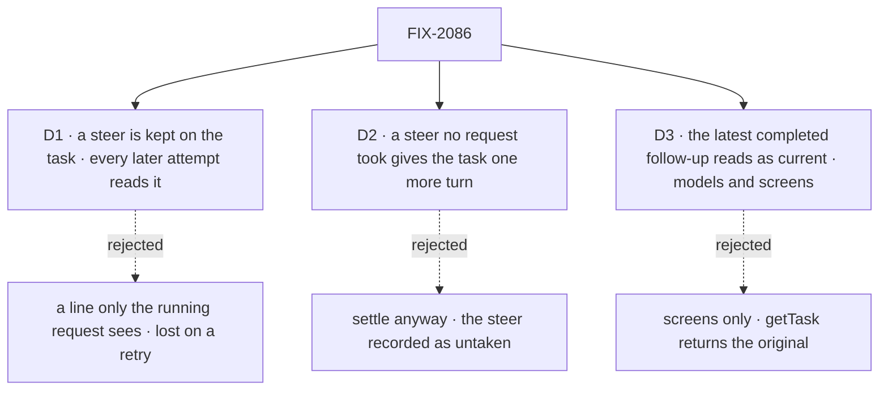

# FIX-2086 · Decisions

[Spec](SPEC.md) · **Decisions**

The owner decided the steer, the follow-up and fixed output in the concept
([rule 20, the `updateTask` table](../../../docs/internal/design/workforce-coordination-concept.md#the-rules)).
These three carry it out where the concept leaves the mechanism open.

## The tree

Solid edges are what you're signing. Dashed edges lost, and the label says why.

## D1 · A steer is kept on the task, and every later attempt reads it

| | |
|---|---|
| **Instead of** | A line written into the task's session, which only the request running now reads, as a user's line reaches a task today |
| **Because** | A steer "joins the brief" (the concept's table), and a brief outlives an attempt: if the attempt that took a steer fails, the retry must not redo the task as first filed. Session history can't carry that: a retry may start before the line is read, retention evicts old items, and history can't tell a kept line from a refused one, which is why the coding door keeps its own `turns` collection today. On the row, `getTask` shows what the task was told |
| **Locks in** | `steers` on the task row: server-written, append-only, each with its sender and the attempt that took it, readable through `getTask`. The coding door's `turns` collection folds into it: its writes go, and a one-off upgrade step writes each turn no attempt took as a steer ([Upgrade](#decided-not-asked)). At most 20 per task; the 21st is refused, naming the rule (cancel and refile, or a follow-up). A retry's brief carries every steer, taken or not |

It comes down to a retry after a steer: a session line is lost, and the task runs as first filed.

**What would change my mind:** filers expecting a steer to apply only to the attempt it reached,
so a retry starts from the original brief. Then a steer is kept per attempt, as `turns` is today.

## D2 · A steer no request took gives the task one more turn before it settles

| | |
|---|---|
| **Instead of** | Settling the task when its request ends, with a late steer recorded as untaken |
| **Because** | The filer was told the steer was accepted. A request that made its last model call before the steer landed, or one with no model call at all, never takes it, and a task settled over it silently ignores the redirect. The concept's rule 6 already keeps a task open for a queued message; an untaken steer is the same kind of owed work. The row knows it, so `orchestration` decides it with no Workforce read |
| **Locks in** | Rule 6 (FIX-2077's predicate) gains *no steer untaken by this attempt*, read from the row. The gate admits one more `work` turn, same attempt, with the steer as its message, and re-checks. A steer to a task with no request on it (waiting on its filed tasks) starts that turn now. The output follows FIX-2081's D3, as for any last turn: the latest checkpoint, else the answer. The extra turn's brief says a prior checkpoint stands unless it reports a new one. The owed turn is a debt on FIX-2078's wake, due at write + 2 s: the wake is written before the steer write when no request runs, or before the gate's not-done write. Its entry starts the same-attempt `work` request, uncharged; until that request is admitted the row is running, its `waitingOn` names the steer, and it holds no lease. Each extra turn takes at least one steer no earlier turn took, so the 20-steer cap holds a task to at most 20 extra turns. A steer is not a message and is not paid from the message budget; the cap is its limit, as the budget is a queued message's |

It comes down to a redirect the filer was told was accepted: settled over, it is ignored without a word.

**What would change my mind:** a late steer turning out to be mostly noise ("thanks", "ok") that
costs a model turn each time. Then an untaken steer is reported to its sender instead, and the
task settles.

## D3 · The latest completed follow-up reads as current, for models and screens

| | |
|---|---|
| **Instead of** | Showing the follow-up's output as current only on screens, with `getTask` returning the original alone |
| **Because** | The epic's [ER-5](../../epics/FIX-2056/DECISIONS.md#who-owns-what): the task tools are the one task surface for models and screens. A filer's model reading writer's task should see the version Alice sees, not one she replaced. Computed at read from `followUpOf`, nothing is stored, so the original's output never changes |
| **Locks in** | The task view adds `current`: the latest follow-up in the chain that **completed**, narrower than the concept's *latest finished* (the implementation PR amends concept :153, T-31 and the gaps row to "completed"). One that errored or was cancelled is skipped, and `current` is absent when none completed, so a model and a screen read the same thing. On `getTask` and the screen action reading one task it is `{ id, output }`, the output cut to `READ_OUTPUT_LIMIT` with `outputCut` set, the projection `readTask` applies today (BP-042). `listTasks` stays result-free: a row carries `current: { id }` only and carries no output (FIX-2081's list rows show `statusNote` only). `output` stays the row's own. A dependent still reads the output of the task it named, as delivered |

It comes down to a filer's model reading a corrected task: screens-only shows it the version Alice replaced.

**What would change my mind:** filers that must act only on what they themselves filed. Then
`current` is a screen-only read and `getTask` keeps the original.

## Decided, not asked

- **One write, one reader per path.** The convergence point is a collection verb in
  `orchestration`, `steer`, on both backings, its status check inside the write: refused once
  finished. It reads `message`'s rule from FIX-2081's field table, through the guarded patch
  FIX-2080 adds; its own additions are the append-only write and the 20-steer cap. A combined call
  (`updateTask({ id, goal, message })`) runs every check, the cap included, before any write, then
  the patch, then the steer, so it never half-applies. Every writer passes it: `updateTask({ message })` from a
  tool or a screen action (FIX-2081's block), and a line typed in an open task's session. Readers:
  the brief a worker is handed (`taskMessage`, the worker input), a context entry re-read before
  each model step, and the harness manager's prompt. Each read marks the steers it took for the
  current attempt, keeping the rule `turns` has today: a steer already taken by this attempt still
  counts as its own, so a step that re-runs after a crash reads it again rather than losing it.
- **A plan row:** an inline plan row refuses `message`, naming the move ("steer the task this
  step belongs to"); that task's steers are read before every model call of the request running
  the step. A dispatched plan row (FIX-2082) takes a steer like any task.
- **A steer is no ending** (rule 6): it records nothing through `endingOf`, changes no status and no
  claim, uses no attempt and never cancels.
- **A coding run:** the manager watches its row while the harness step runs, and a new steer aborts
  that step, not the request. The same request runs the next step only once the aborted step's
  process has exited, resuming the confirmed coding session with the steers in its prompt; the
  checkout keeps whatever the stopped step wrote, and the prompt says it was stopped for a steer.
  The step already takes an abort signal
  ([`manager.ts:2738`](https://github.com/fixpoint-labs/flow-state-dev/blob/96404d2519cd7848940de2857841b67adaf87646/packages/harness-manager/src/manager.ts#L2738))
  and resumes by session id (`:2630`), but today its abort returns before the harness process is
  down (Codex and Cursor race the signal against the stream and kill the process after,
  [`codex/agent.ts:270-286`](https://github.com/fixpoint-labs/flow-state-dev/blob/96404d2519cd7848940de2857841b67adaf87646/packages/codex/src/agent.ts#L270-L286)).
  A harness that can't confirm its process exited is not aborted: the steer waits for that step's
  own end and the next step takes it, or D2's extra turn does.
- **A line in a task's session** goes to the flow's own door (`run`, the coder's `message`;
  `respond` after FIX-2084). In an open task's session the door writes the steer as the user; in a
  finished one it is talk with the session's history and the task is unchanged (M-10). For the
  coder that talk is one run resuming the task's coding session, outside any attempt
  ([What changes](SPEC.md#what-changes)). The door finds the session's task from server state, the
  row whose run link names the session, as the coding door does today. The router that reopened
  goes; Shift Manager's composer still calls the door it calls today, now the replacement.
- **A follow-up the user files takes the original's filer** (rule 4), so its ending goes where the
  original's went: FIX-2078's server-written filer fields copy the original's. A screen files it with `createTask` and `followUpOf`.
- **The refusal** on a finished task names the rule and the move: "a finished task takes no
  message; file a follow-up".
- **Upgrade (ER-6).** FIX-2080 builds the map's entries; this issue adds steers to two of them.
  Its reopened-row entry: a reopened row in flight reads as pending with one steer pointing at the
  session's latest line, so its attempt still picks the task up. Its output is replaced once, by
  that attempt, the last time. Its parked-for-a-turn entry (a door that crashed between the park
  and the re-queue) reads as pending, not charged. A turn the coding door kept that no attempt took
  (`turns/**`, neither delivered nor withdrawn) is not a map entry, since `orchestration` can't
  read a harness-manager collection: a one-off harness-manager upgrade step writes each as an
  untaken steer on its row, from the turn's person, keyed by the turn's id so a replay adds nothing
  (BP-030). After that step the `turns` reader goes.
- **Behaviour lines.** Two rows are in the epic's Changed table (migration.md, added by
  [FIX-2081](../FIX-2081/SPEC.md)): `updateTask({ message })` on an open task steers it, using no
  attempt and never cancelling; a line typed in a finished task's session is talk, and the task
  doesn't change.
- **A taken steer shows in the task's session** as a line from its sender, so the session reads
  as the worker was told.
- **No POC and no checker.** The premises are read from code and cited; nothing rests on a count.

## Considered and dropped

| Option | Why it lost |
|---|---|
| Keep reopen beside follow-ups | Rule 20: finished output never changes. Its filer and dependents already used it |
| Keep the coding door and add a tool beside it | Two ways to steer, and only coding flows get one of them |
| Stop the coding request and park the row, as today | Uses the attempt machinery for a steer; T-21 keeps the request |
| Live delivery into a running harness | FIX-1690's fork, still no for every harness; nothing here blocks it later |
| A steer queue in Workforce state | `orchestration` decides rule 6 and could not read it |

## Settled

- **A context entry re-read before each step reaches a running generator.** Read from
  `binding-reader.ts` and `context-fn.ts`, where a skill activated mid-loop reaches the next step.
- **The harness step stops on its signal and resumes by session id.** Read from `manager.ts`
  (above) and the door's own continue path. Its signal does not wait for the harness process to
  exit (above), which is why the next step waits for that exit.

## Notes from review

- "Three consumption sites each **mark** steers for the current attempt … **Simpler implement shape:** one orchestration boundary marks once per attempt/step; other readers consume read-only untaken steers." — cursor ([review](https://github.com/fixpoint-labs/flow-state-dev/pull/3603#pullrequestreview-5595335794), [thread](https://github.com/fixpoint-labs/flow-state-dev/pull/3603#discussion_r4333353844))
- "A re-read that marks as a side effect is not idempotent under a step retry or replay: mark-then-crash loses the steer, read-without-mark double-delivers … worth a `settle-claim` POC (the generator-step path, with a steer arriving between steps)." — second-look ([comment](https://github.com/fixpoint-labs/flow-state-dev/pull/3603#issuecomment-6308800407))
- "“Manager watches its row” during a harness step — please name expected freshness (subscription/SSE vs poll/backoff). Without that, implementers may copy door-style polling across multi-minute steps." — cursor ([thread](https://github.com/fixpoint-labs/flow-state-dev/pull/3603#discussion_r4333353851))
- "what happens to the checkout and any uncommitted work when the step aborts mid-write, and what the next step's prompt says about the aborted one … restrict v1 to harnesses that confirm a session and say the others refuse." — second-look ([comment](https://github.com/fixpoint-labs/flow-state-dev/pull/3603#issuecomment-6308800407))
- "`current` on **`listTasks`** implies follow-up chain resolution per row. Worth one line: batch/index at read (e.g. one pass keyed by `followUpOf`) or scope `current` to `getTask` if list views stay cheap. Deep chains have no cap unlike steers (20)." — cursor ([thread](https://github.com/fixpoint-labs/flow-state-dev/pull/3603#discussion_r4333353838)); "State the bound (a chain is short, or the walk is indexed), or list views will pay a per-row read" — second-look
- "Session line mirror on take duplicates `steers` on the row. If the only consumer is “what the person sees,” consider read-time projection in Shift Manager instead of a second write path on every take." — cursor ([thread](https://github.com/fixpoint-labs/flow-state-dev/pull/3603#discussion_r4333353866))
- "Retry brief carries **every** steer taken or not (cap 20) … consider promoting the **20-cap** to its own “Decided” bullet with flip (“refile / follow-up”) … Optional: **untaken-only queue on row** + compact history for audit" — cursor ([thread](https://github.com/fixpoint-labs/flow-state-dev/pull/3603#discussion_r4333353833))
- "`steer` collection verb vs public `updateTask` — fine if FIX-2081 owns the verb; otherwise prose can say “guarded patch for `message`” and avoid a second symbol in this spec." — cursor ([review](https://github.com/fixpoint-labs/flow-state-dev/pull/3603#pullrequestreview-5595335794))
- "Delivery story appears here, in `what-changes.svg`, and again in DECISIONS + three D-figures. **Simplify option:** keep goal-check mermaid … and drop this flow **or** drop redundant D-SVGs" · "One **mechanism checklist** in DECISIONS with SPEC linking would cut drift risk for implementers." — cursor ([thread](https://github.com/fixpoint-labs/flow-state-dev/pull/3603#discussion_r4333353827))
- "Suggest putting FIX-2071's number in the code comment at the entry too, so the removal is findable without this spec." — second-look ([comment](https://github.com/fixpoint-labs/flow-state-dev/pull/3603#issuecomment-6308800407))
- "`door.ts`/`turns.ts` carry a lot of hard-won race handling (start-wait, withdraw, kept-is-never-reported-as-not-delivered). Before deleting them, the implementer should list each guarantee and where it lands in the new path, so none is lost silently." — second-look ([comment](https://github.com/fixpoint-labs/flow-state-dev/pull/3603#issuecomment-6308800407))

These are inputs, not instructions. Adopt, adapt, or discard; you owe no justification for
discarding one.

## How it got here

- **Draft** — framed as rule 20's `message` row and fixed output: one steer write kept on the
  task, taken before the next model call or by one more turn, ending a coding run but not its
  request; reopen and the coding door go, and a follow-up carries the correction.
- **Cross-spec** — `updateTask`'s callers briefly added the assignee for an `output` checkpoint;
  on the owner's revision the checkpoint is FIX-2081's `reportProgress`, and the callers are back
  to the filer and the user from a screen.
- **Codex, round 1** (factual, no round) — `current` follows `readTask`'s bounded output and
  `listTasks` stays result-free; `current` names completed follow-ups only; an untaken legacy
  turn reads as a steer at upgrade. The epic's migration lines gain the removed door exports.
- **Cross-spec audit** — the coder keeps a replacement door; a late steer's output and its owed
  turn follow FIX-2081's D3 and FIX-2078's debts; FIX-2080 builds every map entry, and untaken
  coding turns move by a harness-manager upgrade step; migration rows for the reopen and turn-park
  fields.

Open: none.
