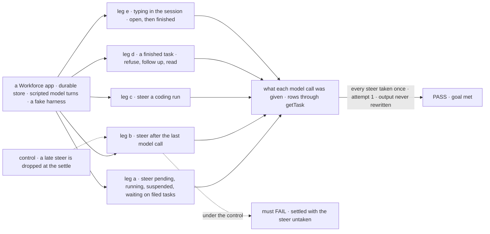
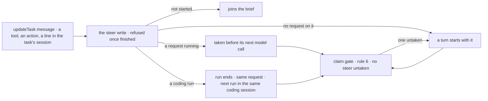

# FIX-2086 · Steer an open task with updateTask's message; correct a finished one with a follow-up

**Spec** · [Decisions](DECISIONS.md)

## Six people, before and after

| Someone who… | Today | After |
|---|---|---|
| **files a task, then thinks of one more detail** | Can patch a few fields, but has no way to say it in words | `updateTask({ id, message })` before it starts: the message joins the brief |
| **redirects a task a worker is running** | No tool for it. Typed in the task's session, the line is a separate reply, not part of the task | The running request takes it before its next model call. No attempt is used, nothing settles, nothing is cancelled |
| **talks to a running coding run** | The run's attempt is stopped, parked and re-queued through a door only coding flows have | The current coding run ends, and once its process has exited the same request starts the next run in the same coding session, with the message |
| **wants a finished task done differently** | A message reopens it: same id, and its output is overwritten | Refused, naming the rule. A follow-up task runs in the same session; the original output stays as delivered |
| **already used a finished task's output** (its filer, a dependent) | It can change underneath them | It never changes. The task view shows the latest completed follow-up's output as current, the original as history |
| **types in a task's session** | Reopens, steers or replies, depending on the kind and the status | One meaning: a steer while the task is open, conversation once it has finished |

## The goal, and how we'll know it's met

**Every word sent into an open task reaches the work through one write, `updateTask`'s
`message`, without using an attempt or ending the task; and a finished task's output never
changes, because a correction is a follow-up.**

| Is it the right goal? | |
|---|---|
| **The real need** | *"One way to brief, steer and redirect a task, and results that stay as delivered"* (the issue). Concept [rule 20](../../../docs/internal/design/workforce-coordination-concept.md#the-rules); stories T-20, T-21, T-26, T-29, T-31, U-02 |
| **Smaller, and rejected** | "Remove reopen." Finished output stops changing, but a filer still can't steer, a coding run still has its own door, and a line in a task's session still means three things |
| **Bigger, and not this issue's** | A steer that answers a question a task stopped on, and retiring `answerTask` (FIX-2058, the epic's [D2](../../epics/FIX-2056/DECISIONS.md#d2)) · a message to a task, which is conversation and never a steer (FIX-2070) |
| **Not done if** | Any write but the steer puts words into an open task · a steer uses an attempt, records an ending or cancels · a task settles with a steer no request took · anything writes a finished task's output again, except once for a row reopened before the upgrade, by the attempt already picking it up · `reopen` or a message door is still exported · a reopened row in flight, or a coding turn no attempt took, is dropped at upgrade |



The check reads what each model call was given and the rows as a screen reads them. The dashed
path drops a steer that arrives after the last model call, and it must fail.

| How we verify | |
|---|---|
| **Goal check** | `goals/task-tools/steer-and-follow-up/` · no model: scripted turns on the real Workforce flows and a fake harness that resumes by session id · run by the implementer at completion · verdict in the implementation PR |
| **Signal** | a: a steer before start is in the first call's brief; to a running request, in its next call and not the one before; to a suspended one, in the first call after the resume; to a task waiting on its filed tasks, a turn starts with it. Each: `attempts` unchanged, no ending, status unchanged. b: a steer after the last call gets one more turn before the settle; the task settles once, after it. Variant: the worker checkpointed before the steer; where the steer turn checkpoints, its checkpoint is the output, and where it doesn't, the earlier one stands. c: the harness step ends, the next run resumes the same coding session with the message, in the same request, attempt 1. d: `updateTask({ message })` on a finished task is refused naming the rule; a follow-up runs in its session; the original's output reads byte-identical; `getTask` shows the follow-up's output as current. e: a line in an open task's session is a steer; in a finished one, a reply, and the row is unchanged |
| **Input** | Deterministic workers. Another step count, steer count or arrival point must pass too |
| **Anti-game** | Model input as the scripted model received it; rows through `getTask`, not the collection |
| **Goals this rewrites** | `goals/coordinators/task-session-stays-open` leg b and `goals/hand-offs/survives-a-restart-and-runs-once` `j:still-answers` / `j:reopened` assert reopen. The implementation PR rewrites them: a line in the finished session is talk that still names the ticket with the row unchanged, and more work is a follow-up (a steer while the task is open). The intent kept is that a finished task's session still knows its work |
| **Control that must fail** | `GOAL_CONTROL=drop-late-steer` must FAIL leg b on *one more turn before the settle*. `GOAL_CONTROL=reopen` must FAIL leg d on *byte-identical*. Today's `main` also fails legs a, c and e |

## What changes


Four ways in become one steer kept on the task; a finished task takes a follow-up instead.

**A filer's calls, and a host's coding flow:**

```diff
+ updateTask({ id, message: "Use the North America numbers" })  // until it finishes
- // a user's line on a finished task's session reopened it, same id, new output
+ updateTask({ id, message: "Make it shorter" })   // refused: finished; file a follow-up
+ createTask({ goal: "Half as long", followUpOf: id })   // same session, same worker
+ getTask({ id })   // { ..., output, current: { id: followUpId, output } }  latest completed; output cut as readTask's
+ listTasks()       // rows carry current: { id } only, no output
```

```diff
  defineFlow({
    kind: CODER_FLOW,
    actions: {
-     message: harnessMessageDoor({ name: "coder", boards }),
+     message: coderDoor,   // `respond` once FIX-2084 renames the door
    },
    task: { actions: { [WORKER_TASK_ENTRY]: workerTaskEntry({ name, block: byTask }) } },
  })
```

The coder keeps a door under whatever name it has when this lands. In an open task's session it
writes the steer as the user. In a finished one it is talk (M-10): one run resumes the task's
coding session with the line, outside any attempt, and its answer is a reply in the session; the
row, its output and its attempts don't change. A harness that confirmed no coding session refuses
it, by name, as today. The door finds the session's task from server state, the row whose run link
names the session, never from the message ([ER-2](../../epics/FIX-2056/DECISIONS.md#who-owns-what), BP-031).

**Docs:** update *Orchestration → Task board* (the `message` row of the field table, follow-ups as
the correction, the current output), *Task substrate* (remove *Putting a finished task back in the
queue*), *Harness manager* (*Talking to a run* becomes a steer that ends the run, not the request),
*Workforce → Coordinators* (a finished task takes a follow-up), and the orchestration, workforce,
harness-manager and shift-manager READMEs. No new page; FIX-2081 publishes the shared opening.

## How a steer reaches the work



One write keeps the steer on the task; every way it is taken marks it, and the gate settles only
when none is left.

## What stays as it is

- **`answerTask` and the question park,** until FIX-2058. A steer to a task stopped on a question
  is taken when it resumes, and never answers the question.
- **A message to a task** (`sendMessage`, FIX-2070) is conversation and never a steer.
- **A follow-up's session and filing** as FIX-2080 sets them: `followUpOf`, the earlier task's
  session, one open task per session.
- **Who may call `updateTask`**: the filer, and the user from a screen (FIX-2081).
- **Stop-and-continue for coding runs** ([FIX-1690's fork](../FIX-1690/DECISIONS.md#open--live-delivery-mid-step-or-stop-and-continue-for-every-harness-first)): no harness takes a line mid-step.

## What's already here, and the debt

| Already here | What this does with it |
|---|---|
| The job, *send words into a task*: `reopen` ([`reopen.ts`](https://github.com/fixpoint-labs/flow-state-dev/blob/96404d2519cd7848940de2857841b67adaf87646/packages/workforce/src/conversation-board/reopen.ts)), the coding door ([`door.ts:14-21`](https://github.com/fixpoint-labs/flow-state-dev/blob/96404d2519cd7848940de2857841b67adaf87646/packages/harness-manager/src/door.ts#L14-L21)), `answerTask`, and a line in an open task's session, a separate reply ([`agent-worker-flow.ts:1321-1324`](https://github.com/fixpoint-labs/flow-state-dev/blob/96404d2519cd7848940de2857841b67adaf87646/packages/workforce/src/agent-worker-flow.ts#L1321-L1324)). Closest: the coding door, which already steers without an attempt | **Folds** three into one: `updateTask`'s `message`. `answerTask` stays for FIX-2058. A steer is not a fifth way |
| The door's `turns` collection: a line kept per attempt, taken once ([`turns.ts`](https://github.com/fixpoint-labs/flow-state-dev/blob/96404d2519cd7848940de2857841b67adaf87646/packages/harness-manager/src/turns.ts)) | **Generalised.** Its keep-then-take rule moves onto the task row; its writes go, and a turn no attempt took reads as a steer at upgrade ([D1](DECISIONS.md#d1)) |
| A context entry re-read before every model step ([`binding-reader.ts:15-19`](https://github.com/fixpoint-labs/flow-state-dev/blob/96404d2519cd7848940de2857841b67adaf87646/packages/orchestration/src/skills/binding-reader.ts#L15-L19)) | **Builds on.** How a running request takes a steer |
| [FIX-1817 D2](../FIX-1817/DECISIONS.md#d2): nothing reopens; more work is a follow-up | **Restored.** The concept reverses FIX-1764's reopen, which superseded it |
| FIX-1764's reopen (no retained spec; [#3534](https://github.com/fixpoint-labs/flow-state-dev/pull/3534) retires it) | **Superseded** |
| [FIX-1690 D1](../FIX-1690/DECISIONS.md#d1): each kind declares its door | **Superseded in part.** The worker's door stays; a coding kind's door goes, and a line in an open task's session is a steer |
| Rule 6's queued message (FIX-2070): a send to a busy session holds the task open until it is answered | **Leaves.** A queued message is conversation, answered with the session's history, and gone once answered. A steer joins the brief and must reach a retry ([D1](DECISIONS.md#d1)), so it can't ride that queue |
| FIX-2077's rule 6, FIX-2080's map, FIX-2081's field table | **Uses.** Adds the untaken-steer input, turns on the reopened entry, fills the `message` row |

| The debt | |
|---|---|
| **Removes** | `reopen`, its patch, the `reopened` mark and change kind, the reopened turn · `messageDoor`, `harnessMessageDoor` and its schemas and types, `reopenIn`, the park for a turn and the `turns` collection, once its upgrade step has run ([migration lines](../../epics/FIX-2056/migration.md)) · the reply that runs beside an open task |
| **Adds** | `steers` on the task, with a taken mark per attempt, written through one collection verb · `current` on the task view ([D3](DECISIONS.md#d3)) · rule 6's untaken-steer input · steers on FIX-2080's reopened-row and parked-for-a-turn map entries · a one-off harness-manager upgrade step that writes each turn no attempt took as a steer |
| **Leaves** | Answering a question by a steer (FIX-2058) · a worker flow with no model call takes a steer only as its next turn, by design ([D2](DECISIONS.md#d2)) |

**Net: down.** A verb, two doors, a collection, a park and a side reply go; a collection verb, one
field on the task and one on its view arrive.

## Sign off

**[The goal](#the-goal-and-how-well-know-its-met), at that size:** one steer for every open task,
taken without an attempt, and output that never changes. If wrong: FIX-2058 and FIX-2070 build
on a task that still has two ways in.

**[The debt](#whats-already-here-and-the-debt), net down:** reopen, the coding door and its
collection go; a steer list and a current-output view arrive. If wrong: a steer list nobody
reads after a task settles.

1. **[D1](DECISIONS.md#d1) · A steer is kept on the task, and every later attempt reads it.** If
   wrong: a long task's brief grows with every steer.
2. **[D2](DECISIONS.md#d2) · A steer no request took gives the task one more turn before it
   settles.** If wrong: a late "never mind" costs one extra model turn.
3. **[D3](DECISIONS.md#d3) · The latest completed follow-up reads as current, for models and
   screens.** If wrong: a filer's model reads a correction it didn't ask for.

**Open: none.** Number 2 is the one to weigh: it decides when a redirected task finishes.

Feature · `orchestration` + `workforce` + `harness-manager` + `shift-manager` · medium · epic [FIX-2056](../../epics/FIX-2056/SPEC.md) · blocked by FIX-2077, FIX-2081
