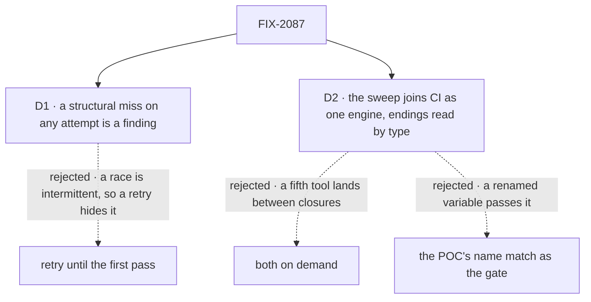

# FIX-2087 · Decisions

[Spec](SPEC.md) · **Decisions**

Two calls shape how strict the closure is and how long its checks keep running. The plan's
contents are the epic's and the closure rule's; they are recorded under *decided, not asked*.

## The tree

Solid edges are what you're signing. Dashed edges lost, and the label says why.

## D1 · On a real model, a structural miss on any attempt is a finding; only a judgment miss earns another attempt

| | |
|---|---|
| **Instead of** | The corpus norm: each real-model leg runs until it first passes, up to three attempts, and the passing attempt is the verdict (`goals/coordinators/hands-each-post-to-its-delegates/`) |
| **Because** | The epic exists to kill races: an ending heard twice, a task settled while its work still writes, a waiting task run again. A race shows on some runs and not others, so retrying to a pass reports exactly the defect as fixed. A model choosing not to file, or wording a draft without the held-out word, is model judgment and is fair to retry. So each assertion is tagged *structural* (counts, order, who wrote an ending, what a row reads) or *judgment* (what the model chose), and a structural FAIL on any attempt is filed |
| **Locks in** | The closure can file a bug on a race seen once in three runs, and the epic waits for its fix and a full re-run. The report prints every attempt, so the owner sees how often each assertion held |

It comes down to a race seen once in three runs: retry-to-pass reports it fixed.

**What would change my mind:** model variance leaving structural assertions unreadable (CAN'T TELL)
on most attempts. Then the walk needs scripted turns at its structural points, and this card is
reopened.

## D2 · The task-surface sweep joins CI as one rule engine shared with the goal, its endings read by type; the real-model walk stays on demand

| | |
|---|---|
| **Instead of** | Both on demand, run by the closure and by whoever re-runs it, as FIX-1887 did. And the POC's name match in CI: it passes a write through a renamed variable, so as a gate it would read as proof of the one thing it can miss |
| **Because** | The epic promises four task tools and one ending path to teams outside the repo ([(e)](../../epics/FIX-2056/DECISIONS.md#e)). Any later PR can break that, and only CI sees every PR. The sweep needs no model and runs in seconds; FIX-1876's vocabulary sweep already runs in CI with its plants. The tool and removed-name rules are robust by name; the endings rule is not, so it reads callers by type. One `rules.mjs` holds all three for the goal and CI, so they can't disagree on a commit. The walk costs model calls and minutes, so it stays a goal |
| **Locks in** | A PR that adds a task tool or an ending writer fails CI until it edits the engine's allow lists, where a reviewer sees it. FIX-2058, retiring `answerTask`, makes that edit |

It comes down to a fifth task tool landing between closures: on demand, nobody sees it.

**What would change my mind:** the type-aware read of the endings rule costing more than a minute of
CI. Then the endings rule runs in the goal only, from the same engine, and the tool rules stay in
CI. The name match never becomes the fallback.

## Decided, not asked

- **The walk runs on a goal-local Lab of `WORKER.md` files on built-in flows**, served by Shift
  Manager's own command, not on kitchen-sink's support desk. The epic asks for an app that adds no
  coordination code, and the concept's cast is what its walk names.
- **Which children are re-run is read from Linear at run time**: every child of FIX-2056 blocking
  this issue. A child that joins later, like FIX-2088, is in the plan with no amendment. The set
  and the 31 rows' map, as read, are printed at the top of the report (ids and titles), so a run
  can be audited without asking Linear again.
- **The ending rule's convergence point is the recorder list**: the claim gate's recorder and its
  write helper, and each pattern's own inline recorder. Every other caller of a task collection's
  `complete` or `fail` is a finding, Workforce, Harness Manager and tools included (rule 18, ER-1).
  A user's cancel and a cascade's are not endings recorded by a worker, and are out of the rule.
- **`answerTask` is the one task tool besides the four**, until FIX-2058 ([D2 of the epic](../../epics/FIX-2056/DECISIONS.md#d2)).
- **Leg b's kill point is held by a named pause**, not timing: the run patches in a stop after the
  ending's write and before its send, as FIX-2078's leg b does.
- **The 31 rows' map is read from each child's Linear scope line** and its stories' acceptance; the
  report prints row, story, check and verdict.
- **Findings follow the closure rule**: filed through `issue-manager` under FIX-2056, blocking this
  issue; a duplicate's relations are wired by the closure worker.

## Considered and dropped

| Alternative | Why not |
|---|---|
| Re-run the children's checks only | The smaller goal; no check hands a routed task down and back up on a real model |
| Run the walk on Shift Manager's DevTeam install | Its host wires its own routes (`errorCapture`, the route model), so a pass there can rest on app code the epic says an app needn't write |
| Script every turn of the walk | Cheaper and stable, but then nothing shows a real model can work the four tools; D1 keeps the model and tags what it may retry |

## Settled

- **The sweep can read the three rules mechanically, and fails on today's `main`**: **CONFIRMED** by
  [`poc/surface-sweep/`](poc/surface-sweep/). Run: `node specs/issues/FIX-2087/poc/surface-sweep/sweep.mjs`.
  On `96404d2`: 1,295 files, 15 tool names, 11 ending writes, **FAIL with 39 live lines** (12 removed
  tools offered, 3 removed collection members, 19 post-entry and split-settle lines, 5 ending writes
  outside a recorder). `--control` reports 41: exactly its two plants.
- **One ending write has no owner**: Harness Manager fails its own row when a run is refused
  (`packages/harness-manager/src/manager.ts:2600`). It passes its own attempt's claim, but a
  claim-fenced write from a worker block is still outside the gate: ER-1 names worker blocks, and
  the gate is `task-entry.ts` and `record-result.ts`. So the rule's wording stands and this is a
  real gap. No child's spec removes it. Recommended to the coordinator for an open child now
  (FIX-2088, whose subject is an attempt's ending); until it lands the allow list names it as an
  exemption with that owner. If no child takes it before the closure runs, the closure files it.
- **The POC's ending rule matches call sites by name** (an argument naming a task). It found every
  write the gaps file lists; a write through a renamed variable would slip it. So the shipped rule
  reads callers by type ([D2](#d2)).

## Notes from review

For the implementer, verbatim; none changes the approach.

- *Owner, #3604:* "the allow list is keyed by file path. Moving or renaming `record-result.ts`, `advisory-write-back.ts` or any of the three pattern recorders fails CI with no ending-rule change. That is a rename tax on a package refactor."
- *Owner, #3604:* "D1's 'judgment vs structural' tag lives only in the assertion names. Make the tag a field the report prints and the runner enforces (a structural FAIL on any attempt ends the leg), or an implementer can retry past it by habit."
- *Cursor, #3604, SPEC plan item 2:* "For each of the three journeys here, can you point to a gap row or team *after* state that **none** of those checks cover? If the answer is 'steer/cancel' and 'goal-seek refused board,' consider folding into leg a (or a single supplemental goal) rather than three more model runs."
- *Cursor, #3604:* "FIX-2078 / FIX-2080 control env vars and assertion ids referenced here may not exist on `main` yet. Consider one line that closure implementation **fails closed** if a composed child lacks the named control tags."
- *Cursor, #3604:* "Dominant cost is band 3 + full plan re-run on any finding (FIX-1887-scale hours + model spend). The surface sweep is negligible in that bundle. Worth noting in PLAN so nobody optimizes the wrong layer."
- *Cursor, #3604, poc/surface-sweep/sweep.mjs:* "For the real goal, a single `rules.mjs` (or parse migration table) avoids FIX-2058 `answerTask` retirement being a missed edit."

## How it got here

- **Draft** — the closure rule's four items over the epic's legs a to c; a sweep POC on today's
  `main` before review; strictness on a real model and the sweep's home put to sign-off.
- **Review round 1** — D2 now ships one rule engine for the goal and CI, with the endings rule read
  by type, because the POC's name match can pass a renamed write and two sweeps could disagree.
  The Harness Manager write goes to a child now instead of waiting for the closure to file it.

**Open: none.**
