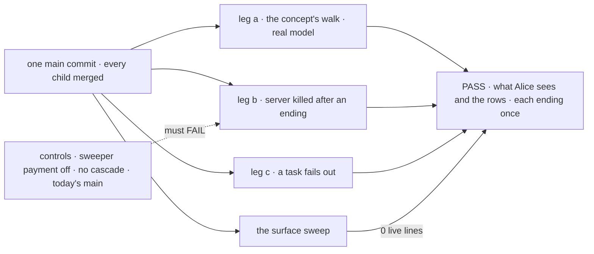

# FIX-2087 · Closure: Workforce coordination runs on one task primitive

**Spec** · [Decisions](DECISIONS.md)

## Five people, before and after

| Someone who… | Today | After this closes |
|---|---|---|
| **decides whether the epic is done** | Every child, each green on its own commit. Nothing uses the whole as a user would | One report on one `main` commit: every check beside its control's FAIL, every finding with its retest |
| **uses a Workforce app, like Alice** | Routed work is a post she can't list. An ending can reach its filer twice, or wait for a touch | On a real model: her routed task is in her list, the draft lands once under writer's name, and her follow-up keeps the first version |
| **runs Workforce on a host that restarts** | A finished task waits until something touches the board | The server is killed after an ending; writer still hears within the due time |
| **maintains the framework** | At least 39 live lines: removed tools offered, posts and the split settle live, five ending writes outside the gate | 0 on the commit, and CI fails a later PR that adds a sixth task tool or a second ending path, found by type ([D2](DECISIONS.md#d2)) |
| **builds a child of this epic** | No plan says what grades the assembled set | This plan, now, while they build |

## The goal, and how we'll know it's met

**On one `main` commit with every other child merged, a person using a Workforce app on a real
model hands out work, waits on it, steers it and hears how it ended through one task; every ending
reaches its filer once; and nothing records an ending except the claim gate or the drain.**

| Is it the right goal? | |
|---|---|
| **The real need** | [The epic's goal](../../epics/FIX-2056/SPEC.md#the-goal-and-how-well-know-its-met) on the assembled set, and the [closure rule](../../../docs/contributing/orchestration.md#the-closure-issue-every-epic-ends-in-qa): the gaps *between* children |
| **Smaller, and rejected** | "Re-run every child's checks on one commit." Each is model-free and grades its own piece; none hands a routed task down and back up on a real model, so a hand-off nobody owns still passes |
| **Bigger, and not this issue's** | Fixing anything: a finding is a child of FIX-2056 · calls and the Inbox (FIX-2070, FIX-2058) |
| **Not done if** | A check ran on another commit · a structural assertion failed on some attempt and a later one is reported instead ([D1](DECISIONS.md#d1)) · a control was skipped or passed · a child that joined later was not re-run · an in-scope gaps row has no check that reads it · a finding is open, or was fixed in the closure PR |



The legs read what Alice sees and the rows through the public task actions; each control degrades
the one behaviour its leg proves.

| How we verify | |
|---|---|
| **Goal check** | `goals/workforce-coordination/runs-on-one-task/` · real model, `openai/gpt-5.4-mini` · run by the closure worker on one `main` commit after every other child merges · the report is the closure PR's body. It runs the whole plan below |
| **Signal** | Tagged `<leg>:<assertion>`. **a**, the concept's [*How it flows*](../../../docs/internal/design/workforce-coordination-concept.md#how-it-flows) less the call and the Inbox: launch's routed task for writer is in Alice's list; writer files researcher's task and ends, its own task running with no request; one `onTaskSettled` starts writer again; its plan board waits on a dispatched fact-check row; the draft lands once, under writer's name, with the held-out word and researcher's fact; a follow-up returns a new version and the original reads byte-identical. **b**: killed after researcher's ending is written, before it is sent; writer hears once, within the due time plus 2 s of restart. **c**: researcher fails out; writer hears one failure notice naming the dependent it cancelled. **Every leg**: each ending reaches its filer exactly once. **Sweep**: 0 live lines |
| **Input** | A goal-local Lab: launch on the built-in coordinator, writer and researcher on the built-in agent flow, as `WORKER.md` files only, on SQLite, served by Shift Manager's command; Alice acts through the shipped clients. Topic, held-out word and fact picked at run time |
| **Anti-game** | Alice's conversation and rows through `listTasks_tasks` and `getTask_tasks` as Alice; endings counted from the filer's notices; no fixture writes a row. Shift Manager's error report is neither a second ending nor a failure ([(f)](../../epics/FIX-2056/DECISIONS.md#f)) |
| **Control that must fail** | `GOAL_CONTROL=no-sweeper-payment` (FIX-2078's) must FAIL **`b:hears-in-due-time`**; `no-cascade` (FIX-2080's) **`c:dependent-cancelled`**. The sweep's `--control` reports exactly its plants, one per rule and a claim-passing cancel for the endings rule. Today's `main` FAILs **`a:routed-listed`**, and the sweep with at least the POC's 39 lines ([it does](DECISIONS.md#settled)) |

## The plan, in the order it runs

| # | What runs | PASS means |
|---|---|---|
| 1 | Legs a to c and the sweep, above | Each green; each control red where named |
| 2 | **A journey per team the walk misses**, same Lab and model. *Hands out work:* a worker files, waits with `getTask` and answers in the same request, offered no task tool beyond the allow list (the five, `answerTask` and `parkOnQuestion`) on a task turn. *Runs a coordinator:* Alice steers one routed task and cancels another. *Builds a goal-seek loop:* `goals/goal-seek-loop/replans-until-done/` passes; one built over a delegation board is refused | Each green; the steer shows in the draft, the cancel is heard once |
| 3 | **Every child's goal check with its controls**, for every child blocking this issue when the run starts, FIX-2088 included, the set printed in the report as it was read, **skipping any that row 1 already walks** ([the closure rule](../../../docs/contributing/orchestration.md#the-closure-issue-every-epic-ends-in-qa)): every one of its legs asserted by a leg of row 1, with its control red there. Read at run time like the set; each skip is printed beside the leg that covers it, and a check walked in part runs. Every goal under `goals/coordinators/` and `goals/hand-offs/`; FIX-2005's leg of `goals/workforce-privacy/`. A goal a child rewrote or retired because it asserts what that child removes is graded on the intent the child's PR states; a red goal that still asserts removed behaviour is a finding against the remover, not the goal's first owner. Each behaviour row of the migration table is proved here, by its owning child's goal | Each PASS beside its documented FAIL |
| 4 | **The gap sweep**: each [coordination seam](../../epics/FIX-2056/DECISIONS.md#coordination-seams) read from both sides; the task-board page FIX-2081 publishes, followed as written; each epic *not done if* state absent; each of the 31 in-scope gaps rows mapped to the check that reads it | Every seam two-sided, every promise backed, 31 of 31 |

Any failure becomes a child of FIX-2056 that blocks this issue, and the whole plan runs again on a
fresh commit once it merges.

## What changes


Everything right of the commit line runs together; the sweep also joins CI.

**One rule engine, called by both.** The three rules and their allow lists live in one `rules.mjs`
that the goal and CI both call, as `goals/vocabulary/one-word-per-thing/` keeps its own, so the two
can't give different answers on one commit. The tools rule allows the five, `answerTask` and
`parkOnQuestion`, and reads every tool the task-tools capability declares, by literal name or
`named()`. The removed rule reads the epic's [migration table](../../epics/FIX-2056/migration.md)
as it stands on the closure's commit, rows its children's implementation PRs added included. A name
row is matched by a scoped matcher where its name means that surface: a removed tool or its
`_tasks` action anywhere in the swept files, not only the task-tools file, and a removed door
(today's `run`, Shift Manager's `message`) by each worker flow's declared actions, since `run`
alone is too common a word. A behaviour row has no name to match; it is proved by its owning
child's goal in row 3, and the report prints which matcher or goal covers each row. The swept files
are FIX-1876's `ROOTS`, so retained specs, `docs/internal` and the migration table itself are
outside, less every `CHANGELOG.md`; a line that names a removed surface on purpose (a BP-030 legacy
read, a refusal) carries the `retired-name-refusal` marker. The endings rule reads every caller of a
task collection's `complete` and `fail` by type, through the TypeScript program, and every
`cancel` that passes the caller's own claim on the row it holds, which is an ending in all but
name; a name match never gates. A helper that wraps them, like `advisoryComplete`, is not a recorder: its own callers are
read in its place, so the allow list names recorder functions, never a helper's file. `--control`
plants one line per rule, and a claim-passing cancel besides. The POC is evidence for the
premise, not the template ([D2](DECISIONS.md#d2)).

```diff
  # .github/workflows/ci.yml, beside "One word per thing"
+ - name: One task surface
+   run: node goals/workforce-coordination/runs-on-one-task/sweep.mjs
+ - name: The task-surface sweep reports its plants
+   run: node goals/workforce-coordination/runs-on-one-task/sweep.mjs --control
```

**Docs:** no documentation impact. The closure ships checks; the task-board page is FIX-2081's, and
a page that doesn't hold when followed is a finding against it.

## What stays as it is

- **No product code.** A gap becomes a child of FIX-2056.
- **Every composed check** runs as it is on `main`; a red one is a finding against its owner, or
  against the child that removed what it asserts ([row 3](#the-plan-in-the-order-it-runs)).
- **Patterns' own recorders** are the drain for their boards: the epic keeps patterns as they are.

## What's already here, and the debt

| Already here | What this does with it |
|---|---|
| The children's goal checks and named controls | **Builds on.** Composed; `no-sweeper-payment` and `no-cascade` reused, not copied |
| `goals/vocabulary/one-word-per-thing/sweep.mjs`, a CI sweep with `--control` (FIX-1876) | **Builds on.** The task-surface sweep takes its shape and its place |
| The goal-local Lab of `goals/workers/files-and-splits-down-the-chain/` | **Builds on.** Leg a's Lab follows it, with the concept's cast |
| [FIX-1887](../FIX-1887/SPEC.md), the last epic's closure | **Kept.** The same shape: a runner over composed checks and a sweep with a control |
| Anything else that grades the assembled set | **None.** Searched `goals/` for `closure`, `onTaskSettled`, `routes-each`, `one-task` |

| The debt | |
|---|---|
| **Removes** | Nothing. The children remove; this proves it |
| **Adds** | One goal, one rule engine and one CI sweep. Permanent by design: the promises outlive the epic. Its allow list changes when FIX-2058 retires `answerTask` |
| **Leaves** | Nothing of its own. Harness Manager's own write on a refused run, its `fail` and the fixed board's `cancel`, is FIX-2090's, which blocks this issue, so the allow list carries no exemption for it ([Settled](DECISIONS.md#settled)) |

**Net: up, a little.** One goal and one CI step, for promises that stay true.

## Sign off

**[The goal](#the-goal-and-how-well-know-its-met), at that size:** the walk, the crash, the failure
and the sweep on a real model, and the rest of the plan, on one commit. If wrong: the epic wraps on
pieces that pass apart and break together, or waits on a walk nobody needed.

**[The debt](#whats-already-here-and-the-debt), net up a little:** one goal and one CI sweep. If
wrong: a CI step that fails a later PR on a tool someone meant to add.

1. **[D1](DECISIONS.md#d1) · On a real model, a structural miss on any attempt is a finding; only a
   judgment miss earns another attempt.** If wrong: findings on races too rare to matter, a round
   each.
2. **[D2](DECISIONS.md#d2) · The sweep joins CI as one rule engine shared with the goal, its
   endings read by type; the walk stays on demand.** If wrong: a CI step every later task-tool
   change has to edit.

**Open: none.** D1 is the one to weigh.

Improvement · closure (QA) · `goals/` and one CI step · large, repeats per finding · one PR after a
clean run · epic [FIX-2056](../../epics/FIX-2056/SPEC.md), closure · required · runs after every
other child merges · Linear [FIX-2087](https://linear.app/fixpoint-labs/issue/FIX-2087)
