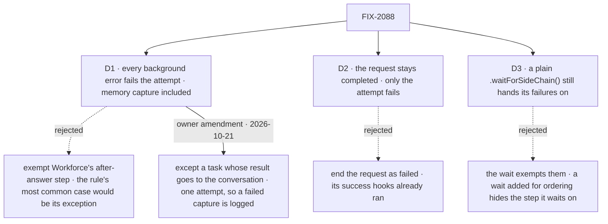

# FIX-2088 · Decisions

[Spec](SPEC.md) · **Decisions**

The concept already ruled that an error in background work fails the attempt. These three say what
that costs, and where it stops. The owner signed off on all three, as recommended
([sign-off](https://github.com/fixpoint-labs/flow-state-dev/pull/3602#issuecomment-6317557785)),
and on 2026-10-21 amended D1 with one carve-out: a task whose result goes back into a conversation
keeps its answer when its memory capture fails ([amendment](#d1-amendment)).

## The tree

Solid edges are what you're signing. Dashed edges lost, and the label says why.

## D1 · Every background error fails the attempt, Workforce's memory capture included

| | |
|---|---|
| **Instead of** | Exempting Workforce's after-answer step (`afterAnswer`), whose docs promise today that *"a failure in it does not fail the turn"* and *"a capture that fails is not a failed conversation"* |
| **Because** | The concept's rule names no exception, and its own example of background work is saving to memory. Memory capture is the background work most workers run, so exempting it would make the rule's common case its exception, and a missed capture would stay visible only in a log. One rule for every step also keeps the gate from asking *which* step failed |
| **Locks in** | In a task, a capture that fails re-runs the whole task, and with no attempts left fails a task whose answer was fine. The retry runs the worker's tools and its `onCompleted` again, as any retry does: a request's run-once guard dedupes within a request, not across attempts. What is new is that a retry can now follow a request whose success hooks already committed, so their effects can happen twice. The `afterAnswer` docs change from "never fails the turn" to "never fails a conversation turn; in a task it fails the attempt". In a conversation nothing changes, and neither does it in a task whose result goes to the conversation ([amendment](#d1-amendment)). A worker that wants capture best-effort catches its own error inside the step: no new setting |

It comes down to one rule: exempting memory capture exempts the case the rule is mostly about.

**What would change my mind:** capture failures that turn out frequent in real runs, or effects
in `onCompleted` that can't stand running twice, so that
retries cost more than a missed memory. Then Workforce catches the after-answer step's errors
itself, one line in Workforce and no framework setting, and the docs keep their promise.

### Owner amendment, 2026-10-21 · a task whose result goes to the conversation keeps its answer

**The rule.** For a task whose result goes back into a conversation (`resultTo: "conversation"`,
which FIX-2080 gives exactly one attempt), a failed after-answer memory capture is logged and does
not fail the task: the task ends with its answer, as a conversation turn does today. Every other
task keeps D1: a failed capture fails the attempt, and the task runs again while attempts are left.

**Why.** After FIX-2083, every message a coordinator routes to a delegate is such a task. With one
attempt, failing it retries nothing: a delegate's right answer would become a failure line, and the
person would have to ask again. D1 was priced as "a flaky capture re-runs whole tasks", which a
one-attempt task never does. This is the remedy D1's *What would change my mind* already named.

**Scope.** Only Workforce's after-answer capture, and only on such a task. Any other background
step in it still fails the attempt, as D1 and [D3](#d3) say. The carve-out is one line in
Workforce, which reads the task row's result setting, never session state, so ER-2 holds. The
framework's rule, the gate and the engine do not change. FIX-2083 cites this rule; it lives here.

**What would change my mind:** delegates whose later answers depend on what they saved, so a
silently missed save makes them wrong later; or evidence that capture failures are rare enough that
one uniform rule is worth an occasional lost answer. Removing the carve-out is the one line.

Approved by the owner on 2026-10-21 at 17:15Z, as the cross-spec audit's F1 recommended
([audit comment](https://github.com/fixpoint-labs/flow-state-dev/pull/3602#issuecomment-6320916666)).
Leg k covers both halves.

## D2 · The request stays completed; only the attempt fails

| | |
|---|---|
| **Instead of** | Ending a request that works a task as `failed` when its background work errors |
| **Because** | By the last drain the request's status is already stored as completed, `onCompleted` has run and may have committed its side effects, and its result has streamed. Flipping it then reports a failure for work whose success already happened. The engine's contract, that background work never drives a request's status, then holds for every request. The attempt is the task's unit: every request in that try, so it is the right place for the outcome |
| **Locks in** | A task's session can show a completed request beside a task that went back to pending or failed. The task row carries the outcome and the step's error; the DevTool shows the step's failed trace, as today. A host that reads request status to judge a task reads the task instead |

It comes down to the success hooks: they ran before the last drain, so the request can't un-succeed.

**What would change my mind:** a screen that must show the failure on the request itself, such
as a session view with no task panel. Then the request record gains a "background work failed"
flag beside its status, not a different status.

## D3 · A failure a plain `.waitForSideChain()` drained still fails the attempt

| | |
|---|---|
| **Instead of** | Treating the default wait as handling the failure. That needs no code, but the wait hands the author nothing to handle: it returns its input and logs. A wait added only for ordering would silently exempt the very step it waits on, and "every background error fails the attempt" would carry an exception nobody chose |
| **Because** | The default wait lets the pipeline carry on past a failed step and logs it, and the docs recommend it as an ordering barrier, *"wait for persistence before reading state below"*. Today the failure is gone once the wait drains it. Here the pipeline still continues past the wait, as documented; in a task, the failure the wait drained still reaches the gate and fails the attempt. The pool keeps a failure when a default wait drains it, as it does at the request's drains |
| **Locks in** | A user-visible docs promise changes for a task: the control-flow page says the default lets errors be *"recorded silently"*; in a task it now fails the attempt. The default value does not change, and nothing changes in a conversation. `failOnError: true` is unchanged: its throw is the sequencer's, so a `.rescue` can still catch it. A worker that wants the step best-effort catches inside it, as [D1](#d1) says. Leg j covers it |

It comes down to the wait's job: it orders steps, and ordering is no reason to hide a failure.

**What would change my mind:** teams that use the default wait specifically to mean "I accept
this step failing". Then the wait exempts its failures and the docs say so.

## Decided, not asked

- **A suspension keeps no failure of its own; the resume's rerun decides.** A suspended request
  does not drain, and its pool ends with it. A step that failed, or was still running, has no
  completed trace, and the resume rebuilds the control flow and reruns every step without one
  ([memoization and replay](../../../apps/docs/docs/advanced/block-memoization-and-replay.md)). The
  rerun lands in the resumed request's pool, so its failure reaches the seam like any other. A
  rerun that succeeds clears it: the step's last run in the attempt is its outcome, and failing the
  attempt then would redo work already done. Carrying the earlier failure would need a durable
  record across the suspension for no change in outcome. Leg i covers both reruns.

- **The convergence point.** The engine's one drain helper collects the failures on all five
  drains (`engine/src/execution/runAction.ts`: success path `:2447`, `:2518`, `:2641`; error path
  `:2773`, `:2936`) and keeps them for the request. FIX-2077's seam after the last drain receives
  them, and its one rule-6 check is the only reader. The failures stay in the request's
  background-work pool across drains, nothing new on the stored request, and the seam reads them
  once, after the last drain, not at each one. No other drain site, and no flow-author
  hook, decides it.
- **Every request admitted for the task counts:** `work`, `onTaskSettled`, and a resume of either
  (FIX-2077's admission list). One attempt holds them all. A queued message's request is not
  admitted (FIX-2103), so its step that throws fails only that request.
- **The recorded error** is the first background failure, named by its step, through the same
  failure write a throw takes. If the request also threw, the request's own error wins.
- **A cancel is not an error, and the engine decides what a cancel is.** A request whose cancel
  fired (the explicit abort, the one signal background work already listens to) hands the gate no
  failures at all, whether a step settled on the abort or threw anyway, so a cancelled task stays
  cancelled. The test is that signal, never the error's name or type. A dropped connection never
  fires it, so a step that throws after one still fails the attempt.
- **An inline plan row's background work** belongs to the parent task's request, as FIX-2077
  says for its settle. Its error fails the parent's attempt; the row was already recorded when
  its worker returned.
- **A board's `onError`.** Its `"skip"` and `"fail"` settle the row the same way here. `"fail"`
  has no request left to fail, since the request already completed.
- **What a message's waiting caller hears** when that request's background work fails is
  FIX-2070's. This issue fails the attempt.
- **No POC and no checker.** The premise, that failures are only logged and the request completes,
  is read from the drain helper and the five call sites above. The one count, three failure
  writers, is the search in *What's already here*.

## Considered and dropped

| Option | Why it lost |
|---|---|
| End every task entry with `.waitForSideChain({ failOnError: true })` | Misses work the end hooks start, and ends the request as failed, which [D2](#d2) rejects |
| A best-effort flag on `.sideChain()` | A second kind of background work for a job a `try`/`catch` inside the step already does |
| Fail the attempt from inside the drain helper | The engine would need to know about tasks. FIX-2077's seam exists so it does not |

## How it got here

- **Draft** — framed as the gap FIX-2077 leaves: the engine already collects every background
  failure, so carry them to FIX-2077's seam and let the one rule-6 check fail the attempt
  through the write a throw takes, leaving request status as it is.
- **Review** — the cancel rule now names its test, the request's own cancel signal, not the
  error's shape, and a dropped connection is not a cancel (leg f); the failures stay in the
  request's existing pool instead of a new field on the request; D1's price now names success
  hooks running twice, because a reviewer showed a retry follows a request whose `onCompleted`
  committed.
- **Review round 2** — goal legs for a queued message, an `onTaskSettled` turn, a resume and a
  default wait; a failure before a suspension is decided by the resume's rerun; the default
  `.waitForSideChain()` question raised as D3.
- **Sign-off** — the owner accepted D1 and D2 and answered D3 yes, all as recommended
  ([comment](https://github.com/fixpoint-labs/flow-state-dev/pull/3602#issuecomment-6317557785)).
  D3 moved from open to decided.
- **Owner amendment (2026-10-21)** — the cross-spec audit (F1) found that, with FIX-2083, a routed
  message is a one-attempt task whose result goes to the conversation, so D1 would drop a delegate's
  right answer over a failed capture. The owner approved a carve-out for such tasks
  ([D1's amendment](#d1-amendment)); leg k added.
- **Amendment, after merge** — FIX-2103 (owner's decision, Oct 22): a task settles when its turn ends, and a message to its session is conversation, not part of it, holding no claim. Its request isn't admitted for the task, so its
  background error no longer fails the attempt: leg g inverts, and the admission list drops it. No
  change to D1-D3.

## Notes from review

- "These five `runAction.ts` line numbers duplicate FIX-2077 DECISIONS (“Where it runs: after the engine’s last drain”). Consider a single cross-link to 2077 for drain choreography and keep 2088’s “Decided, not asked” to *what’s new*… Line pins will drift on unrelated engine edits." — cursor ([thread](https://github.com/fixpoint-labs/flow-state-dev/pull/3602#discussion_r4333338110))
- "Same list as FIX-2077’s admitted-for-a-task bullets. For a slimmer 2088, one line + link (“every request 2077 admits—see FIX-2077 DECISIONS”) avoids two specs diverging if admission ever changes." — cursor ([thread](https://github.com/fixpoint-labs/flow-state-dev/pull/3602#discussion_r4333338113))
- "The orchestration-wide `.fail(` / `failTask` / `recordError` census is strong audit evidence but heavy for a direction spec… keep the conclusion (“this adds no third failure writer”) in the debt table and move the search narrative to the implementation PR or a footnote." — cursor ([thread](https://github.com/fixpoint-labs/flow-state-dev/pull/3602#discussion_r4333338117))
- "“Five drains” + DECISIONS line numbers + this mermaid triple-describe the same pipeline. Optional trim: keep this diagram + `what-changes.svg` for readers; shorten DECISIONS convergence to a pointer." — cursor ([thread](https://github.com/fixpoint-labs/flow-state-dev/pull/3602#discussion_r4333338127))
- "`d1` and `d2` SVGs share ~35 lines of identical CSS. Not blocking—if you touch figures, a shared stylesheet or one template would match how we’d simplify other issue-spec decision figures later." — cursor ([thread](https://github.com/fixpoint-labs/flow-state-dev/pull/3602#discussion_r4333338129))
- "Multiple drains per `runAction` are required for hook ordering; the gate / rule-6 work should run once after the final drain, not at every `drainRequestSideChainPool` call (cheap check, easy to get wrong)." — cursor ([review](https://github.com/fixpoint-labs/flow-state-dev/pull/3602#pullrequestreview-5595317606))
- "If #3592's seam shape changes (for example, per-request versus per-attempt), “one attempt holds them all” needs re-checking. Failures from several requests (work, a queued message, a resume) must aggregate per attempt, and the spec only asserts it." — jhoffner, agent-written ([comment](https://github.com/fixpoint-labs/flow-state-dev/pull/3602#issuecomment-6308761457))

These are inputs, not instructions. Adopt, adapt, or discard; you owe no justification for
discarding one. A note that turns out to reveal a design problem is a spec blind spot: surface it
and fold it back.
