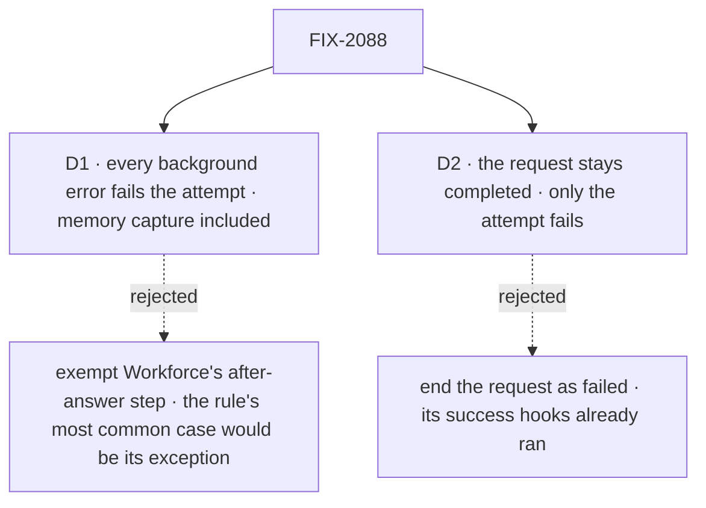

# FIX-2088 · Decisions

[Spec](SPEC.md) · **Decisions**

The concept already ruled that an error in background work fails the attempt. These two say what
that costs, and where it stops.

## The tree

Solid edges are what you're signing. Dashed edges lost, and the label says why.

## D1 · Every background error fails the attempt, Workforce's memory capture included

| | |
|---|---|
| **Instead of** | Exempting Workforce's after-answer step (`afterAnswer`), whose docs promise today that *"a failure in it does not fail the turn"* and *"a capture that fails is not a failed conversation"* |
| **Because** | The concept's rule names no exception, and its own example of background work is saving to memory. Memory capture is the background work most workers run, so exempting it would make the rule's common case its exception, and a missed capture would stay visible only in a log. One rule for every step also keeps the gate from asking *which* step failed |
| **Locks in** | In a task, a capture that fails re-runs the whole task, model calls included, and with no attempts left fails a task whose answer was fine. The `afterAnswer` docs change from "never fails the turn" to "never fails a conversation turn; in a task it fails the attempt". In a conversation nothing changes. A worker that wants capture best-effort catches its own error inside the step: no new setting |

It comes down to one rule: exempting memory capture exempts the case the rule is mostly about.

**What would change my mind:** capture failures that turn out frequent in real runs, so that
retries cost more than a missed memory. Then Workforce catches the after-answer step's errors
itself, one line in Workforce and no framework setting, and the docs keep their promise.

## D2 · The request stays completed; only the attempt fails

| | |
|---|---|
| **Instead of** | Ending a request that works a task as `failed` when its background work errors |
| **Because** | By the last drain the request's status is already stored as completed, `onCompleted` has run and may have committed its side effects, and its result has streamed. Flipping it then reports a failure for work whose success already happened. The engine's contract, that background work never drives a request's status, then holds for every request. The attempt is the task's unit: every request in that try, so it is the right place for the outcome |
| **Locks in** | A task's session can show a completed request beside a task that went back to pending or failed. The task row carries the outcome and the step's error; the DevTool shows the step's failed trace, as today. A host that reads request status to judge a task reads the task instead |

It comes down to the success hooks: they ran before the last drain, so the request can't un-succeed.

**What would change my mind:** a screen that must show the failure on the request itself, such
as a session view with no task panel. Then the request record gains a "background work failed"
flag beside its status, not a different status.

## Decided, not asked

- **The convergence point.** The engine's one drain helper collects the failures on all five
  drains (`engine/src/execution/runAction.ts`: success path `:2447`, `:2518`, `:2641`; error path
  `:2773`, `:2936`) and keeps them for the request. FIX-2077's seam after the last drain receives
  them, and its one rule-6 check is the only reader. No other drain site, and no flow-author
  hook, decides it.
- **Every request admitted for the task counts:** `work`, `onTaskSettled`, a queued message's
  request, and a resume of any of them (FIX-2077's admission list). One attempt holds them all.
- **The recorded error** is the first background failure, named by its step, through the same
  failure write a throw takes. If the request also threw, the request's own error wins.
- **A cancel is not an error.** Work stopped by the request's own abort settles as a rejection;
  the gate ignores those, so a cancelled task stays cancelled.
- **An inline plan row's background work** belongs to the parent task's request, as FIX-2077
  says for its settle. Its error fails the parent's attempt; the row was already recorded when
  its worker returned.
- **A board's `onError`.** Its `"skip"` and `"fail"` settle the row the same way here. `"fail"`
  has no request left to fail, since the request already completed.
- **What a message's waiting caller hears** when that request's background work fails is
  FIX-2070's. This issue fails the attempt.
- **No POC and no checker.** The premise, that failures are only logged and the request completes,
  is read from the drain helper and the five call sites above. The one count, three failure
  writers, is the search in *What's already here*.

## Considered and dropped

| Option | Why it lost |
|---|---|
| End every task entry with `.waitForSideChain({ failOnError: true })` | Misses work the end hooks start, and ends the request as failed, which [D2](#d2) rejects |
| A best-effort flag on `.sideChain()` | A second kind of background work for a job a `try`/`catch` inside the step already does |
| Fail the attempt from inside the drain helper | The engine would need to know about tasks. FIX-2077's seam exists so it does not |

## How it got here

- **Draft** — framed as the gap FIX-2077 leaves: the engine already collects every background
  failure, so carry them to FIX-2077's seam and let the one rule-6 check fail the attempt
  through the write a throw takes, leaving request status as it is.

**Open: none.**
