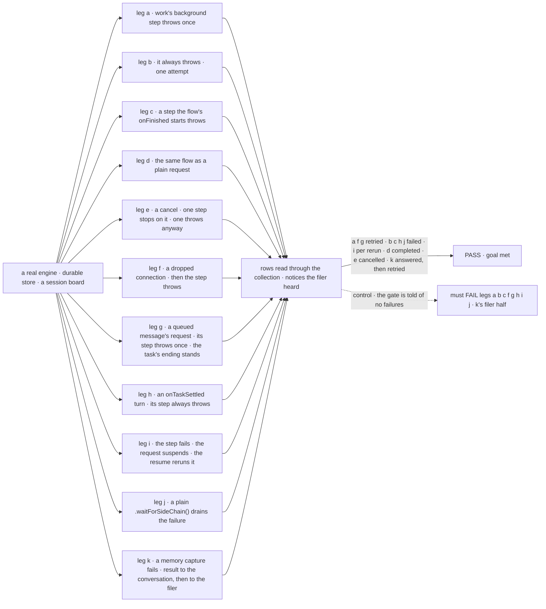
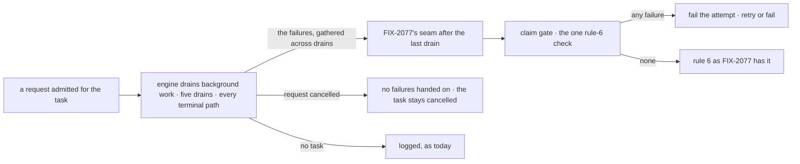

# FIX-2088 · A task's background work that errors doesn't fail its attempt

**Spec** · [Decisions](DECISIONS.md)

## Six people, before and after

| Someone who… | Today | After |
|---|---|---|
| **files a task whose worker's background step throws** | Hears "done". The error is only in the server log | The attempt fails, as if the worker threw: the task runs again while attempts are left, and otherwise the filer hears it failed, with the step named |
| **gives a Workforce worker memory, and its capture fails while it works a task** | The task is done; the missed capture is logged | The attempt fails and the task runs again ([D1](DECISIONS.md#d1)) |
| **talks to a worker in a conversation, and a background step throws** | Logged; the turn completes | The same. Only a request working a task changes |
| **sends a message a coordinator routes to a delegate with memory, and its capture fails** | Gets the answer; the missed capture is logged | The same. A task whose result goes to the conversation has one attempt, so its failed capture is logged and the answer lands ([D1's amendment](DECISIONS.md#d1-amendment)). Any other background step still fails it |
| **reads the task's session afterwards** | The request reads completed | It still reads completed. The task shows the retry or the failure, with the step's error ([D2](DECISIONS.md#d2)) |
| **cancels a task while its background work runs** | The task is cancelled | The same, whatever that work does after the cancel. A dropped connection is not a cancel: a step that throws after one still fails the attempt |

## The goal, and how we'll know it's met

**When background work errors in any request working a task, that task's attempt fails exactly as
if the request had thrown: it retries while attempts are left, otherwise it fails, and its filer
never hears "done" for it.**

| Is it the right goal? | |
|---|---|
| **The real need** | *"A task whose background work broke is not reported as done"* (the issue), and the concept's rule: an attempt fails when one of its requests errors, *"its background work included"* ([Tasks, failed attempts](../../../docs/internal/design/workforce-coordination-concept.md)) |
| **Smaller, and rejected** | "Only the `work` request's own background work counts." A failed step in an `onTaskSettled` turn, a resume, or work the flow's `onFinished` starts would still end as done (a queued message is not part of the task since FIX-2103) |
| **Bigger, and not this issue's** | What a message's waiting caller hears when its request's background work fails (FIX-2070). Notices reaching the filer when nothing touches the board (FIX-2078) |
| **Not done if** | The check passes only for work started in `work` · a failure before a suspension is lost when its rerun fails too · a retry records attempt 1's returned result (a checkpoint it reported carries over, per FIX-2081 D3) · a cancel reads as a failure · an error after a dropped connection is hidden · a conversation turn's behaviour changes · a failed capture drops a conversation-result task's answer · the failure only reaches a log |

The check reads task rows and what the filer heard. The dashed path drops the failures before the
gate, and must fail.

| How we verify | |
|---|---|
| **Goal check** | `goals/task-board/background-error-fails-the-attempt/` · no model · run by the implementer at completion · verdict in the implementation PR |
| **Signal** | a: done on attempt 2 with attempt 2's output; attempt 1's returned result nowhere on the row; the filer heard one ending. A variant where both attempts checkpoint: the output is attempt 2's checkpoint, and attempt 1's checkpoint carried over until then (FIX-2081 D3). b: failed after 1 attempt; its error names the background step; one failure notice. c: as b. d: the request completes and no task row exists. e: cancelled, not failed, not re-pended, both for a step that settles on the abort and for one that throws after it. f, g: as a. h: as b. i: the rerun throws, as b; the rerun succeeds, done on attempt 1 with no failure recorded. j: as b, the pipeline having continued past the wait ([D3](DECISIONS.md#d3)). k: a Workforce worker with memory whose capture fails, filed from a conversation with its result to the conversation: done on attempt 1, its answer in the conversation, no failure recorded, the capture error logged; the same worker on a task whose result goes to the filer: as a ([D1's amendment](DECISIONS.md#d1-amendment)) |
| **Input** | Deterministic workers on the Workforce session board. A step from `.forEachSideChain`, or one started in `onCompleted`, must pass too |
| **Anti-game** | No assertions on the seam's input, on log lines or on a stubbed gate: rows through the collection, notices as the filer got them |
| **Control that must fail** | `GOAL_CONTROL=drop-background-failures` must FAIL legs a, f and g on *done on attempt 2* and legs b, c, h, j and i's throwing rerun on *failed after 1 attempt*; leg d and i's clean rerun must still pass, which proves the control is narrow. The same control must also FAIL k's filer half. `GOAL_CONTROL=no-conversation-carve-out` must FAIL k's conversation half on *done on attempt 1*. Today's `main` must also FAIL legs a and b |

## What changes

The request still ends completed; the claim gate now fails the attempt, through the write a throw
takes. Nothing a person writes changes: a step meant to be best-effort catches its own error.

**Docs:** update *Orchestration → Task board → Assignees that dispatch* (a background error fails
the attempt), *Workforce → Built-in worker* (the `afterAnswer` row and *Giving workers memory*: in
a task, a failed capture fails the attempt, except in a task whose result goes to the conversation), *Advanced → Sequencer side chains*, the workforce
README's `afterAnswer` row and `docs/architecture/execution-and-errors.md`. No new page; FIX-2081
publishes the task-board opener.

## How it reaches the gate

The engine already collects every failure when it drains; it now hands them to FIX-2077's seam.
The engine, not the gate, decides what a cancel is: a request whose cancel fired hands on no
failures, whatever their shape, and a dropped connection is not a cancel.

## What stays as it is

- **Conversation turns and every other request** with no task: background failures stay logged
  and drop out, as `docs/architecture/execution-and-errors.md` says.
- **A routed message's answer.** A task whose result goes to the conversation logs a failed memory
  capture and keeps its answer ([D1's amendment](DECISIONS.md#d1-amendment)).
- **A request's own status.** Background work never drives it ([D2](DECISIONS.md#d2)).
- **`.waitForSideChain({ failOnError })`.** `true` still fails the request, and that throw is the
  sequencer's, so a `.rescue` can still catch it. The default still lets the pipeline continue; in
  a task, the failure it drained still fails the attempt ([D3](DECISIONS.md#d3)).
- **A suspended request** does not drain, as today. A step that failed or was still running has no
  completed trace, so the resume reruns it; the rerun's outcome is the one handed on.

## What's already here, and the debt

| Already here | What this does with it |
|---|---|
| The engine's drain helper, which collects every background failure and logs it (`drainRequestSideChainPool`) | **Extends.** The request's background-work pool, which already holds every step, keeps their failures across drains as well as logging them |
| [FIX-2077](../FIX-2077/SPEC.md)'s engine seam after the last drain, and its one rule-6 check ([#3592](https://github.com/fixpoint-labs/flow-state-dev/pull/3592), merged) | **Extends.** The seam also carries the failures; the check fails the attempt on any |
| The gate's failure write on a throw (`recordError`, which re-pends or fails the row) | **Builds on.** The one way to fail an attempt; background failures go through it |
| Whatever else fails an attempt | **Three today:** the recorders' failure write (the gate's and the inline drain's), `failTask` (FIX-2081 removes it), and the split settle (FIX-2077 removes it). `.waitForSideChain({ failOnError: true })` fails the request, which reaches the first. Searched `.fail(`, `failTask`, `recordError`, `failOnError` across `orchestration`, `workforce`, `engine`. This adds none |
| Workforce's `afterAnswer` promise: *"a failure in it does not fail the turn"* | **Amended** for a task ([D1](DECISIONS.md#d1)); kept for a conversation and for a task whose result goes to the conversation ([amendment](DECISIONS.md#d1-amendment)) |
| `execution-and-errors.md`: a background failure *"does not drive request terminal status"* | **Kept** ([D2](DECISIONS.md#d2)) |
| FIX-2077's *Leaves* row naming this issue | **Paid** |

| The debt | |
|---|---|
| **Removes** | The gap where a task's background failure is seen by nothing but a log |
| **Adds** | Nothing on the stored request. The pool keeps its failures across drains, and the seam reads them once, after the last. Permanent by design: the gate needs it. One check in Workforce's after-answer step on the task row's result setting ([D1's amendment](DECISIONS.md#d1-amendment)) |
| **Leaves** | Nothing new |

**Net: flat.** No surface added or removed; one input reaches a check that exists.

## Sign off

**[The goal](#the-goal-and-how-well-know-its-met), at that size:** every request working a task,
not only `work`. If wrong: a failure in a message or an end hook still reads as done.

**[The debt](#whats-already-here-and-the-debt), net flat:** failures the pool already sees, kept and
handed to an existing seam. If wrong: a list in the pool nobody else reads.

1. **[D1](DECISIONS.md#d1) · Every background error fails the attempt, Workforce's memory capture
   included.** If wrong: a flaky capture re-runs whole tasks, their tools and success hooks included,
   and can fail one whose answer was fine. Amended by the owner on 2026-10-21: a task whose result
   goes to the conversation logs a failed capture and keeps its answer
   ([amendment](DECISIONS.md#d1-amendment)).
2. **[D2](DECISIONS.md#d2) · The request stays completed; only the attempt fails.** If wrong: a
   person reading a task's session sees "completed" beside a task that retried.

3. **[D3](DECISIONS.md#d3) · A failure a plain `.waitForSideChain()` drained still fails the
   attempt.** If wrong: a failure an author waited on fails a task they meant to keep.

Signed off by the owner, all three as recommended
([comment](https://github.com/fixpoint-labs/flow-state-dev/pull/3602#issuecomment-6317557785));
D1 amended by the owner on 2026-10-21.

Improvement · `engine` + `orchestration` + `workforce` docs · small · ships after FIX-2077 · epic [FIX-2056](../../epics/FIX-2056/SPEC.md)
