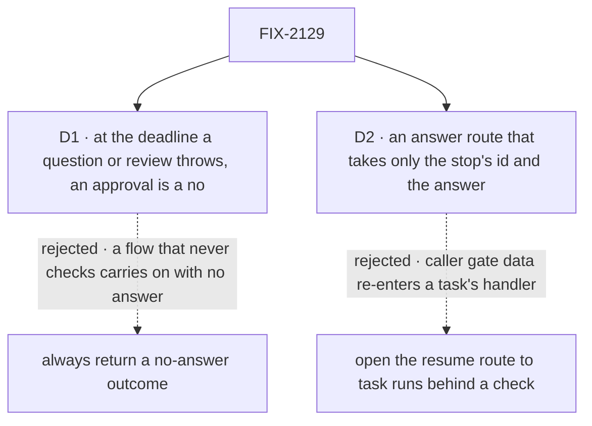

# FIX-2129 · Decisions

[Spec](SPEC.md) · **Decisions**

Most of this issue was decided above it: the concept's rule 12, and the epic's ER-1, ER-2, ER-3,
ER-7 and D3. Two calls are left, both about the surface the later children write against.

## The tree

Solid edges are what you're signing. Dashed edges lost, and the label says why.

## D1 · At its deadline, a question or review throws an error the block may catch; an approval reads as a no

| | |
|---|---|
| **Instead of** | Always returning a "no answer by the deadline" outcome, as a wait on a task does, for the block to branch on |
| **Because** | The concept says an unhandled deadline fails a question's or review's try, using an attempt. With a returned outcome nothing can tell a block that handled it from one that forgot, so the forgetful one carries on with an empty answer and nobody sees it. A thrown error is unhandled exactly when nobody catches it. An approval needs neither: a no is a safe default, so it returns `answer: false` with a deadline flag |
| **Locks in** | `ctx.waitForUser` returns the answer or `cancelled`, and throws a deadline error a block tells apart with one exported check. FIX-2131 to FIX-2133 and every app that asks a person write against this; changing it later changes every asking block. The wait gate keeps its returned deadline: it carries on by default, which a person's question must not |

It comes down to a flow that never checks: a returned outcome lets it carry on with no answer.

**What would change my mind:** evidence that most asking flows go ahead without the answer. Then
returning it is the common path, and the throw is ceremony.

## D2 · A screen answers a person's stop through a route that takes only the stop's id and the answer

*An engineering call, decided; recorded because it fixes a public route.*

| | |
|---|---|
| **Instead of** | Opening the resume route to runs a task started, with an exception for a person's stop |
| **Because** | The resume route takes a request id, an action and gate data from the caller, and re-entering a task's handler with them is what its source allow-list refuses (BP-031, FIX-999). The answer route reads the request, flow, session and user from the stored stop, checks the stop is a person's and the caller is its user, and validates the answer against the stop's own schema. Only the answer comes from the caller |
| **Locks in** | A public route and a client call, which the implementer names, beside resume. Every screen answers a person's stop through it, and no child builds another (ER-7). The resume route keeps serving a user's own runs, unchanged |

It comes down to what the caller sends: through resume, caller data re-enters a task's handler.

## Decided, not asked

- **"Resumes once" has one convergence point:** the stop's single pending state, the fence every
  resume already shares (FIX-1816 BR-16b). Every writer resolves through it: the answer route, the
  sweeper at the deadline, the cancel's payment, the user's stop, and FIX-2131's steer. The loser
  is told `already-resolved`. Nothing resolves a person's stop another way.
- **One predicate says whether a suspension is a person's**, in `contracts` beside the reasons
  (ER-1). The claim gate and the answer route read it here; FIX-2131 moves the Inbox and the send.
  `ctx.suspend` with `human_approval` or `human_input` passes it too, so a raw person's stop gets the
  mark, the cancel and the stop; resumed `cancelled`, it throws as a reject does.
- **The kind is a field on the suspension**, with the reasons unchanged, so every renderer that
  knows the two reasons keeps working. A record without it reads its kind from its reason (BP-030).
- **The row copies the stop** (its id, kind, prompt and deadline) in the write that sets the mark
  and drops the lease (ER-2), from the request's ending. `listTasks` reads no suspension store per
  row (BP-033), and a stop's prompt never changes. Admission and every ending clear it.
- **`waitingFor`** is the public name on `getTask` and `listTasks`, beside `waitingOn`, which they
  now show. The park's `question` string stays until FIX-2131 removes it.
- **The cancel is a debt with a due time** (rule 8), written in the cancel's own write: the
  cancelling side pays it at once through the request host, and a board touch or the sweeper
  resends it. It never goes over HTTP.
- **A cancelled block's writes to the task are refused** by the claim fence already there, and
  nothing it returns is recorded. A task it files after the cancel never starts; whether it is
  refused or filed cancelled is the implementer's.
- **A user's stop of a person's stop cancels the task.** The request's ending tells the gate the
  stop was a person's, and the gate cancels where it would have failed the try. A stop of a running
  request, or of a wait, is unchanged.
- **The deadline** rides the stop's existing expiry, which FIX-2063's sweeper fires. The host
  setting has its own bounds beside `waitDeadlines`; its name is the implementer's. A question's and
  a review's expiry now resume the block, as an approval's already does (FIX-1846).
- **The model's `waitForUser` tool is FIX-2131's**, which swaps it for `parkOnQuestion` in one
  change, so a model never has two ways to ask.
- **Messages:** a send or call to a session waiting on a person queues (rule 10, epic D2). A test
  pins it so FIX-2070's change is seen.

## Considered and dropped

| Alternative | Why not |
|---|---|
| Always return the deadline outcome (simpler: one result shape) | D1: a forgotten check carries on with no answer |
| Read the stop's text from the suspension store at `getTask` time | A store read per row in `listTasks`, and a second read path for the same fact |
| Cancel the run's stop synchronously in `updateTask`, with no debt | A crash between the row's cancel and the resume leaves the run parked for good, which is today's bug |
| Keep failing the try on a user's stop | Rule 12, and it asks the person the same question again |
| Hold the session's key while waiting | The epic's D2 rejected it: `onTaskSettled` must still run |

## Settled

- **No POC.** The kept claim and the same-try resume are shipped and tested (FIX-2077,
  `settles-when-its-work-is-over.test.ts`), and the fence is FIX-1816's. The new parts are wiring
  on those. No counted fact carries the approach, so there is no checker either.

## How it got here

- **Draft** — framed as the base every later stop builds on: `waitForUser` on `ctx.suspend`, the
  mark keyed on one predicate with the stop recorded on the row, four endings through one fence,
  and one trusted answer route; FIX-2130 folded in as the epic decided.

**Open: none.**
