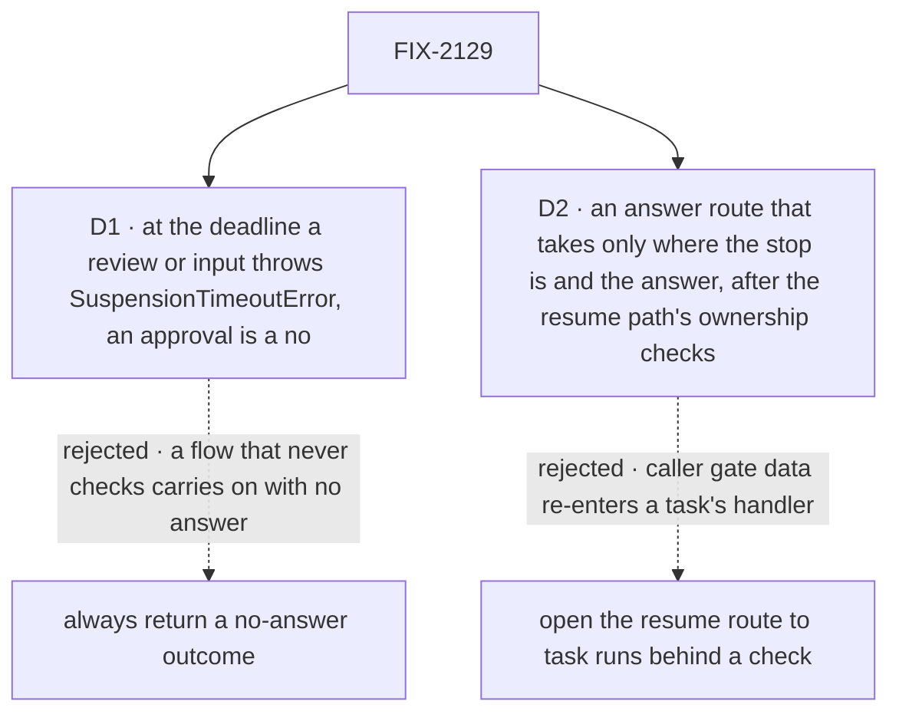

# FIX-2129 · Decisions

[Spec](SPEC.md) · **Decisions**

Most of this issue was decided above it: the concept's rule 12, and the epic's ER-1, ER-2, ER-3,
ER-7 and D3. Since the epic's amendment (#3748), a question with a task row holds its task (ER-8,
FIX-2133) and a question with none is input, so `waitForUser` has three kinds: approval, review and
input. Two calls are left, both about the surface the later children write against.

## The tree

Solid edges are what you're signing. Dashed edges lost, and the label says why.

## D1 · At its deadline, a review or input throws `SuspensionTimeoutError`, which the block may catch; an approval reads as a no

| | |
|---|---|
| **Instead of** | Always returning a "no answer by the deadline" outcome, as a wait on a task does, for the block to branch on |
| **Because** | The concept says an unhandled deadline fails a review's or input's try, using an attempt. With a returned outcome nothing can tell a block that handled it from one that forgot, so the forgetful one carries on with an empty answer and nobody sees it. A thrown error is unhandled exactly when nobody catches it. An approval keeps what FIX-1846 shipped, a no marked as the deadline's: that is a choice, not the same rule. A no leaves undone the one thing that waited for a yes, and an input's empty answer has no value that is safe to carry on with: code reads it on its next line, which is why it suspends and doesn't hold (epic D1) |
| **Locks in** | `ctx.waitForUser` returns the answer or `cancelled`, and at a review's or input's deadline throws `SuspensionTimeoutError`, which `core` already exports and nothing throws today: one timeout error for one suspension mechanism. The throw is a block's contract; FIX-2131's model tool returns a deadline result instead, since a model can't catch. ER-1's "share answered and deadline" means the same words, not the same shape: a wait returns `{ answered: false, deadline: true }`. FIX-2131 and every app that suspends for a person write against this; changing it later changes every asking block. The wait gate keeps its returned deadline: it carries on by default, which a person's input must not. A held question's deadline is not this: it is FIX-2133's, and goes ahead from its brief ([epic, decided](../../epics/FIX-2058/DECISIONS.md#decided-in-review-recorded-so-no-child-reopens-them)) |

It comes down to a flow that never checks: a returned outcome lets it carry on with no answer.

**What would change my mind:** evidence that most asking flows go ahead without the answer. Then
returning it is the common path, and the throw is ceremony.

## D2 · A screen answers a person's suspension through a route that takes only where the stop is and the answer, after the resume path's ownership checks

*An engineering call, decided; recorded because it fixes a public route.*

| | |
|---|---|
| **Instead of** | Opening the resume route to runs a task started, with an exception for a person's stop |
| **Because** | The resume route takes a request id, an action and gate data from the caller, and re-entering a task's handler with them is what its source allow-list refuses (BP-031, FIX-999). The answer route finds the stop by its request and its id, the pair every store keys a stop by (a stop's id is unique only within its request), as the Inbox item and the row's record carry them. It loads the stop's request and runs the checks the public resume path runs, `ownsRecord` and `callerReachesRequest` (flow instance, user, tenant, org), before it loads or resolves the stop, answering a miss as an unknown stop. A stored stop carries no tenant or org, so checking its user alone would let a known pair cross a tenant where user ids overlap. Then it checks the stop is a person's, reads the flow and session from the stored stop, and validates the answer against the stop's own schema. The pair only finds the stop; nothing it trusts comes from the caller but the answer |
| **Locks in** | A public route and a client call, which the implementer names, beside resume. Every screen answers a person's suspension through it, and no child builds another: ER-7's one trusted route per kind, the other being FIX-2133's `updateTask` for a held question. The ownership checks are shared with resume, not copied, so the two can't drift. The resume route keeps serving a user's own runs, unchanged |

It comes down to what the caller sends: through resume, caller data re-enters a task's handler.

## Decided, not asked

- **"Resumes once" has one convergence point:** the stop's single pending state, the fence every
  resume already shares (FIX-1816 BR-16b). Every writer resolves through it: the answer route, the
  sweeper at the deadline, the cancel's payment and the user's stop. A steer into a suspended task
  waits for the resume (ER-2); it answers only a held question, which isn't a suspension (ER-8).
  The loser is told `already-resolved`. Nothing resolves a person's suspension another way.
- **Once a cancel is written, it wins.** The row commits the cancel before its debt reaches the
  fence, so an answer landing in between must not win it: the answer is told `already-resolved`
  and the block resumes `cancelled`, never with an answer for a task already ended. How the answer
  route sees the written cancel (it checks the row and pays the debt itself, or the cancel reserves
  the stop's outcome first) is the implementer's; the goal's concurrency leg asserts the loser's
  response, not only one resume.
- **One predicate says whether a suspension is a person's**, in `contracts` beside the reasons
  (ER-1). The claim gate and the answer route read it here; FIX-2131 moves the Inbox and the send.
  `ctx.suspend` with `human_approval` or `human_input` passes it too, so a raw person's stop gets the
  mark, the cancel and the stop; resumed `cancelled`, it throws as a reject does.
- **The kind is a field on the suspension**, approval, review or input and never a question, with
  the reasons unchanged, so every renderer that knows the two reasons keeps working. A record
  without it reads its kind from its reason: `human_approval` an approval, `human_input` input. New
  code still writes such records: a raw `ctx.suspend` person's stop carries no kind.
- **The row copies the stop** (its request and id, kind, prompt and deadline) in the write that sets the mark
  and drops the lease (ER-2), from the request's ending. `listTasks` reads no suspension store per
  row (BP-033), and a stop's prompt never changes. Admission and every ending clear it.
- **`waitingOn: "user"`, not `"person"`** (owner, 2026-10-23), to match `waitForUser` and
  `userId`. `"person"` ships today (FIX-2077); this is a plain rename, since stores are reset and no
  row written before it is read (owner, 2026-10-23). The exported `TaskWaitingOn` becomes
  `"user" | "wait" | "filed" | "steer"`.
- **`waitingFor`** is the public name on `getTask` and `listTasks`, beside `waitingOn`, which they
  now show. The park's `question` string stays until FIX-2131 removes it. It is a read convenience
  and a join key for the task's context, never a listing source: the Inbox lists a suspension from
  `readAsks` only, so listing from `waitingFor` too would show a task's approval or review twice.
  FIX-2133 derives the same two fields for a row with an open question (`kind: "question"`); the
  claim gate keys on the stored mark and the predicate, never on the derived read.
- **The cancel is the board's existing owed-resume debt** (rule 8), not a second one: the
  cancel's own write sets the row's `cancelOwed`/`resumeOwed` marks, the cancelling side pays it at
  once, and `payOwedResumes` (`wait-on-task.ts`) pays it on the next board touch, as it pays a
  wait's today, through `RequestHost.resumeWait`, widened to take a person's suspension with a
  `cancelled` outcome. No eighth verb on the request host, which is closed at seven
  (`request-host.ts`), and no second payer. It never goes over HTTP. A crash between the row's cancel and the resume is the
  case the debt exists for, so the goal check kills the host there (leg e).
- **A cancelled block's writes to the task are refused** by the claim fence already there, and
  nothing it returns is recorded. What it does outside the task (a call, another scope's resource)
  lands, as any block's does. A stop it asks after the cancel resolves `cancelled` at once and opens
  no item.
- **A cancelled task has no live child.** The filed-work cascade cancels only what the row filed up
  to the cancel's time, so a filing the cancelled block makes afterwards would outlive it, against
  the concept's "anything it creates is cancelled with it". A filing whose parent is already
  cancelled is refused, the parent read in the filing's write. Where the parent is on another board
  and can't be read there, the child must never be claimable, not even for an instant: today's
  cross-board filing adds the child and only then cancels it (`addTask`, then `cancelIfParentEnded`,
  `workforce/src/conversation-board/board.ts`), which leaves a window a claimer can win. The filing
  lands the child already cancelled in the same write that adds it, read against the committed
  parent row, so there is never a claimable interval. Goal leg c′ latches the filing right after the
  add commits and forces a claimer in another process into that point; `GOAL_CONTROL=cancel-after-add`
  must fail it. Refused beats
  cancelling it later: no row to explain, and the block is told.
- **A user's stop of a person's stop cancels the task.** The request's ending tells the gate the
  stop was a person's, and the gate cancels where it would have failed the try. A stop of a running
  request, or of a wait, is unchanged.
- **The deadline** is the call's `deadline`, else the host's person-stop setting, else none
  ([epic D3](../../epics/FIX-2058/DECISIONS.md#d3), owner, 2026-10-24). A set one is written to the
  stop's existing `expiresAt` (the field `timeoutMs` sets), which FIX-2063's sweeper fires: one
  clock. With none, `expiresAt` stays empty, and neither the sweeper nor the debt pass ends the
  stop: it waits until it is answered, stopped or cancelled. The host setting is unset by default
  and has its own bounds beside `waitDeadlines`; its name is the implementer's. It applies to
  `waitForUser` and to a held question, never to a raw `ctx.suspend`, which keeps its own
  `timeoutMs`, none meaning no deadline. A held question reads the same setting, so the two can't
  drift (ER-8); before it lands, only FIX-2133's test hook gives a question a deadline. This issue
  owns that proof: goal leg f sets the setting and reads it on both, and a raw `ctx.suspend`'s own
  `timeoutMs` beside them; leg g leaves it unset and finds both still waiting. An input's and a
  review's expiry now resume the block, as an approval's already does (FIX-1846). Input that
  fails its try at a deadline is asked again on the next try, so it can stay open a deadline per
  try.
- **A person's stop never holds back a notice.** A task the stopped request filed ends during the
  stop, and its `onTaskSettled` runs then (ER-2). A filing request parked on a person's stop counts
  as ended for holding notices back; a wait after the resume that finds the notice taken says it is
  arriving as a notice, the mechanism #3733 adds.
- **The model's `waitForUser` tool is FIX-2131's**, landing in the change that retires
  `parkOnQuestion` for the hold, so a model never has two ways to ask.
- **Messages:** a send or call to a session waiting on a person queues (rule 10, epic D2). A test
  pins it so FIX-2070's change is seen.

## Considered and dropped

| Alternative | Why not |
|---|---|
| Always return the deadline outcome (simpler: one result shape) | D1: a forgotten check carries on with no answer |
| Return a typed result with a `deadline` variant the block must narrow | No runtime signal: a block can still read past it (`asked.answer ?? ""`), and plain JavaScript has no narrowing. An unhandled deadline must fail the try, which only a throw does |
| A new deadline error with its own check | `SuspensionTimeoutError` already exists for this and nothing throws it: two timeout errors for one mechanism |
| Read the stop's text from the suspension store at `getTask` time | A store read per row in `listTasks`, and a second read path for the same fact |
| Cancel the run's stop synchronously in `updateTask`, with no debt | A crash between the row's cancel and the resume leaves the run parked for good, which is today's bug |
| Keep failing the try on a user's stop | Rule 12, and it asks the person the same question again |
| A `question` kind on `waitForUser` | The epic's amendment (#3748, D1): a question with a task row holds its task and needs no durable execution (ER-8); one with none is input |
| Check only the stored stop's user on an answer | The stop carries no tenant or org; where user ids overlap, a known stop could be answered across a tenant (BP-031) |
| Check the parent in the claim gate instead of in the filing's write | The gate can read a stale per-process mirror of the parent (`resource-backed.ts`), so a child of a cancelled parent could still be claimed. Only the committed parent row, read in the write that adds the child, closes the window |
| Let a cancelled block's late filing land, and cascade it later | The cascade is bounded by the cancel's time, so it would never be cancelled: an orphan that runs |
| Hold the session's key while waiting | The epic's D2 rejected it: `onTaskSettled` must still run |

## Settled

- **No POC.** The kept claim and the same-try resume are shipped and tested (FIX-2077,
  `settles-when-its-work-is-over.test.ts`), and the fence is FIX-1816's. The new parts are wiring
  on those. No counted fact carries the approach, so there is no checker either.

## Notes from review

Recorded for the implementer, not folded into the design.

- **Cursor (PR #3735, review):** "Cancel debt + sweeper resend … reusing existing `cancelOwed` / `payOwedResumes` shape (if semantically identical) would avoid a second debt sweep path at implementation time." And: "If cancel debt uses filtered `list({ … })` like `payOwedResumes`, say so in implementer notes to avoid full-board scan amplification."
- **Cursor:** "All four writers through `resumeUnderLease` / `expireUnderLease` only — no second resolve path in shift-manager." "Predicate only in `contracts`; gate switches off inline `stopOf` list." "Cancel debt paid via a **host seam** like `resumeWait`, not orchestration importing engine routes (package boundary)."
- **Cursor:** "Residuals are sweeper O(pending) and more post-expiry continuations once questions gain deadlines … Optional: cap/limit on `waitingFor.prompt` size in list payloads (BP-042-adjacent)."
- **Cursor:** "Six-people table + `what-changes.svg` largely duplicate"; "'Decided, not asked' re-states several FIX-2058 ER bullets"; "Two mermaid 'four endings → fence' diagrams (SPEC + DECISIONS) could be one with a link."
- **Second look:** "Moving `PERSON_REASONS` is a three-line import swap, and leaving it creates a window where `contracts` and `shift-manager` can disagree on a custom reason. Suggest moving all three in this PR, or adding a test that fails if they diverge. Also note `SuspensionReason` has an open `string & {}` arm, so the predicate must say what a custom reason is." (The epic gives the move to FIX-2131; a divergence test is the implementer's call.)
- **Second look:** "The `REOPENED_SOURCES` removal (`reads.ts:240`, used at `:837`) is only for a person's stop. Please confirm the implementer deletes the set and not only that branch, so it isn't left as dead config."
- **Second look:** "What happens if the suspension is superseded (replayed block, re-driven turn) while the row still points at the old id? … A crash-recovery path is worth one line."
- **Second look:** "The goal check relies on a 'wait past three lease periods'. Please give the check a way to fake time. Without it the check is slow and flaky."
- **Second look:** on approval: "make the deadline flag part of the type so the narrowed `answer` can't be read without it."

## How it got here

- **Draft** — framed as the base every later stop builds on: `waitForUser` on `ctx.suspend`, the
  mark keyed on one predicate with the stop recorded on the row, four endings through one fence,
  and one trusted answer route; FIX-2130 folded in as the epic decided.
- **Review round 1** — the deadline error is the existing `SuspensionTimeoutError`; a person's stop
  holds back no notice; the docs line gains the architecture page.
- **Review round 2** — the answer route finds a stop by its request and id; a written cancel beats
  a late answer.
- **Round 3, to the epic's amendment** (#3748) — the `question` kind dropped: a question holds its
  task (FIX-2133) or is input. The answer route runs the resume path's ownership checks (ER-7,
  Codex). A cancelled task refuses new filings, and a crash after the cancel is a goal leg (Codex).
  A cross-board child of a cancelled task lands cancelled in the write that adds it, read against
  the committed parent row; the claim-gate variant dropped (stale mirror). Leg c′ latches the add
  window, with the cancel and the claim in separate processes (Codex).
  FIX-2137 blocks approval resumes; the goal check runs with trace observability off.
- **Cross-spec alignment** — the person-stop host setting also replaces FIX-2133's question-deadline
  constant; FIX-2137 merged (#3749).
- **Owner, 2026-10-23** — `waitingOn: "person"` renamed `"user"`; the old value is not read.
- **Owner, 2026-10-23** — no old data: stores are reset, so no persisted-data dual-read (BP-030
  waived for this epic's persisted shapes).
- **Other shapes, 2026-10-24** — acceptance is FIX-2133's Inbox reconciler green with a task's
  suspension present; this issue turns its answerable clause green, and waits on FIX-2133's first
  PR for it.
- **Reuse review, 2026-10-24** — the cancel's debt reuses `resumeOwed`, `payOwedResumes` and
  `resumeWait` (Cursor's note, adopted); `waitingFor` is never a listing source.
- **Owner, 2026-10-24** — no default deadline on a person's stop (epic D3): the host setting is
  unset by default and the call's `deadline` opts in; leg b sets its deadlines, leg f sets the
  setting, and leg g, with its control, proves a stop with none still waits.

**Open: none.**
