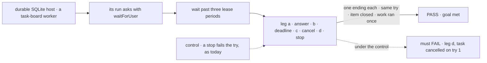
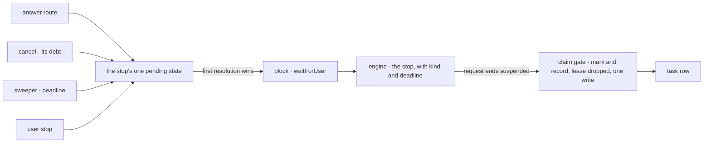

# FIX-2129 · A stop for a person holds its task

**Spec** · [Decisions](DECISIONS.md)

## Six people, before and after

| Someone who… | Today | After |
|---|---|---|
| **answers a worker's question in the Inbox** | Sees "can't be answered from Shift Manager" for any stop in a run a task started | Answers it there; the same try carries on, still holding its claim |
| **reads a task, as its filer or on a screen** | Sees *in progress*, with no sign it waits on a person or on what | Sees it waiting on a person, with the stop's kind, prompt and deadline, in `getTask` and `listTasks` |
| **writes a block that asks a person** | Calls `ctx.suspend` with a reason. An approval past its expiry reads as a rejection; a question past it stays parked for good | Calls `ctx.waitForUser({ kind, prompt, deadline? })`, 7 days by default. At the deadline an approval is a no, and a question or review fails the try unless the block catches it |
| **cancels a task waiting on a person** | The row cancels, but its run stays parked and its Inbox item stays open | The block resumes `cancelled` and runs to its end. Nothing it writes or returns lands; the item closes |
| **stops a run waiting on them** | The try fails and the task runs again, asking again | The run ends, its item closes, and the task is cancelled |
| **answers and cancels at the same moment** | n/a | One wins; the other is told the stop is already resolved |

Every other stop for a person rests on this one: FIX-2131, FIX-2132 and FIX-2133 test against
`waitForUser`, its mark on the row and its answer route.

## The goal, and how we'll know it's met

**A task whose run stops to ask a person shows what it waits for, is answered from the Inbox on the
same try, and ends exactly once, whether it is answered, runs out of time, is cancelled or is
stopped.**

| Is it the right goal? | |
|---|---|
| **The real need** | Rule 12 of [the concept](../../../docs/internal/design/workforce-coordination-concept.md#the-rules): "A stop for a person resumes once: answered, deadline or cancelled … Its task keeps its claim." The epic's legs b and c ([FIX-2058](../../epics/FIX-2058/SPEC.md#the-goal-and-how-well-know-its-met)) and its rules ER-1, ER-2, ER-3 and ER-7 |
| **Smaller, and rejected** | "The row records the question, so `getTask` shows it" (the issue before FIX-2130 folded in). Met while the Inbox still can't answer a task's stop, a cancel leaves the run parked, and a stop runs the work again |
| **Bigger, and not this issue's** | Every kind of stop in the Inbox: questions and reviews listed (FIX-2131), a coding run's question (FIX-2132), a held task (FIX-2133), proved together by FIX-2134 |
| **Not done if** | The check ran only in memory · the answer goes through the resume route opened to task runs · a cancel closes the item but the run never resumes, or its write lands · only an approval acts on its deadline |



The check reads the task through its public actions and answers through the route a screen uses,
never through the store.

| How we verify | |
|---|---|
| **Goal check** | `goals/task-board/holds-a-task-waiting-on-a-person/` · model-free (`n/a`) · run by the implementer at completion · verdict in the implementation PR |
| **Signal** | a: past three lease periods, `getTask` shows `waitingOn: "person"` and the prompt, a second worker claims nothing, and the answer completes try 1 with the work counter at 1. b: an unhandled question fails try 1, a caught one completes it, an approval reads as a no. c: the block runs on once, its progress write is refused, a task it files never starts, the row stays `cancelled` with no output. d: `cancelled` on try 1. Every leg: the item leaves the pending list. An answer and a cancel together resume once |
| **Input** | A question, "Which region?", and an approval. Another prompt or kind must pass too |
| **Anti-game** | Don't assert on the store's writes or the suspension record; read through `getTask` and the Inbox's pending read. The work counter is a real row, not item counts |
| **Control that must fail** | `GOAL_CONTROL=stop-fails-attempt` fails leg d on *cancelled on try 1*; `GOAL_CONTROL=public-resume` fails leg a on *answered through the route*. Today's `main` fails legs a to c: it has no `waitForUser` |

## What changes


Read down each column: every red cell today is a stop a person can't see, can't answer, or that
runs the work twice.

**A block that asks:**

```diff
- const region = (await ctx.suspend!({ reason: "human_input", message: "Which region?" })) as string;
+ const asked = await ctx.waitForUser({ kind: "question", prompt: "Which region?", deadline: 2 * DAY });
+ if (asked.cancelled) return { skipped: true };   // the task was cancelled: nothing here is recorded
+ const region = asked.answer;
+ // At the deadline this throws; catch isPersonDeadline(error) to go ahead, end, or ask again (D1).
```

**What a reader of the task sees:**

```diff
  { id: "t1", status: "in_progress", attempts: 1,
+   waitingOn: "person",
+   waitingFor: { kind: "question", prompt: "Which region?", deadline: 1761868800000 } }
```

**Docs:** update the `core`, `engine`, `client` and `orchestration` READMEs;
`apps/docs/docs/configuration/runtime.md` (the deadline setting), `apps/docs/docs/api/client.md`
(the answer call) and `apps/docs/docs/orchestration/task-board.md` (a task waiting on a person: its
reads, cancel and stop). No new page; the one-way-to-stop story is FIX-2131's (the epic's docs line).

## How a stop reaches the row, and how it ends



All four endings resolve the same pending state, the fence FIX-1816 built, so the first one wins.
The resumed run is admitted on its claim as today.

## What stays as it is

- **The person mark and the kept claim** (FIX-2077 D1). This keys them on one predicate and records which stop holds the task.
- **`ctx.suspend`** for every other suspension, and for a person's stop it can't express (a form, a selection, a skip).
- **The resume route** and its source allow-list (FIX-999).
- **Waits on work** (`getTask` with `wait`, FIX-2082): their deadline, wake and stop are untouched.
- **What the Inbox lists:** approvals and input, until FIX-2131. A message to a session waiting on a person still queues (rule 10); a test pins it.

## What's already here, and the debt

| Already here | What this does with it |
|---|---|
| Ways to ask a person and wait, across `packages/`: `ctx.suspend` with `human_approval` or `human_input` (the closest), the question park (`parkOnQuestion`, `answerTask`), the review park (`awaitReview`, `unparkAndDrain`), harness-manager's question inbox. Searched `suspend(`, `park`, `awaitReview`, `answer`, `ask` | **Builds on** the closest: `waitForUser` is `ctx.suspend` with a kind, a deadline and a cancel. FIX-2131 and FIX-2132 retire the other three onto it |
| [FIX-2077 D1](../FIX-2077/DECISIONS.md#d1) and [its person-stop line](../FIX-2077/DECISIONS.md#person-stop): a person's stop records `waitingOn: "person"`, drops the lease, and its resume is admitted on the same try | **Kept.** The mark comes from the shared predicate, and the same write records which stop holds the task |
| FIX-2077's rule that a stopped request fails its try (`task-request.ts` header) | **Amended** for a stop of a person's stop: the task is cancelled instead (rule 12) |
| [FIX-1816](../FIX-1816/BUSINESS-RULES.md) BR-16a and BR-16b: a stop of a person's gate ends the turn; whichever resolves the gate first wins | **Kept and extended:** the fence also takes the cancel and the deadline, and the stop also cancels the task |
| FIX-1846: an expired approval continues as a rejection marked expired | **Builds on:** an approval's deadline reads as a no. A question's and a review's now resume too |
| Three copies of "is it a person's stop": the gate's `stopOf`, `PERSON_REASONS` and the Lab send's `stopOf` | **Replaces** the gate's with one predicate in `contracts` ([ER-1](../../epics/FIX-2058/DECISIONS.md#who-owns-what)); FIX-2131 moves the other two |
| The Inbox's `REOPENED_SOURCES` check: a person's stop in a task's run is unanswerable | **Removes** it for a person's stop: every listed item answers through the answer route ([ER-7](../../epics/FIX-2058/DECISIONS.md#who-owns-what)) |

| The debt | |
|---|---|
| **Removes** | The gate's own person check; the Inbox's unanswerable task stops; a stop that runs a person's work twice; a cancelled task's run left parked |
| **Adds** | `ctx.waitForUser`, the answer route and client call, a person-deadline host setting ([D3](../../epics/FIX-2058/DECISIONS.md#d3)), a `cancelled` suspension status, the row's record of its stop, the cancel's debt. All permanent by design. `ctx.suspend` with a person's reason stays the lower-level form of the same stop, as it is under the wait gate |
| **Leaves** | `PERSON_REASONS` and the send's `stopOf` until FIX-2131; the parks until FIX-2131 and FIX-2132; the error reporter's own `ctx.suspend` question, which works as before |

**Net: flat here, down across the epic.** One call is added and one check replaced; the three
paths it lets FIX-2131 and FIX-2132 remove are what bring the net down.

## Sign off

**[The goal](#the-goal-and-how-well-know-its-met), at that size:** shown, answered on the same
try, ended once by any of four. If wrong: three children build on a stop that can still run work
twice or leave an item open.

**[The debt](#whats-already-here-and-the-debt), flat:** one call and one route added, one check
replaced. If wrong: `ctx.suspend` and `waitForUser` drift into two ways to ask.

1. **[D1](DECISIONS.md#d1) · At its deadline, a question or review throws an error the block may
   catch; an approval reads as a no.** If wrong: every asking flow wraps a catch it didn't need.
2. **[D2](DECISIONS.md#d2) · A screen answers a person's stop through a route that takes only the
   stop's id and the answer.** Engineering, decided. If wrong: two answer paths to keep in step.

**Open: none.** D1 is the one to weigh: it is the contract every later child and app writes against.

Feature · `contracts`, `core`, `engine`, `client`, `orchestration`, `shift-manager` · large · epic FIX-2058 · blocked by FIX-2063 and FIX-2056
