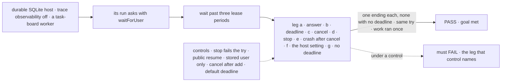
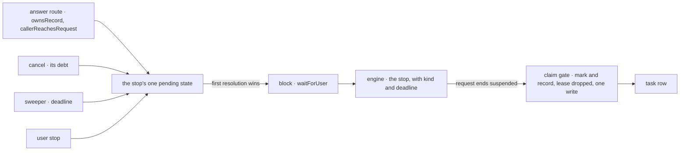

# FIX-2129 · A suspension for a person holds its task and ends once

**Spec** · [Decisions](DECISIONS.md)

## Six people, before and after

| Someone who… | Today | After |
|---|---|---|
| **answers a worker's approval, review or input in the Inbox** | Sees "can't be answered from Shift Manager" for any stop in a run a task started | Answers it there; the same try carries on, still holding its claim. Nobody in another tenant or org can answer it |
| **reads a task, as its filer or on a screen** | Sees *in progress*, with no sign it waits on a person or on what | Sees it waiting on a person, with the stop's kind, prompt and deadline, in `getTask` and `listTasks` |
| **writes a block that asks a person** | Calls `ctx.suspend` with a reason. An approval past its expiry reads as a rejection; input past it stays parked for good | Calls `ctx.waitForUser({ kind, prompt, deadline? })`, kind approval, review or input, with no deadline unless the call or the host sets one. At a deadline an approval is a no, and a review or input fails the try unless the block catches it. A question the work can go on without holds its task instead (FIX-2133) |
| **cancels a task waiting on a person** | The row cancels, but its run stays parked and its Inbox item stays open | The block resumes `cancelled` and runs to its end. Nothing it writes to the task or returns is kept, and a task it files is refused; what it does elsewhere lands, as any block's does. The item closes, a crash in between included |
| **stops a run waiting on them** | The try fails and the task runs again, asking again | The run ends, its item closes, and the task is cancelled |
| **answers and cancels at the same moment** | n/a | One wins; the other is told the stop is already resolved. Once the cancel is written, it is the one that wins |

Every later suspension for a person rests on this one: FIX-2131's review tests against
`waitForUser`, its mark on the row and its answer route. A question with a task row is not a
suspension: it holds its task ([epic ER-8](../../epics/FIX-2058/DECISIONS.md#who-owns-what),
FIX-2133), and its answer goes through the board's `updateTask`, not this route
([ER-7](../../epics/FIX-2058/DECISIONS.md#who-owns-what)).

## The goal, and how we'll know it's met

**A task whose run suspends for a person shows what it waits for, is answered from the Inbox on
the same try by that person only, and ends exactly once, whether it is answered, runs out of time,
is cancelled or is stopped.**

| Is it the right goal? | |
|---|---|
| **The real need** | Rule 12 of [the concept](../../../docs/internal/design/workforce-coordination-concept.md#the-rules): "A stop for a person resumes once: answered, deadline or cancelled … Its task keeps its claim." The epic's legs b and c ([FIX-2058](../../epics/FIX-2058/SPEC.md#the-goal-and-how-well-know-its-met)) and its rules ER-1, ER-2, ER-3 and ER-7 |
| **Smaller, and rejected** | "The row records the stop, so `getTask` shows it" (the issue before FIX-2130 folded in). Met while the Inbox still can't answer a task's stop, a cancel leaves the run parked, and a stop runs the work again |
| **Bigger, and not this issue's** | Every kind of stop in the Inbox: reviews listed (FIX-2131), a question holding its task (FIX-2133, FIX-2131, FIX-2132), proved together by FIX-2134 |
| **Not done if** | The check ran only in memory · the answer goes through the resume route opened to task runs · a caller with the stop's user id in another tenant or org can answer it · a cancel closes the item but the run never resumes, or its write or a task it files lands · a crash after the cancel leaves the run parked · only an approval acts on its deadline · a stop with no deadline set expires · a resume runs a completed step again |



The check reads the task through its public actions and answers through the route a screen uses,
never through the store.

| How we verify | |
|---|---|
| **Goal check** | `goals/task-board/holds-a-task-waiting-on-a-person/` · model-free (`n/a`) · run by the implementer at completion · verdict in the implementation PR |
| **Signal** | a: past three lease periods, `getTask` shows `waitingOn: "user"` and the prompt, a second worker claims nothing, and the answer completes try 1 with the work counter at 1; the same answer from a caller with the stop's user id in another tenant, and in another org, is told the stop doesn't exist; a task the request filed before it stopped ends during the stop, and its `onTaskSettled` runs then, not after the answer. b: with a `deadline` set on each call, an unhandled input fails try 1, a caught one completes it, an approval reads as a no and its resume runs no completed step again. c: the block runs on once, its progress write is refused, a task it files on the same board is refused, the row stays `cancelled` with no output and no open child. c′: the cancelled block files onto another board, with the cancel and a claimer in separate processes. A latch right after the child's add commits holds the filing there, and the claimer attempts its claim inside that window before the latch releases; under the fix the latch point has no claimable state, so the claim finds nothing. d: `cancelled` on try 1. e: the host dies after the cancel's row write and before the resume; after a restart, a board touch or the sweep resumes the block `cancelled` and the item closes. f: the host's person-stop setting set to a distinctive value; a `waitForUser` with no `deadline` and a held question (FIX-2133) both persist that deadline, and a raw `ctx.suspend` keeps its own `timeoutMs`, none meaning no deadline. g: with the setting unset, a `waitForUser` with no `deadline` and a held question persist none; past the sweeper's interval and a board touch, the request is still suspended, the question still open, and both items still listed. Every leg but g: the item leaves the pending list. Every leg: FIX-2133's `reconcileInbox` is green with a task's suspension present, its answerable clause included, which today's `main` fails on a task run's approval. An answer and a cancel together resume once; an answer after the cancel's write is told `already-resolved` and the block resumes `cancelled` |
| **Input** | An input, "Which region?", an approval, and a review |
| **Anti-game** | Run with `FSDEV_TRACE_OBSERVABILITY=0`, production's default, so a resume that runs completed steps again (FIX-2137) shows as a work counter of 2, not hidden by dev's traces. Don't assert on the store's writes or the suspension record; read through `getTask` and the Inbox's pending read. The work counter is a real row, not item counts. Leg e kills the host process, not a mocked fast path |
| **Control that must fail** | `GOAL_CONTROL=stop-fails-attempt` fails leg d on *cancelled on try 1*; `GOAL_CONTROL=public-resume` fails leg a on *answered through the route*; `GOAL_CONTROL=stored-user-only` fails leg a on *another tenant is told the stop doesn't exist*; `GOAL_CONTROL=cancel-after-add`, which keeps today's order of adding the child and then cancelling it, fails leg c′ deterministically: the latch forces its claimer into the window, and the claim succeeds; `GOAL_CONTROL=default-deadline`, which gives a stop with none the wait default, fails leg g on *still suspended*. Today's `main` fails legs a to c′ and e to g: it has no `waitForUser` |

## What changes


Read down each column: every red cell today is a stop a person can't see, can't answer, or that
runs the work twice.

**A block that asks:**

```diff
- const region = (await ctx.suspend!({ reason: "human_input", message: "Which region?" })) as string;
+ const asked = await ctx.waitForUser({ kind: "input", prompt: "Which region?", deadline: 2 * DAY });
+ if (asked.cancelled) return { skipped: true };   // the task was cancelled: nothing here is recorded
+ const region = asked.answer;
+ // At the deadline input throws SuspensionTimeoutError; catch it to go ahead, end, or ask again (D1).
```

**What a reader of the task sees:**

```diff
  { id: "t1", status: "in_progress", attempts: 1,
+   waitingOn: "user",
+   waitingFor: { kind: "input", prompt: "Which region?", deadline: 1761868800000 } }
```

**Docs:** update the `core`, `engine`, `client` and `orchestration` READMEs;
`docs/architecture/execution-and-errors.md` (its durable-execution section: the answer route beside
resume and its ownership checks, a review's and an input's expiry, `SuspensionTimeoutError` thrown,
the `cancelled` resume, a stop that cancels the task);
`apps/docs/docs/configuration/runtime.md` (the person-stop deadline setting, unset by default), `apps/docs/docs/api/client.md`
(the answer call) and `apps/docs/docs/orchestration/task-board.md` (a task waiting on a person: its
reads, cancel and stop). The concept already says a person's stop has no deadline unless one is set ([epic D3](../../epics/FIX-2058/DECISIONS.md#d3)). A
changeset with a migration note: a raw `ctx.suspend` person's stop now gets the mark, the cancel and
the stop, an input's expiry now resumes its block, a cancelled task refuses new filings, and a cross-board child of one is never claimable, and
`contracts` gains a `cancelled` status, and `TaskWaitingOn` reads `"user"` where it read `"person"`. No new page; the one-way-to-stop story is FIX-2131's (the
epic's docs line).

## How a stop reaches the row, and how it ends



All four endings resolve the same pending state, the fence FIX-1816 built, so the first one wins;
a cancel already written to the row beats an answer that lands before its debt is paid. The answer
route runs the public resume path's ownership checks on the stop's request before it loads or
resolves the stop (ER-7). The resumed run is admitted on its claim as today.

## What stays as it is

- **The person mark and the kept claim** (FIX-2077 D1). This keys them on one predicate and records which stop holds the task.
- **`ctx.suspend`** for every other suspension, and for a person's stop it can't express (a form, a selection, a skip).
- **The resume route**, its source allow-list (FIX-999) and its ownership checks, which the answer route reuses.
- **Waits on work** (`getTask` with `wait`, FIX-2082): their deadline, wake and stop are untouched.
- **What the Inbox lists:** approvals and input, until FIX-2131 and FIX-2133. A message to a session waiting on a person still queues (rule 10); a test pins it.

## What's already here, and the debt

| Already here | What this does with it |
|---|---|
| Ways to ask a person and wait, across `packages/`: `ctx.suspend` with `human_approval` or `human_input` (the closest), the question park (`parkOnQuestion`, `answerTask`), the review park (`awaitReview`, `unparkAndDrain`), harness-manager's question inbox. Searched `suspend(`, `park`, `awaitReview`, `answer`, `ask` | **Builds on** the closest: `waitForUser` is `ctx.suspend` with a kind, a deadline and a cancel. FIX-2131 retires the review park onto it; the question park and the harness inbox move onto FIX-2133's hold, not onto this |
| [FIX-2077 D1](../FIX-2077/DECISIONS.md#d1) and [its person-stop line](../FIX-2077/DECISIONS.md#person-stop): a person's stop records `waitingOn: "person"`, drops the lease, and its resume is admitted on the same try | **Kept, its value renamed `"user"`** (owner, [Decided, not asked](DECISIONS.md#decided-not-asked)). The mark comes from the shared predicate, and the same write records which stop holds the task |
| FIX-2077's rule that a stopped request fails its try (`task-request.ts` header) | **Amended** for a stop of a person's stop: the task is cancelled instead (rule 12) |
| [FIX-1816](../FIX-1816/BUSINESS-RULES.md) BR-16a and BR-16b: a stop of a person's gate ends the turn; whichever resolves the gate first wins | **Kept and extended:** the fence also takes the cancel and the deadline, and the stop also cancels the task |
| FIX-1846: an expired approval continues as a rejection marked expired | **Builds on:** an approval's deadline reads as a no. An input's and a review's now resume too |
| `SuspensionTimeoutError` in `core`: exported, documented as thrown on a timed-out resume, recognized by the generator and the tool executor, and thrown by nothing. `SuspendOptions.timeoutMs`, which sets the stop's `expiresAt` | **Reused:** it is the deadline error ([D1](DECISIONS.md#d1)). `waitForUser`'s `deadline` is written to the same `expiresAt`, so a stop has one clock |
| `ownsRecord` and `callerReachesRequest` (`engine/src/routes/route-utils.ts`): the public resume path's checks of flow instance, user, tenant and org, answering another's request as a missing one | **Reused** by the answer route, before it loads or resolves the stop ([D2](DECISIONS.md#d2), ER-7). A stored stop carries no tenant or org, so its user alone isn't enough |
| The board's owed-resume debt: `Task.cancelOwed` and `resumeOwed`, paid by `payOwedResumes` on a board touch (`orchestration/src/tasks/helpers/wait-on-task.ts`) through `RequestHost.resumeWait` (`core/src/types/request-host.ts`, a seam closed at seven verbs) | **Extended:** the cancel's debt is this one; `resumeWait` takes a person's suspension with a `cancelled` outcome. No new payer, no eighth verb |
| The filed-work cascade (`orchestration/src/tasks/collection/cascade.ts`, `workforce/src/conversation-board/cascade.ts`): a cancel cancels the open tasks its row filed up to the cancel's time | **Kept**, and closed behind: a filing whose parent is already cancelled is refused, so work a cancelled block files after the cancel can't outlive it (concept, *Inbox items*: what it creates is cancelled with it) |
| Three copies of "is it a person's stop": the gate's `stopOf`, `PERSON_REASONS` and the Lab send's `stopOf` | **Replaces** the gate's with one predicate in `contracts` ([ER-1](../../epics/FIX-2058/DECISIONS.md#who-owns-what)); FIX-2131 moves the other two |
| The Inbox's `REOPENED_SOURCES` check: a person's stop in a task's run is unanswerable | **Removes** it for a person's stop: every listed suspension answers through the answer route ([ER-7](../../epics/FIX-2058/DECISIONS.md#who-owns-what)) |

| The debt | |
|---|---|
| **Removes** | The gate's own person check; a declared error nothing throws; the Inbox's unanswerable task stops; a stop that runs a person's work twice; a cancelled task's run left parked; a cancelled task's late filings |
| **Adds** | The `waitingOn` value `"user"`, renamed from `"person"` (stores are reset, so the old value is not read); `ctx.waitForUser`, the answer route and client call, an opt-in person-deadline host setting, unset by default ([D3](../../epics/FIX-2058/DECISIONS.md#d3)), which FIX-2133's question deadline also reads, a `cancelled` suspension status, the row's record of its stop, the cancel's debt on the existing owed-resume marks, the refusal of a filing under a cancelled parent. All permanent by design. `ctx.suspend` with a person's reason stays the lower-level form of the same stop, as it is under the wait gate; new code asks with `waitForUser` |
| **Leaves** | `PERSON_REASONS` and the send's `stopOf` until FIX-2131; the parks until FIX-2131 and FIX-2132; the error reporter's own `ctx.suspend` question, which works as before |

**Net: flat here, down across the epic.** One call is added and one check replaced; the review
park it lets FIX-2131 remove, and the one trusted route per kind, are what bring the net down.

## Depends on

| Blocked by | Why |
|---|---|
| FIX-2056 | Its claim gate, steer and `getTask` (the epic's base) |
| FIX-2133's first PR, a soft edge | The Inbox reconciler this issue's acceptance runs; cheap, since this issue already waits on FIX-2063 |
| FIX-2063 | Durable execution and the sweeper on file-backed hosts: a suspension needs them (ER-6), and leg e's restart needs the sweep |
| FIX-2137, for approval resumes ([#3749](https://github.com/fixpoint-labs/flow-state-dev/pull/3749), merged; Done) | A durable resume with trace observability off ran its completed steps again. With it on `main`, a resume skips them, which the goal check, run with observability off, confirms |

## Sign off

**[The goal](#the-goal-and-how-well-know-its-met), at that size:** shown, answered on the same
try by its own caller only, ended once by any of four, a crash after a cancel included. If wrong:
the children build on a stop that can still run work twice, leave an item open, or be answered
across a tenant.

**[The debt](#whats-already-here-and-the-debt), flat:** one call and one route added, one check
replaced. If wrong: `ctx.suspend` and `waitForUser` drift into two ways to ask.

1. **[D1](DECISIONS.md#d1) · At its deadline, a review or input throws `SuspensionTimeoutError`,
   which the block may catch; an approval reads as a no.** If wrong: every asking flow wraps a catch it didn't need.
2. **[D2](DECISIONS.md#d2) · A screen answers a person's suspension through a route that takes only
   where the stop is and the answer, after the resume path's ownership checks.** Engineering, decided. If wrong: two answer paths to keep in step.

**Open: none.** D1 is the one to weigh: it is the contract every later child and app writes against.

Feature · `contracts`, `core`, `engine`, `client`, `orchestration`, `shift-manager` · large · epic FIX-2058 · blocked by FIX-2056 and FIX-2063 (FIX-2137, for approval resumes, merged)
