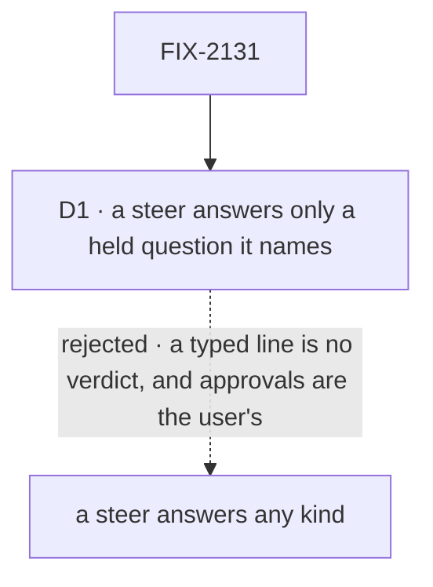

# FIX-2131 · Decisions

[Spec](SPEC.md) · **Decisions**

Most of this issue was decided above it: rule 11 of
[the concept](../../../docs/internal/design/workforce-coordination-concept.md#the-rules), the
epic's amended D1 (a question holds its task; approvals, reviews and input suspend), its ER-4,
ER-5 and ER-8, FIX-2129's `waitForUser`, its endings and its answer route, and FIX-2133's hold.
One call is left, about what a person sees.

## The tree

Solid edges are what you're signing. Dashed edges lost, and the label says why.

## Owner decisions

- **Owner, 2026-10-23** — no old data: stores are reset, so no retired-shape map entries for parks and no migrated-question allowance (BP-030 waived for this epic's persisted shapes; overrides ER-5's 'rows persisted before are still read').

## D1 · A steer answers only a held question it names; approvals and reviews are answered in the Inbox

| | |
|---|---|
| **Instead of** | Letting any steer answer any kind of stop, so "looks good" typed in a task's session would answer its review, or "yes" its approval |
| **Because** | Rule 11: only the user answers approvals and reviews, and the concept names the session line and the filer's steer as answers to a *question*. An approval is a yes or no and a review is a verdict; free text read as either is a guess about what the person meant, and a filer answering one would approve its own work. A question's answer is text, so a steer is a whole answer. It names the question it answers, as ER-8 requires; one naming none answers nothing |
| **Locks in** | A steer into a task waiting on an approval or a review is kept and the item stays open (ER-2). The block's result is the Inbox's verdict alone; the steer reaches the work the way any steer does (FIX-2086): the next model call takes it, and a task does not complete with a steer untaken, so it takes one more turn whose brief holds it. A revision request on a review is the same: the verdict resumes the block, and the request's words are the user's steer. The filer answers only a question asked midway, and not on a routed task, whose filer is the conversation (ER-4). The user answers a question from the Inbox, a line in the task's session (which the composer writes as a steer naming it) or a screen's `updateTask`. Apps and screens write against this; widening it later changes what a typed line does to a waiting task |

It comes down to a typed line read as a verdict: "looks good" would approve work nobody looked at.

**What would change my mind:** users who review in the task's session and never open the Inbox.
Then a review takes a typed line, and an approval still doesn't.

## D2 · Retired: no row parked before the upgrade is read

Moot by the [owner's reset](#owner-decisions): stores are reset, so no parked row is read and
FIX-2080's map gains no entry for it. The `parked` status and its rows simply go.

## Decided, not asked

- **This issue merges after FIX-2132.** A coding run's question on a board writes the same park
  and is answered by the same unpark `answerTask` uses (harness-manager's `parkOnBoardQuestion`).
  Removing them first would leave that question no answer on `main`. FIX-2131 builds in parallel
  and owns removing the shared park and its status; FIX-2132 moves every
  harness-manager park off it: the question, a held-work mismatch and the judge's ask, all of which
  call `parkOnBoardQuestion` or `awaitReview` today, and the run record's `parked`. No stored
  park is read, harness ones included ([owner](#owner-decisions)); FIX-2132 adds no map entry.
- **The model's tools are `askQuestion({ question })` and `waitForUser({ kind, prompt })`,** kind
  approval, review or input (ER-1), in `parkOnQuestion`'s slot (`controlTools`). **Which applies
  when:** on a task row, a question is `askQuestion` and an approval or review is `waitForUser`;
  with no task row there is nothing to hold, so a question is `waitForUser` input. On a task turn,
  a waited-on task's included, `waitForUser` refuses `input` by name and points at `askQuestion`,
  so a model never has two ways to ask one; a turn with no task row doesn't get `askQuestion`.
  This is the owner's decision on [agent-mailbox#44](https://github.com/fixpoint-labs/agent-mailbox/issues/44),
  recorded in #3748: questions hold, before the start and midway; approvals, reviews and
  code-consumed input suspend. Input stays for a block's own code (`human_input`, or an inline ask
  the code reads next), not for a model's tool on a task turn.
  `askQuestion` calls ER-8's ask: it adds the question, drops the lease and ends the turn
  unsettled. What the request did before asking stands, and the next turn starts from the brief,
  the last checkpoint and the answer. Its deadline is the hold's (ER-8, FIX-2133). `waitForUser`,
  input included, takes the host's person-stop deadline where the host sets one and none otherwise
  ([epic D3](../../epics/FIX-2058/DECISIONS.md#d3)); at a deadline it returns a no-answer result,
  since a model can't catch (ER-1); input's answer is the tool's result. `waitForUser` never takes
  `question` (ER-1).
- **First answer wins, unless a cancel is already written,** at one point per kind: a held
  question's at ER-8's one write (FIX-2133), a review's at FIX-2129's pending state. This issue
  adds writers to the first, never a second write: the filer's tool and the Inbox through
  `updateTask` with the question's id, and the task-session line through `steerFromLine`.
- **A line in the task's session is a steer the server writes.** Shift Manager's task-session
  composer sends the plain line, instead of a turn to the session, and orchestration's
  `steerFromLine` answers the row's oldest open question with it, as the user the request was
  verified as (FIX-2133; BP-031: no client picks the question). With none open, the line is an
  ordinary steer. A `sendMessage` to a session waiting on a person still queues and answers
  nothing (rule 10; the owner's call of 2026-10-22).
- **Who may answer by steer** is ER-8's acceptance, read from server-set state (BP-031): the
  public action for any question, the filer's tool only for a midway question on a task not routed.
- **One loser rule.** An answer that loses, to another answer, a cancel or the deadline, is told
  so; a steer that loses stays an ordinary steer, taken before the next model call (FIX-2086).
- **The steer cap** and its reservation are
  FIX-2133's, inside ER-8's write ([FIX-2133, *Decided, not asked*](https://github.com/fixpoint-labs/flow-state-dev/blob/spec/FIX-2133/specs/issues/FIX-2133/DECISIONS.md#decided-not-asked)). This issue's tools
  and composer only call it.
- **A revision's steer is written before the review resolves** (amended 2026-10-24, from
  FIX-2163). The answer route writes the revision request's words as a steer on the row, then
  resolves the review, and refuses a revision with no words. A block that loops on untaken steers
  (the harness manager's steer check, FIX-2163) then sees them when it resumes; the other order
  lets the task complete over the request for changes.
- **A retry keeps a question's answer and asks for a review again.** A question's answer is a
  steer on the row, so the next attempt's brief holds it, as it holds any steer. A review's verdict
  lives on its suspension, which ends with its attempt; a revision request's words are a steer, and stay.
- **The Inbox** lists a review as FIX-2133's one item type over open holds: a review is a
  suspension hold, named a review; held questions, before start and midway, are row holds on the
  same type. Both take a task's context from the board snapshot it already loads, not a read per
  task, through orchestration's Inbox read. `reads.ts`'s
  `PERSON_REASONS` and `send.ts`'s `stopOf` move onto the predicate. Chief of Staff's parked
  list goes: its questions are held questions now.
- **What this reads and writes on the row** (amended 2026-10-25, the epic's one list of holds).
  The review stop writes nothing of its own: the claim gate's stop arm opens its suspension hold
  (FIX-2133, PR 2), and the resume closes it. `askQuestion` opens a row hold through ER-8's write.
  Retiring the park, the drain's excusal, the Inbox and the composer read open holds, never
  `waitingOn: "user"`, `waitingFor` or `questions`, which FIX-2133 removes or never builds. Its
  model tools ask questions only, never `confirm` (the epic's [Open](../../epics/FIX-2058/DECISIONS.md#open)).
- **The `parked` notice goes.** No ending `parked` is written. Until FIX-2070 the filer is told
  nothing when its task asks, and finds the question through `getTask`.
- **Removed outright** ([FIX-2056 (e)](../../epics/FIX-2056/DECISIONS.md#e)): no deprecation
  release. A board built with `onReview` is refused by name (BP-030). The `parked` status is no
  longer written or read; its board column and filters go.
- **FIX-2087's sweep** drops `answerTask` and `parkOnQuestion` from its allow list and its
  migration table, and lists `askQuestion` and `waitForUser` beside `reportProgress`.
- **FIX-1851** closes as superseded when this merges.

## Considered and dropped

| Alternative | Why not |
|---|---|
| Keep `answerTask` as a thin call onto the steer (simpler for callers) | A second way to answer, which ER-4 forbids |
| One model tool, `waitForUser` with a `question` kind that holds instead of suspending | ER-1 keeps `question` out of `waitForUser`, and the two behave differently to the model: a suspension's result is the answer, a hold ends the turn |
| `waitForUser` input on a task turn whenever the model needs the value as the call's result, by ER-1's test of who consumes the answer (round 4, reverted) | The consumer of a model's tool result is the model, not code, so it is a question and holds ([agent-mailbox#44](https://github.com/fixpoint-labs/agent-mailbox/issues/44), recorded in #3748). Any model can say it needs the value now, which would reopen the mid-task suspension the decision retired |
| Merge before FIX-2132, leaving the shared park for the coding run; or land the new surface first and delete the shared park in a third PR | `main` carries both forms between the merges, and whichever PR lands last must remember the deletion. FIX-2132 builds in parallel, so the serial merge costs only the wait |
| A line in the task's session answers as a message to the session | The session is waiting, so the line queues behind it (rule 10) and contradicts the owner's call that a steer is the only way to change open work |
| Keep the `parked` status for app-written parks | The second form of stopping the epic's D1 removes |

## Settled

- **No POC.** The new parts sit on FIX-2129's pending state, FIX-2133's hold and FIX-2086's steer
  write, each specced and tested there. The facts the approach rests on are read from the code:
  the coding run's board question uses the same park and unpark
  (`harness-manager/src/manager.ts`, `parkOnBoardQuestion`; `test/claim-host.ts`,
  `unpark(..., { answer: true })`), and its fixed-board question writes a park with no question
  mark, the shape of a review park (`parkOnMismatch`, `board.awaitReview(identity.taskId, question)`).
  No counted fact carries the approach, so no checker.

## Notes from review

Recorded for the implementer from the epic review ([#3732](https://github.com/fixpoint-labs/flow-state-dev/pull/3732)), routed here on Linear; not folded into the design.

- **Round 1:** "Include one persisted legacy parked row, read through FIX-2080's map, in the tests (BP-030 dual-read is the one case the no-shim decision does not waive)."
  Moot: owner reset decision, 2026-10-23.
- **Round 1 and 2:** "Plan the migration of the ~25 orchestration test files that touch answerTask/parkOnQuestion/awaitReview/unparkAndDrain inside the deletion PR, so it is not also a separate test rewrite."
- **Round 1:** "Build Inbox items from the board snapshot LabReader already loads, not from a getTask/listTasks call per task on each refresh (N+1)."
- **Round 1:** "Move both reads.ts PERSON_REASONS and send.ts stopOf onto the contracts predicate."

From this PR's round 1 ([#3738](https://github.com/fixpoint-labs/flow-state-dev/pull/3738)):

- **Cursor:** "share one internal resolve (Inbox route + steer write + session line) rather than a parallel `answerQuestionFromSteer` beside unpark logic."
- **Cursor:** "When Chief of Staff's parked list goes, dedup: question/review stops appear once (asks), not also via `shiftSummary.parked` / board scans."
- **Cursor:** "Steer admission: kind/filer/`resultTo` from trusted row state already loaded for the write (BP-031), not a follow-up fetch per steer."
- **Cursor:** "Inbox construction must not call task tools per row; enrichment joins snapshot boards in memory."
- **Cursor:** "Decided, not asked re-documents FIX-2129 / FIX-2086 mechanics … one paragraph pointing at FIX-2129 + FIX-2086 and listing only this issue's deltas." And: a leg → actor → pass table for the Signal.
- **Second look, D1:** "the tool result should make 'answered by session line' visible to the block so it can't be mistaken for the Inbox answer."
- **Second look, D2:** "the three new map entries must have disjoint predicates from `parked-for-turn` and `parked-split` … A parked row can carry `parkedForTurn` and a question. Please pin the precedence in a test." Moot: owner reset decision, 2026-10-23.
- **Second look, tests:** "~40 files under `packages/orchestration/test`, plus `harness-manager/test` (3 files), `integration-tests/.../task-board-park-exit-across-requests.test.ts`, `devtool/test/task-actions.test.ts`, and `shift-manager/test/devteam-chief-of-staff-tasks.test.ts` … the `park-exit` drain tests … should be deleted, not migrated."
- **Codex, round 4** (at 5504374d, not adopted; the owner's #44 decision governs): "When a task model needs a free-form value as the current tool result, this guard redirects it to `askQuestion`, which ends the turn rather than returning the answer to the suspended call. That contradicts the governing distinction: ER-1 assigns approval, review, and input to `waitForUser` whenever code reads the answer next, and the concept explicitly says a request working a task may still suspend (`specs/epics/FIX-2058/DECISIONS.md:86`; `docs/internal/design/workforce-coordination-concept.md:227-232`). The fresh evidence beyond the earlier finding is this newly added task-row refusal, so leg g should cover task-row input result/deadline behavior instead of requiring the refusal."
- **Codex, round 5, required for the implementer** (at 96a0a605; its input half is moot, since input is refused on task turns): "When a task model emits `askQuestion` and `waitForUser({ kind: "input" })` in the same step, the generator executes sibling tool calls concurrently and waits for all of them before propagating the first suspension (`packages/core/src/blocks/generator.ts:1368-1445`). The question call can therefore write ER-8's open-question hold while the input call creates ER-2's person suspension, leaving the row governed by incompatible answer and re-entry protocols or making the result write-order dependent. Leg g invokes `waitForUser` alone, so its no-hold assertion misses this reachable collision; define atomic precedence/refusal and add a same-step collision check." The residue is real for `askQuestion` beside `waitForUser` approval or review in one step. **Required:** a turn opens at most one way of waiting on a person. Within a step the first to commit wins, and the sibling is refused with a tool error naming the other. FIX-2133 enforces it in the writes ([FIX-2133](https://github.com/fixpoint-labs/flow-state-dev/blob/spec/FIX-2133/specs/issues/FIX-2133/DECISIONS.md#decided-not-asked)); the tool error and leg g are this issue's.
- **Second look:** "I'd not widen beyond [the predicate move] (e.g. leave `goal-seek-loop.ts`/`quiescence.ts` park handling to the removal itself)."

## How it got here

- **Draft** — framed as retiring both parks onto FIX-2129's `waitForUser`, with the steer as the
  filer's answer and the Inbox listing both kinds; ordered after FIX-2132, which shares the park.
- **Round 1** — a session line answers as a steer the composer writes, not as a message to the
  session, because a waiting session queues messages (rule 10). A steer into a review reaches the
  work through FIX-2086's owed turn, because a resumed block is handed only its verdict. Every
  `parked` surface got a named fate.
- **Re-spec onto the epic's amendment** (#3748) — a midway question no longer suspends: it holds
  its task through ER-8 (FIX-2133, now blocking this issue), and the answer, a steer naming the
  question, owes one more turn on the same attempt. Reviews still suspend; a revision request is a
  steer. D2 flipped from running a parked row again to holding it, since ER-5 maps every parked
  question onto the hold. Round 2: the steer cap reserves an answer's place at the ask, replacing
  the round-1 exception, which was unbounded.
- **Round 3** (Codex at 36853b4f) — `waitForUser` keeps `input`, for a turn with no task row.
- **Round 4** — `input` on task turns was allowed, then reverted to round 3 (FSD Architect):
  the owner's #44 decision governs, and a model's question on a task turn holds.
- **Owner reset** (2026-10-23) — stores are reset, so D2, its two map entries, the feedback-less
  park's fixed prompt, the migrated question's place above the cap and leg f all go.
- **Owner, 2026-10-24** — no default deadline on a person's stop (epic D3): leg g sets the host's
  deadline for its no-answer result, and checks that with none the request still waits. From the
  epic's analysis: the drain's park excusal moves onto ER-1's predicate and ER-8's hold (since
  2026-10-25, the row's open holds), so a board
  waiting only on a person reports `blocked` (leg h); a model's review returns at its deadline
  where a block's throws, and the signal for that is [FIX-2165](https://linear.app/fixpoint-labs/issue/FIX-2165)'s; reviews list through FIX-2133's one Inbox read, from `readAsks`, adding no source, and acceptance is its reconciler green with a review present; a session line answers server-side through `steerFromLine`, so the composer keeps no copy of which question; each deleted name joins the sweep list in the same PR; `turnReentries` goes with its only writer.
- **Epic amendment, 2026-10-25** — one list of holds per task: a review's stop and a question both
  read as open holds; nothing here writes `waitingFor` or `questions`.

**Open: none of this issue's.**
