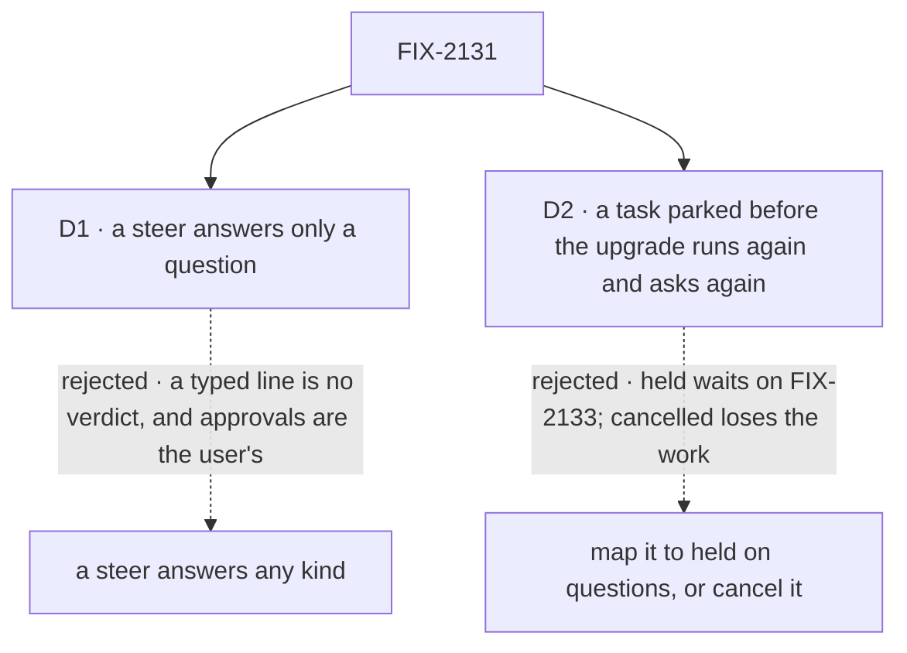

# FIX-2131 · Decisions

[Spec](SPEC.md) · **Decisions**

Most of this issue was decided above it: rule 11 of
[the concept](../../../docs/internal/design/workforce-coordination-concept.md#the-rules), the
epic's ER-4 and ER-5, and FIX-2129's `waitForUser`, its endings and its answer route. Two calls
are left, both about what a person sees.

## The tree

Solid edges are what you're signing. Dashed edges lost, and the label says why.

## D1 · A steer answers only a question; approvals and reviews are answered in the Inbox

| | |
|---|---|
| **Instead of** | Letting any steer answer any kind of stop, so "looks good" typed in a task's session would answer its review, or "yes" its approval |
| **Because** | Rule 11: only the user answers approvals and reviews, and the concept names the session line and the filer's steer as answers to a *question*. An approval is a yes or no and a review is a verdict; free text read as either is a guess about what the person meant, and a filer answering one would approve its own work. A question's answer is text, so a steer is a whole answer |
| **Locks in** | A steer into a task waiting on an approval or a review is kept, the item stays open, and the block reads the steer once the Inbox answers. The filer answers only a question asked midway, and not on a routed task, whose filer is the conversation (ER-4). The user answers a question from the Inbox, the task's session or a screen's `updateTask`. Apps and screens write against this; widening it later changes what a typed line does to a waiting task |

It comes down to a typed line read as a verdict: "looks good" would approve work nobody looked at.

**What would change my mind:** users who review in the task's session and never open the Inbox.
Then a review takes a typed line, and an approval still doesn't.

## D2 · A task parked before the upgrade runs again and asks again, using no attempt

| | |
|---|---|
| **Instead of** | Mapping a stored parked row onto *held on questions*, or cancelling it |
| **Because** | A parked row has no suspended request to resume, so it can't become a waiting stop as it is. Held on questions is FIX-2133's and would make this issue wait on it (the epic's seam). Cancelling loses open work. Running it again is what answering it did anyway, a new attempt from the top, and FIX-2080's `parked-for-turn` entry already reads its parked rows this way. The run asks again through `waitForUser`, so the question lands in the Inbox |
| **Locks in** | Three read-time entries in FIX-2080's map: a row parked on a question and a row parked for review read `pending`, one more turn re-entry, so no attempt is spent; a row answered but not yet run reads `pending` with the answer as one untaken steer. A person with an open question from before sees it again, perhaps in new words, after one more run. Nothing is written at upgrade |

It comes down to a parked row having no request to resume: only a new run can ask again.

**What would change my mind:** stored parked rows whose work is expensive to redo, such as a long
coding run. Then those are FIX-2132's own entry, read first.

## Decided, not asked

- **This issue merges after FIX-2132.** A coding run's question on a conversation's board writes
  the same question park and is answered by the same unpark `answerTask` uses (harness-manager's
  `parkOnBoardQuestion`). Removing them first would leave that question no answer on `main`.
  FIX-2131 builds in parallel and owns removing the shared park, its status and the map entries;
  FIX-2132 moves the coding run off it. A harness-only entry, if FIX-2132 needs one, reads first.
- **"First answer wins" has one convergence point:** FIX-2129's pending state for the stop. Its
  writers are the answer route (the Inbox), the steer write (`updateTask`'s `message`, from the
  model's tool, its action and a screen, and a line in the task's session), the sweeper at the
  deadline, the cancel and the user's stop. A steer resolves nothing any other way.
- **Who may answer by steer** is read from server-set state (BP-031): the steer's sender, the
  row's filer and `resultTo`, and the stop's kind on the row (`waitingFor`, FIX-2129).
- **A steer that answers** is kept on the row like any steer, taken by the attempt it answered,
  so it isn't handed over twice. The caller's result says whether it answered or was kept.
- **A steer that loses the race** is an ordinary steer, taken before the next model call
  (FIX-2086). An Inbox answer that loses is told `already-resolved` (FIX-2129).
- **The model's tool is `waitForUser({ kind, prompt })`**, all three kinds, on every task turn,
  a waited-on task's included (the concept: "A waited-on task may still stop for a person"). It
  takes the host's person-stop default deadline and returns a no-answer result at it, since a
  model can't catch (FIX-2129 D1). It takes `parkOnQuestion`'s slot (`controlTools`), so a
  worker's tool list never has both.
- **The Inbox** reads ER-1's predicate, names a review as a review, and takes a task's context
  from the board snapshot it already loads, not a read per task. `reads.ts`'s `PERSON_REASONS`
  and `send.ts`'s `stopOf` move onto the predicate. Chief of Staff's parked list goes: its
  questions are asks now.
- **Removed outright** ([FIX-2056 (e)](../../epics/FIX-2056/DECISIONS.md#e)): no deprecation
  release. A board built with `onReview` is refused by name (BP-030). The `parked` status is no
  longer written and is read only through the map; its board column and filters go.
- **FIX-2087's sweep** drops `answerTask` and `parkOnQuestion` from its allow list and its
  migration table, and lists `waitForUser` beside `reportProgress`.
- **FIX-1851** closes as superseded when this merges.

## Considered and dropped

| Alternative | Why not |
|---|---|
| Keep `answerTask` as a thin call onto the steer (simpler for callers) | A second way to answer, which ER-4 forbids |
| Merge before FIX-2132, leaving the shared park for the coding run | `main` carries both forms between the merges, and the last of the two to land must remember to remove it |
| Keep the `parked` status for app-written parks | The second form of stopping the epic's D1 removes |
| Rewrite stored parked rows at upgrade | A write pass over every store; the map reads them where they are (FIX-2056 D3) |

## Settled

- **No POC.** The new parts sit on FIX-2129's pending state and FIX-2086's steer write, both
  specced and tested there. The one fact the ordering rests on, that the coding run's board
  question uses the same park and unpark, is read from the code
  (`harness-manager/src/manager.ts`, `parkOnBoardQuestion`; `test/claim-host.ts`,
  `unpark(..., { answer: true })`). No counted fact carries the approach, so no checker.

## Notes from review

Recorded for the implementer from the epic review ([#3732](https://github.com/fixpoint-labs/flow-state-dev/pull/3732)), routed here on Linear; not folded into the design.

- **Round 1:** "Include one persisted legacy parked row, read through FIX-2080's map, in the tests (BP-030 dual-read is the one case the no-shim decision does not waive)."
- **Round 1 and 2:** "Plan the migration of the ~25 orchestration test files that touch answerTask/parkOnQuestion/awaitReview/unparkAndDrain inside the deletion PR, so it is not also a separate test rewrite."
- **Round 1:** "Build Inbox items from the board snapshot LabReader already loads, not from a getTask/listTasks call per task on each refresh (N+1)."
- **Round 1:** "Move both reads.ts PERSON_REASONS and send.ts stopOf onto the contracts predicate."

## How it got here

- **Draft** — framed as retiring both parks onto FIX-2129's `waitForUser`, with the steer as the
  filer's answer and the Inbox listing both kinds; ordered after FIX-2132, which shares the park.

**Open: none.**
