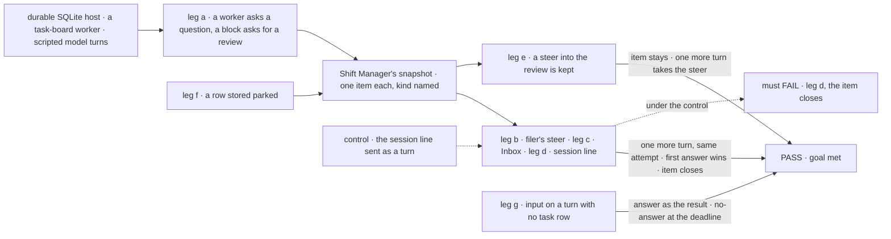
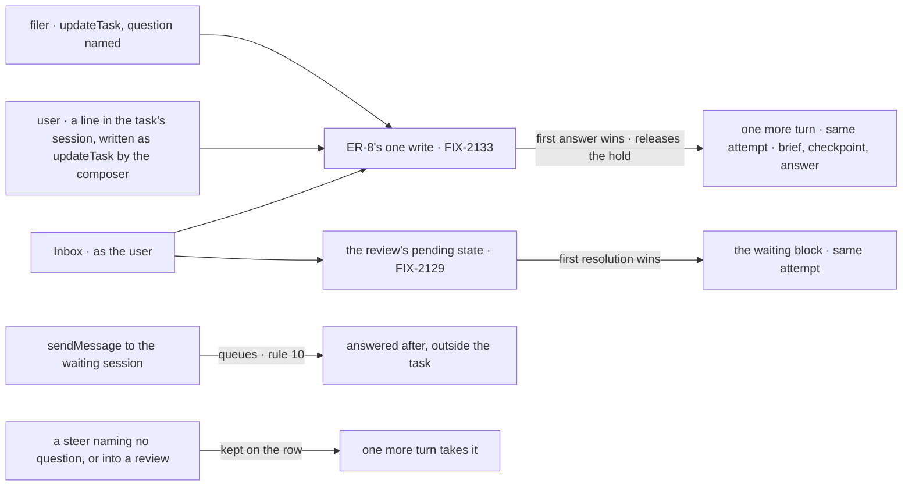

# FIX-2131 · Questions hold their task, reviews suspend: retire the question and review parks

**Spec** · [Decisions](DECISIONS.md)

## Six people, before and after

| Someone who… | Today | After |
|---|---|---|
| **writes a worker whose model needs an answer midway** | Its model calls `parkOnQuestion`. The task parks, the turn ends, and the answer comes back as a new turn from the queue | Its model calls `askQuestion`. The turn ends and the task holds on its row ([ER-8](../../epics/FIX-2058/DECISIONS.md#who-owns-what), FIX-2133). The answer takes one more turn on the same attempt, picking up from the brief, its last checkpoint and the answer |
| **writes a flow block that wants its work reviewed** | Calls `awaitReview`, which parks the task, and mounts `unparkAndDrain` so something can answer it | Calls `ctx.waitForUser({ kind: "review", … })`. The Inbox answers it, and the block carries on with the verdict. A revision request's words are a steer the work takes next |
| **filed a task that asked a question** | Answers it with `answerTask`, a fifth task tool | Answers it with a steer that names the question, `updateTask({ id, question, message })`. The first answer wins; a later one is an ordinary steer |
| **is the user, looking for what waits on them** | The Inbox lists approvals and input. A parked question sits in Chief of Staff's separate list; a parked review shows nowhere | The Inbox lists approvals, held questions and reviews. A line typed in the task's session answers its open question too: the composer writes it as a steer naming it |
| **steers a task waiting on an approval or a review** | n/a | The steer does not answer it. The item stays open, the steer is kept, and the task takes one more turn for it before it ends ([D1](DECISIONS.md#d1)) |
| **had a task parked before the upgrade** | n/a | It holds on its parked question, which shows in the Inbox as it was. The answer carries the task on, on its same attempt ([D2](DECISIONS.md#d2)) |

## The goal, and how we'll know it's met

**A worker that needs a person midway asks one way and its task holds; a flow that needs a review
suspends; the person sees each as one Inbox item; and the first answer, from the Inbox, the task's
session or the filer's steer, carries the work on on the same attempt.**

| Is it the right goal? | |
|---|---|
| **The real need** | The issue's objective, as the epic's amendment reads it: a question holds its task and a review suspends ([D1 *Applied to questions*](../../epics/FIX-2058/DECISIONS.md#d1)); both show in the Inbox and are answered one way. The epic's legs a and b for these two kinds, and its rules ER-4 and ER-5 ([FIX-2058](../../epics/FIX-2058/DECISIONS.md#who-owns-what)) |
| **Smaller, and rejected** | "The four calls are deleted and `waitForUser` is documented." Met while the filer has no way to answer, a review shows in the Inbox as a question or not at all, and a row parked before the upgrade is stranded |
| **Bigger, and not this issue's** | The hold itself, its one write, its deadline and its re-entry (FIX-2133) · a coding run's question (FIX-2132) · the filer told of the question by a message (FIX-2070) · the five kinds proved together (FIX-2134) |
| **Not done if** | A model's question on a task turn suspends its request · a `waitForUser` review lists as an approval or a question · a steer answers an approval or a review · a steer naming no question answers one · the filer's steer answers a routed task's question · a stored parked row reads as parked, or is lost · a plain message to a waiting task's session answers it · a task tool still answers a suspension · the check answered through the store |



The check reads what Shift Manager's Inbox read lists and what `getTask` returns, and answers the
way a person or a filer does, never through the store.

| How we verify | |
|---|---|
| **Goal check** | `goals/task-board/asks-a-person-one-way/` · model-free (`n/a`, scripted turns call the real tools) · run by the implementer at completion · verdict in the implementation PR |
| **Signal** | a: the snapshot lists one held `question` item and one `review` item; `getTask` shows the asking task running with no lease and one open question, the reviewed one waiting on a person, and no row `parked`. b: the filer's `updateTask` naming the question answers it; the task takes exactly one more turn, `attempts` stays 1, that turn's brief holds the answer, and the item leaves the list; an Inbox answer after it is told the question is answered. A filer's steer naming no question leaves the item listed, and so does one to a routed task's question. c: the snapshot lists the review as `review`; the Inbox's verdict resumes the block on its attempt, and a revision request's words reach the next model call as a steer. d: a line the user types in the task's session is written as `updateTask` from the user naming the open question, and answers a second question; `sendMessage({ to: { task } })` to a task waiting on a review queues and answers nothing (rule 10). e: a steer into a waiting review leaves its item listed; once the Inbox answers, the task takes one more turn before it completes, and that turn's brief holds the steer. f: rows stored `parked` and `awaiting_review`, one on a question and one for review, read as held midway on their parked text, `attempts` unchanged, and list as held questions; a review park with no `feedback` lists with the fixed fallback prompt and is answerable; a stored answered row runs one turn on its attempt, whose brief holds the answer, and gains no steer. A parked row already holding `MAX_STEERS` steers takes its question's answer as one place above the cap, and a second steer is refused; an answered row at the cap runs with its steer count unchanged. A row with a question park and `parkedForTurn` is held while the question is unanswered, and re-enters pending for its turn once a steer carries the question's key. g: on a turn with no task row, `waitForUser` input returns the person's answer as its result, and a no-answer result, not a throw, at its deadline; on a task turn it refuses `input` and names `askQuestion`. A task-turn step that calls `askQuestion` and `waitForUser` review together opens exactly one wait: the first to commit wins, the sibling returns a tool error naming it, and the row holds either an open question or a person suspension, never both. Sweep: `parkOnQuestion`, `answerTask`, `unparkAndDrain`, `awaitReview`, `unpark` and `onReview` have no references in package source outside the retired-shape map |
| **Input** | "Which region?" from a model turn; "Does this draft read right?" from a block. Any prompt passes the same way |
| **Anti-game** | Don't assert on the suspension store or on rows written by hand, except leg f's seeded legacy rows. Read through the snapshot and `getTask` |
| **Control that must fail** | `GOAL_CONTROL=composer-sends-turn` (the session line sent as a message) fails leg d on *answers a second question*. `GOAL_CONTROL=no-park-map` fails leg f on *read as held*. Today's `main` fails leg a (the task parks; no review item) and the sweep |

## What changes


Read down each column: every red cell today is a second path or a stop the Inbox can't show.

**A worker's model asks midway** (on a task row; with none, a question is `waitForUser` input):

```diff
- parkOnQuestion({ question: "Which region?" })   // the task parks; the next turn is the answer
+ askQuestion({ question: "Which region?" })      // ER-8's ask: the turn ends, the task holds
+ // the answer, a steer naming the question, owes one more turn on the same attempt
```

**A block asks for review, and the app stops answering it:**

```diff
- await tasks.awaitReview(taskId, "Does this draft read right?");   // parks; the next attempt reads feedback
+ const review = await ctx.waitForUser({ kind: "review", prompt: "Does this draft read right?" });
+ if (review.cancelled) return { skipped: true };
  …
- actions: { answer: { block: board.unparkAndDrain } }   // gone: the Inbox answers through FIX-2129's route
```

**The filer answers:**

```diff
- answerTask({ taskId: "t1", answer: "EU" })
+ updateTask({ id: "t1", question: "q1", message: "EU" })   // answers q1; first answer wins
```

**Docs:** update `apps/docs/guides/human-in-the-loop.md` to teach the epic's one rule: suspend with
`waitForUser` when code reads the answer next, hold the task on a question otherwise, with
`ctx.suspend` for forms and selections. In `apps/docs/docs/orchestration/task-board.md`, extend
FIX-2129's *When a task waits on a person* section with reviews and the steer, beside FIX-2133's
held questions; *Waiting on a person: `onReview`* and *When a task stops on a question* go, and
`answerTask_<board>` leaves the actions. Every other page and README the sweep finds naming a
removed call or the `parked` status is rewritten (about fifteen pages today, and the READMEs it
finds). A changeset with a migration note covering each public item
[below](#every-parked-surface-and-its-fate). No new page.

## How an answer reaches a stop



A held question's answers meet at ER-8's one write, and a review's at FIX-2129's pending state, so
in both the first answer wins unless a cancel is already written. One loser rule: an answer that
loses, to another answer, a cancel or the deadline, is told so, and a steer that loses stays a
steer. The steer cap leaves room for every open question's answer, by
[FIX-2133's rule](https://github.com/fixpoint-labs/flow-state-dev/blob/spec/FIX-2133/specs/issues/FIX-2133/DECISIONS.md#decided-not-asked).

## What stays as it is

- **`waitForUser`, its row mark, its endings and its answer route** (FIX-2129). Reviews answer through them.
- **The hold on questions: its one write, its deadline, its re-entry and its Inbox item** (FIX-2133, ER-8). Midway questions ask through it.
- **Approvals and input** in the Inbox, and a steer to a running or pending task (FIX-2086).
- **A message to a session waiting on a person queues** (rule 10; FIX-2129's pinned test). A line answers only as a steer.
- **Messages** until FIX-2070, the words until FIX-2071 (which drops the names this removes).
- **harness-manager's `answerQuestion()`** until FIX-2132.

## What's already here, and the debt

| Already here | What this does with it |
|---|---|
| Ways to stop for a person, across `packages/`: `waitForUser` (FIX-2129), the hold on questions (FIX-2133), `ctx.suspend` with a person's reason, the question park, the review park, harness-manager's inbox. Searched `parkOnQuestion`, `awaitReview`, `unpark`, `answer`, `suspend` | **Replaces** the question park with the hold and the review park with `waitForUser`. After FIX-2132, one of each |
| Ways to answer one: the answer route (FIX-2129), the hold's write (FIX-2133), `answerTask` and its action, `unpark` and `unparkAndDrain`, harness-manager's `answerQuestion()`, and the steer (FIX-2086), which today never answers | **Removes** `answerTask` and both unparks; the steer naming a question answers it through the hold's write |
| [FIX-1817 D1](../FIX-1817/DECISIONS.md#d1): an answered question continues as a new turn through the board's re-queue | **Superseded** in whole: the answer owes one more turn on the same attempt (ER-8, [FIX-2086](../FIX-2086/DECISIONS.md#d2)'s steer turn) |
| [FIX-2086](../FIX-2086/SPEC.md)'s "a steer to a task stopped on a question never answers it" | **Amended:** a steer naming a held question answers it, the filer's only on a task that isn't routed ([D1](DECISIONS.md#d1)) |
| [FIX-2056 D2](../../epics/FIX-2056/DECISIONS.md#d2) and [(e)](../../epics/FIX-2056/DECISIONS.md#e): answering by steer is this epic's; old APIs go outright | **Kept and finished** |
| [FIX-2056 D3](../../epics/FIX-2056/DECISIONS.md#d3), FIX-2080's map, with its `parked-for-turn` entry: a parked row reads pending, uncharged | **Extended** by two entries mapping parked rows onto the hold ([D2](DECISIONS.md#d2), ER-5) |
| FIX-2087's task-surface sweep, allowing `answerTask` and `parkOnQuestion` | **Amended:** both allowances go; `askQuestion` and `waitForUser` join `reportProgress` as a worker's own tools |
| FIX-2129's rule that a message to a session waiting on a person queues (rule 10), and its pinned test | **Kept.** The session line answers as a steer, not as a message |
| FIX-2086's session door: a line in an open task's session is a steer | **Kept** for a running task. For a task with an open question, Shift Manager's task-session composer writes `updateTask` naming it, as the user, instead of sending a turn |
| `PERSON_REASONS` in Shift Manager and the Lab send's `stopOf` | **Replaced** by ER-1's predicate |

| The debt | |
|---|---|
| **Removes** | `parkOnQuestion` and its capability, `answerTask` and its action, `awaitReview`, `unpark`, `unparkAndDrain`, `onReview` and the drain's park exit, the `parked` status as a write, `parkedOnQuestion` and `answered`, Chief of Staff's parked list, two person-stop checks, two sweep allowances |
| **Adds** | Two model tools in `parkOnQuestion`'s slot: `askQuestion`, onto ER-8's ask, and FIX-2129's `waitForUser` for approvals, reviews and, with no task row, input · the session composer's steer naming the open question · two map entries. All permanent by design; the map goes no earlier than FIX-2071 |
| **Leaves** | harness-manager's inbox and `answerQuestion()` (FIX-2132) · FIX-1851, which closes as superseded |

**Net: down.** Two parks, two unparks and a tool become a hold, a suspension and a steer.

### Every `parked` surface, and its fate

| Surface | Fate |
|---|---|
| The `parked` status (and `awaiting_review`, its older name), its transitions, the claim refusal for a parked row, the claim reason `parked` | **Removed** as a write and from the public status. A stored row is **read through the map** onto the hold ([D2](DECISIONS.md#d2)) |
| `counts.parked` and the drain's rungs on it (board meta, check board, quiescence, the goal-seek loop) | **Removed.** A task waiting on a person is running, with its claim (FIX-2129) or held with no lease (ER-8) |
| `onReview` and the drain's park exit | **Removed.** A board built with `onReview` is refused by name |
| `parkOnQuestion`, `createParkOnQuestion`, `parkedOnQuestion`, `answered` | **Removed.** `askQuestion` and `waitForUser` take the tool's slot |
| `answerTask`, its action, `unpark`, `unparkAndDrain`, `awaitReview` | **Removed** |
| The notice ending `parked` (orchestration's notice and settled entry, workforce's settle notice) | **No longer written.** A stored, undelivered one still reads and is delivered; the filer's reply to it is a steer (D2). Until FIX-2070 the filer is told nothing when a task asks; it finds the question through `getTask` |
| Workforce's wake backfill, which checks for `parked` | **Read through the map:** a parked row is held on its question |
| harness-manager's parks: every `parkOnBoardQuestion` caller (the question, a held-work mismatch, a read failure) and its run record's `parked` | **FIX-2132's.** This merges after it; this issue's sweep fails until they are gone |
| The `parked` column, filters and answer action in Shift Manager, devtool, `react` and kitchen-sink | **Removed.** A waiting task shows through FIX-2129's mark or ER-8's open questions, and its Inbox item |
| The `ui` registry's `task-plan` copy | **Removed**, with a changeset line, since apps copy it. Its status read shows a legacy `parked` as running |
| Chief of Staff's parked list | **Removed.** Its questions are held questions |
| labs/conductor's `onReview: "exit"` and its unpark answer | **Rewritten** onto `waitForUser` and the Inbox route |
| Goals asserting `parked` or `answerTask` (about twenty today, from task-session-stays-open to a-mapped-project) | **Rewritten** onto the hold or the suspension, or **retired** where the park was the thing proved |
| Integration tests of the drain's park exit | **Deleted**, with the feature. Tests that only use a park to stop a task move onto the hold or `waitForUser` |
| Docs pages naming `parked` or `answerTask` (the glossary and its figure, the orchestration and workforce pages, the goal-seek loop, durable execution, background work, the `ui` and devtool overviews) | **Rewritten** onto FIX-2129's *When a task waits on a person* section and FIX-2133's held questions, which they link to instead of re-explaining the stop |

## Sign off

**[The goal](#the-goal-and-how-well-know-its-met), at that size:** both kinds in the Inbox, one
ask each, three doors to one answer, old rows not stranded. If wrong: a person still hunts for a review.

**[The debt](#whats-already-here-and-the-debt), net down:** five calls, a board option and a
status go; two tools and two map entries come. If wrong: the map outlives every stored park.

1. **[D1](DECISIONS.md#d1) · A steer answers only a held question it names; approvals and reviews
   are answered in the Inbox.** If wrong: a user types "looks good" and the review still waits.
2. **[D2](DECISIONS.md#d2) · A task parked before the upgrade holds on its parked question, a
   review's park included.** If wrong: an old review's answer reaches the work as a steer, not a verdict.

**Open: none of this issue's.** What a held question does at its deadline is the epic's open
question, FIX-2133's to build ([Open](../../epics/FIX-2058/DECISIONS.md#open)).
**Merges after FIX-2132** ([why](DECISIONS.md#decided-not-asked)).

Feature · `orchestration`, `workforce`, `patterns`, `devtool`, `react`, `ui`, `shift-manager` · large · epic FIX-2058 · blocked by FIX-2063, FIX-2129, FIX-2133, FIX-2056, FIX-2132 (builds in parallel; merges after it)
