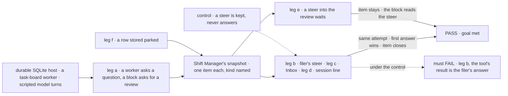
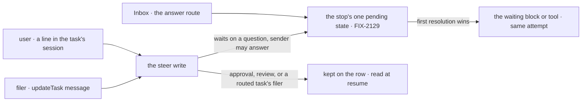

# FIX-2131 · Questions and reviews suspend: retire the question and review parks

**Spec** · [Decisions](DECISIONS.md)

## Six people, before and after

| Someone who… | Today | After |
|---|---|---|
| **writes a worker that can't go on without an answer** | Its model calls `parkOnQuestion`. The task parks, the turn ends, and the answer comes back as a new turn from the queue | Its model calls `waitForUser`. The turn waits, and the tool's result is the answer, on the same attempt |
| **writes a flow block that wants its work reviewed** | Calls `awaitReview`, which parks the task, and mounts `unparkAndDrain` so something can answer it | Calls `ctx.waitForUser({ kind: "review", … })`. The Inbox answers it, and the block carries on |
| **filed a task that asked a question** | Answers it with `answerTask`, a fifth task tool | Answers it with a steer, `updateTask({ id, message })`. The first answer wins; a later one is an ordinary steer |
| **is the user, looking for what waits on them** | The Inbox lists approvals and input. A parked question sits in Chief of Staff's separate list; a parked review shows nowhere | The Inbox lists approvals, questions and reviews. A question can also be answered by typing in the task's session |
| **steers a task waiting on an approval or a review** | n/a | The steer does not answer it. The item stays open, and the block reads the steer when it resumes ([D1](DECISIONS.md#d1)) |
| **had a task parked before the upgrade** | n/a | The task runs again at its next touch, using no attempt, and asks again in the Inbox. An answer already given reaches the run as a steer ([D2](DECISIONS.md#d2)) |

## The goal, and how we'll know it's met

**A worker or a flow that needs a person asks one way; the person sees a question or a review as
one Inbox item; and the first answer, from the Inbox, the task's session or the filer's steer,
carries on the same attempt.**

| Is it the right goal? | |
|---|---|
| **The real need** | The issue's objective: "A question or review is a stop for a person like any other: it suspends, shows in the Inbox, and is answered one way." The epic's legs a and b for these two kinds, and its rules ER-4 and ER-5 ([FIX-2058](../../epics/FIX-2058/DECISIONS.md#who-owns-what)) |
| **Smaller, and rejected** | "The four calls are deleted and `waitForUser` is documented." Met while the filer has no way to answer, a review shows in the Inbox as a question or not at all, and a row parked before the upgrade is stranded |
| **Bigger, and not this issue's** | A coding run's question (FIX-2132) · a task held on questions (FIX-2133) · the filer told of the question by a message (FIX-2070) · the five kinds proved together (FIX-2134) |
| **Not done if** | A review lists as an approval or a question · a steer answers an approval or a review · the filer's steer answers a routed task's question · a stored parked row reads as parked, or is lost · a task tool still answers a stop · the check answered through the store |



The check reads what Shift Manager's Inbox read lists and what `getTask` returns, and answers the
way a person or a filer does, never through the store.

| How we verify | |
|---|---|
| **Goal check** | `goals/task-board/asks-a-person-one-way/` · model-free (`n/a`, scripted turns call the real tools) · run by the implementer at completion · verdict in the implementation PR |
| **Signal** | a: the snapshot lists one `question` item and one `review` item, `getTask` shows each task waiting on a person, no row is `parked`. b: the filer's `updateTask` message is the tool's result, `attempts` stays 1, the item leaves the list, and an Inbox answer after it is told `already-resolved`. c: the review answered in the Inbox resumes the same attempt. d: a line the user types in the task's session answers a second question. e: a steer into a waiting review leaves its item listed; the block reads it after the answer. A filer's steer to a routed task's question leaves its item listed. f: a row stored parked on a question reads `pending` with no attempt spent, runs, and lists as a question; a stored answered row's answer is a steer the run reads. Sweep: the four calls, `awaitReview`, `unpark` and `onReview` have no references in package source outside the retired-shape map |
| **Input** | "Which region?" from a model turn; "Does this draft read right?" from a block. Any prompt passes the same way |
| **Anti-game** | Don't assert on the suspension store or on rows written by hand, except leg f's seeded legacy row. Read through the snapshot and `getTask` |
| **Control that must fail** | `GOAL_CONTROL=steer-kept-only` fails leg b on *the tool's result is the filer's answer*. `GOAL_CONTROL=no-park-map` fails leg f on *reads `pending`*. Today's `main` fails leg a (the task parks; no review item) and the sweep |

## What changes


Read down each column: every red cell today is a second path or a stop the Inbox can't show.

**A worker's model asks:**

```diff
- parkOnQuestion({ question: "Which region?" })        // the task parks; the next turn is the answer
+ waitForUser({ kind: "question", prompt: "Which region?" })
+ // the result is the answer, on the same attempt; at the deadline, a no-answer result the model reads
```

**A block asks for review, and the app stops answering it:**

```diff
- await tasks.awaitReview(taskId, "Does this draft read right?");   // parks; the next attempt reads feedback
+ const review = await ctx.waitForUser({ kind: "review", prompt: "Does this draft read right?" });
+ if (review.cancelled) return { skipped: true };
  …
- actions: { answer: { block: board.unparkAndDrain } }   // gone: the Inbox answers through FIX-2129's route
```

**The filer answers:**

```diff
- answerTask({ taskId: "t1", answer: "EU" })
+ updateTask({ id: "t1", message: "EU" })   // answers the question t1 waits on; first answer wins
```

**Docs:** update `apps/docs/guides/human-in-the-loop.md` to teach `waitForUser` as the one way to
stop for a person, with `ctx.suspend` for forms and selections (the epic's docs line), and
`apps/docs/docs/orchestration/task-board.md`: one *When a task waits on a person* section replaces
*Waiting on a person: `onReview`* and *When a task stops on a question*, and `answerTask_<board>`
leaves the actions. Update `configuration.md` (`onReview` goes), `task-substrate.md`
(`awaitReview` and `unpark` go), `workforce/delegating-work.md`, `workforce/coordinators.md` and
`shift-manager/overview.md` (the Inbox lists reviews), and the `orchestration`, `workforce` and
`patterns` READMEs. A changeset with a migration note. No new page.

## How an answer reaches a stop



A steer reaches the same pending state the Inbox does, so the first answer wins and the loser
finds it resolved. A steer that loses stays a steer.

## What stays as it is

- **`waitForUser`, its row mark, its endings and its answer route** (FIX-2129). This issue answers through them.
- **Approvals and input** in the Inbox, and a steer to a running or pending task (FIX-2086).
- **Messages** until FIX-2070, the words until FIX-2071, the held start until FIX-2133.
- **harness-manager's `answerQuestion()`** until FIX-2132.

## What's already here, and the debt

| Already here | What this does with it |
|---|---|
| Ways to stop for a person, across `packages/`: `waitForUser` (the closest, FIX-2129), `ctx.suspend` with a person's reason, the question park, the review park, harness-manager's inbox. Searched `parkOnQuestion`, `awaitReview`, `unpark`, `answer`, `suspend` | **Replaces** the two parks with the closest. After FIX-2132, one way |
| Ways to answer one: the answer route (FIX-2129, the closest), `answerTask` and its action, `unpark` and `unparkAndDrain`, harness-manager's `answerQuestion()`, and the steer (FIX-2086), which today never answers | **Removes** `answerTask` and both unparks; **extends** the steer to answer a question. The Inbox's route and the steer are its two doors, for the user and the filer |
| [FIX-1817 D1](../FIX-1817/DECISIONS.md#d1): an answered question continues as a new turn through the board's re-queue | **Superseded** in whole: the answer resumes the same attempt (rule 12) |
| [FIX-2086](../FIX-2086/SPEC.md)'s "a steer to a task stopped on a question never answers it" | **Amended:** a steer answers a question, the filer's only on a task that isn't routed ([D1](DECISIONS.md#d1)) |
| [FIX-2056 D2](../../epics/FIX-2056/DECISIONS.md#d2) and [(e)](../../epics/FIX-2056/DECISIONS.md#e): answering by steer is this epic's; old APIs go outright | **Kept and finished** |
| [FIX-2056 D3](../../epics/FIX-2056/DECISIONS.md#d3), FIX-2080's map, with its `parked-for-turn` entry: a parked row reads pending, uncharged | **Extended** by entries for parked questions, answered questions and reviews ([D2](DECISIONS.md#d2)) |
| FIX-2087's task-surface sweep, allowing `answerTask` and `parkOnQuestion` | **Amended:** both allowances go; `waitForUser` joins `reportProgress` as a worker's own tool |
| `PERSON_REASONS` in Shift Manager and the Lab send's `stopOf` | **Replaced** by ER-1's predicate |

| The debt | |
|---|---|
| **Removes** | `parkOnQuestion` and its capability, `answerTask` and its action, `awaitReview`, `unpark`, `unparkAndDrain`, `onReview` and the drain's park exit, the `parked` status as a write, `parkedOnQuestion` and `answered`, Chief of Staff's parked list, two person-stop checks, two sweep allowances |
| **Adds** | The `waitForUser` model tool, in `parkOnQuestion`'s place · the steer as one more writer to FIX-2129's pending state · three map entries. All permanent by design; the map goes no earlier than FIX-2071 |
| **Leaves** | harness-manager's inbox and `answerQuestion()` (FIX-2132) · FIX-1851, which closes as superseded |

**Net: down.** Two parks, two unparks and a tool become one call and a steer.

## Sign off

**[The goal](#the-goal-and-how-well-know-its-met), at that size:** both kinds in the Inbox, one
ask, three doors to one answer, old rows not stranded. If wrong: a person still hunts for a review.

**[The debt](#whats-already-here-and-the-debt), net down:** five calls, a board option and a
status go; one tool and three map entries come. If wrong: the map outlives every stored park.

1. **[D1](DECISIONS.md#d1) · A steer answers only a question; approvals and reviews are answered
   in the Inbox.** If wrong: a user types "looks good" and the review still waits.
2. **[D2](DECISIONS.md#d2) · A task parked before the upgrade runs again and asks again, using no
   attempt.** If wrong: an open question is asked again in new words, after one more run.

**Open: none.** D1 is the one to weigh: it decides what a typed line can do to a waiting task.
**Merges after FIX-2132** ([why](DECISIONS.md#decided-not-asked)).

Feature · `orchestration`, `workforce`, `patterns`, `devtool`, `react`, `shift-manager` · large · epic FIX-2058 · blocked by FIX-2063, FIX-2129, FIX-2056
