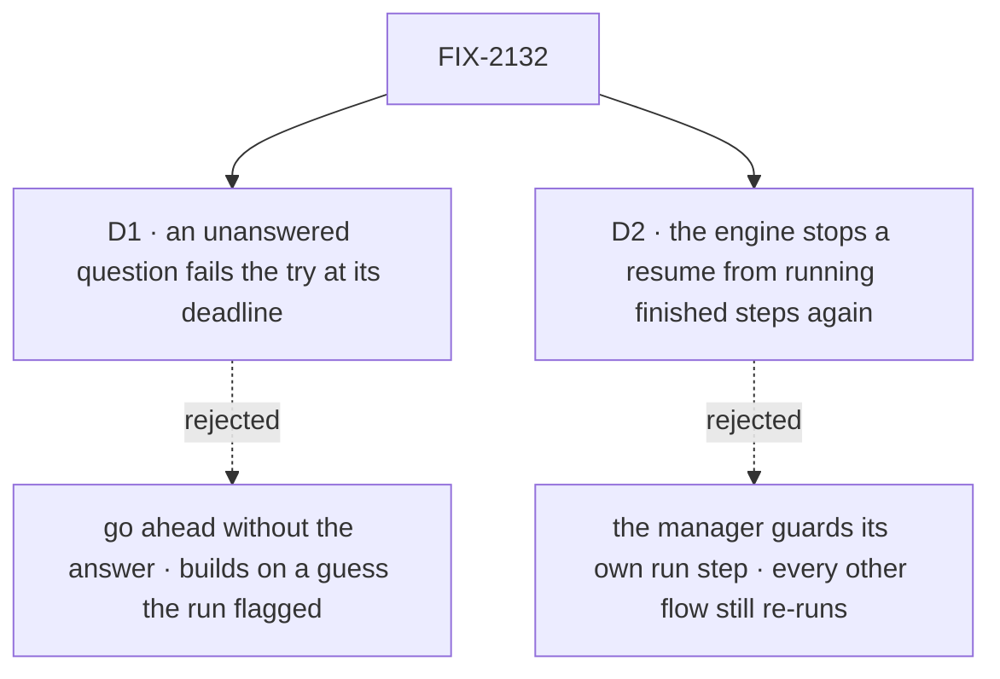

# FIX-2132 · Decisions

[Spec](SPEC.md) · **Decisions**

Two calls shape this issue. The rest follows from the epic's rules
([FIX-2058](../../epics/FIX-2058/DECISIONS.md#who-owns-what)) and FIX-2129's `waitForUser`,
which this builds on at its review head ([#3735](https://github.com/fixpoint-labs/flow-state-dev/pull/3735), `6188b938`).

## The tree

Solid edges are what you sign. Dashed edges lost, and the label says why.

## D1 · A coding run's question nobody answers by its deadline fails the try; the next try resumes the same coding session

| | |
|---|---|
| **Instead of** | Catching the deadline and telling the run to go ahead on its best judgment |
| **Because** | The run asked because it could not decide. Going ahead builds on the guess it flagged, and a person later unpicks a branch they never saw coming. Unhandled is the concept's default for a question: it errors and uses a try (*Inbox items*, the deadline row), so the manager adds nothing |
| **Locks in** | An unanswered coding question costs a try, after the host's person-stop deadline (7 days, [epic D3](../../epics/FIX-2058/DECISIONS.md#d3)). The retry resumes the coding session and may ask again; after the last try the task fails for good, and its filer hears why |

It comes down to work built on a guess: going ahead builds on exactly what the run flagged.

**What would change my mind:** teams that want coding runs to keep moving more than they fear a
wrong guess. Then a manager option, *go ahead at the deadline*, with the guess named in the PR.

## D2 · The engine stops a resume from running finished steps again in production, and FIX-2132 waits for it

| | |
|---|---|
| **Instead of** | The harness manager guarding its own run step with `ctx.runOnce`, and shipping on FIX-2129 alone |
| **Because** | The POC showed that with trace observability off, as in production, every resume runs every finished step again: three coding runs became six ([Settled](#settled)). That is the engine's replay, not the manager's: every flow that asks a person after doing work has the same fault. A guard in the manager makes coding runs safe and leaves the rest, and it must cover every step that writes, not only the run |
| **Locks in** | FIX-2137 blocks this issue: a resume never runs a completed step again, with traces on or off. The goal check runs with traces off. FIX-2132 ships one engine fix later than it could |

It comes down to every other flow that asks a person: a manager guard leaves them re-running work.

**What would change my mind:** FIX-2137 can't land before the epic's closure. Then the manager
guards its run step as the POC's third case did, and FIX-2137 stays open for everyone else.

## Decided, not asked

- **Every ask the manager makes goes through one step**: the run's marker, the judge's *ask*,
  and a saved-work mismatch. That step is the only caller of `waitForUser` in the manager, and
  the convergence point for "a question is an Inbox item". No other path parks, writes an inbox
  row or announces.
- **The ask step sits after the verdict and the saves**, so the run's work is held and its kept
  files saved before the request suspends, and the checkout lease is already free.
- **The answer is one more step through the steer loop** (FIX-2086), under its cap: answers and
  steers together take at most `MAX_STEERS` steps in a try; past that the try fails.
- **The next run resumes the confirmed coding session.** With none confirmed, it starts fresh,
  told the brief, the question and the answer, as a retry does today.
- **The prompt after an answer is the phase's `buildPrompt`**, with the answer in `answers`, so
  phases written for the old fold keep working. `answers` is every answer this run was given,
  oldest first, kept on the run record so a later try still has them.
- **The marker's path names the attempt and the step** (`<attempt>-<step>.md`): a step after an
  answer must never read the question it already answered. `isAskMarkerPath` widens to match.
- **A line while the run waits** answers the question when FIX-2131 says its sender may, or is
  kept on the task and taken with the answer. Either way no run starts beside the waiting
  request: the session door starts an owed turn only for `waitingOn: "steer"`.
- **A cancel or a user's stop** resumes the ask step with `cancelled` or ends the request
  (FIX-2129). The manager starts no further run and records the run's outcome; its branch and
  kept files stay.
- **Removed outright** (epic, *no shim*; [FIX-2056 (e)](../../epics/FIX-2056/DECISIONS.md#e)):
  the inbox collection and its ten exports, `announce` (refused by name, BP-030),
  `parkOnBoardQuestion`, `HarnessRunParked` where only the park used it. A stored inbox row is
  left unread: only the conductor lab wrote them, and its next try asks again.
- **The conductor lab** answers through the answer route and its `status` reads waiting tasks from
  the board. Its `answer` action goes. LAB-154's goal check moves to the same route and keeps its
  generated-fact proof.
- **No harness entry in the retired-shape map.** A coding row parked before the upgrade reads
  through FIX-2131's question and review entries, runs again using no try, resumes its confirmed
  coding session, and asks again. FIX-2131's D2 named a long coding run as the case that would
  need its own entry; resuming the session is what makes it cheap.
- **Merge order:** this merges before FIX-2131, which removes the board park this issue moves off
  ([FIX-2131, decided, not asked](https://github.com/fixpoint-labs/flow-state-dev/blob/spec/FIX-2131/specs/issues/FIX-2131/DECISIONS.md#decided-not-asked)).

## Considered and dropped

| Alternative | Why not |
|---|---|
| Keep the run's question a board park, and only list it in the Inbox | The answer would still start a new try, which the concept rules out |
| An ask tool the model calls, through `mcpTools`, in place of the marker | Not every harness takes relayed tools (`ask.ts`), and it changes nothing a person sees |
| Keep the inbox collection as a read-only status surface | A second record of a question the task row already carries (FIX-2129) |
| Suspend inside the harness step, mid-run | The harness is its own process and can't pause midway (concept) |

## Settled

- **A resume re-enters at the ask step and loops back with the answer — CONFIRMED with traces
  on, REFUTED with traces off.** `poc/answer-loops-back/` (`bash
  specs/issues/FIX-2132/poc/answer-loops-back/run.sh`), on `main` at `f740b61c1`. Traces on: three
  passes, three runs, the second question a new stop. Traces off: six runs, pass 1 three times;
  with the run in `ctx.runOnce`, each pass ran once but appended state doubled. The approach
  holds; where the fix lives is D2, and FIX-2137 carries it.
- **No counted facts carry the approach**, so no checker. The ten exports are one `index.ts`
  block.

## How it got here

- **Draft** — framed as moving every harness-manager ask onto FIX-2129's `waitForUser`, with the
  answer as one more step through FIX-2086's steer loop; the POC found that resume replay runs
  finished steps again in production, filed as FIX-2137 and made D2.

**Open: none.**
