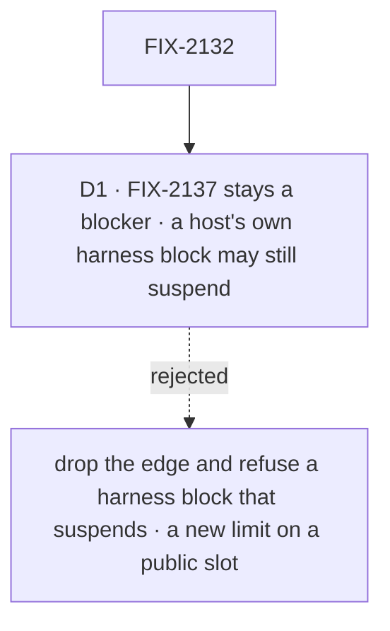

# FIX-2132 · Decisions

[Spec](SPEC.md) · **Decisions**

One call is this issue's. The shape is the epic's: a coding run's question holds its task
([ER-8](../../epics/FIX-2058/DECISIONS.md#who-owns-what), owned by FIX-2133), the answer is a
steer that starts the next run in the same coding session, and only approvals, reviews and input
suspend ([ER-1](../../epics/FIX-2058/DECISIONS.md#who-owns-what)). This spec builds on FIX-2133's
hold as the epic and FIX-2133's spec (#3747) state it.

## The tree

Solid edges are what you sign. Dashed edges lost, and the label says why.

## D1 · FIX-2137 stays a blocker: the manager's own path never suspends for a question, but a host's harness block may suspend

*Engineering, decided by the coordinator after Codex's finding on `c2aa9f5`; recorded because it
keeps an edge in the epic's graph.*

| | |
|---|---|
| **Instead of** | Dropping the FIX-2137 edge (a durable resume with trace observability off runs its completed steps again; fix in #3749), and refusing a harness block that suspends |
| **Because** | The built-in path holds every question and never suspends for one (FIX-2163 later adds a review that does, behind a host option): under [ER-1](../../epics/FIX-2058/DECISIONS.md#who-owns-what) a question holds its task, and every ask the manager makes is a question (the run's marker, the judge's *ask*, a saved-work mismatch). But the public `HarnessSlot` takes any `HarnessBlock` (`manager.ts`, `HarnessSlot`), and the harness step's `onSettled` already handles a child that exits suspended. A host's own harness that calls `ctx.suspend` resumes through the engine's durable resume, which is FIX-2137's path. Refusing it would be a new limit on a public slot, to save an edge that costs nothing: FIX-2137 is merged (#3749), so the edge is satisfied |
| **Locks in** | FIX-2137 blocks FIX-2132, with FIX-2133 and FIX-2056. The manager itself suspends no request for a question. *Amended 2026-10-24 by [FIX-2163](../FIX-2163/DECISIONS.md#decided-not-asked):* it suspends only for a review of a run's changes when the host sets `reviewChanges`; questions still never suspend. This issue's implementation keeps the sweep at no `waitForUser` reference in `harness-manager`; FIX-2163's implementation changes it to exactly one, the review step. The goal check runs with traces off |

It comes down to the public slot: a host's harness block can still suspend, and that path needs FIX-2137.

**What would change my mind:** no host-supplied block or callback that receives a `BlockContext`
inside the manager chain can suspend, such as the `HarnessSlot` block, `judge.block`, the phase
hooks or `ledgers`. Only then does nothing in the coding flow resume, and the edge drops.

## Decided, not asked

- **Every ask the manager makes goes through one step**: the run's marker, the judge's *ask*,
  and a saved-work mismatch. That step is the manager's only caller of ER-8's ask write, and the
  convergence point for "a question is an Inbox item". No other path parks, writes an inbox row or
  announces. On the fixed board it writes with that run's ticket: its attempt fence plus the turn
  generation, as FIX-2133 defines them.
- **The ask step sits after the verdict and the saves**, so the run's work is held and its kept
  files saved before the turn ends, and the checkout lease is already free.
- **The answer's turn is FIX-2133's owed turn**, claimed for the same attempt. The manager reads
  the session this attempt confirmed from its run record before the turn's open clears it, as it
  does today, so the next run resumes it; with none confirmed, a fresh session is told the brief,
  the question and the answer.
- **No cap of the manager's own on answers.** Each answer starts its own turn, and each turn needs
  a person's answer, so people bound them; steers inside a turn stay under `MAX_STEERS`, and a
  flood of steers can't refuse an answer.
- **The prompt after an answer is the phase's `buildPrompt`**, with `answers` read from the task's
  row: this try's answered questions, oldest first. No copy on the run record, so a question's
  text and answer live in one place. The deadline's "no answer came" steer reaches the run as any
  steer does.
- **The marker's path names the attempt and the run** (`<attempt>-<run>.md`), the run counted on
  the run record so the count survives the answer's turn: a run must never read a question an
  earlier turn already asked. `isAskMarkerPath` matches that shape, so a marker is never committed.
- **A line typed in the run's session answers its question, with no change here.**
  `harnessSessionDoor` already writes the line through orchestration's `steerFromLine`, which
  FIX-2133 makes answer the task's oldest open question through the one question write, for every
  session alike (the concept: "the user typing in a task's session answers its question"). The
  answer's turn then starts as any answer's does. A steer naming no question, the filer's or
  `updateTask({ message })`, answers nothing (ER-8): it is kept on the task, and the run the answer
  starts takes it. The claim gate refuses a held row, so no run starts beside the hold.
- **A cancel** closes the question with the row (ER-8). No turn is owed, so the manager starts
  nothing; its branch and kept files stay, and a regression assertion beside `stopsOnAbort` proves it. FIX-2133's cancel leg proves the hold closes.
- **At the deadline the manager adds nothing.** ER-8's deadline write releases the hold with a
  "no answer came" steer and owes the turn like an answer, so the next run goes ahead in the same
  session, as the [epic decided](../../epics/FIX-2058/DECISIONS.md#decided-in-review-recorded-so-no-child-reopens-them) (owner, 2026-10-24).
- **Removed outright** (epic, *no shim*; [FIX-2056 (e)](../../epics/FIX-2056/DECISIONS.md#e)):
  the inbox collection and its ten exports, `announce` (refused by name, BP-030),
  `parkOnBoardQuestion` and harness-manager's `awaitReview` calls (the epic moves every question
  onto the hold, [FIX-2058, who owns what](../../epics/FIX-2058/DECISIONS.md#who-owns-what)),
  and `HarnessRunParked`, which only the parks used.
- **The conductor lab** answers through `updateTask` as the Inbox does, and its `status` reads held
  tasks from the board. Its `answer` action goes. LAB-154's goal check moves to the same action and
  keeps its generated-fact proof.
- **No harness entry in the retired-shape map**, and no map entries at all: stores are reset
  (owner, 2026-10-23), so no row parked before this work is read. The only coding rows that hold
  are the ones this ask step writes.
- **Merge order:** this merges before FIX-2131, which removes the board park this issue moves off
  ([FIX-2131, decided, not asked](https://github.com/fixpoint-labs/flow-state-dev/blob/spec/FIX-2131/specs/issues/FIX-2131/DECISIONS.md#decided-not-asked)).

## Considered and dropped

| Alternative | Why not |
|---|---|
| Suspend the coding flow's request with `waitForUser` (this spec's first draft) | A question isn't an approval, a review or input ([ER-1](../../epics/FIX-2058/DECISIONS.md#who-owns-what)); suspending needs durable execution and a resume that runs no step twice (FIX-2137), where the hold needs neither |
| Keep the run's question a board park, and only list it in the Inbox | The answer would still start a new try, which the concept rules out |
| An ask tool the model calls, through `mcpTools`, in place of the marker | Not every harness takes relayed tools (`ask.ts`), and it changes nothing a person sees |
| Keep the inbox collection as a read-only status surface | A second record of a question the task row already carries (ER-8) |
| Suspend inside the harness step, mid-run | The harness is its own process and can't pause midway (concept) |

## Settled

- **A resume re-enters at the ask step and loops back with the answer — CONFIRMED with traces
  on, REFUTED with traces off.** `poc/answer-loops-back/` (`bash
  specs/issues/FIX-2132/poc/answer-loops-back/run.sh`), on `main` at `f740b61c1`. Traces on: three
  passes, three runs, the second question a new stop. Traces off: six runs, pass 1 three times;
  with the run in `ctx.runOnce`, each pass ran once but appended state doubled. It tested the
  suspension shape this spec has since dropped for its own asks. Its finding is FIX-2137, now merged, which
  applies to this issue through a host's harness block that suspends ([D1](#d1)).
- **No POC for the answer's turn.** Its one premise, that a second turn on the same attempt resumes
  the session that attempt confirmed, rests on a read the manager already makes before the open
  (`manager.ts`, the session read before `openRunRow`), and leg b fails if it doesn't hold.
- **No counted facts carry the approach**, so no checker. The ten exports are one `index.ts`
  block.

## Notes from review

For the implementer; none of these changes the approach. Recorded verbatim from #3743.

- **Second look, 4 (D1 re-ask):** "The retry resumes the session and 'may ask again', so a person who is away for a week sees the same question as a new item and spends a try each time (3 tries is 3 weeks). D1 itself is sound, since going ahead on a guess is worse. Consider saying that the re-ask is the same question, shown once, so the second try does not surface a duplicate item."
- **Second look, 5 (persisted fields):** "Read it with a `== null` guard (BP-030, BP-035). The marker path change (`<attempt>.md` to `<attempt>-<step>.md`) also needs `isAskMarkerPath` to accept the old shape. A pre-upgrade run that wrote `<attempt>.md` and is then resumed should be read, not treated as a stray file. Note too that `run.askMarkerPath` is exposed to phase authors, so changing its shape is a public-contract change and belongs in the changeset's migration note, which the spec already plans." *The `== null` guard and the old-shape handling: moot, owner reset decision, 2026-10-23; new code always writes the run count, and no `<attempt>.md` exists. The migration note for `askMarkerPath`'s shape stays: that is callers' code.*
- **Second look, 6 (module):** "Put the ask step in its own module, not as another closure in `manager.ts`. [...] a file with a small interface (verdict + saves in, question or none out). It also makes the 'no other path parks' claim checkable by import, not just by grep, and it makes the ask step unit-testable without the whole sequencer. [...] I'd not do a wider split of `manager.ts` in this PR."
- **Second look, checks (goal check):** "Keep the real model for the session-resume proof (the part only Claude Code can show), but run the two-question and cap cases (see 2) on the devteam stub, so a model that doesn't ask doesn't read as a spec failure."
- **Second look, checks (FIX-2129 head):** "Since `FIX-2129` is still at review head (`6188b938`), say what happens to this spec if `waitForUser`'s shape moves before it merges." Build on `waitForUser` as FIX-2129 merges it; a change to its call shape is a rename here, a change to what an unanswered question does is a change to ER-1 and so to D1.
- **Cursor, reuse:** "prefer **extending the existing steer connector** (`again: true` + `loopBack` to the harness step) so answers and steers share one cap and one loop predicate — avoid a parallel 'ask loop' beside `stepForSteer`." *Superseded by the re-spec on #3748: the manager has no cap of its own on answers; the only bound is ER-8's write (FIX-2133), where each open question reserves room for its answer under `MAX_STEERS`; FIX-2133 owns that reservation. Don't build a shared manager cap.*
- **Cursor, two stores:** "`run.answers` on the run record vs steer text on the task row means two mid-attempt human-text stores. If implementer can fold Q&A into the same persistence/ordering path steer already uses (without breaking 'same try' semantics), that would reduce replay/prompt bugs."

- **Codex, delete/recreate (required, #3743 at `05a197b4`):** "When a durable task is deleted and recreated under the same ID, its attempt count and question history reset while its checkout remains keyed by principal/epic/issue/phase (`packages/harness-manager/src/manager.ts:1903-1936`). The supported delete/requeue lifecycle mints a new `incarnationId`, but this guard checks only attempt-local question history, so the replacement's first attempt can read the old checkout's surviving `.fsdev/ask/1.md` and recreate a stale question. Consume the legacy marker after its ask is durably recorded, or bind fallback eligibility to the task incarnation, and cover delete/recreate in the transition test." *Required, now for the live marker: the legacy fallback is gone (owner reset decision, 2026-10-23), but the same hazard holds for `<attempt>-<run>.md`, since a recreated task restarts its attempt and run counts in the surviving checkout and its first run could meet the old incarnation's `1-1.md`. Bind the marker to the task's `incarnationId`, or consume it once its ask is durably recorded, and cover delete/recreate in a test.*

## How it got here

- **Draft** — framed as moving every harness-manager ask onto FIX-2129's `waitForUser`, with the
  answer as one more step through FIX-2086's steer loop; the POC found that resume replay runs
  finished steps again in production, filed as FIX-2137 and made D2.
- **Review round 1** — D1 cited ER-1; FIX-2133 named for questions known up front; the sweep took
  `awaitReview` and `HarnessRunParked`.
- **2026-10-23, re-specified on the epic's amendment** (#3748): the owner decided a question holds
  its task. The question became ER-8's hold and the answer FIX-2133's owed turn; the old D1, a
  deadline that fails the try, gave way to the epic's open call; the old D2, waiting on FIX-2137,
  became this D1, which first dropped the edge; Codex on `c2aa9f5` found a host's harness block
  may still suspend, so the edge stays. Folded from Codex on `2db22ea`: the cancel leg asserts the
  work survives, a deadline leg. Codex on `c2aa9f5`: the edge stays (D1). Cursor's two-stores note is folded:
  `answers` reads the row.
- **Owner, 2026-10-23** — no old data: stores and attempt files are reset, so no legacy marker
  read (BP-030 waived for this epic's persisted shapes). The guarded `<attempt>.md` fallback and
  its transition test went with it.
- **Owner, 2026-10-24** — no default deadline on a person's stop (epic D3): leg e keeps its
  deadline set through FIX-2133's test hook, and adds a question with none that still holds. From
  the epic's reuse review: the run counter is genuinely new; the manager's attempt-only checks
  move onto the turn generation.

- **Cut to the coding-run delta** (the epic's other-shapes analysis, 2026-10-24): legs c, d and e
  went, since cancel, the deadline and line answering are FIX-2133's to prove; three regressions (a cancel keeping the branch and kept files among them) and
  FIX-2133's reconciler stayed, and the door change dropped to none. It still merges before FIX-2131,
  which deletes `awaitReview`, and keeps the FIX-2163 edge.

## Notes from the reuse review, for the implementer

- Could clearing the ask marker before each run remove the run counter?

**Open: none of its own.**
