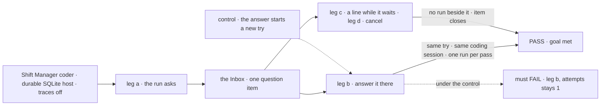
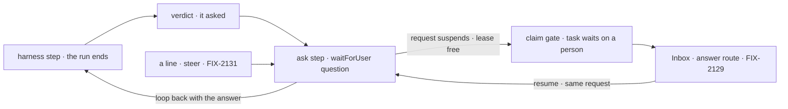

# FIX-2132 · A coding run's question suspends its coding flow's request

**Spec** · [Decisions](DECISIONS.md)

## Six people, before and after

| Someone who… | Today | After |
|---|---|---|
| **answers a coding run's question in Shift Manager** | Can't: the question parks the task where the Inbox can't see it | Sees it in the Inbox as a question and answers it there. The run carries on in the same coding session, on the same try |
| **filed the coding work** | Sees the task *parked*; the answer starts a new try and spends a retry | Sees it waiting on a person, with the question; no retry is spent |
| **types a line into the run's session while it waits** | The line waits for the next try; the question still waits | The line answers the question, or rides along with the answer. No run starts beside the waiting one |
| **cancels the task while it waits** | The task cancels; the harness inbox row stays open | The item closes, no further run starts, and the work already done stays on its branch |
| **leaves the question unanswered** | It waits for good | At its deadline, 7 days by default, the try fails; the next try resumes the same coding session and may ask again ([D1](DECISIONS.md#d1)) |
| **runs the conductor lab** | Answers with the lab's `answer` action, onto the harness inbox | Answers through the same answer route a screen uses; `status` lists tasks waiting on a person |

A run's own question, the judge's *ask* and a saved-work mismatch all ask the same way.

## The goal, and how we'll know it's met

**A coding run that needs a person's answer shows its question in the Inbox, and the answer
carries the run on in the same coding session, on the same try, with no finished work run again.**

| Is it the right goal? | |
|---|---|
| **The real need** | The concept's *Inbox items*, last paragraph: "Its question ends the run, and the coding flow's request suspends with `waitForUser`. The answer starts the next run in the same coding session, using no attempt." The epic's leg a and b for this kind ([FIX-2058](../../epics/FIX-2058/SPEC.md#the-goal-and-how-well-know-its-met)) |
| **Smaller, and rejected** | "The harness inbox is deleted and the question parks on the board." Met while the answer still spends a try, and the Inbox still can't show the question |
| **Bigger, and not this issue's** | Questions and reviews from every other flow (FIX-2131); the filer told of the question (FIX-2070); the five kinds together (FIX-2134) |
| **Not done if** | The check ran with trace observability on only · the answer starts a new try · the next run starts a fresh coding session · a line starts a run beside the waiting request · the harness inbox still answers a question |



The check reads the Inbox, the task through `getTask`, and what each harness run was handed.

| How we verify | |
|---|---|
| **Goal check** | `goals/shift-manager/a-coding-runs-question-is-answered-in-the-inbox/` · real model, Claude Code through the devteam harness, for legs a and b; legs c and d on the devteam harness stub · run by the implementer at completion · verdict in the implementation PR |
| **Signal** | a: the snapshot lists one `question` item with the run's text; `getTask` shows `waitingOn: "person"`, `attempts` 1; the checkout lease is free. b: after the Inbox answer, `attempts` stays 1, the next run resumes the session id the first confirmed, and a fact only the first run learned (LAB-154's technique) lands in the checkout; each pass ran once; the task completes and the item closes. c: a line typed while it waits starts no harness run until the answer, and the run after it has the line; a line while a run works ends that run, not the request (`stopsOnAbort`). d: a cancel closes the item, and no harness run starts after it. Sweep: `answerQuestion`, `askQuestion`, `inboxCollection`, `parkOnBoardQuestion` and `announce` have no references in package or lab source |
| **Input** | A coding task whose brief forces one question. A second question in the same try must pass too |
| **Anti-game** | Don't assert on the suspension store or the run record. Run with `FSDEV_TRACE_OBSERVABILITY=0`: with traces on, a resume that would run the work again in production passes |
| **Control that must fail** | `GOAL_CONTROL=new-attempt` fails leg b on *`attempts` stays 1*. Today's `main` fails leg a (no Inbox item) and the sweep. FIX-2137's POC case fails *each pass ran once* until that issue lands |

## What changes


Read down each column: every red cell today is a question the Inbox can't see, or a retry spent on an answer.

**A host needs no new code. A host that answered through the harness inbox stops:**

```diff
- import { answerQuestion, listQuestions } from "@flow-state-dev/harness-manager";
- await answerQuestion(ctx, topic, "Use the v2 endpoint");
+ // The question is an Inbox item; a screen answers it through FIX-2129's answer route.
- harnessManager({ ..., announce: (event) => notify(event.question) })   // refused by name
+ harnessManager({ ... })
```

**What a phase's prompt builder gets after an answer:**

```diff
  buildPrompt: (run) => [run.task.goal, ...run.answers.map((a) => `${a.question}\n${a.answer}`)].join("\n\n"),
- // run.answers: answered inbox rows, read on the NEXT try
+ // run.answers: every answer this run was given, oldest first, on the same try
- // write a question to run.askMarkerPath (.fsdev/ask/<attempt>.md)
+ // write a question to run.askMarkerPath (.fsdev/ask/<attempt>-<step>.md)
```

**Docs:** update the `harness-manager` README (*Continuing a run*, *Running a conversation's
tasks*, the judge's ask, the held-work mismatch, the export surface, *Limits*) and
`apps/docs/docs/orchestration/harness-manager.md` (*Asking and being answered*: no retry is
spent; *Talking to a run*: a line can answer a waiting question), and the conductor lab's README.
A changeset with a migration note for the removed exports and `announce`. No new page.

## How the answer reaches the next run



The ask step sits after the run, so a resume re-enters at the ask, never the run. The loop
back is the one the steer step already uses (FIX-2086).

## What stays as it is

- **The ask marker**: the run still asks by writing a file the prompt names.
- **A coding session resumed by id** (the `resume` feed), and a fresh one told the question
  and answer when the harness never confirmed one.
- **The steer step** and `stopsOnAbort` (FIX-2086): a steer while a run works ends that run
  where the harness can be stopped safely, and the next run continues the session.
- **Talk** after the task finishes, and the judge's *done* and *not done*.

## What's already here, and the debt

| Already here | What this does with it |
|---|---|
| Ways a coding run asks, in `harness-manager`: the inbox row (`askQuestion`, `answerQuestion`, `announce`), the board's question park (`parkOnBoardQuestion`), and the review park on a fixed board. FIX-2129's `waitForUser` is the closest. Searched `ask`, `park`, `awaitReview`, `answer`, `inbox` | **Replaces** all three with the closest. After FIX-2131, one way |
| FIX-2086's steer step: one more harness run in the same request, resuming the confirmed session | **Builds on**: the answer is one more step through the same loop and cap |
| [LAB-154](../../../goals/harness-manager/answered-run-continues-its-session/goal.md): an answered run continues its coding session on the next try | **Amended**: the same session, on the same try. Its goal check moves to the answer route |
| [FIX-1766 D2](../FIX-1766/DECISIONS.md#d2): a saved-work mismatch parks the row for the run's owner | **Amended**: the owner is asked with `waitForUser`; the answer continues the same request from the base |
| [FIX-1666 D1](../FIX-1666/DECISIONS.md#d1): the coder's question isn't an Inbox item, because it parks with no suspension | **Resolved**: it is one now; its EM approval is kept |
| [LAB-162](https://linear.app/fixpoint-labs/issue/LAB-162) ([#1612](https://github.com/fixpoint-labs/flow-state-dev/pull/1612)), superseded by the epic | **Not revived**; shared harness dispatch is kept |
| FIX-2131's map entries for parked questions and reviews | **Uses**: a coding row parked before the upgrade runs again, resumes its coding session, and asks again. No harness entry |

| The debt | |
|---|---|
| **Removes** | The harness inbox (`inbox.ts`, ten exports), `announce`, `parkOnBoardQuestion`, the inbox fold in the prompt, the conductor lab's `answer` action, a retry spent per answer |
| **Adds** | An ask step in the manager's loop; a step segment in the marker's path. Both permanent by design |
| **Leaves** | The run record's `parked` outcome word, until FIX-2071's renames |

**Net: down.** One of the three ask paths the epic counts goes, with ten exports and an option.

## Sign off

**[The goal](#the-goal-and-how-well-know-its-met), at that size:** in the Inbox, the same session
and try, nothing run twice. If wrong: coding questions stay off-screen, or each answer re-runs
the work.

**[The debt](#whats-already-here-and-the-debt), net down:** the harness inbox and its option go;
one step comes. If wrong: a host loses a status read it built on the inbox.

1. **[D1](DECISIONS.md#d1) · A question nobody answers by its deadline fails the try; the next
   try resumes the session.** If wrong: an ignored task burns its retries and fails.
2. **[D2](DECISIONS.md#d2) · The engine stops a resume from running finished steps again in
   production (FIX-2137), and FIX-2132 waits for it.** If wrong: this ships one fix later than
   it could.

**Open: none.** D2 is the one to weigh: it adds a blocker to the epic.

Feature · `harness-manager`, conductor lab, a goal check · medium · epic FIX-2058 · blocked by FIX-2063, FIX-2129, FIX-2137, FIX-2056
